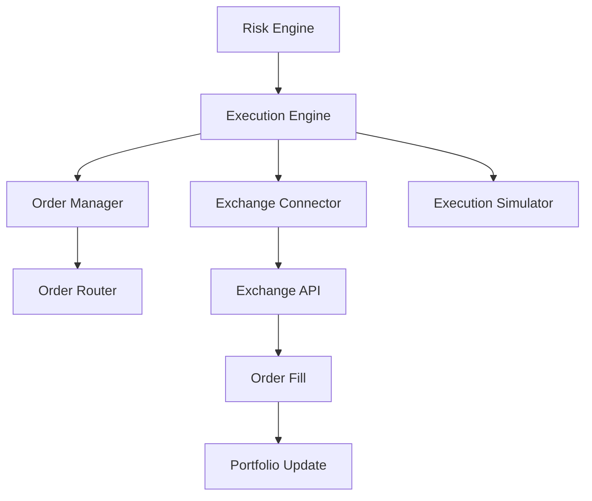
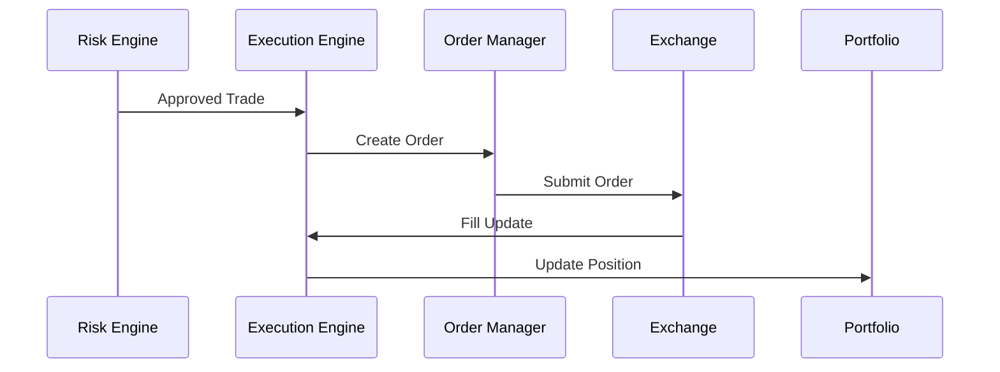
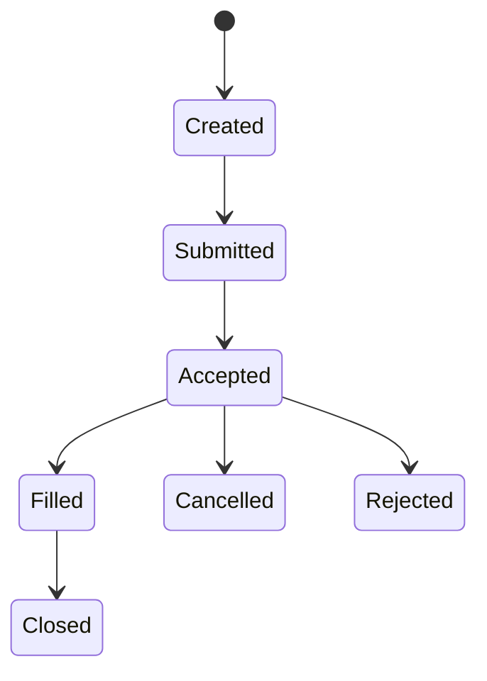
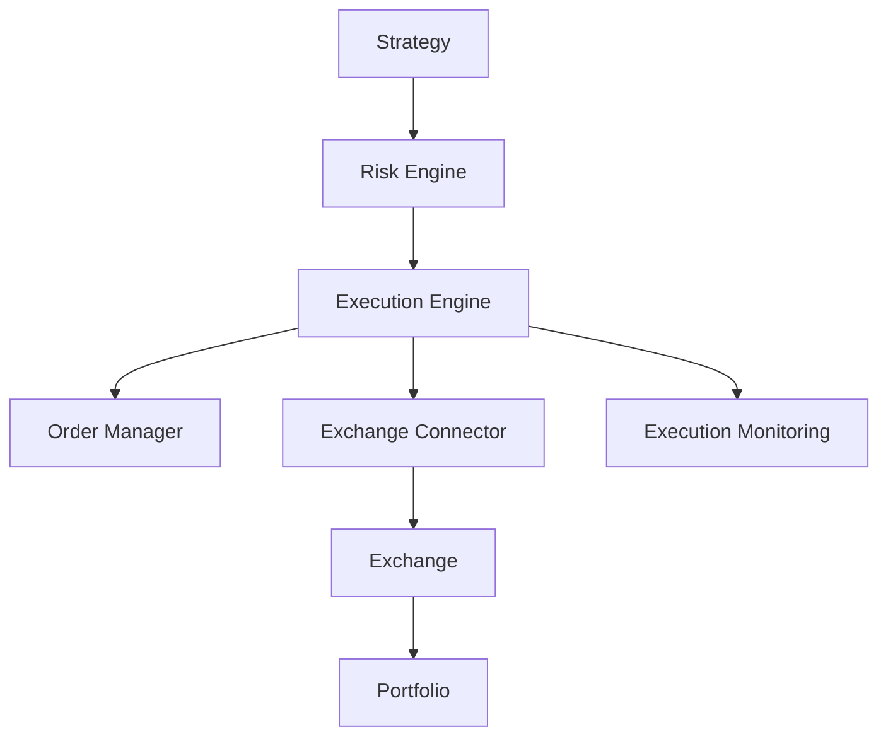

# ETH Bot - Execution Engine

## Overview

The Execution Engine is the order management and trade execution layer of the ETH Futures AI Trading System.

It is responsible for converting approved trading decisions into actual exchange orders.

The Execution Engine handles:

- Order creation
- Order routing
- Order execution
- Order tracking
- Fill management
- Exchange communication
- Execution monitoring


System position:


```
Strategy Engine

↓

Risk Engine

↓

Execution Engine

↓

Exchange

↓

Portfolio
```


---

# Execution Engine Objectives


The Execution Engine must:


- Execute approved trades safely
- Minimize execution cost
- Handle exchange errors
- Manage order lifecycle
- Track fills
- Maintain execution reliability


---

# System Architecture





---

# Folder Structure


```
execution_engine/


├── README.md


├── config/


│   ├── execution.yaml

│   └── exchange.yaml


├── core/


│   ├── execution_engine.py

│   ├── order_manager.py

│   └── execution_logic.py


├── orders/


│   ├── order.py

│   ├── order_state.py

│   └── order_tracker.py


├── exchange/


│   ├── connector.py

│   ├── rest_client.py

│   └── websocket_client.py


├── simulator/


│   ├── paper_execution.py

│   └── slippage.py


├── monitoring/


│   ├── execution_metrics.py

│   └── alerts.py


└── tests/
```


---

# Execution Flow





---

# Inputs


The Execution Engine receives:


## Approved Trade Signal


Example:


```json
{
 "symbol":"ETHUSDT",

 "side":"BUY",

 "size":2,

 "leverage":3,

 "stop_loss":3400,

 "take_profit":3700
}
```


---

# Order Management


The Order Manager controls:


- Order creation
- Order modification
- Order cancellation
- Order status


---

# Order Lifecycle





---

# Order Types


## Market Order


Purpose:


Immediate execution.


Example:


```
BUY ETH at market price
```


Advantages:


- Fast execution
- High fill probability


Disadvantages:


- Slippage risk


---

## Limit Order


Purpose:


Execute at specific price.


Example:


```
BUY ETH at 3500
```


Advantages:


- Price control


Disadvantages:


- May not fill


---

## Stop Order


Purpose:


Risk protection.


Example:


```
Stop Loss Trigger

↓

Market Order
```


---

# Futures Order Management


Supports:


```
Long Entry

Short Entry

Close Position

Reduce Only

Stop Loss

Take Profit
```


---

# Exchange Integration


Supported communication:


## REST API


Used for:


- Create orders
- Cancel orders
- Query status


---

## WebSocket


Used for:


- Order updates
- Fill notifications
- Position updates


---

# Exchange Connector


Example:


```
exchange/


├── binance.py

├── bybit.py

└── okx.py
```


---

# Execution Logic


Before sending order:


```
Receive Approved Trade

↓

Validate Parameters

↓

Create Order

↓

Send Exchange Request

↓

Track Execution
```


---

# Execution Optimization


The engine should optimize:


## Slippage


Reduce:


```
Expected Price

vs

Actual Fill Price
```


---

## Latency


Reduce:


```
Signal Time

↓

Order Time

↓

Fill Time
```


---

## Liquidity


Check:


```
Order Book Depth

Spread

Volume
```


---

# Slippage Management


Example:


Expected:


```
ETH = 3500
```


Actual:


```
ETH = 3503
```


Difference:


```
3 points slippage
```


---

# Execution Metrics


Track:


## Speed


```
Signal-to-order time

Order-to-fill time
```


---

## Quality


```
Fill Price

Expected Price

Slippage
```


---

## Reliability


```
Failed Orders

Rejected Orders

Cancelled Orders
```


---

# Error Handling


## Exchange Failure


Process:


```
Detect Error

↓

Retry

↓

Fallback

↓

Alert
```


---

# Retry Strategy


Example:


```
Attempt 1

↓

Wait

↓

Attempt 2

↓

Wait

↓

Final Failure Alert
```


---

# Position Synchronization


The Execution Engine keeps:


```
Exchange Position

=

Internal Position
```


Checks:


- Quantity
- Entry price
- Margin
- Leverage


---

# Paper Trading Support


The same engine should support:


```
Real Execution

Paper Execution
```


Architecture:


```
Execution Engine

↓

Execution Adapter

↓

Paper Simulator

OR

Exchange API
```


---

# Execution Configuration


Example:


```yaml
exchange:

 name:

 binance


mode:

 live


order:

 type:

 market


retry:

 count:

 3
```


---

# Safety Controls


## Maximum Order Size


Prevents:


```
Accidental large orders
```


---

## Duplicate Order Protection


Prevents:


```
Same order submitted twice
```


---

## Emergency Stop


Stops:


```
All new orders
```


---

# Monitoring


Monitor:


```
Active Orders

Filled Orders

Failed Orders

Execution Time

Slippage

Exchange Status
```


---

# Reports


Daily report:


```
Total Orders

Fill Rate

Average Slippage

Execution Cost
```


---

# Testing


Execution Engine testing:


```
Unit Testing

↓

Backtesting Simulation

↓

Paper Trading

↓

Small Capital Live Test
```


---

# Future Improvements


Add:


- Smart order routing
- TWAP execution
- VWAP execution
- Liquidity prediction
- Multi-exchange execution
- AI execution optimization


---

# Final Architecture





---

# Summary


The Execution Engine safely transforms trading decisions into executed orders while controlling reliability, speed, and execution quality.


Final flow:


```
Trade Approval

↓

Order Creation

↓

Exchange Execution

↓

Fill Tracking

↓

Portfolio Update
```


Document Version:

```
v1.0
```