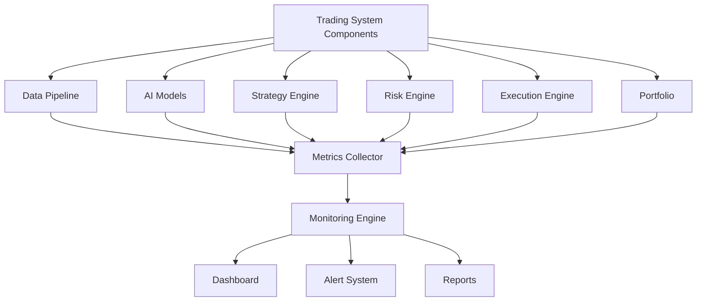
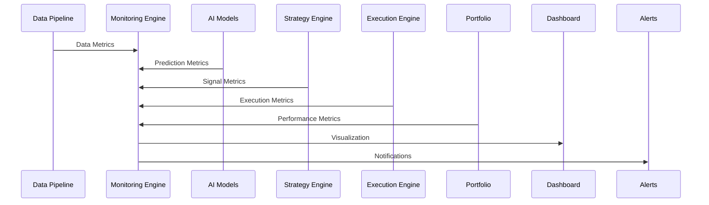
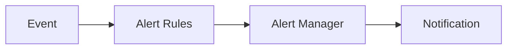
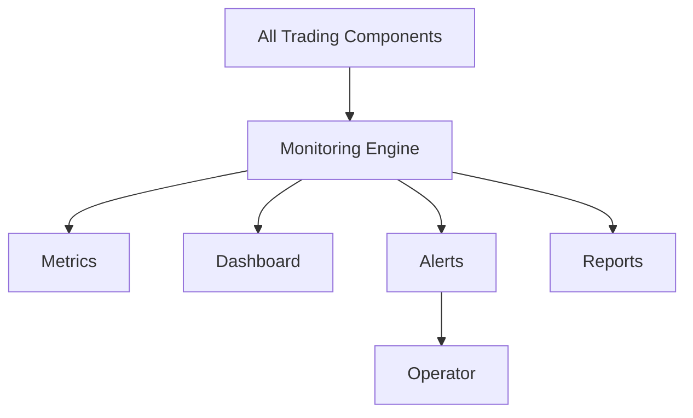

# ETH Bot - Monitoring Engine

## Overview

The Monitoring Engine is the observability and control layer of the ETH Futures AI Trading System.

It continuously monitors:

- System health
- Data pipeline status
- AI model performance
- Strategy behavior
- Risk conditions
- Execution quality
- Portfolio status


The Monitoring Engine ensures that the complete trading system operates safely and reliably 24/7.


---

# Position in System Architecture


Complete trading architecture:


```
Market Data

↓

Data Pipeline

↓

Technical Indicators

↓

Feature Engineering

↓

AI Models

↓

Strategy Engine

↓

Risk Engine

↓

Execution Engine

↓

Portfolio

↓

Monitoring Engine
```


---

# Monitoring Engine Objectives


The Monitoring Engine must:


- Detect system failures
- Track performance
- Monitor trading behavior
- Generate alerts
- Maintain operational visibility
- Support debugging
- Track AI model health


---

# Monitoring Architecture





---

# Folder Structure


```
Monitoring-engine/


├── README.md


├── config/


│   ├── monitoring.yaml

│   └── alerts.yaml


├── core/


│   ├── monitor.py

│   ├── health.py

│   └── event_manager.py


├── metrics/


│   ├── system_metrics.py

│   ├── trading_metrics.py

│   ├── model_metrics.py

│   └── data_metrics.py


├── alerts/


│   ├── alert_manager.py

│   ├── rules.py

│   └── notifications.py


├── dashboard/


│   ├── dashboard.py

│   └── charts.py


├── reports/


│   ├── daily_report.py

│   └── performance_report.py


├── logs/


└── tests/
```


---

# Monitoring Flow





---

# Monitoring Categories


The Monitoring Engine tracks:


```
System Health

↓

Data Quality

↓

AI Performance

↓

Strategy Performance

↓

Risk Status

↓

Execution Quality

↓

Portfolio Performance
```


---

# 1. System Health Monitoring


## Purpose


Monitor infrastructure health.


Checks:


- CPU usage
- Memory usage
- Disk usage
- Network status
- Service availability


---

# System Metrics


Example:


```
CPU:

45%


Memory:

60%


Disk:

70%
```


---

# Service Health


Monitor:


```
Data Pipeline

AI Service

Strategy Engine

Risk Engine

Execution Engine

Database
```


---

# 2. Data Monitoring


## Purpose


Ensure market data reliability.


Track:


```
Data freshness

Missing candles

API failures

Data delay

Data quality score
```


---

# Data Health Example


```
Latest ETH Candle:

10:00


Current Time:

10:01


Status:

Healthy
```


---

# 3. AI Model Monitoring


## Purpose


Track model behavior.


Monitor:


- Prediction accuracy
- Confidence changes
- Model drift
- Prediction distribution


---

# Model Metrics


Example:


```
Direction Model


Accuracy:

65%


Confidence Average:

72%
```


---

# Model Drift Detection


Detect:


```
Training Data

vs

Live Market Data
```


Example:


```
Old volatility:

40


Current volatility:

120
```


Possible:


```
Market regime change
```


---

# 4. Strategy Monitoring


## Purpose


Track strategy decisions.


Monitor:


```
Signals Generated

Long Signals

Short Signals

Rejected Signals

Trade Frequency
```


---

# Strategy Analysis


Example:


```
Strategy:

AI Trend Strategy


Signals:

200


Trades:

80


Win Rate:

62%
```


---

# 5. Risk Monitoring


## Purpose


Monitor capital protection.


Track:


```
Exposure

Leverage

Margin

Drawdown

Daily Loss
```


---

# Risk Alerts


Examples:


```
Maximum Drawdown Reached


High Exposure


Margin Warning
```


---

# 6. Execution Monitoring


## Purpose


Monitor order quality.


Track:


```
Order Count

Fill Rate

Execution Time

Slippage

Failed Orders
```


---

# Execution Quality


Example:


```
Expected Price:

3500


Execution Price:

3502


Slippage:

2 points
```


---

# 7. Portfolio Monitoring


Track:


```
Balance

Equity

PnL

Positions

Returns
```


---

# Portfolio Dashboard


Display:


```
Current Balance

Open Positions

Daily Profit/Loss

Drawdown

Risk Level
```


---

# 8. Alert System


## Alert Levels


## INFO


Normal events.


Example:


```
Pipeline started
```


---

## WARNING


Potential issue.


Example:


```
API response slow
```


---

## ERROR


System problem.


Example:


```
Data collector failed
```


---

## CRITICAL


Immediate action required.


Example:


```
Execution engine stopped
```


---

# Alert Channels


Support:


```
Telegram

Discord

Email

Slack

Dashboard
```


---

# Alert Flow





---

# 9. Dashboard


## Purpose


Provide real-time system visibility.


---

# Dashboard Sections


## System Overview


Shows:


```
Services

Status

Uptime
```


---

## Market Data


Shows:


```
Latest Price

Data Delay

Exchange Status
```


---

## AI


Shows:


```
Predictions

Confidence

Accuracy
```


---

## Trading


Shows:


```
Signals

Orders

Positions
```


---

## Risk


Shows:


```
Exposure

Drawdown

Risk Score
```


---

# 10. Logging System


Logs:


```
System Events

Errors

Trades

Predictions

Alerts
```


---

# Log Structure


```
logs/


├── system.log

├── trading.log

├── model.log

├── execution.log

└── error.log
```


---

# 11. Reports


Generated:


## Daily Report


Contains:


```
System Health

Trading Summary

Risk Summary

Model Performance
```


---

## Weekly Report


Contains:


```
Performance Analysis

Strategy Review

Model Review
```


---

# 12. Recommended Technology Stack


## Metrics


```
Prometheus
```


---

## Dashboard


```
Grafana
```


---

## Logging


```
Loguru

ELK Stack
```


---

## Alerting


```
AlertManager

Telegram Bot
```


---

# 13. Configuration Example


```yaml
monitoring:


interval:

 10s


alerts:


drawdown:

 10%


api_failure:

 enabled


channels:


 telegram:

 enabled
```


---

# 14. Future Improvements


Add:


- AI-based anomaly detection
- Predictive failure detection
- Automatic recovery
- Trading behavior analysis
- Model degradation alerts
- Self-healing system


---

# Final Architecture





---

# Summary


The Monitoring Engine provides complete visibility and safety control over the AI trading system.


Final flow:


```
System Events

↓

Metrics

↓

Monitoring Engine

↓

Dashboard + Alerts

↓

Action
```


Document Version:

```
v1.0
```