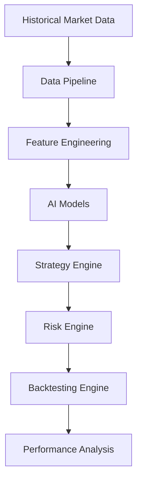
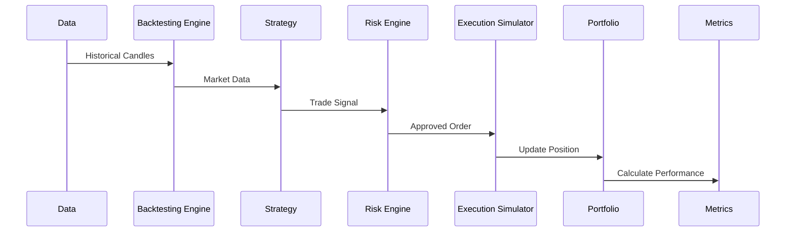
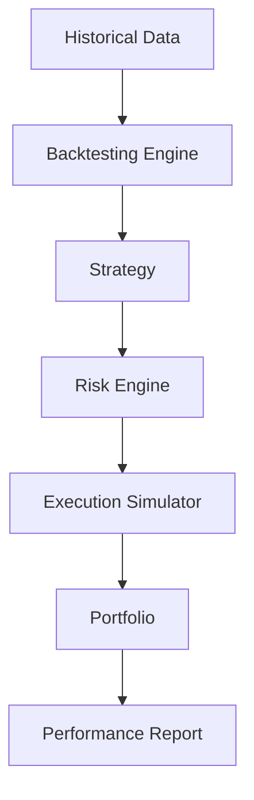

# ETH Bot - Backtesting System

## Overview

The Backtesting System evaluates trading strategies and AI models using historical market data before deploying them into live trading.

It provides a controlled environment to test:

- Strategy performance
- AI model predictions
- Risk management rules
- Execution logic
- Portfolio behavior


The backtesting system answers:

- Does the strategy work?
- Under which market conditions does it perform?
- What is the expected risk?
- How stable is the performance?


---

# Backtesting Architecture





---

# Backtesting Role In System


Complete trading architecture:


```
Market Data

↓

Technical Indicators

↓

Feature Engineering

↓

AI Models

↓

Strategy

↓

Risk Engine

↓

Execution

↓

Portfolio

↓

Monitoring
```


Backtesting validates every layer before live deployment.


---

# Objectives


The backtesting system should:


- Simulate historical trading
- Test strategies
- Evaluate AI predictions
- Measure risk
- Compare models
- Generate reports


---

# What Is Tested?


## Strategy Testing


Examples:


- Trend following
- Mean reversion
- Breakout
- Momentum


---

## AI Model Testing


Examples:


- Direction prediction
- Trend prediction
- Volatility prediction
- Reversal prediction


---

## Risk Testing


Examples:


- Stop loss
- Position sizing
- Maximum drawdown
- Risk limits


---

# Backtesting Folder Structure


```
backtesting/


├── README.md


├── config/


│   ├── backtest.yaml

│   └── fees.yaml


├── engine/


│   ├── backtest_engine.py

│   ├── simulator.py

│   └── event_loop.py


├── data/


│   ├── loader.py

│   └── data_adapter.py


├── execution/


│   ├── order_simulator.py

│   └── slippage.py


├── portfolio/


│   ├── portfolio.py

│   └── positions.py


├── metrics/


│   ├── performance.py

│   └── risk_metrics.py


├── reports/


│   ├── charts.py

│   └── report_generator.py


├── strategies/


│   └── strategy_runner.py


└── tests/
```


---

# Backtesting Flow





---

# Historical Data Input


Sources:


```
data_pipeline/storage/


├── raw/

├── processed/

├── features/

└── datasets/
```


Supported:


- OHLCV
- Indicators
- Features
- Derivatives data
- Order book data


---

# Backtesting Modes


## Strategy Backtesting


Tests:


```
Strategy Logic

↓

Trade Results
```


Example:


```
EMA crossover strategy
```


---

## Model Backtesting


Tests:


```
AI Prediction

↓

Trading Decision

↓

Performance
```


Example:


```
LSTM predicts bullish

↓

Strategy enters long
```


---

## Full System Backtesting


Tests:


```
Data

↓

AI

↓

Strategy

↓

Risk

↓

Execution

↓

Portfolio
```


---

# Event Driven Backtesting


The system should simulate events:


```
New Candle

↓

Update Indicators

↓

Generate Features

↓

Model Prediction

↓

Strategy Decision

↓

Execute Order

↓

Update Portfolio
```


---

# Backtesting Engine Components


## Data Loader


Responsible for:


- Loading historical data
- Time synchronization
- Data feeding


---

## Event Loop


Controls:


```
Time progression

Market events

Trading events
```


---

## Strategy Runner


Executes:


- Entry logic
- Exit logic
- Position decisions


---

## Execution Simulator


Simulates:


- Order fills
- Fees
- Slippage
- Market impact


---

# Order Simulation


## Market Order


Simulation:


```
Current Price

+

Slippage

=

Execution Price
```


---

## Limit Order


Simulation:


```
Price touched

↓

Order Filled
```


---

# Trading Costs


Include:


## Exchange Fees


Example:


```
Maker Fee

Taker Fee
```


---

## Slippage


Example:


```
Expected:

3500


Executed:

3502
```


---

## Funding Cost


For futures:


```
Position

×

Funding Rate
```


---

# Portfolio Simulation


Tracks:


```
Balance

Equity

Positions

Margin

PnL
```


---

# Performance Metrics


## Returns


Calculate:


```
Total Return

Daily Return

Monthly Return
```


---

## Risk Metrics


Important:


### Maximum Drawdown


Measures:


```
Largest portfolio decline
```


---

### Sharpe Ratio


Measures:


```
Risk adjusted return
```


---

### Sortino Ratio


Measures:


```
Downside risk adjusted return
```


---

## Trading Metrics


Track:


```
Total Trades

Winning Trades

Losing Trades

Win Rate

Profit Factor
```


---

# AI Model Evaluation


Models should be evaluated separately.


Example:


## Direction Model


Metrics:


```
Accuracy

Precision

Recall

F1 Score
```


---

## Regression Model


Metrics:


```
MAE

RMSE

Prediction Error
```


---

# Walk Forward Testing


## Purpose


Avoid overfitting.


Process:


```
Train

↓

Validate

↓

Test Future Period

↓

Move Window

↓

Repeat
```


---

# Example


```
Train:

2022-2024


Test:

2025


Move Window


Train:

2023-2025


Test:

2026
```


---

# Backtesting Config


Example:


```yaml
symbol:

 ETHUSDT


timeframe:

 1h


initial_balance:

 10000


fees:

 0.05%


slippage:

 0.02%


leverage:

 3
```


---

# Results Storage


```
backtesting/results/


├── reports/

├── trades/

├── equity/

└── metrics/
```


---

# Report Generation


Reports include:


## Performance


```
Return

Drawdown

Sharpe Ratio
```


---

## Trading


```
Trade History

Entry

Exit

Profit
```


---

## Visualization


Charts:


- Equity curve
- Drawdown chart
- Trade markers
- Monthly returns


---

# Backtesting Libraries


Possible:


```
vectorbt

backtrader

zipline
```


Custom engine recommended for:


- Futures
- AI models
- Custom risk rules


---

# Testing Rules


Before live trading:


Required:


```
Backtest

↓

Out-of-sample Test

↓

Paper Trading

↓

Live Trading
```


---

# Future Improvements


Add:


- Monte Carlo simulation
- Portfolio optimization
- Multi-asset testing
- Distributed backtesting
- Realistic market impact
- Reinforcement learning evaluation


---

# Final Architecture





---

# Summary


The Backtesting System validates the complete trading pipeline before real capital deployment.


Final flow:


```
Historical Data

↓

Simulation

↓

Strategy

↓

Risk

↓

Portfolio

↓

Performance
```


Document Version:

```
v1.0
```