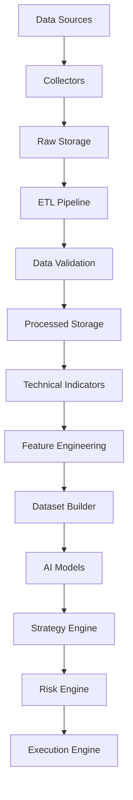
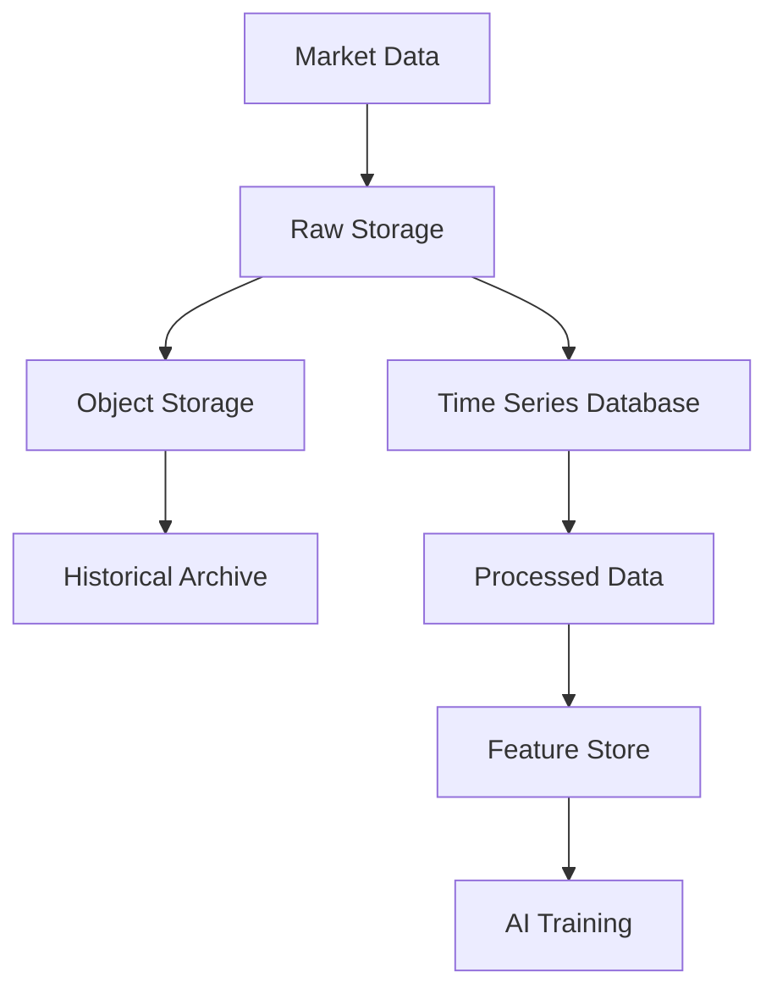

Here's the corrected Markdown code with proper formatting to fix the preview issues:

```markdown
# ETH Bot - Data Pipeline

## Overview

The Data Pipeline is the foundation layer of the ETH Futures AI Trading System.

It is responsible for:

- Collecting market data 24/7
- Storing raw exchange data
- Cleaning and transforming data
- Validating data quality
- Generating technical indicators
- Creating AI/ML-ready datasets
- Supporting LSTM, XGBoost, LightGBM and other models

---

## Objectives

The Data Pipeline must provide:

- Reliable market data
- Historical data management
- Automated collection
- Data quality checks
- Reproducible datasets
- Feature generation
- Model-ready inputs

---

## Supported Models

The pipeline supports:

- LSTM
- XGBoost
- LightGBM
- CatBoost
- Transformer
- Other ML/DL models

---

## System Architecture



---

## Database Architecture

The data pipeline requires storage optimized for:

- Time-series market data
- Large historical datasets
- Fast feature retrieval
- Model training

---

## Storage Strategy



---

## Data Pipeline Folder Structure

Complete structure:

```text
data_pipeline/
│
├── README.md
│
├── config/
│   ├── exchange.yaml
│   ├── database.yaml
│   ├── pipeline.yaml
│   └── logging.yaml
│
├── sources/
│   ├── exchange_api.py
│   ├── websocket.py
│   └── historical_loader.py
│
├── collectors/
│   ├── ohlcv_collector.py
│   ├── funding_collector.py
│   ├── oi_collector.py
│   ├── orderbook_collector.py
│   ├── liquidation_collector.py
│   └── options_collector.py
│
├── etl/
│   ├── extract.py
│   ├── transform.py
│   ├── load.py
│   └── pipeline.py
│
├── validation/
│   ├── schema_check.py
│   ├── missing_data.py
│   ├── anomaly_detection.py
│   └── quality_report.py
│
├── storage/
│   ├── raw/
│   ├── processed/
│   └── features/
│
├── indicators/
│   ├── trend.py
│   ├── momentum.py
│   ├── volatility.py
│   └── volume.py
│
├── features/
│   ├── price_features.py
│   ├── market_features.py
│   ├── derivative_features.py
│   └── feature_pipeline.py
│
├── datasets/
│   ├── lstm/
│   ├── xgboost/
│   ├── lightgbm/
│   └── transformer/
│
├── scheduler/
│   ├── hourly_jobs.py
│   ├── daily_jobs.py
│   └── scheduler.py
│
├── monitoring/
│   ├── health_check.py
│   ├── metrics.py
│   └── alerts.py
│
├── logs/
│
└── tests/
```

---

