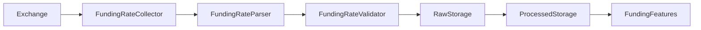
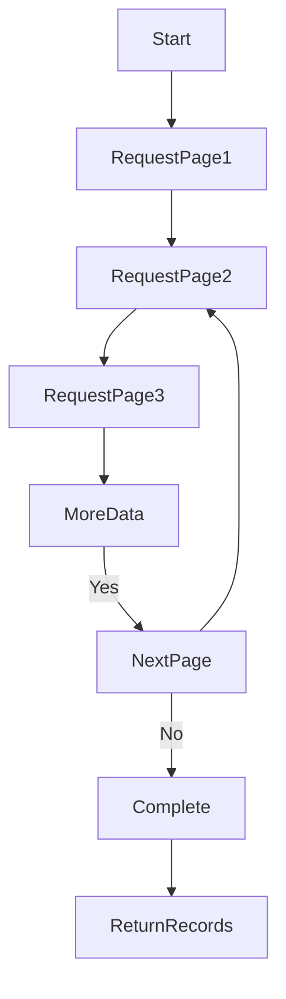
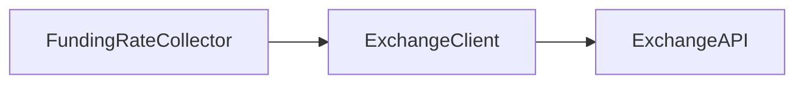
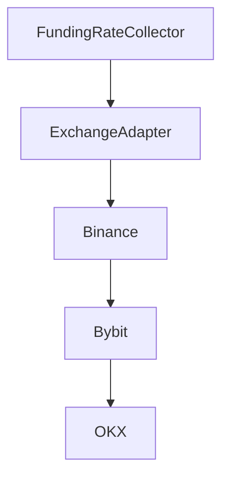
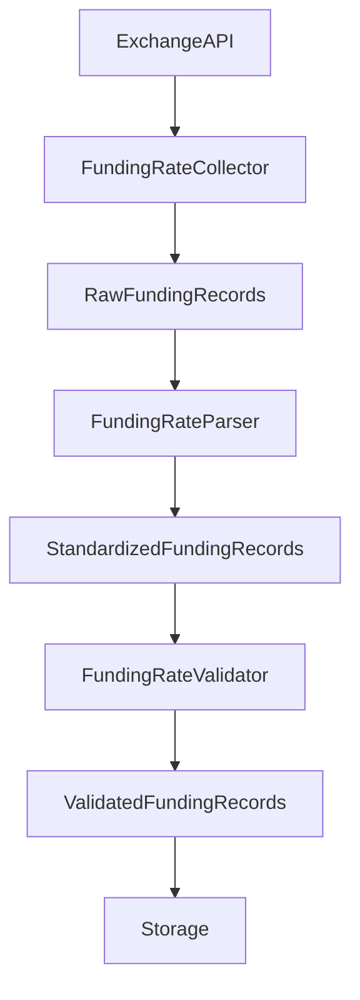

# Funding Rate Collector

## Overview

The **Funding Rate Collector** is responsible for collecting funding-rate data for ETH perpetual futures from the configured exchange.

It belongs to the ingestion layer of the ETH Bot data pipeline.

The collector's job is to **acquire raw funding-rate records reliably** and pass them to the parser. It should not interpret the funding rate, calculate trading signals, or generate features.

---

# Location

```text
data_pipeline/
└── collectors/
    └── funding_rate/
        ├── collector.py
        ├── parser.py
        ├── validator.py
        ├── config.py
        │
        └── md/
            ├── collector.md
            ├── parser.md
            └── validator.md
```

---

# Position in the Data Pipeline



The collector is the first application-level component in this flow.

---

# Primary Responsibilities

The Funding Rate Collector is responsible for:

* Requesting funding-rate history.
* Requesting the latest funding-rate records.
* Collecting funding rates for a specific time range.
* Handling paginated historical requests.
* Passing request parameters to the exchange client.
* Using the common retry mechanism.
* Normalizing the outer API response into a collection of records.
* Preventing duplicate records across pagination.
* Returning raw records to the parser.

---

# Non-Responsibilities

The collector does **not**:

* Parse funding-rate fields into the final schema.
* Validate funding-rate values.
* Calculate funding-rate changes.
* Calculate funding-rate averages.
* Calculate funding-rate z-scores.
* Generate trading signals.
* Generate ML features.
* Store records permanently.
* Execute trades.
* Decide whether funding is bullish or bearish.

The architecture should remain:

```text
Collect
   ↓
Parse
   ↓
Validate
   ↓
Store
   ↓
Process
   ↓
Feature Engineering
```

---

# Supported Collection Modes

The collector provides three main collection modes.

## 1. General Collection

```python
collector.collect()
```

Used for collecting funding-rate history.

Optional parameters include:

```python
symbol
start_time
end_time
limit
```

---

## 2. Latest Funding Rate

```python
collector.collect_latest()
```

Used when the system needs the most recent funding-rate record.

This is useful for:

* Monitoring.
* Live dashboards.
* Data freshness checks.
* Live trading pipelines.

---

## 3. Time-Range Collection

```python
collector.collect_range(
    start_time,
    end_time,
)
```

Used for historical data acquisition.

This is particularly important during:

* Initial dataset construction.
* Backtesting data preparation.
* Historical database population.
* Model retraining.

---

# Default Market

The collector is designed for the ETH perpetual futures market.

The default configured symbol is:

```text
ETHUSDT
```

However, the symbol should remain configurable rather than being hard-coded into the entire pipeline.

Example:

```python
collector.collect(
    symbol="ETHUSDT"
)
```

---

# Request Parameters

The collector supports:

| Parameter    | Purpose                         |
| ------------ | ------------------------------- |
| `symbol`     | Futures trading pair            |
| `start_time` | Beginning of requested period   |
| `end_time`   | End of requested period         |
| `limit`      | Maximum records per API request |

Timestamps are expected in Unix milliseconds.

Example:

```text
start_time = 1754006400000
end_time   = 1754092800000
```

---

# Historical Collection

Funding-rate history can exceed the maximum number of records returned by one exchange request.

Therefore, the collector supports pagination.



The collector advances the request window using the timestamp of the latest returned record.

---

# Pagination Principle

The collector should not assume that every funding event occurs at exactly the same interval.

Instead:

```text
Page 1
    ↓
Last returned timestamp
    ↓
Next request start
    ↓
Page 2
```

Conceptually:

```text
next_start = last_timestamp + 1
```

This prevents repeatedly requesting the same record.

---

# Pagination Safety

The collector contains safeguards against infinite pagination.

Pagination stops when:

* The exchange returns no records.
* Fewer records than the requested limit are returned.
* A usable timestamp cannot be extracted.
* The next timestamp does not advance.
* The configured maximum page count is reached.
* The requested end time has been reached.

This protects the data pipeline from malfunctioning exchange responses.

---

# Maximum Pages

The collector has a configurable maximum page count.

Conceptually:

```python
max_pages = 100
```

This acts as a safety boundary.

Without such a boundary, an exchange API malfunction could cause an endless collection loop.

---

# Exchange Client

The collector does not directly implement exchange HTTP communication.

Instead, it receives an exchange client:

```python
FundingRateCollector(
    client=exchange_client
)
```

The client is expected to provide a funding-rate history operation.

Conceptually:

```python
client.get_funding_rate_history(...)
```

This keeps exchange communication separate from collection logic.

---

# Exchange Adapter Boundary

The preferred architecture is:



For multiple exchanges:



The collector should not become filled with exchange-specific API branches.

---

# Retry Handling

Funding-rate requests can fail because of:

* Network failures.
* Temporary exchange errors.
* Rate limits.
* Connection interruptions.
* Server-side errors.

The collector therefore delegates retry behavior to the common base collector infrastructure when available.

```text
FundingRateCollector
       ↓
Retry Layer
       ↓
Exchange Client
```

Retry configuration should remain centralized rather than duplicated across every collector.

---

# Response Handling

The collector normalizes only the **outer response structure**.

For example, the exchange may return:

```json
[
  {
    "symbol": "ETHUSDT",
    "fundingRate": "0.0001",
    "fundingTime": 1754006400000
  }
]
```

or:

```json
{
  "data": [
    {
      "symbol": "ETHUSDT",
      "fundingRate": "0.0001",
      "fundingTime": 1754006400000
    }
  ]
}
```

The collector converts these into a list of records.

It does **not** decide what `fundingRate` means.

---

# Parser Boundary

The collector returns raw records to:

```text
funding_rate/parser.py
```

The parser is responsible for field-level transformation.

Example:

```text
Exchange Record
       ↓
FundingRateParser
       ↓
Standardized Funding Record
```

The collector should therefore avoid logic such as:

```python
funding_rate = float(...)
```

unless required purely for pagination or transport purposes.

The actual schema transformation belongs to the parser.

---

# Validator Boundary

After parsing:

```text
FundingRateParser
       ↓
FundingRateValidator
```

The validator determines whether the standardized funding-rate record is acceptable.

Possible validation rules include:

* Valid symbol.
* Valid timestamp.
* Valid funding rate.
* Valid numeric representation.
* Required fields present.
* Correct timestamp ordering.

---

# Deduplication

Pagination can sometimes return overlapping records.

The collector therefore performs lightweight deduplication.

A record can be identified using fields such as:

```text
symbol
fundingTime
funding_time
timestamp
time
```

The collector should preserve the first occurrence and remove duplicates.

This is **transport-level deduplication**, not database-level deduplication.

---

# Storage Boundary

The collector should not directly write to permanent storage.

Preferred flow:

```text
Collector
   ↓
Parser
   ↓
Validator
   ↓
Storage Layer
```

This keeps acquisition independent from storage technology.

Possible storage systems can therefore change without rewriting the collector.

---

# Data Flow



---

# Historical Data Workflow

For initial historical collection:

```text
1. Configure ETHUSDT
2. Set start timestamp
3. Set end timestamp
4. Request first page
5. Store returned records in memory
6. Determine latest returned timestamp
7. Request next page
8. Repeat until range is complete
9. Deduplicate records
10. Return raw records
```

The parser and validator operate after collection.

---

# Live Data Workflow

For periodic collection:

```text
Scheduler
    ↓
FundingRateCollector
    ↓
Latest Funding Rate
    ↓
FundingRateParser
    ↓
FundingRateValidator
    ↓
Storage
```

The scheduler determines **when** to collect.

The collector determines **how to acquire** the data.

---

# Configuration

Collector configuration should be externalized.

Example conceptual configuration:

```yaml
funding_rate:
  symbol: ETHUSDT
  limit: 1000
  max_pages: 100
```

This avoids embedding operational settings directly into the collector.

---

# Validation of Collection Requests

Before making an API request, the collector validates:

### Symbol

Must be a non-empty string.

### Limit

Must be greater than zero.

The current implementation limits it to:

```text
1000
```

### Start Time

If provided, must be a non-negative integer timestamp.

### End Time

If provided, must be a non-negative integer timestamp.

### Time Range

When both are provided:

```text
start_time < end_time
```

must be true.

---

# Error Handling

The collector should fail explicitly for invalid collection parameters.

Examples:

```text
Invalid symbol
Invalid limit
Invalid start timestamp
Invalid end timestamp
Invalid time range
Unsupported client method
Unsupported API response
```

It should not silently convert an invalid request into a different request.

---

# Data Freshness

Funding-rate data is event-based rather than continuous OHLCV data.

Therefore, the collector should preserve the original funding timestamp.

Example:

```text
Funding Event
     ↓
fundingTime
     ↓
UTC-normalized timestamp
```

The collector should not manufacture an artificial hourly or daily timestamp.

---

# Relationship With OHLCV

Funding rate and OHLCV are different market-data streams.

They should remain independent:

```text
OHLCV Collector
       ↓
OHLCV Parser
       ↓
OHLCV Validator


Funding Rate Collector
       ↓
Funding Rate Parser
       ↓
Funding Rate Validator
```

They can later be aligned in the processed/feature layer.

---

# Relationship With Derivative Features

Funding-rate-derived features belong in:

```text
data_pipeline/
└── schema/
    └── features/
        └── derivative_features.py
```

Examples include:

```text
funding_rate
funding_rate_change
funding_rate_ma
funding_rate_zscore
funding_rate_extreme
funding_rate_regime
```

These should not be calculated inside `collector.py`.

---

# Example Runtime

```python
collector = FundingRateCollector(
    client=exchange_client,
    config={
        "symbol": "ETHUSDT",
        "limit": 1000,
        "max_pages": 100,
    },
)

records = collector.collect(
    start_time=start_timestamp,
    end_time=end_timestamp,
)
```

The result is a collection of raw exchange records.

The next component should be:

```python
parsed = parser.parse(records)
```

followed by:

```python
validated = validator.validate(parsed)
```

---

# Complete Funding-Rate Pipeline

```mermaid
flowchart LR

Config
    -->
Scheduler

Scheduler
    -->
FundingRateCollector

FundingRateCollector
    -->
ExchangeREST

ExchangeREST
    -->
RawResponse

RawResponse
    -->
FundingRateParser

FundingRateParser
    -->
FundingRateValidator

FundingRateValidator
    -->
RawStorage

RawStorage
    -->
ProcessedStorage

ProcessedStorage
    -->
DerivativeFeatures

DerivativeFeatures
    -->
ModelDatasets
```



---

# Testing

Recommended tests:

## Collection Tests

```text
collect latest funding rate
collect historical funding rates
collect specific time range
```

## Pagination Tests

```text
multiple pages
single page
empty page
partial page
maximum pages reached
timestamp does not advance
```

## Request Tests

```text
valid symbol
invalid symbol
valid limit
invalid limit
valid start time
invalid start time
valid end time
invalid end time
invalid time range
```

## Response Tests

```text
list response
data-wrapped response
result-wrapped response
rows-wrapped response
single mapping response
empty response
unsupported response
```

## Deduplication Tests

```text
duplicate timestamp
overlapping pages
unique records
records without timestamps
```

Recommended location:

```text
tests/
└── collectors/
    └── funding_rate/
        └── test_collector.py
```

---

# Design Principles

The Funding Rate Collector should be:

* Reliable.
* Stateless.
* Exchange-client driven.
* Configurable.
* Paginated.
* Retry-aware.
* Deterministic.
* Testable.
* Independent of storage.
* Independent of parsing.
* Independent of validation.
* Independent of feature engineering.
* Independent of strategy logic.

---

# Critical Architectural Rule

The collector should answer only:

> **"How do I reliably obtain the funding-rate records?"**

It should not answer:

> "Is this funding rate valid?"

That belongs to the validator.

It should not answer:

> "What does this funding rate mean?"

That belongs to analytics/features.

It should not answer:

> "Should the bot trade?"

That belongs to the strategy and risk layers.

---

# Summary

The Funding Rate Collector is the acquisition component for ETH perpetual futures funding-rate data.

Its core flow is:

```text
Exchange API
      ↓
FundingRateCollector
      ↓
Pagination / Retry / Request Handling
      ↓
Raw Funding Records
      ↓
FundingRateParser
      ↓
FundingRateValidator
      ↓
Storage
      ↓
Derivative Features
      ↓
ML Datasets
```

Keeping the collector focused on **reliable data acquisition** makes the funding-rate pipeline easier to test, replace, extend, and integrate with the rest of the ETH futures data architecture.
