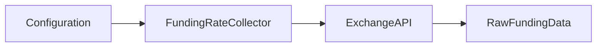
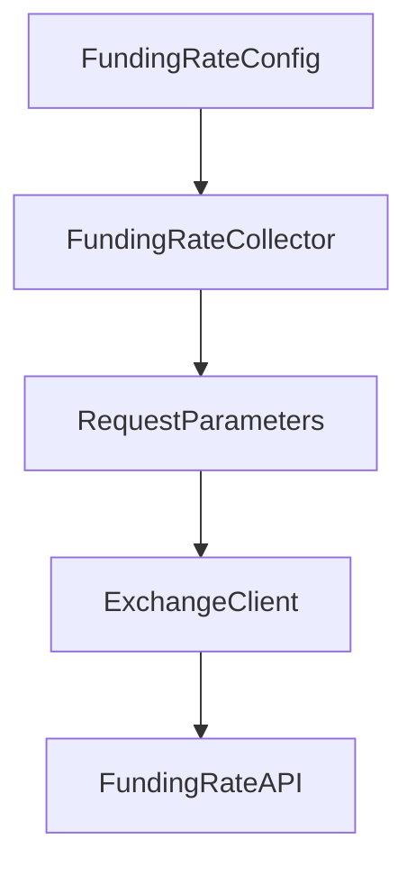
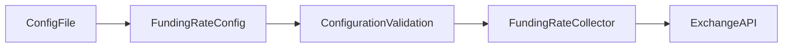
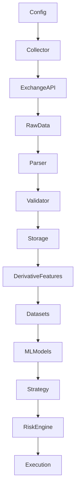

# Funding Rate Collector Configuration

## Overview

The **Funding Rate Collector Configuration** defines the operational parameters used by the funding-rate collector.

It controls **how funding-rate data is collected**, while keeping collection logic separate from the collector implementation.

The configuration does not:

* Collect data.
* Parse exchange responses.
* Validate funding-rate records.
* Calculate funding-rate features.
* Generate trading signals.
* Execute trades.

---

# Location

```text id="xgq7n2"
data_pipeline/
└── collectors/
    └── funding_rate/
        ├── collector.py
        ├── parser.py
        ├── validator.py
        ├── config.py
        │
        └── md/
            ├── collector.md
            ├── parser.md
            ├── validator.md
            └── config.md
```

---

# Configuration Position



The configuration provides the collector with its operational parameters.

---

# Configuration Object

The main configuration object is:

```python id="tw0q7p"
FundingRateConfig
```

It is implemented as an immutable dataclass.

Conceptually:

```python id="x1fj7j"
@dataclass(frozen=True)
class FundingRateConfig:
    ...
```

Using an immutable configuration helps prevent accidental modification while the collector is running.

---

# Configuration Categories

The configuration is divided into:

```text id="9smh0d"
FundingRateConfig
│
├── Market
├── API Request
├── Collection
├── Time Handling
├── Retry
├── Network
├── Rate Limiting
├── Validation
└── Runtime
```

---

# Market Configuration

## `symbol`

```python id="8f0m4e"
symbol: str = "ETHUSDT"
```

Defines the futures market for which funding-rate data is collected.

Default:

```text id="y1f8px"
ETHUSDT
```

The symbol remains configurable so the collector architecture can later support other instruments.

Example:

```python id="d6g53k"
FundingRateConfig(
    symbol="ETHUSDT"
)
```

---

# API Request Configuration

## `limit`

```python id="8zn8tb"
limit: int = 1000
```

Defines the maximum number of funding-rate records requested in one API call.

Default:

```text id="ujgk8m"
1000
```

The configuration restricts the value to a maximum of `1000`.

This prevents accidental requests that exceed the expected exchange API limit.

---

## `max_pages`

```python id="fdc6g8"
max_pages: int = 100
```

Defines the maximum number of API pages that may be requested during one historical collection operation.

This is a safety boundary against:

* Infinite pagination.
* Malformed API responses.
* Non-advancing timestamps.
* Unexpected exchange behavior.

---

# Collection Configuration

## `enable_historical`

```python id="6p3s7f"
enable_historical: bool = True
```

Controls whether historical funding-rate collection is enabled.

This is useful when separating:

```text id="0svq4g"
Historical Backfill
```

from:

```text id="1d0m1u"
Live Collection
```

---

## `enable_latest`

```python id="j1l4tg"
enable_latest: bool = True
```

Controls whether the latest funding-rate collection mode is enabled.

This is particularly relevant to live monitoring and live-data pipelines.

---

# Timestamp Configuration

## `timestamp_unit`

```python id="vl7x4x"
timestamp_unit: str = "ms"
```

Defines the timestamp representation used by the collector.

The configured value is:

```text id="i2j9z8"
ms
```

meaning Unix timestamps in milliseconds.

Example:

```text id="x1f5we"
1754006400000
```

The collector should preserve the exchange's timestamp precision rather than converting funding events into an artificial OHLCV interval.

---

# Retry Configuration

Funding-rate API requests can fail temporarily.

The configuration therefore includes retry parameters.

---

## `max_retries`

```python id="s5n1y2"
max_retries: int = 5
```

Defines the maximum number of retry attempts.

---

## `retry_delay_seconds`

```python id="czp9kn"
retry_delay_seconds: float = 1.0
```

Defines the initial delay between retry attempts.

---

## `retry_backoff_factor`

```python id="i4p8zy"
retry_backoff_factor: float = 2.0
```

Defines the multiplier used for increasing retry delays.

Conceptually:

```text id="d5xj6c"
Attempt 1
   ↓
1 second

Attempt 2
   ↓
2 seconds

Attempt 3
   ↓
4 seconds

Attempt 4
   ↓
8 seconds
```

The exact retry implementation belongs to the shared retry layer.

---

# Network Configuration

## `timeout_seconds`

```python id="c8vl0y"
timeout_seconds: float = 10.0
```

Defines the maximum expected duration for an exchange request before it is treated as timed out.

This prevents the collector from waiting indefinitely for an exchange response.

---

# Rate-Limit Configuration

## `requests_per_second`

```python id="v6q4fk"
requests_per_second: Optional[float] = None
```

Controls optional client-side request throttling.

When:

```text id="9z0n6v"
None
```

the collector does not impose an application-level requests-per-second limit through this configuration.

When configured:

```python id="5j0rme"
requests_per_second=5.0
```

the surrounding request/retry infrastructure can enforce the configured rate.

Rate limiting is particularly important during historical backfills.

---

# Validation Configuration

## `validate_symbol`

```python id="3v5b8x"
validate_symbol: bool = True
```

Controls whether the collector should validate the configured symbol before making a request.

---

## `validate_time_range`

```python id="7s0d6q"
validate_time_range: bool = True
```

Controls whether the collector should validate:

```text id="z8j4r7"
start_time < end_time
```

when both timestamps are supplied.

---

# Runtime Configuration

## `enabled`

```python id="p6q2ca"
enabled: bool = True
```

Determines whether the funding-rate collector is enabled.

This allows a global pipeline configuration to disable a particular data source without removing its implementation.

Example:

```yaml id="8h9l3k"
funding_rate:
  enabled: false
```

The scheduler or collector registry can then skip the funding-rate collector.

---

# Default Configuration

The default configuration is conceptually:

```text id="o4q2i6"
symbol                  ETHUSDT

limit                   1000
max_pages               100

enable_historical       True
enable_latest           True

timestamp_unit          ms

max_retries             5
retry_delay_seconds     1.0
retry_backoff_factor    2.0

timeout_seconds         10.0

requests_per_second     None

validate_symbol         True
validate_time_range     True

enabled                 True
```

---

# Configuration Validation

Configuration validation occurs when the configuration object is created.

This prevents invalid operational parameters from reaching the collector.

---

## Symbol Validation

The symbol cannot be empty.

Invalid:

```python id="5xxr6b"
FundingRateConfig(
    symbol=""
)
```

---

## Limit Validation

The limit must be positive.

Invalid:

```python id="1h8y9c"
limit=0
```

Invalid:

```python id="4q5t7f"
limit=-100
```

The configured maximum is:

```text id="l2o0pb"
1000
```

---

## Page Validation

`max_pages` must be greater than zero.

Invalid:

```python id="q1x8sx"
max_pages=0
```

---

## Retry Validation

`max_retries` cannot be negative.

Valid:

```text id="z8r3gq"
0
```

is allowed when retries are intentionally disabled.

Invalid:

```text id="5k0x2a"
-1
```

---

## Retry Delay Validation

The initial retry delay cannot be negative.

Invalid:

```python id="6e3rj5"
retry_delay_seconds=-1
```

---

## Backoff Validation

The backoff factor must be at least `1`.

Example:

```text id="2o6j9k"
2.0
```

is valid.

A factor below `1` would reduce the delay after each retry and therefore violates the intended exponential-backoff configuration.

---

## Timeout Validation

The timeout must be positive.

Invalid:

```python id="c6y8se"
timeout_seconds=0
```

---

## Rate-Limit Validation

When configured, `requests_per_second` must be positive.

Valid:

```python id="q9d3l2"
requests_per_second=5.0
```

Invalid:

```python id="4c1j6y"
requests_per_second=0
```

---

# Configuration Factory

The module provides:

```python id="q3q8g0"
get_funding_rate_config()
```

This returns the default configuration.

Example:

```python id="2b5m8s"
config = get_funding_rate_config()
```

---

# Symbol Override

A different symbol can be supplied through the factory:

```python id="x3n4p1"
config = get_funding_rate_config(
    symbol="ETHUSDT"
)
```

The factory preserves the remaining default settings while overriding the symbol.

---

# Collector Integration

The configuration feeds the collector:



The collector should consume configuration values rather than duplicating constants throughout its implementation.

---

# Configuration vs Collector

The distinction is:

| Component      | Responsibility                    |
| -------------- | --------------------------------- |
| `config.py`    | Defines operational settings      |
| `collector.py` | Collects exchange data            |
| `parser.py`    | Converts raw exchange data        |
| `validator.py` | Validates standardized records    |
| Storage        | Persists data                     |
| Features       | Calculates funding-rate analytics |
| Strategy       | Uses signals                      |
| Risk Engine    | Controls trading risk             |

This separation prevents the collector from becoming tightly coupled to downstream trading logic.

---

# Configuration vs Feature Parameters

Feature parameters should **not** be placed in this configuration.

For example, these do not belong here:

```text id="f9u4gx"
funding_rate_ma_window
funding_rate_zscore_window
funding_rate_extreme_threshold
funding_rate_momentum_window
```

They belong in the feature/analytics configuration.

The collector only needs to know:

```text id="7j2l8p"
How do I obtain the raw funding-rate data?
```

---

# Historical Backfill

During a historical backfill, configuration might be:

```text id="c5j1z9"
symbol = ETHUSDT
limit = 1000
max_pages = 100
enable_historical = True
```

The workflow becomes:

```text id="3v7x5m"
Historical Date Range
       ↓
FundingRateCollector
       ↓
Paginated API Requests
       ↓
Raw Funding Records
       ↓
Parser
       ↓
Validator
       ↓
Storage
```

---

# Live Collection

For live collection:

```text id="x8s2o6"
enable_latest = True
enabled = True
```

The scheduler can periodically trigger:

```python id="f3w9q2"
collector.collect_latest()
```

The result then passes through:

```text id="m1z6yk"
Parser
   ↓
Validator
   ↓
Storage
```

---

# Configuration Lifecycle



An invalid configuration should fail before the collector begins normal operation.

---

# Environment Separation

The same configuration class can support different environments.

For example:

```text id="n0y5vq"
Development
    ↓
small request limits
short time ranges
reduced collection frequency
```

while production can use:

```text id="r4h7sj"
Production
    ↓
full request limits
historical backfills
live collection
configured rate limiting
```

The implementation remains unchanged.

---

# Testing Configuration

Recommended tests:

```text id="4z3n7k"
default configuration
symbol override
empty symbol
zero limit
negative limit
limit above 1000
zero max_pages
negative max_retries
negative retry delay
backoff factor below 1
zero timeout
negative timeout
zero requests_per_second
invalid timestamp unit
```

Recommended location:

```text id="5b8n2r"
tests/
└── collectors/
    └── funding_rate/
        └── test_config.py
```

---

# Design Principles

The configuration should be:

* Centralized.
* Immutable.
* Explicit.
* Validated.
* Environment-independent.
* Easy to test.
* Easy to override.
* Separate from business logic.
* Separate from feature engineering.
* Separate from trading logic.

---

# Complete Architecture



The configuration layer therefore sits at the **top of the funding-rate ingestion path** and controls collection behavior without becoming coupled to downstream ML or trading decisions.

---

# Summary

`funding_rate/config.py` defines the operational contract for funding-rate collection.

Its main responsibilities are:

```text id="y6t2d4"
Market
    ↓
Request limits
    ↓
Pagination
    ↓
Historical/latest collection
    ↓
Timestamp representation
    ↓
Retry behavior
    ↓
Network timeout
    ↓
Rate limiting
    ↓
Collection validation
    ↓
Runtime enable/disable
```

The central rule is:

> **Configuration controls data acquisition; it does not contain funding-rate intelligence.**

That keeps the ETH futures data pipeline modular:

```text id="p8k4r2"
Configuration
      ↓
Collector
      ↓
Parser
      ↓
Validator
      ↓
Storage
      ↓
Features
      ↓
Datasets
      ↓
Models
      ↓
Strategy
      ↓
Risk Engine
      ↓
Execution
```
