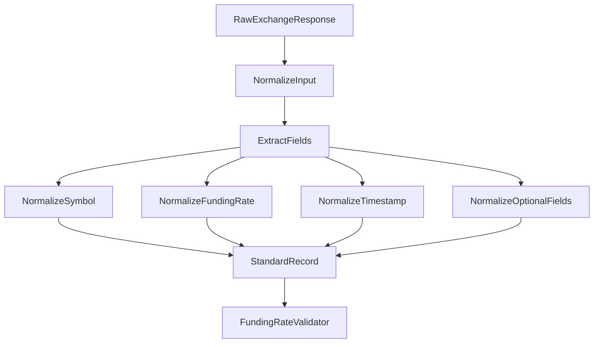
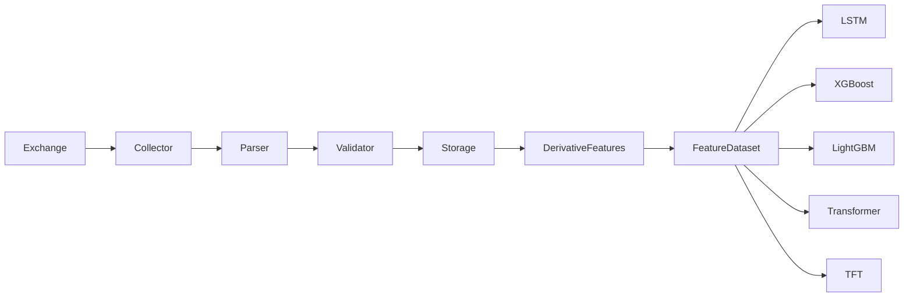

# Funding Rate Parser

## Overview

The **Funding Rate Parser** converts raw exchange funding-rate responses into a standardized internal representation for the ETH futures data pipeline.

It sits between the funding-rate collector and validator:

```text
Exchange API
    ↓
FundingRateCollector
    ↓
FundingRateParser
    ↓
FundingRateValidator
    ↓
Storage
```

The parser is responsible for **structural normalization and type conversion**, not business validation or feature engineering.

---

# Location

```text
data_pipeline/
└── collectors/
    └── funding_rate/
        ├── collector.py
        ├── parser.py
        ├── validator.py
        ├── config.py
        │
        └── md/
            ├── collector.md
            ├── parser.md
            ├── validator.md
            └── config.md
```

---

# Responsibilities

The parser is responsible for:

* Accepting raw exchange responses.
* Extracting funding-rate fields.
* Normalizing exchange-specific field names.
* Normalizing symbols.
* Converting funding rates to numeric values.
* Converting timestamps to Unix milliseconds.
* Supporting common exchange response wrappers.
* Preserving optional mark-price information.
* Preserving optional exchange metadata.
* Returning standardized Python dictionaries.

---

# Non-Responsibilities

The parser does **not**:

* Make API requests.
* Retry failed requests.
* Validate trading/business rules.
* Store records.
* Calculate funding-rate features.
* Calculate funding-rate momentum.
* Calculate funding-rate z-scores.
* Generate trading signals.
* Decide whether a trade should occur.

The architectural boundary is:

```text
Collector
    = Acquire

Parser
    = Normalize

Validator
    = Validate

Features
    = Analyze

Strategy
    = Decide

Risk Engine
    = Approve / Reject
```

---

# Parser Class

The main parser class is:

```python
FundingRateParser
```

It exposes two primary methods:

```python
parse()
```

and:

```python
parse_record()
```

---

# `parse()`

The `parse()` method processes a collection of raw records.

Example:

```python
parsed = parser.parse(records)
```

It accepts:

* Lists.
* Tuples.
* Mappings.
* Exchange responses containing `data`.
* Exchange responses containing `result`.
* Exchange responses containing `rows`.
* Exchange responses containing `list`.

It returns:

```text
list[dict]
```

---

# `parse_record()`

The `parse_record()` method converts one raw exchange record into the standardized internal structure.

Example raw record:

```json
{
    "symbol": "ETHUSDT",
    "fundingRate": "0.0001",
    "fundingTime": 1754006400000
}
```

The standardized result becomes conceptually:

```json
{
    "symbol": "ETHUSDT",
    "funding_rate": 0.0001,
    "funding_time": 1754006400000
}
```

---

# Field Normalization

Different exchanges may use different field names for the same information.

The parser therefore supports aliases.

## Symbol

Supported fields:

```text
symbol
s
instrument
instId
```

All are normalized to:

```text
symbol
```

---

## Funding Rate

Supported fields:

```text
fundingRate
funding_rate
r
```

All are normalized to:

```text
funding_rate
```

---

## Funding Timestamp

Supported fields:

```text
fundingTime
funding_time
timestamp
time
T
```

All are normalized to:

```text
funding_time
```

---

## Mark Price

Supported fields:

```text
markPrice
mark_price
p
```

All are normalized to:

```text
mark_price
```

Mark price is optional.

---

## Exchange Metadata

Supported fields:

```text
exchange
source
```

The parser normalizes these to:

```text
exchange
```

---

# Standardized Output

The parser produces the following core fields:

```text
symbol
funding_rate
funding_time
```

Optional fields include:

```text
mark_price
exchange
```

Conceptually:

```text
Funding Rate Record
│
├── symbol
├── funding_rate
├── funding_time
├── mark_price       [optional]
└── exchange         [optional]
```

---

# Numeric Normalization

Exchange APIs commonly return numeric values as strings.

Example:

```text
"0.0001"
```

The parser converts this into:

```text
0.0001
```

The conversion uses Python's `Decimal` internally before converting to `float`.

This avoids relying on implicit string conversion.

---

# Numeric Validation During Parsing

The parser performs basic conversion-level checks.

For example, the following is rejected:

```text
"not-a-number"
```

Boolean values are also rejected as numeric values.

The parser additionally rejects non-finite values such as:

```text
NaN
Infinity
-Infinity
```

These checks exist because such values cannot be safely represented as normal funding-rate observations.

Business-level range validation remains the validator's responsibility.

---

# Timestamp Normalization

The parser converts supported timestamp representations into:

```text
Unix milliseconds
```

Example:

```text
1754006400
```

can be interpreted as Unix seconds and normalized to:

```text
1754006400000
```

while:

```text
1754006400000
```

is treated as milliseconds.

---

# Supported Timestamp Types

The parser supports:

```text
int
float
Decimal
str
datetime
```

Strings may contain either numeric timestamps or ISO-8601 timestamps.

Example:

```text
2026-08-05T12:00:00Z
```

can be converted into Unix milliseconds.

---

# Timezone Handling

If an incoming `datetime` does not contain timezone information, the parser treats it as UTC.

Timezone-aware timestamps are converted according to their actual timezone.

The standardized output is always:

```text
Unix milliseconds
```

This provides a consistent representation for downstream processing.

---

# Input Normalization

The parser supports several exchange response structures.

## Direct List

```json
[
    {
        "symbol": "ETHUSDT",
        "fundingRate": "0.0001",
        "fundingTime": 1754006400000
    }
]
```

---

## `data` Wrapper

```json
{
    "data": [
        {
            "symbol": "ETHUSDT",
            "fundingRate": "0.0001",
            "fundingTime": 1754006400000
        }
    ]
}
```

---

## `result` Wrapper

```json
{
    "result": [
        {
            "symbol": "ETHUSDT",
            "fundingRate": "0.0001",
            "fundingTime": 1754006400000
        }
    ]
}
```

---

## `rows` Wrapper

```json
{
    "rows": [
        {
            "symbol": "ETHUSDT",
            "fundingRate": "0.0001",
            "fundingTime": 1754006400000
        }
    ]
}
```

---

## `list` Wrapper

```json
{
    "list": [
        {
            "symbol": "ETHUSDT",
            "fundingRate": "0.0001",
            "fundingTime": 1754006400000
        }
    ]
}
```

The parser extracts the underlying records before processing them.

---

# Empty Responses

If the exchange returns:

```text
None
```

or an empty list:

```text
[]
```

the parser returns:

```text
[]
```

This allows the collector pipeline to handle empty collection windows without manufacturing records.

---

# Symbol Normalization

Symbols are converted to strings and stripped of surrounding whitespace.

Example:

```text
" ETHUSDT "
```

becomes:

```text
"ETHUSDT"
```

An empty symbol becomes:

```text
None
```

The validator can subsequently determine whether a missing symbol is acceptable.

---

# Parser vs Validator

This distinction is important.

The parser asks:

> **Can this raw value be converted into the standardized representation?**

The validator asks:

> **Is this standardized record valid for the data pipeline?**

For example:

```text
"0.0001"
```

is converted by the parser to:

```text
0.0001
```

The validator can then determine whether that funding rate falls within the expected domain.

---

# Parser vs Feature Engineering

The parser should not calculate:

```text
funding_rate_change
funding_rate_ma
funding_rate_zscore
funding_rate_momentum
funding_rate_extreme
funding_regime
```

Those belong downstream.

The intended flow is:

```text
Raw Funding Rate
      ↓
Parser
      ↓
Standard Funding Rate
      ↓
Validator
      ↓
Derivative Features
```

---

# Data Type Conversion

The parser performs these conversions:

| Raw Field     | Standard Field | Conversion        |
| ------------- | -------------- | ----------------- |
| `symbol`      | `symbol`       | String            |
| `fundingRate` | `funding_rate` | Numeric           |
| `fundingTime` | `funding_time` | Unix milliseconds |
| `markPrice`   | `mark_price`   | Numeric           |
| `exchange`    | `exchange`     | String            |

---

# Error Handling

The parser raises explicit errors when a value cannot be structurally converted.

Examples:

```text
Unsupported input type
Unsupported timestamp type
Invalid numeric value
Invalid timestamp
Negative timestamp
Invalid ISO timestamp
Boolean used as numeric value
Boolean used as timestamp
```

The parser should not silently replace malformed values with arbitrary defaults.

---

# Preservation of Missing Values

Optional fields may be absent.

For example:

```json
{
    "symbol": "ETHUSDT",
    "fundingRate": "0.0001",
    "fundingTime": 1754006400000
}
```

does not contain a mark price.

The parser therefore does not invent one.

The result remains:

```json
{
    "symbol": "ETHUSDT",
    "funding_rate": 0.0001,
    "funding_time": 1754006400000
}
```

---

# Parser Pipeline



---

# Example

Raw exchange record:

```json
{
    "symbol": "ETHUSDT",
    "fundingRate": "0.000125",
    "fundingTime": 1754006400000,
    "markPrice": "3800.50"
}
```

Parser output:

```json
{
    "symbol": "ETHUSDT",
    "funding_rate": 0.000125,
    "funding_time": 1754006400000,
    "mark_price": 3800.5
}
```

The parser has normalized the structure but has not yet decided whether the record is valid.

---

# Multiple Records

Input:

```json
[
    {
        "symbol": "ETHUSDT",
        "fundingRate": "0.0001",
        "fundingTime": 1754006400000
    },
    {
        "symbol": "ETHUSDT",
        "fundingRate": "0.0002",
        "fundingTime": 1754035200000
    }
]
```

Output:

```json
[
    {
        "symbol": "ETHUSDT",
        "funding_rate": 0.0001,
        "funding_time": 1754006400000
    },
    {
        "symbol": "ETHUSDT",
        "funding_rate": 0.0002,
        "funding_time": 1754035200000
    }
]
```

---

# Relationship With Collector

The collector obtains raw data:

```text
funding_rate/collector.py
```

The parser consumes that data:

```text
funding_rate/parser.py
```

The relationship is:

```text
FundingRateCollector
        ↓
raw exchange records
        ↓
FundingRateParser
        ↓
standardized records
```

The parser should not call the exchange API directly.

---

# Relationship With Validator

After parsing:

```text
FundingRateParser
        ↓
FundingRateValidator
```

The validator can perform domain-specific checks such as:

```text
required fields
valid symbol
valid timestamp
valid funding-rate range
timestamp ordering
duplicate detection
schema compliance
```

---

# Relationship With Storage

The parser should not write directly to storage.

Preferred architecture:

```text
Collector
    ↓
Parser
    ↓
Validator
    ↓
Storage
```

This keeps parsing independent from:

* CSV.
* Parquet.
* SQL.
* Time-series databases.
* Object storage.

---

# Relationship With Features

Once validated records are stored, the feature layer can calculate funding-rate analytics.

For example:

```text
funding_rate
      ↓
funding_rate_change
      ↓
funding_rate_momentum
      ↓
funding_rate_zscore
      ↓
funding_rate_regime
```

These features can then become inputs to the ML datasets.

---

# Model Dataset Flow

The broader pipeline is:



---

# Testing

Recommended tests for `FundingRateParser` include:

## Input Tests

```text
list input
tuple input
mapping input
data wrapper
result wrapper
rows wrapper
list wrapper
empty input
None input
```

## Field Tests

```text
symbol
fundingRate
funding_rate
fundingTime
funding_time
timestamp
time
markPrice
exchange
```

## Numeric Tests

```text
string number
integer number
float number
Decimal number
invalid number
NaN
Infinity
boolean
```

## Timestamp Tests

```text
Unix seconds
Unix milliseconds
ISO-8601 string
datetime
timezone-aware datetime
timezone-naive datetime
negative timestamp
invalid timestamp
```

Recommended test location:

```text
tests/
└── collectors/
    └── funding_rate/
        └── test_parser.py
```

---

# Design Principles

The parser should remain:

* Deterministic.
* Stateless.
* Exchange-aware only at the field-mapping level.
* Independent of networking.
* Independent of storage.
* Independent of trading logic.
* Easy to unit test.
* Explicit about conversion errors.
* Conservative about missing data.

---

# Critical Architectural Rule

The Funding Rate Parser should answer:

> **"How do I convert this exchange response into our standard funding-rate structure?"**

It should not answer:

> **"Is this funding rate acceptable?"**

That belongs to the validator.

It should not answer:

> **"What does this funding rate imply?"**

That belongs to analytics/features.

It should not answer:

> **"Should the bot trade?"**

That belongs to strategy and risk management.

---

# Summary

The funding-rate parser is the normalization boundary between exchange-specific raw data and the ETH Bot's standardized funding-rate schema.

Its core flow is:

```text
Raw Exchange Response
        ↓
Input Normalization
        ↓
Field Extraction
        ↓
Symbol Normalization
        ↓
Funding Rate Conversion
        ↓
Timestamp Normalization
        ↓
Optional Field Normalization
        ↓
Standardized Funding Record
        ↓
Funding Rate Validator
```

The key architectural principle is:

> **Parser = structural normalization, not business logic.**
