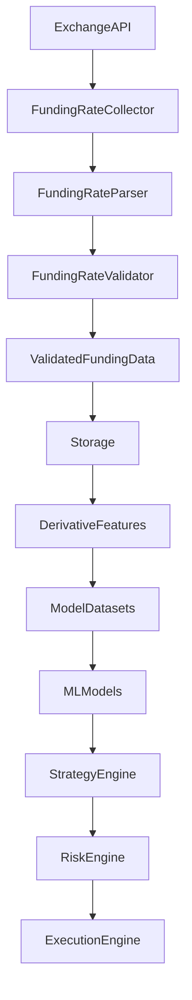

# Funding Rate Validator

## Overview

The **Funding Rate Validator** validates standardized funding-rate records after parsing and before storage or downstream feature generation.

```text
Exchange API
    ↓
Funding Rate Collector
    ↓
Funding Rate Parser
    ↓
Funding Rate Validator
    ↓
Storage
    ↓
Derivative Features
    ↓
Datasets
```

The validator works on the **standardized record produced by `parser.py`**.

---

## Location

```text
data_pipeline/
└── collectors/
    └── funding_rate/
        ├── collector.py
        ├── parser.py
        ├── validator.py
        ├── config.py
        │
        └── md/
            ├── collector.md
            ├── parser.md
            ├── validator.md
            └── config.md
```

---

# Responsibilities

The validator is responsible for:

* Checking required fields.
* Validating the trading symbol.
* Validating funding-rate data types.
* Rejecting non-finite funding rates.
* Checking funding-rate boundaries.
* Validating funding timestamps.
* Validating optional mark price.
* Detecting duplicate funding timestamps.
* Detecting backward timestamp movement.
* Returning structured validation results.

---

# Non-Responsibilities

The validator does **not**:

* Call exchange APIs.
* Collect market data.
* Parse exchange-specific response formats.
* Store records.
* Calculate technical indicators.
* Calculate funding-rate features.
* Generate trading signals.
* Decide whether to enter a position.
* Manage trading risk.

The architectural separation is:

```text
Collector
    = Acquire data

Parser
    = Normalize data

Validator
    = Validate data

Features
    = Analyze data

Strategy
    = Generate trade idea

Risk Engine
    = Approve or reject trade
```

---

# Main Class

The main implementation is:

```python
FundingRateValidator
```

The validator is initialized with configurable validation rules.

Example:

```python
validator = FundingRateValidator(
    expected_symbol="ETHUSDT"
)
```

---

# Default Configuration

The validator uses:

```text
expected_symbol          = ETHUSDT

min_funding_rate         = -1.0
max_funding_rate         = 1.0

require_mark_price       = False

enforce_timestamp_order  = True

reject_duplicates        = True
```

The funding-rate limits are **data-quality safety boundaries**, not trading thresholds.

---

# Required Fields

Every standardized funding-rate record must contain:

```text
symbol
funding_rate
funding_time
```

Conceptually:

```text
Funding Rate Record
│
├── symbol          REQUIRED
├── funding_rate    REQUIRED
└── funding_time    REQUIRED
```

Missing required fields cause validation failure.

---

# Symbol Validation

The validator expects a configured trading symbol.

Default:

```text
ETHUSDT
```

Example valid record:

```json
{
    "symbol": "ETHUSDT",
    "funding_rate": 0.0001,
    "funding_time": 1754006400000
}
```

An unexpected symbol is rejected.

Example:

```json
{
    "symbol": "BTCUSDT",
    "funding_rate": 0.0001,
    "funding_time": 1754006400000
}
```

when:

```text
expected_symbol = ETHUSDT
```

This prevents data from another market from entering the ETH dataset.

---

# Symbol Type

The symbol must be a string.

Invalid:

```python
symbol=123
```

Invalid:

```python
symbol=None
```

Invalid:

```python
symbol=""
```

Valid:

```python
symbol="ETHUSDT"
```

Whitespace surrounding the symbol is not considered part of the intended value.

---

# Funding Rate Validation

The standardized field is:

```text
funding_rate
```

It must contain a numeric value.

Valid:

```text
0.0001
-0.0002
0
```

Invalid:

```text
"abc"
None
True
False
NaN
Infinity
-Infinity
```

---

# Funding Rate Boundary

The validator provides structural safety boundaries:

```text
minimum = -1.0
maximum = 1.0
```

Therefore:

```text
-1.0 ≤ funding_rate ≤ 1.0
```

is accepted by the default configuration.

Values outside this range are rejected.

These boundaries are intended to detect malformed or obviously corrupted data.

They are **not** intended to define bullish or bearish funding conditions.

---

# Why Funding Thresholds Are Not Trading Rules

The validator should not contain rules such as:

```text
funding_rate > 0.01 → bullish
funding_rate < -0.01 → bearish
```

Those belong to the feature/strategy layer.

The validator only determines whether the data is structurally acceptable.

---

# Funding Timestamp

The standardized timestamp field is:

```text
funding_time
```

The parser converts timestamps to Unix milliseconds.

The validator therefore expects a numeric timestamp.

Example:

```text
1754006400000
```

---

# Timestamp Validation

The validator checks that:

* The timestamp exists.
* The timestamp is numeric.
* The timestamp is finite.
* The timestamp is not negative.

Invalid:

```text
None
"abc"
True
NaN
Infinity
-100
```

Valid:

```text
1754006400000
```

---

# Timestamp Ordering

Funding-rate records should normally be chronological.

For example:

```text
10:00
       ↓
18:00
       ↓
02:00 next day
```

The validator can detect a record that moves backward in time.

Example:

```text
1754006400000
1754035200000
1754010000000  ← invalid ordering
```

The third record is earlier than the preceding record.

---

# Timestamp Ordering Configuration

This behavior is controlled by:

```python
enforce_timestamp_order=True
```

If disabled:

```python
enforce_timestamp_order=False
```

timestamp ordering is not treated as a batch-level validation error.

---

# Duplicate Detection

Funding-rate records should not contain duplicate:

```text
symbol + funding_time
```

pairs within the same batch.

Example:

```text
ETHUSDT + 1754006400000
ETHUSDT + 1754006400000
```

The second occurrence is treated as a duplicate.

---

# Duplicate Configuration

Duplicate detection is controlled by:

```python
reject_duplicates=True
```

To disable it:

```python
reject_duplicates=False
```

This can be useful when a downstream deduplication layer is responsible for handling duplicates.

---

# Mark Price Validation

`mark_price` is optional by default.

Example:

```json
{
    "symbol": "ETHUSDT",
    "funding_rate": 0.0001,
    "funding_time": 1754006400000
}
```

is valid without `mark_price`.

When supplied, however, the mark price must be numeric and finite.

It must also be greater than zero.

---

# Required Mark Price

The validator can optionally require mark price:

```python
validator = FundingRateValidator(
    require_mark_price=True
)
```

In that configuration:

```text
mark_price
```

becomes required.

This should only be enabled when the upstream exchange source reliably provides mark-price data.

---

# `validate()`

The primary validation method is:

```python
validator.validate(record)
```

It returns:

```text
True
```

when the record is valid.

When validation fails, it raises:

```python
ValueError
```

with the validation errors.

Example:

```python
validator.validate(
    {
        "symbol": "ETHUSDT",
        "funding_rate": 0.0001,
        "funding_time": 1754006400000,
    }
)
```

Result:

```text
True
```

---

# `validate_record()`

The lower-level method:

```python
validator.validate_record(record)
```

returns a list of validation errors.

Valid record:

```python
[]
```

Invalid record:

```python
[
    "Missing required field: funding_rate."
]
```

This is useful when the caller wants to collect validation errors without immediately raising an exception.

---

# `validate_batch()`

For multiple records:

```python
validator.validate_batch(records)
```

The method returns:

```text
(
    batch_is_valid,
    validation_results
)
```

Example conceptual result:

```python
(
    False,
    [
        {
            "index": 0,
            "valid": True,
            "errors": [],
        },
        {
            "index": 1,
            "valid": False,
            "errors": [
                "Duplicate funding timestamp."
            ],
        },
    ],
)
```

This makes batch-level validation easier to inspect.

---

# Batch Validation

The batch validator checks individual records first.

Then it checks cross-record properties:

```text
Individual validation
        ↓
Duplicate detection
        ↓
Timestamp ordering
        ↓
Batch result
```

This is important because duplicate and ordering problems cannot always be identified by validating one record in isolation.

---

# `filter_valid()`

The method:

```python
validator.filter_valid(records)
```

returns only records that pass validation.

Conceptually:

```text
Raw Parsed Records
        ↓
Validator
        ↓
Valid Records
```

Invalid records are excluded.

This can be useful when the pipeline intentionally continues with clean records while logging invalid ones separately.

---

# `validate_or_none()`

The method:

```python
validator.validate_or_none(record)
```

returns:

```text
record
```

when valid and:

```text
None
```

when invalid.

This provides a simple integration pattern:

```python
valid_record = validator.validate_or_none(
    parsed_record
)

if valid_record is not None:
    storage.write(valid_record)
```

---

# Parser → Validator Contract

The parser creates a standardized record.

Example:

```json
{
    "symbol": "ETHUSDT",
    "funding_rate": 0.0001,
    "funding_time": 1754006400000,
    "mark_price": 3800.50
}
```

The validator then verifies that this standardized structure is acceptable.

```text
Parser
  ↓
Standardized Record
  ↓
Validator
  ↓
Validated Record
```

---

# Parser vs Validator

The distinction is critical.

| Parser                      | Validator                |
| --------------------------- | ------------------------ |
| Extracts fields             | Checks fields            |
| Renames fields              | Checks required fields   |
| Converts strings to numbers | Checks numeric values    |
| Converts timestamps         | Checks timestamps        |
| Handles exchange wrappers   | Checks symbol            |
| Normalizes structure        | Detects duplicates       |
| Structural transformation   | Data-quality enforcement |

For example:

```text
"0.0001"
```

becomes:

```text
0.0001
```

in the parser.

The validator then checks whether:

```text
0.0001
```

is a valid numeric funding rate.

---

# Validator vs Feature Layer

The validator does not calculate:

```text
funding_rate_change
funding_rate_momentum
funding_rate_ma
funding_rate_zscore
funding_rate_extreme
funding_regime
```

Those belong to:

```text
data_pipeline/
└── schema/
    └── features/
        └── derivative_features.py
```

The intended flow is:

```text
Raw Funding Data
       ↓
Parser
       ↓
Validator
       ↓
Stored Funding Data
       ↓
Derivative Features
```

---

# Validator vs Risk Engine

The validator must not be confused with the trading risk engine.

The validator asks:

> Is this data valid?

The risk engine asks:

> Should this proposed trade be allowed?

For example:

```text
Funding rate = 0.0001
```

The validator can determine:

```text
valid data = YES
```

But it must not determine:

```text
take trade = YES
```

That decision belongs downstream.

---

# Complete Data Flow



---

# Validation Boundaries

The validator should focus on data-quality boundaries.

```text
Required field?
      ↓
Correct type?
      ↓
Finite value?
      ↓
Valid symbol?
      ↓
Valid timestamp?
      ↓
Valid structural range?
      ↓
Duplicate?
      ↓
Correct ordering?
```

Only after these checks should the record enter the trusted dataset.

---

# Example Valid Record

```json
{
    "symbol": "ETHUSDT",
    "funding_rate": 0.000125,
    "funding_time": 1754006400000,
    "mark_price": 3800.50
}
```

Expected result:

```text
VALID
```

---

# Example Missing Field

```json
{
    "symbol": "ETHUSDT",
    "funding_time": 1754006400000
}
```

Result:

```text
INVALID

Missing required field:
funding_rate
```

---

# Example Wrong Symbol

```json
{
    "symbol": "BTCUSDT",
    "funding_rate": 0.000125,
    "funding_time": 1754006400000
}
```

Result:

```text
INVALID

Unexpected symbol.
Expected:
ETHUSDT
```

---

# Example Invalid Funding Rate

```json
{
    "symbol": "ETHUSDT",
    "funding_rate": "invalid",
    "funding_time": 1754006400000
}
```

Result:

```text
INVALID

funding_rate must be numeric.
```

---

# Example Invalid Timestamp

```json
{
    "symbol": "ETHUSDT",
    "funding_rate": 0.000125,
    "funding_time": -100
}
```

Result:

```text
INVALID

funding_time cannot be negative.
```

---

# Example Duplicate Records

```json
[
    {
        "symbol": "ETHUSDT",
        "funding_rate": 0.0001,
        "funding_time": 1754006400000
    },
    {
        "symbol": "ETHUSDT",
        "funding_rate": 0.0002,
        "funding_time": 1754006400000
    }
]
```

The second record is identified as a duplicate because the:

```text
symbol + funding_time
```

combination is identical.

---

# Example Out-of-Order Records

```text
1754006400000
1754035200000
1754010000000
```

The third record is earlier than the second.

The batch validator reports:

```text
funding_time is earlier than the previous record.
```

---

# Testing

Recommended test file:

```text
tests/
└── collectors/
    └── funding_rate/
        └── test_validator.py
```

Tests should cover:

```text
Required fields
Symbol validation
Funding-rate type
Funding-rate finiteness
Funding-rate boundaries
Timestamp type
Timestamp finiteness
Negative timestamps
Mark-price validation
Missing mark price
Duplicate records
Timestamp ordering
Batch validation
Valid filtering
Configuration validation
```

---

# Configuration Testing

The following configurations should fail:

```python
FundingRateValidator(
    min_funding_rate=1.0,
    max_funding_rate=-1.0
)
```

because:

```text
minimum > maximum
```

An empty expected symbol should also fail:

```python
FundingRateValidator(
    expected_symbol=""
)
```

---

# Design Principles

The validator should be:

* Deterministic.
* Stateless.
* Explicit.
* Strict about malformed data.
* Independent of networking.
* Independent of storage.
* Independent of feature engineering.
* Independent of trading decisions.
* Easy to unit test.
* Suitable for both single-record and batch validation.

---

# Recommended Pipeline Contract

The funding-rate pipeline should maintain this contract:

```text
collector.py
    ↓
Raw Exchange Data

parser.py
    ↓
Standardized Funding Data

validator.py
    ↓
Validated Funding Data

storage
    ↓
Trusted Historical Dataset

derivative_features.py
    ↓
Funding Analytics

datasets/
    ↓
ML-Ready Data
```

---

# Summary

`funding_rate/validator.py` is the **data-quality gate** for funding-rate records.

Its primary job is to ensure that the standardized funding-rate data is:

```text
Complete
   ↓
Correctly Typed
   ↓
Correct Symbol
   ↓
Numerically Valid
   ↓
Timestamp Valid
   ↓
Non-Duplicated
   ↓
Chronologically Consistent
```

The key architectural rule is:

> **Validator = data-quality gate, not trading decision engine.**
