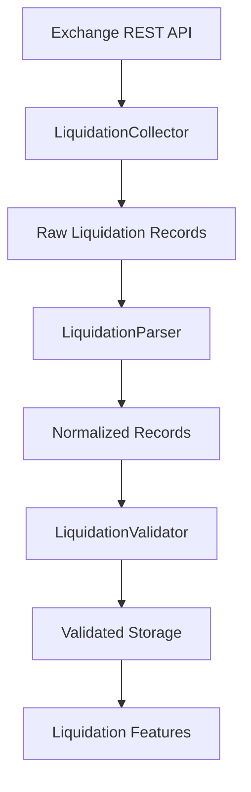

# Liquidations Collector

## Overview

`collector.py` is responsible for collecting **ETH futures liquidation data** from the configured exchange REST API.

It is the acquisition layer for liquidation data.

```text
Exchange API
     ↓
LiquidationsCollector
     ↓
LiquidationsParser
     ↓
LiquidationsValidator
     ↓
Storage
     ↓
Indicators Analytics
     ↓
Dataset Generator
```

The collector acquires raw data. It does **not** interpret or validate the business meaning of the records.

---

# Location

```text
D:\Sachin Chakrawarti\eth_bot\data_pipeline\collectors\liquidations\
│
├── collector.py
├── parser.py
├── validator.py
├── config.py
│
└── md\
    ├── collector.md
    ├── parser.md
    ├── validator.md
    └── config.md
```

---

# Main Class

The main class is:

```python
LiquidationCollector
```

It requires two dependencies:

```python
LiquidationCollector(
    client,
    config,
)
```

Where:

* `client` provides the REST transport.
* `config` provides collection settings.

The collector does not create or manage the HTTP client itself.

---

# Responsibilities

The collector is responsible for:

* Requesting liquidation data.
* Building request parameters.
* Applying configured symbol settings.
* Applying request limits.
* Applying time ranges.
* Collecting latest liquidation records.
* Collecting historical liquidation records.
* Handling pagination.
* Preventing pagination loops.
* Extracting raw records from common response wrappers.
* Optionally removing duplicate raw records.

---

# Non-Responsibilities

The collector does **not**:

* Normalize exchange field names.
* Convert liquidation fields into the internal schema.
* Validate liquidation values.
* Calculate liquidation indicators.
* Calculate liquidation imbalance.
* Calculate liquidation intensity.
* Generate trading signals.
* Decide whether to enter a trade.
* Execute orders.
* Manage portfolio risk.

Those responsibilities belong to later pipeline layers.

---

# Collector Architecture



---

# Constructor

The constructor is:

```python
LiquidationCollector(
    client,
    config,
)
```

Example:

```python
collector = LiquidationCollector(
    client=rest_client,
    config=config,
)
```

Both dependencies are required.

If `client` is missing:

```text
client cannot be None.
```

If `config` is missing:

```text
config cannot be None.
```

---

# REST Client Abstraction

The collector expects a client with a method similar to:

```python
client.get(
    endpoint,
    params=params,
    timeout=timeout,
)
```

This keeps the collector independent of a particular HTTP library.

The client could internally use:

* `requests`
* `httpx`
* an exchange SDK
* a custom REST client

The collector only depends on the required interface.

---

# Why Dependency Injection Is Used

Instead of creating an HTTP client inside `collector.py`:

```text
LiquidationCollector
        ↓
requests
```

the architecture uses:

```text
REST Client
     ↓
LiquidationCollector
```

This makes the collector:

* easier to test,
* easier to mock,
* easier to replace,
* less coupled to transport implementation.

---

# `collect()`

The primary collection method is:

```python
collect(
    start_time=None,
    end_time=None,
    limit=None,
)
```

It supports:

* latest data,
* bounded historical data,
* custom request limits.

Example:

```python
records = collector.collect(
    start_time=1754006400000,
    end_time=1754092800000,
)
```

---

# Collection Flow

```text
collect()
    ↓
Normalize start_time
    ↓
Normalize end_time
    ↓
Validate time range
    ↓
Resolve request limit
    ↓
Build API parameters
    ↓
Request exchange
    ↓
Extract raw records
    ↓
Return records
```

---

# Latest Data

For latest liquidation records:

```python
records = collector.collect_latest()
```

This sends a request without historical time boundaries.

The exchange determines which recent records are returned according to the configured limit.

---

# `collect_latest()`

Method:

```python
collect_latest(
    limit=None,
)
```

Example:

```python
records = collector.collect_latest(
    limit=100,
)
```

The method:

1. Resolves the request limit.
2. Builds request parameters.
3. Calls the REST client.
4. Extracts records.
5. Returns raw records.

---

# Historical Collection

For historical liquidation data:

```python
collect_historical(
    start_time,
    end_time,
    limit=None,
)
```

Example:

```python
records = collector.collect_historical(
    start_time=1754006400000,
    end_time=1754092800000,
)
```

This method supports pagination.

---

# Why Pagination Is Required

Exchange APIs commonly limit the number of records returned per request.

For example:

```text
Requested period:
10,000 liquidation events

Maximum API page:
500 events
```

The collector must therefore perform multiple requests:

```text
Request 1 → 500
Request 2 → 500
Request 3 → 500
...
Request N
```

until the requested time range is covered.

---

# Historical Pagination

The pagination flow is:

```text
Start Time
    ↓
Request Page
    ↓
Records
    ↓
Find Latest Timestamp
    ↓
Advance Start Time
    ↓
Request Next Page
    ↓
...
End Time reached
```

The next page begins at:

```python
current_start = last_timestamp + 1
```

This prevents requesting the same timestamp boundary repeatedly.

---

# Pagination Safety

The collector prevents endless pagination.

It checks whether the latest timestamp is advancing.

For example:

```text
Page 1 → 12:00
Page 2 → 12:30
Page 3 → 13:00
```

is valid.

But:

```text
Page 1 → 12:00
Page 2 → 12:00
```

does not advance.

The collector stops rather than entering an infinite loop.

---

# Maximum Pages

Historical collection uses:

```python
max_pages
```

from configuration.

If the configuration does not provide this value, the collector uses a default maximum.

The purpose is to protect the pipeline from:

* API bugs,
* pagination bugs,
* malformed responses,
* unexpected exchange behavior.

---

# Time Normalization

The collector accepts:

```text
Unix milliseconds
```

or:

```text
datetime
```

For example:

```python
collector.collect(
    start_time=1754006400000,
)
```

or:

```python
collector.collect(
    start_time=datetime(
        2026,
        8,
        1,
        tzinfo=timezone.utc,
    ),
)
```

Both are normalized to Unix milliseconds.

---

# Timestamp in Seconds

Small integer timestamps are interpreted as Unix seconds.

For example:

```text
1754006400
```

becomes:

```text
1754006400000
```

This provides convenience when working with external timestamp values.

---

# Naive Datetime

If a supplied `datetime` does not contain timezone information, the collector treats it as UTC.

Example:

```python
datetime(2026, 8, 1)
```

is interpreted as:

```text
2026-08-01 00:00:00 UTC
```

For production data pipelines, explicitly timezone-aware UTC datetimes are preferred.

---

# Time Range Validation

The collector validates:

```text
start_time <= end_time
```

Invalid:

```text
start_time = 15:00
end_time   = 10:00
```

This raises:

```text
start_time cannot be greater than end_time.
```

---

# Request Parameters

The collector constructs parameters from configuration and method arguments.

Typical parameters include:

```text
symbol
startTime
endTime
limit
```

Example:

```python
{
    "symbol": "ETHUSDT",
    "startTime": 1754006400000,
    "endTime": 1754092800000,
    "limit": 100,
}
```

The exact endpoint and exchange parameter contract should be controlled through configuration.

---

# Symbol

The configured symbol is used when building requests.

Example:

```text
ETHUSDT
```

Because the ETH Bot is designed around ETH futures, the collector should normally operate on the configured ETH futures instrument.

The collector itself does not hard-code strategy behavior around the symbol.

---

# Request Limit

The request limit can be provided:

```python
collector.collect_latest(
    limit=100,
)
```

or obtained from configuration.

The collector checks that:

```text
limit > 0
```

and that it does not exceed:

```text
max_limit
```

---

# Invalid Limit

Invalid:

```python
limit = 0
```

or:

```python
limit = -10
```

The collector raises an error.

A limit larger than the configured maximum is also rejected.

---

# API Request

The actual REST request is isolated in:

```python
_request()
```

This method:

1. Gets the configured endpoint.
2. Gets the configured request timeout.
3. Calls the injected REST client.

Conceptually:

```text
_request()
     ↓
client.get()
     ↓
Exchange API
```

---

# Endpoint

The endpoint is read from configuration.

A default endpoint is provided in the implementation, but production configuration should explicitly define the exchange endpoint.

This avoids coupling the collector's main logic to one exchange.

---

# Timeout

The REST request uses:

```text
request_timeout
```

from configuration.

This prevents a network request from blocking the data pipeline indefinitely.

---

# Response Extraction

The collector supports several common API response shapes.

### Direct list

```json
[
    {
        "symbol": "ETHUSDT"
    }
]
```

### `data`

```json
{
    "data": [
        {
            "symbol": "ETHUSDT"
        }
    ]
}
```

### `result`

```json
{
    "result": [
        {
            "symbol": "ETHUSDT"
        }
    ]
}
```

### `rows`

```json
{
    "rows": [
        {
            "symbol": "ETHUSDT"
        }
    ]
}
```

### `list`

```json
{
    "list": [
        {
            "symbol": "ETHUSDT"
        }
    ]
}
```

---

# `_extract_records()`

The method:

```python
_extract_records()
```

extracts the actual records from an exchange response.

It does not normalize fields.

For example:

```text
raw field:
orderId

```

remains:

```text
orderId
```

The transformation to the internal schema belongs to:

```text
parser.py
```

---

# Collector Output

The collector returns:

```text
List[Mapping]
```

containing raw exchange records.

Example:

```python
[
    {
        "symbol": "ETHUSDT",
        "side": "SELL",
        "price": "3521.40",
        "qty": "12.5",
        "time": 1754006400000,
    }
]
```

The parser then transforms this into the internal liquidation schema.

---

# Collector vs Parser

The distinction is:

```text
Collector:
"Get the data."

Parser:
"Translate the data."
```

For example:

```text
Exchange:
qty = "12.5"
```

The collector returns it unchanged.

The parser may transform it into:

```text
quantity = 12.5
```

---

# Collector vs Validator

The distinction is:

```text
Collector:
Acquire

Parser:
Normalize

Validator:
Validate
```

The collector should not reject a liquidation merely because:

```text
price < 0
```

That is a validation concern.

---

# Deduplication

Historical pagination can sometimes produce overlapping records.

The collector therefore supports:

```text
deduplicate_records
```

through configuration.

When enabled, duplicate raw records are removed before returning the result.

---

# Deduplication Key

The preferred key is based on:

```text
symbol + order identifier
```

when an order identifier exists.

If no order identifier is available, the collector uses:

```text
symbol
timestamp
side
price
quantity
```

as a fallback identity.

---

# Why Deduplicate Before Parsing?

Deduplication here is only a transport-level convenience.

The collector does not need to understand the complete normalized liquidation schema.

It simply prevents obvious pagination duplicates from being passed downstream.

The parser and validator remain responsible for normalized data behavior.

---

# Record Timestamp Extraction

Historical pagination requires knowing where the current page ends.

The collector therefore recognizes common timestamp fields such as:

```text
time
timestamp
T
updateTime
update_time
```

This timestamp extraction is only used for pagination.

It is **not** the main parser.

---

# Pagination Timestamp vs Parser Timestamp

There are intentionally two separate responsibilities.

### Collector

Uses timestamp only to determine:

```text
Where should the next API request begin?
```

### Parser

Uses timestamp to produce:

```text
The normalized internal timestamp field.
```

This prevents the collector from becoming a duplicate parser.

---

# Empty Response

If the exchange returns:

```json
[]
```

the collector returns:

```python
[]
```

This is a normal condition and can occur when there are no liquidation events in the requested period.

The orchestration layer can decide whether an empty result is acceptable.

---

# Unsupported Response

If the exchange client returns an unsupported response type, such as:

```text
string
integer
unexpected object
```

the collector raises a `TypeError`.

This prevents malformed API responses from silently entering the pipeline.

---

# Error Philosophy

The collector should:

* Fail clearly on invalid configuration.
* Fail clearly on invalid time ranges.
* Fail clearly on invalid limits.
* Stop pagination when progress stops.
* Return empty results when the API legitimately returns no records.
* Avoid silently converting malformed API responses into valid records.

---

# Retry Responsibility

The collector delegates low-level HTTP retry behavior to the injected REST client.

Architecture:

```text
LiquidationCollector
        ↓
REST Client
        ↓
Retry / Rate Limit Handling
        ↓
Exchange
```

This avoids duplicating retry logic across every data collector.

If the project later introduces a shared:

```text
base/rest_collector.py
```

the liquidation collector can use that shared abstraction.

---

# Scheduler Integration

The collector itself does not schedule collection.

Scheduling belongs to the pipeline scheduler.

For example:

```text
Scheduler
    ↓
LiquidationCollector
    ↓
Exchange
```

This separation allows the same collector to be used for:

* scheduled collection,
* historical backfills,
* manual recovery,
* testing,
* paper-trading preparation.

---

# Data Pipeline Integration

The complete flow is:


---

# Relationship With Liquidation Features

The collector provides the raw observations required for downstream features.

Examples of possible later features include:

```text
liquidation_volume
liquidation_count
long_liquidation_volume
short_liquidation_volume
liquidation_imbalance
liquidation_intensity
liquidation_spike
liquidation_zscore
```

These calculations do **not** belong in `collector.py`.

---

# Relationship With Trading Strategy

Liquidation data can later become an input to:

```text
Direction Model
Momentum Model
Volatility Model
Trend Model
Reversal Model
```

But the collector must remain unaware of those models.

The dependency should remain one-directional:

```text
Collector
    ↓
Data
    ↓
Analytics
    ↓
Models
    ↓
Strategy
    ↓
Risk
    ↓
Execution
```

---

# Testing

Recommended test location:

```text
tests/
└── collectors/
    └── liquidations/
        └── test_collector.py
```

Tests should cover:

### Constructor

```text
valid client
valid config
missing client
missing config
```

### Collection

```text
latest collection
time-bounded collection
empty response
```

### Time handling

```text
Unix seconds
Unix milliseconds
datetime
naive datetime
negative timestamp
invalid timestamp
```

### Time range

```text
valid range
equal start/end
start > end
```

### Limits

```text
default limit
custom limit
zero limit
negative limit
limit > max_limit
```

### Response extraction

```text
list
data wrapper
result wrapper
rows wrapper
list wrapper
unsupported response
```

### Pagination

```text
multiple pages
end time reached
empty page
timestamp does not advance
maximum pages reached
```

### Deduplication

```text
duplicate order ID
duplicate timestamp/record
multiple symbols
deduplication disabled
```

---

# Example Usage

```python
collector = LiquidationCollector(
    client=rest_client,
    config=config,
)

records = collector.collect_latest(
    limit=100,
)
```

Historical collection:

```python
records = collector.collect_historical(
    start_time=1754006400000,
    end_time=1754092800000,
)
```

The returned records are then passed to the parser:

```python
parsed_records = parser.parse(
    records
)
```

and then to the validator:

```python
validator.validate_records(
    parsed_records
)
```

---

# Complete Responsibility Chain

```text
┌─────────────────────────────┐
│ Liquidation Collector       │
│                             │
│ Acquire raw data            │
│ Build requests              │
│ Handle pagination           │
│ Extract response records    │
└──────────────┬──────────────┘
               ↓
┌─────────────────────────────┐
│ Liquidation Parser          │
│                             │
│ Normalize fields            │
│ Convert types               │
│ Normalize timestamps        │
└──────────────┬──────────────┘
               ↓
┌─────────────────────────────┐
│ Liquidation Validator       │
│                             │
│ Validate structure          │
│ Validate values             │
│ Validate timestamps         │
└──────────────┬──────────────┘
               ↓
┌─────────────────────────────┐
│ Indicators Analytics        │
│                             │
│ Calculate liquidation       │
│ features and statistics     │
└─────────────────────────────┘
```

---

# Design Principles

`collector.py` should remain:

* Stateless with respect to market data.
* Exchange-client agnostic.
* Configuration-driven.
* Pagination-safe.
* Testable.
* Independent of feature engineering.
* Independent of strategy logic.
* Independent of risk management.
* Independent of order execution.

The central principle is:

> **`collector.py` acquires raw liquidation data reliably; it does not interpret whether that data is valid, significant, or actionable for trading.**
