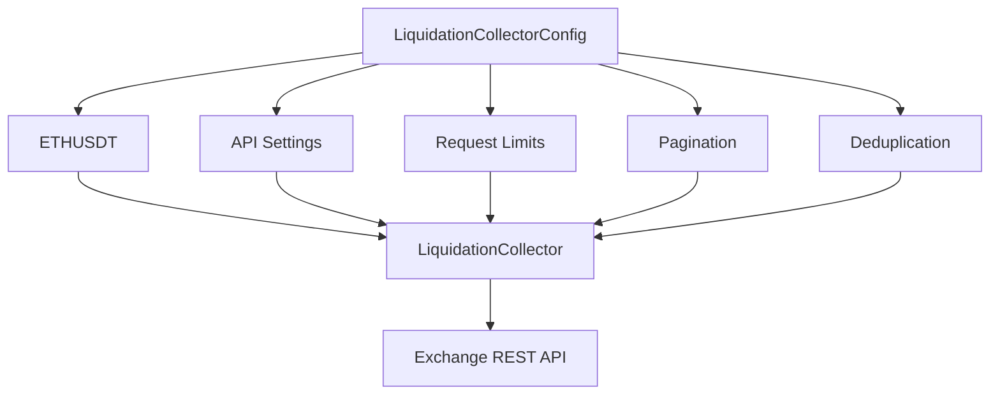

# Liquidations Collector Configuration

## Overview

`config.py` defines the configuration required by the liquidation collector.

Its purpose is to keep collection behavior separate from the collector implementation.

```text
config.py
    ↓
LiquidationCollector
    ↓
Exchange API
```

The configuration controls:

* ETH futures symbol.
* REST API endpoint.
* Request timeout.
* Default request limit.
* Maximum request limit.
* Historical pagination limit.
* Duplicate-record handling.

---

# Location

```text
D:\Sachin Chakrawarti\eth_bot\data_pipeline\collectors\liquidations\
│
├── collector.py
├── parser.py
├── validator.py
├── config.py
│
└── md\
    ├── collector.md
    ├── parser.md
    ├── validator.md
    └── config.md
```

---

# Main Configuration Class

The main class is:

```python
LiquidationCollectorConfig
```

It is implemented as a frozen dataclass.

Conceptually:

```text
LiquidationCollectorConfig
        │
        ├── symbol
        ├── endpoint
        ├── request_timeout
        ├── limit
        ├── max_limit
        ├── max_pages
        └── deduplicate_records
```

---

# Why Use a Configuration Class?

Without a configuration object, collection settings would be scattered throughout the collector:

```python
symbol = "ETHUSDT"
limit = 100
timeout = 10
max_pages = 100
```

This makes the collector harder to modify.

Instead:

```python
config = LiquidationCollectorConfig(...)
```

allows the collector to read all settings from one object.

---

# Default Configuration

The module provides:

```python
DEFAULT_LIQUIDATION_CONFIG
```

which uses the default values defined by `LiquidationCollectorConfig`.

Conceptually:

```python
config = LiquidationCollectorConfig()
```

is equivalent to using the default configuration object.

---

# Symbol

Configuration field:

```python
symbol: str = "ETHUSDT"
```

The default instrument is:

```text
ETHUSDT
```

This matches the ETH futures focus of the trading system.

Example:

```python
config = LiquidationCollectorConfig(
    symbol="ETHUSDT",
)
```

---

# Symbol Validation

The symbol must be a string.

Invalid:

```python
symbol=123
```

Invalid:

```python
symbol=""
```

Invalid:

```python
symbol="   "
```

Valid:

```python
symbol="ETHUSDT"
```

The configuration validates this during initialization.

---

# Endpoint

Configuration field:

```python
endpoint: str = "/futures/data/allForceOrders"
```

The endpoint identifies the exchange REST API resource used by the collector.

The collector reads the endpoint from configuration rather than embedding exchange-specific behavior throughout its logic.

---

# Endpoint Validation

The endpoint must be a non-empty string.

Invalid:

```python
endpoint=""
```

Invalid:

```python
endpoint=None
```

Valid:

```python
endpoint="/futures/data/allForceOrders"
```

---

# Request Timeout

Configuration field:

```python
request_timeout: float = 10.0
```

This specifies the maximum amount of time allowed for an individual REST request.

Example:

```python
config = LiquidationCollectorConfig(
    request_timeout=15.0,
)
```

The collector passes this value to the REST client.

---

# Timeout Validation

The timeout must be greater than zero.

Valid:

```text
1
5
10
30
```

Invalid:

```text
0
-1
```

A boolean value is also rejected.

---

# Default Request Limit

Configuration field:

```python
limit: int = 100
```

This is the default number of records requested per API call.

Example:

```python
config = LiquidationCollectorConfig(
    limit=500,
)
```

The collector uses this value when the caller does not explicitly provide a limit.

---

# Maximum Request Limit

Configuration field:

```python
max_limit: int = 1000
```

This defines the maximum request size allowed by the collector.

For example:

```text
limit = 100
max_limit = 1000
```

is valid.

But:

```text
limit = 1500
max_limit = 1000
```

is invalid.

---

# Relationship Between Limit and Max Limit

The configuration requires:

```text
limit <= max_limit
```

Therefore:

```python
LiquidationCollectorConfig(
    limit=500,
    max_limit=1000,
)
```

is valid.

But:

```python
LiquidationCollectorConfig(
    limit=1500,
    max_limit=1000,
)
```

raises a validation error.

---

# Historical Pagination

Configuration field:

```python
max_pages: int = 100
```

This limits the number of API pages that can be requested during a historical collection.

For example:

```text
Page 1
Page 2
Page 3
...
Page 100
```

After the configured maximum is reached, pagination stops.

---

# Why Max Pages Is Required

Without a maximum page limit, a pagination bug could theoretically produce:

```text
Request
  ↓
Request
  ↓
Request
  ↓
Request
  ↓
...
```

indefinitely.

`max_pages` provides a hard safety boundary.

---

# Max Pages Validation

`max_pages` must be a positive integer.

Valid:

```text
1
10
100
1000
```

Invalid:

```text
0
-1
1.5
True
```

---

# Deduplication

Configuration field:

```python
deduplicate_records: bool = True
```

When enabled, the collector attempts to remove duplicate raw liquidation records.

This is particularly useful during historical pagination because adjacent API pages can sometimes overlap.

---

# Deduplication Enabled

Default:

```python
deduplicate_records=True
```

Therefore:

```text
Page 1
    ↓
records A B C

Page 2
    ↓
records C D E
```

can become:

```text
A B C D E
```

instead of:

```text
A B C C D E
```

---

# Disabling Deduplication

Deduplication can be disabled:

```python
config = LiquidationCollectorConfig(
    deduplicate_records=False,
)
```

This may be useful when the caller wants the collector to preserve the raw page results exactly.

However, downstream validation should then be responsible for detecting duplicates if required.

---

# Configuration Validation

The configuration validates itself during construction.

The validation covers:

```text
symbol
endpoint
request_timeout
limit
max_limit
max_pages
deduplicate_records
```

This means invalid configuration is detected before the collector begins requesting market data.

---

# Configuration Lifecycle

The normal lifecycle is:

```text
Create Configuration
        ↓
Validate Configuration
        ↓
Create Collector
        ↓
Collect Data
```

Example:

```python
config = LiquidationCollectorConfig(
    symbol="ETHUSDT",
    limit=100,
    max_limit=1000,
    max_pages=100,
    request_timeout=10.0,
    deduplicate_records=True,
)

collector = LiquidationCollector(
    client=rest_client,
    config=config,
)
```

---

# Frozen Configuration

The configuration is immutable after creation.

Conceptually:

```text
Create
  ↓
Validate
  ↓
Freeze
```

This prevents accidental runtime changes such as:

```python
config.limit = 5000
```

after the collector has already been initialized.

Immutable configuration makes collection behavior more predictable.

---

# Configuration and Collector Separation

The architecture is:

```text
┌─────────────────────────────┐
│ config.py                   │
│                             │
│ What should happen?         │
└──────────────┬──────────────┘
               ↓
┌─────────────────────────────┐
│ collector.py                │
│                             │
│ How should it happen?       │
└──────────────┬──────────────┘
               ↓
┌─────────────────────────────┐
│ Exchange REST API            │
└─────────────────────────────┘
```

This separation keeps configuration and execution logic independent.

---

# Configuration and Parser

`config.py` does not define parser behavior.

The parser is responsible for:

```text
raw exchange record
        ↓
normalized liquidation record
```

The configuration only controls how records are collected.

---

# Configuration and Validator

`config.py` does not define data-quality rules such as:

```text
quantity > 0
price > 0
timestamp valid
side valid
```

Those rules belong to:

```text
validator.py
```

---

# Configuration and Feature Engineering

The configuration does not contain feature parameters such as:

```text
liquidation_imbalance_window
liquidation_zscore_window
liquidation_spike_threshold
```

Those belong to the indicators/analytics layer.

---

# Configuration and Strategy

The configuration does not define:

```text
BUY
SELL
LONG
SHORT
ENTRY
EXIT
```

Trading decisions belong to the strategy engine.

---

# Configuration and Risk Engine

The configuration does not define:

```text
maximum_position
stop_loss
maximum_drawdown
leverage
risk_per_trade
```

Those belong to the risk-management architecture.

---

# Configuration Flow



---

# Recommended Configuration

For the current ETH futures project, the baseline configuration is:

```python
LiquidationCollectorConfig(
    symbol="ETHUSDT",
    endpoint="/futures/data/allForceOrders",
    request_timeout=10.0,
    limit=100,
    max_limit=1000,
    max_pages=100,
    deduplicate_records=True,
)
```

This provides a reasonable starting configuration while keeping all collection parameters explicit.

---

# Testing

Recommended test location:

```text
tests/
└── collectors/
    └── liquidations/
        └── test_config.py
```

Tests should verify:

### Defaults

```text
default symbol
default endpoint
default timeout
default limit
default max_limit
default max_pages
default deduplication
```

### Symbol

```text
valid symbol
empty symbol
whitespace symbol
non-string symbol
```

### Endpoint

```text
valid endpoint
empty endpoint
non-string endpoint
```

### Timeout

```text
positive timeout
zero timeout
negative timeout
boolean timeout
```

### Limits

```text
valid limit
zero limit
negative limit
non-integer limit
limit > max_limit
```

### Pagination

```text
valid max_pages
zero max_pages
negative max_pages
non-integer max_pages
```

### Deduplication

```text
True
False
non-boolean value
```

---

# Configuration Contract

The complete contract is:

```text
LiquidationCollectorConfig
│
├── symbol
│   └── ETH futures instrument
│
├── endpoint
│   └── liquidation REST endpoint
│
├── request_timeout
│   └── maximum request duration
│
├── limit
│   └── default records per request
│
├── max_limit
│   └── maximum records per request
│
├── max_pages
│   └── maximum historical pages
│
└── deduplicate_records
    └── duplicate-record handling
```

---

# Final Responsibility

The purpose of `config.py` can be summarized as:

> **`config.py` defines and validates the operational parameters used by `LiquidationCollector` to acquire ETH futures liquidation data reliably and predictably.**

The dependency chain remains:

```text
config.py
    ↓
collector.py
    ↓
parser.py
    ↓
validator.py
    ↓
storage
    ↓
indicators analytics
    ↓
datasets
    ↓
ML models
```
