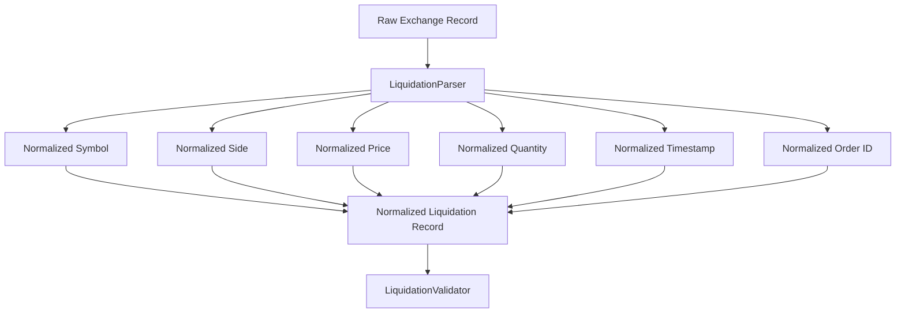

# Liquidations Parser

## Overview

`parser.py` converts raw exchange liquidation records into the **internal ETH futures liquidation data format**.

The parser sits between the collector and validator:

```text
Exchange API
     ↓
collector.py
     ↓
Raw Liquidation Records
     ↓
parser.py
     ↓
Normalized Liquidation Records
     ↓
validator.py
```

The parser's primary responsibility is **normalization**, not validation or trading logic.

---

# Location

```text
D:\Sachin Chakrawarti\eth_bot\data_pipeline\collectors\liquidations\
│
├── collector.py
├── parser.py
├── validator.py
├── config.py
│
└── md\
    ├── collector.md
    ├── parser.md
    ├── validator.md
    └── config.md
```

---

# Main Class

The main parser class is:

```python
LiquidationParser
```

Example:

```python
parser = LiquidationParser()
```

The parser does not require an exchange client because it does not communicate with the exchange.

---

# Responsibilities

The parser is responsible for:

* Parsing raw liquidation records.
* Normalizing exchange-specific field names.
* Converting numeric values.
* Normalizing timestamps.
* Normalizing symbols.
* Normalizing liquidation sides.
* Normalizing order identifiers.
* Extracting optional source metadata.
* Supporting single-record parsing.
* Supporting batch parsing.

---

# Non-Responsibilities

The parser does **not**:

* Make REST requests.
* Open WebSocket connections.
* Schedule collection.
* Validate trading-data business rules.
* Calculate liquidation indicators.
* Generate trading signals.
* Decide whether a liquidation is important.
* Execute trades.
* Manage risk.

The separation is:

```text
Collector → Acquire
Parser    → Normalize
Validator → Validate
Analytics → Calculate
Strategy  → Decide
Risk      → Approve/Reject
Execution → Execute
```

---

# Parser Architecture



---

# Internal Output Schema

The parser produces a normalized record containing:

```text
symbol
side
order_id
price
quantity
quote_quantity
timestamp
event_time
source
```

Conceptually:

```python
{
    "symbol": "...",
    "side": "...",
    "order_id": "...",
    "price": ...,
    "quantity": ...,
    "quote_quantity": ...,
    "timestamp": ...,
    "event_time": ...,
    "source": "..."
}
```

---

# Example Raw Record

An exchange might return:

```python
{
    "symbol": "ETHUSDT",
    "side": "SELL",
    "orderId": "123456789",
    "price": "3521.40",
    "qty": "12.5",
    "time": 1754006400000,
}
```

The parser converts it into:

```python
{
    "symbol": "ETHUSDT",
    "side": "SELL",
    "order_id": "123456789",
    "price": 3521.40,
    "quantity": 12.5,
    "quote_quantity": None,
    "timestamp": 1754006400000,
    "event_time": None,
    "source": None,
}
```

---

# `parse()`

The primary method is:

```python
parse(record)
```

It accepts one raw liquidation record.

Example:

```python
parsed = parser.parse(
    raw_record
)
```

The returned object is a normalized dictionary.

---

# Parsing Flow

```text
Raw Record
    ↓
Check Mapping
    ↓
Parse Symbol
    ↓
Parse Side
    ↓
Parse Order ID
    ↓
Parse Price
    ↓
Parse Quantity
    ↓
Parse Quote Quantity
    ↓
Parse Timestamp
    ↓
Parse Event Time
    ↓
Parse Source
    ↓
Normalized Record
```

---

# Input Type

The parser expects a mapping:

```python
Mapping[str, Any]
```

Typical examples include:

```python
dict
```

or another mapping-compatible object.

Invalid input such as:

```python
parser.parse("invalid")
```

raises a `TypeError`.

---

# Symbol Parsing

The parser recognizes common symbol fields:

```text
symbol
s
```

For example:

```python
{
    "s": "ETHUSDT"
}
```

becomes:

```python
{
    "symbol": "ETHUSDT"
}
```

---

# Symbol Normalization

The symbol is:

1. Converted to a string.
2. Stripped of surrounding whitespace.
3. Converted to uppercase.

Example:

```text
" ethusdt "
```

becomes:

```text
"ETHUSDT"
```

---

# Side Parsing

The parser recognizes several possible exchange fields:

```text
side
S
orderSide
order_side
```

The normalized field is:

```text
side
```

---

# Side Normalization

The parser maps common aliases.

Examples:

```text
B
BUY
LONG
OPEN_LONG
```

become:

```text
BUY
```

and:

```text
S
SELL
SHORT
OPEN_SHORT
```

become:

```text
SELL
```

---

# Important Side Semantics

The parser only normalizes the exchange representation.

It does **not** determine whether:

```text
SELL = long liquidation
```

or:

```text
BUY = short liquidation
```

because the exact semantic interpretation depends on the exchange's liquidation-event contract.

That interpretation should be defined explicitly in the schema/validation or analytics layer.

---

# Order ID

The parser recognizes:

```text
orderId
order_id
id
i
```

and normalizes them to:

```text
order_id
```

Example:

```python
{
    "orderId": 123456
}
```

becomes:

```python
{
    "order_id": "123456"
}
```

The parser converts the identifier to a string so downstream systems have a consistent representation.

---

# Price Parsing

The parser recognizes:

```text
price
p
```

Example:

```python
{
    "price": "3521.40"
}
```

becomes:

```python
{
    "price": 3521.40
}
```

The exchange's string representation is converted to a Python `float`.

---

# Quantity Parsing

The parser recognizes:

```text
quantity
qty
q
```

Example:

```python
{
    "qty": "12.5"
}
```

becomes:

```python
{
    "quantity": 12.5
}
```

---

# Quote Quantity

The parser recognizes:

```text
quoteQuantity
quote_quantity
quoteQty
notional
```

and normalizes them to:

```text
quote_quantity
```

Example:

```python
{
    "quoteQty": "44017.5"
}
```

becomes:

```python
{
    "quote_quantity": 44017.5
}
```

If the exchange does not provide quote quantity:

```python
{
    "quote_quantity": None
}
```

The parser does not calculate it automatically.

---

# Why Quote Quantity Is Not Calculated

Although:

```text
quote_quantity ≈ price × quantity
```

may be mathematically possible, calculating it in the parser could introduce assumptions about:

* contract specification,
* quantity units,
* quote currency,
* exchange contract type.

Therefore, the parser preserves the exchange-provided value when available.

Feature calculations belong downstream.

---

# Timestamp Parsing

The parser recognizes:

```text
time
timestamp
T
updateTime
update_time
```

The normalized field is:

```text
timestamp
```

The internal representation is:

```text
Unix milliseconds
```

---

# Timestamp in Seconds

If an exchange provides:

```text
1754006400
```

the parser interprets it as seconds and converts it to:

```text
1754006400000
```

---

# Timestamp in Milliseconds

If the exchange provides:

```text
1754006400000
```

it is preserved as milliseconds.

---

# Datetime Timestamp

The parser also accepts a Python `datetime`.

Example:

```python
datetime(
    2026,
    8,
    1,
    tzinfo=timezone.utc,
)
```

This is converted to Unix milliseconds.

---

# ISO-8601 Timestamp

The parser supports ISO-style strings.

Example:

```text
2026-08-01T00:00:00Z
```

is converted to Unix milliseconds.

The trailing:

```text
Z
```

is interpreted as UTC.

---

# Naive Datetime

If a Python `datetime` has no timezone:

```python
datetime(
    2026,
    8,
    1,
)
```

the parser treats it as UTC.

For production data, timezone-aware UTC timestamps are preferred.

---

# Event Time

Some exchanges provide an event-generation timestamp separately from the primary liquidation timestamp.

The parser recognizes:

```text
eventTime
event_time
E
```

and normalizes it to:

```text
event_time
```

This field is optional.

---

# Difference Between Timestamp and Event Time

Depending on the exchange:

```text
timestamp
```

may represent the liquidation/order event time, while:

```text
event_time
```

may represent the exchange message/event timestamp.

The parser preserves both when available.

The exact semantic definition should be documented in the exchange-specific schema.

---

# Source

The parser recognizes:

```text
source
exchange
exchange_name
```

and normalizes the result to:

```text
source
```

Example:

```python
{
    "exchange": "binance"
}
```

becomes:

```python
{
    "source": "binance"
}
```

---

# Missing Optional Fields

Missing optional fields become:

```python
None
```

For example:

```python
{
    "symbol": "ETHUSDT",
    "price": "3500"
}
```

can produce:

```python
{
    "symbol": "ETHUSDT",
    "side": None,
    "order_id": None,
    "price": 3500.0,
    "quantity": None,
    "quote_quantity": None,
    "timestamp": None,
    "event_time": None,
    "source": None,
}
```

The parser preserves the structure of the internal schema.

The validator determines whether missing fields are acceptable.

---

# Numeric Conversion

The parser converts numeric values using:

```text
_parse_float()
```

Examples:

```text
"3521.40" → 3521.40
"12.5"    → 12.5
12.5      → 12.5
```

---

# Empty Numeric Values

An empty string:

```text
""
```

is interpreted as:

```python
None
```

This prevents an empty exchange field from becoming a parsing error when the field is optional.

---

# Boolean Numeric Values

Boolean values are rejected as numeric values.

For example:

```python
price=True
```

is not silently converted to:

```text
1.0
```

This avoids hidden data corruption.

---

# Invalid Numeric Values

Invalid numeric strings such as:

```text
"abc"
```

raise a `ValueError`.

This is important because silently converting invalid market data into `None` could hide upstream exchange-data problems.

---

# `parse_many()`

For batch processing, the parser provides:

```python
parse_many(records)
```

Example:

```python
parsed_records = parser.parse_many(
    raw_records
)
```

The method applies:

```text
parse()
```

to every record.

---

# Batch Parsing Flow

```text
Raw Records
    ↓
Record 1 → parse()
Record 2 → parse()
Record 3 → parse()
...
Record N → parse()
    ↓
Normalized Records
```

---

# Empty Batch

An empty iterable:

```python
[]
```

produces:

```python
[]
```

This is a valid condition.

---

# `None` Batch

Passing:

```python
parser.parse_many(None)
```

raises:

```text
ValueError
```

because the parser cannot distinguish a missing collection from an intentionally empty collection.

---

# Field Mapping

The core field mapping is:

| Exchange field                            | Internal field   |
| ----------------------------------------- | ---------------- |
| `symbol` / `s`                            | `symbol`         |
| `side` / `S`                              | `side`           |
| `orderId` / `order_id` / `id` / `i`       | `order_id`       |
| `price` / `p`                             | `price`          |
| `quantity` / `qty` / `q`                  | `quantity`       |
| `quoteQuantity` / `quoteQty` / `notional` | `quote_quantity` |
| `time` / `timestamp` / `T` / `updateTime` | `timestamp`      |
| `eventTime` / `event_time` / `E`          | `event_time`     |
| `source` / `exchange`                     | `source`         |

This mapping provides a stable internal interface even when the exchange uses abbreviated field names.

---

# Parser and Exchange Coupling

The parser contains knowledge of common exchange field aliases.

This is acceptable because its job is to translate:

```text
Exchange Format
        ↓
Internal Format
```

The rest of the pipeline should consume only the normalized schema.

---

# Parser and Collector Separation

The collector:

```text
Gets records.
```

The parser:

```text
Transforms records.
```

Example:

```text
Exchange
   ↓
Collector
   ↓
{
    "s": "ETHUSDT",
    "p": "3521.40",
    "q": "12.5"
}
   ↓
Parser
   ↓
{
    "symbol": "ETHUSDT",
    "price": 3521.40,
    "quantity": 12.5
}
```

---

# Parser and Validator Separation

The parser may produce:

```python
{
    "price": -10.0
}
```

if the raw exchange record contains that value.

The parser's job is to convert the value.

The validator's job is to determine whether:

```text
price > 0
```

must hold.

This separation keeps parsing and data-quality policy independent.

---

# Parser and Analytics Separation

The parser should not calculate:

```text
liquidation_volume
liquidation_imbalance
liquidation_intensity
liquidation_zscore
```

For example:

```text
price × quantity
```

is not automatically a parser feature.

Analytics belongs after validation.

---

# Parser and ML Dataset Generation

The parser output becomes an upstream input for dataset generation.

Conceptually:

```text
Raw API Data
    ↓
Collector
    ↓
Parser
    ↓
Validator
    ↓
Processed Data
    ↓
Indicators Analytics
    ↓
Dataset Generator
    ↓
LSTM
XGBoost
LightGBM
Transformer
TFT
Tabular
```

The parser therefore provides a stable foundation for multiple model-specific datasets.

---

# Parser Design Principles

The parser should remain:

* Deterministic.
* Stateless.
* Exchange-format aware.
* Internal-schema focused.
* Independent of networking.
* Independent of strategy.
* Independent of risk.
* Independent of execution.
* Easy to unit test.

---

# Testing

Recommended location:

```text
tests/
└── collectors/
    └── liquidations/
        └── test_parser.py
```

Tests should cover:

### Symbol

```text
symbol
s
uppercase conversion
whitespace removal
missing symbol
```

### Side

```text
BUY
SELL
B
S
LONG
SHORT
unknown side
```

### Order ID

```text
orderId
order_id
id
i
numeric ID
missing ID
```

### Price

```text
string price
integer price
float price
empty price
invalid price
boolean price
```

### Quantity

```text
quantity
qty
q
empty quantity
invalid quantity
```

### Quote Quantity

```text
quoteQuantity
quoteQty
quote_quantity
notional
missing quote quantity
```

### Timestamp

```text
seconds
milliseconds
datetime
ISO-8601
UTC
invalid timestamp
negative timestamp
```

### Batch

```text
multiple records
empty records
None
```

---

# Example

Raw exchange data:

```python
raw_record = {
    "s": "ethusdt",
    "S": "SELL",
    "i": 123456,
    "p": "3521.40",
    "q": "12.5",
    "T": 1754006400000,
}
```

Parser:

```python
parser = LiquidationParser()

parsed = parser.parse(
    raw_record
)
```

Normalized result:

```python
{
    "symbol": "ETHUSDT",
    "side": "SELL",
    "order_id": "123456",
    "price": 3521.40,
    "quantity": 12.5,
    "quote_quantity": None,
    "timestamp": 1754006400000,
    "event_time": None,
    "source": None,
}
```

---

# Complete Data Flow

```mermaid
flowchart LR

API["Exchange API"]
    -->
Collector["collector.py"]

Collector
    -->
Raw["Raw Records"]

Raw
    -->
Parser["parser.py"]

Parser
    -->
Normalized["Normalized Records"]

Normalized
    -->
Validator["validator.py"]

Validator
    -->
Validated["Validated Records"]

Validated
    -->
Analytics["Indicators Analytics"]

Analytics
    -->
Datasets["Dataset Generator"]

Datasets
    -->
Models["ML / DL Models"]
```



---

# Final Responsibility

The purpose of `parser.py` can be summarized as:

> **`parser.py` translates exchange-specific raw liquidation records into a consistent internal ETH futures liquidation schema without making trading, risk, or data-quality decisions.**
