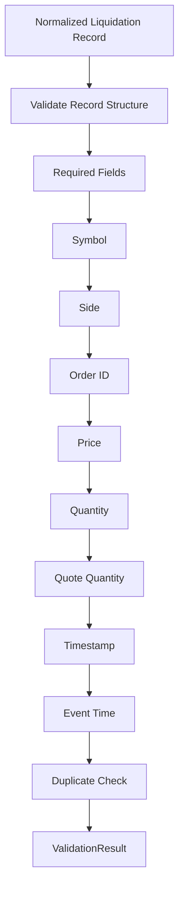
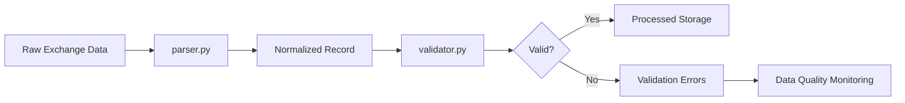

# Liquidations Validator

## Overview

`validator.py` validates **normalized ETH futures liquidation records** produced by `parser.py`.

Its role is to ensure that liquidation data is structurally and logically acceptable before entering downstream storage, analytics, feature engineering, dataset generation, and ML/DL pipelines.

```text
Exchange
   ↓
collector.py
   ↓
Raw Data
   ↓
parser.py
   ↓
Normalized Data
   ↓
validator.py
   ↓
Validated Data
   ↓
Indicators Analytics
   ↓
Dataset Generator
   ↓
ML / DL Models
```

---

# Location

```text
D:\Sachin Chakrawarti\eth_bot\data_pipeline\collectors\liquidations\
│
├── collector.py
├── parser.py
├── validator.py
├── config.py
│
└── md\
    ├── collector.md
    ├── parser.md
    ├── validator.md
    └── config.md
```

---

# Main Responsibilities

The validator is responsible for:

* Validating record structure.
* Checking required fields.
* Validating the ETH futures symbol.
* Validating liquidation side.
* Validating order IDs.
* Validating price.
* Validating quantity.
* Validating quote quantity.
* Validating timestamps.
* Detecting duplicate records in batches.
* Returning structured validation results.
* Optionally raising an exception for invalid records.

---

# Non-Responsibilities

The validator does **not**:

* Collect exchange data.
* Parse exchange-specific field names.
* Connect to REST APIs.
* Connect to WebSockets.
* Calculate indicators.
* Generate trading signals.
* Decide whether to enter a trade.
* Reject trades.
* Manage portfolio risk.
* Execute orders.

The distinction is important:

```text
Collector
    → Acquire data

Parser
    → Normalize data

Validator
    → Validate data

Analytics
    → Calculate information

Strategy
    → Generate trade decisions

Risk Engine
    → Approve / reject trades

Execution Engine
    → Execute approved trades
```

---

# Main Classes

The module contains two main data structures/classes:

```python
ValidationIssue
ValidationResult
```

and the main validator:

```python
LiquidationValidator
```

---

# `ValidationIssue`

`ValidationIssue` represents one validation problem.

Conceptually:

```python
ValidationIssue(
    field="price",
    message="price must be greater than zero.",
    value=-10.0,
)
```

It contains:

| Field     | Purpose                      |
| --------- | ---------------------------- |
| `field`   | Field that failed validation |
| `message` | Explanation of the problem   |
| `value`   | Actual invalid value         |

---

# `ValidationResult`

`ValidationResult` represents the result of validating one record.

Example valid result:

```python
ValidationResult(
    valid=True,
    issues=(),
)
```

Example invalid result:

```python
ValidationResult(
    valid=False,
    issues=(...)
)
```

The two main properties are:

```text
valid
issues
```

---

# `raise_if_invalid()`

`ValidationResult` provides:

```python
raise_if_invalid()
```

This allows callers to explicitly convert a validation failure into an exception.

Example:

```python
result = validator.validate(
    record
)

result.raise_if_invalid()
```

If the record is valid, nothing happens.

If the record is invalid, `ValueError` is raised.

---

# `LiquidationValidator`

The primary validator class is:

```python
LiquidationValidator
```

Example:

```python
validator = LiquidationValidator()
```

By default, it is configured for:

```text
ETHUSDT
```

---

# Default Expected Symbol

The default expected instrument is:

```text
ETHUSDT
```

This is important because the project is specifically designed around **ETH futures**.

The validator prevents unrelated instruments from silently entering the ETH liquidation dataset.

---

# Custom Symbol

The expected symbol can be configured:

```python
validator = LiquidationValidator(
    expected_symbol="ETHUSDT"
)
```

The value is normalized to uppercase.

For example:

```text
ethusdt
```

becomes:

```text
ETHUSDT
```

---

# Required Fields

By default, these fields are required:

```text
symbol
side
price
quantity
timestamp
```

Therefore, a normalized liquidation record should contain:

```python
{
    "symbol": ...,
    "side": ...,
    "price": ...,
    "quantity": ...,
    "timestamp": ...
}
```

---

# Optional Fields

The following fields can be missing depending on exchange data:

```text
order_id
quote_quantity
event_time
source
```

By default:

```text
order_id
quote_quantity
event_time
```

may be `None`.

---

# Validation Flow



---

# `validate()`

The primary method is:

```python
validate(record)
```

Example:

```python
result = validator.validate(
    liquidation
)
```

It returns:

```python
ValidationResult
```

rather than immediately raising an exception.

This allows the caller to inspect all problems.

---

# Valid Record

Example:

```python
record = {
    "symbol": "ETHUSDT",
    "side": "SELL",
    "order_id": "12345",
    "price": 3521.40,
    "quantity": 2.5,
    "quote_quantity": 8803.50,
    "timestamp": 1754006400000,
    "event_time": 1754006400000,
    "source": "exchange",
}
```

Validation:

```python
result = validator.validate(
    record
)
```

Expected:

```python
result.valid is True
```

---

# Invalid Record

Example:

```python
record = {
    "symbol": "BTCUSDT",
    "side": "SELL",
    "price": -100,
    "quantity": 0,
    "timestamp": None,
}
```

The validator can report multiple problems rather than stopping after the first one.

Possible issues include:

```text
symbol → unexpected symbol
price → price must be greater than zero
quantity → quantity must be greater than zero
timestamp → timestamp is required
```

---

# Record Structure Validation

The validator first checks that the input is a mapping.

Valid:

```python
dict
```

Invalid:

```python
"ETHUSDT"
```

or:

```python
None
```

An invalid record structure produces a `ValidationResult` with:

```text
valid = False
```

---

# Required Field Validation

The validator checks every required field.

For example:

```python
{
    "symbol": "ETHUSDT",
    "side": "SELL"
}
```

is missing:

```text
price
quantity
timestamp
```

These missing fields become validation issues.

---

# `None` Required Values

A field may exist but still be invalid if it is `None`.

Example:

```python
{
    "symbol": None
}
```

is treated as missing for validation purposes.

This prevents the following from being considered valid:

```python
"symbol": None
```

---

# Symbol Validation

The validator checks:

1. Symbol exists.
2. Symbol is a string.
3. Symbol is not empty.
4. Symbol matches the configured ETH futures symbol.

Example:

```text
ETHUSDT
```

is valid.

Example:

```text
BTCUSDT
```

is rejected when:

```text
expected_symbol = ETHUSDT
```

---

# Symbol Case

The validator normalizes symbol comparison.

For example:

```text
ethusdt
ETHUSDT
EthUsdt
```

are treated as the same symbol.

The parser should normally already produce uppercase symbols, but the validator remains defensive.

---

# Side Validation

Valid normalized sides are:

```text
BUY
SELL
```

The validator checks that the side is:

* Present.
* A string.
* Non-empty.
* One of the allowed sides.

---

# Unknown Side

An unknown side such as:

```text
HOLD
```

is rejected by default.

The behavior can be changed with:

```python
allow_unknown_side=True
```

This should normally remain `False` for production data.

---

# Order ID Validation

`order_id` is optional by default.

If present, it must be:

```text
string
```

or:

```text
integer
```

Boolean values are rejected.

For example:

```python
True
```

is not accepted as a valid order ID.

---

# Empty Order ID

An empty string:

```text
""
```

is invalid when `order_id` is present.

This prevents meaningless identifiers from entering downstream datasets.

---

# Missing Order ID

By default:

```text
order_id = None
```

is accepted.

This is useful because not every liquidation data source exposes an order identifier.

Strict behavior can be enabled:

```python
LiquidationValidator(
    allow_missing_order_id=False
)
```

---

# Price Validation

The validator checks that `price` is numeric.

Valid examples:

```text
3500
3500.25
```

Invalid examples:

```text
"abc"
NaN
Infinity
```

when finite-number validation is enabled.

---

# Positive Price

By default:

```text
price > 0
```

is required.

Therefore:

```text
price = 0
```

is invalid.

And:

```text
price = -100
```

is invalid.

This is appropriate for ETH futures liquidation prices.

---

# Quantity Validation

The validator checks that:

```text
quantity
```

is numeric and finite.

By default:

```text
quantity > 0
```

is required.

Therefore:

```text
quantity = 0
```

is invalid.

And:

```text
quantity = -2
```

is invalid.

---

# Quote Quantity Validation

`quote_quantity` is optional by default.

If supplied, it must be numeric and finite.

By default:

```text
quote_quantity >= 0
```

is required.

Therefore:

```text
quote_quantity = -100
```

is rejected.

---

# Why Quote Quantity Is Optional

Some exchanges provide:

```text
price
quantity
```

but do not provide:

```text
quote_quantity
```

Therefore, the validator allows:

```python
"quote_quantity": None
```

by default.

Strict validation can be enabled:

```python
LiquidationValidator(
    allow_missing_quote_quantity=False
)
```

---

# Finite Number Validation

The validator can reject:

```text
NaN
Infinity
-Infinity
```

using:

```python
enforce_finite_numbers=True
```

This is enabled by default.

This is important because invalid floating-point values can contaminate:

```text
Indicators
↓
Features
↓
Datasets
↓
Model Training
```

---

# Timestamp Validation

The internal timestamp representation is:

```text
Unix milliseconds
```

The validator expects:

```python
int
```

---

# Valid Timestamp

Example:

```python
1754006400000
```

is a valid integer timestamp format.

---

# Invalid Timestamp Types

The validator rejects:

```python
"1754006400000"
```

as a normalized timestamp because the parser is expected to have already converted it to an integer.

It also rejects:

```python
datetime(...)
```

at this stage.

The separation is intentional:

```text
Parser
→ timestamp conversion

Validator
→ timestamp validation
```

---

# Negative Timestamp

A negative timestamp is rejected.

Example:

```python
timestamp = -1
```

produces a validation issue.

---

# Future Timestamp

The validator can reject timestamps that are too far into the future.

The default tolerance is:

```text
60,000 ms
```

or:

```text
60 seconds
```

This allows small clock differences while still detecting obviously corrupted timestamps.

---

# `max_future_ms`

The tolerance can be configured:

```python
LiquidationValidator(
    max_future_ms=120_000
)
```

This allows up to two minutes of future timestamp tolerance.

---

# Event Time

`event_time` is optional by default.

If provided, it is validated using the same normalized timestamp rules:

```text
integer
non-negative
not excessively future-dated
```

---

# Timestamp Relationship

The validator intentionally does **not** enforce:

```text
event_time <= timestamp
```

or:

```text
timestamp <= event_time
```

because exchanges can assign different meanings to:

```text
timestamp
event_time
update_time
message_time
```

The exact relationship must be defined by the exchange-specific schema.

---

# Duplicate Detection

Batch validation can detect duplicates.

Example:

```python
results = validator.validate_batch(
    records,
    reject_duplicates=True,
)
```

The validator creates an identity key for each record.

---

# Duplicate Key With Order ID

When an order ID exists, the identity is based on:

```text
symbol
order_id
```

Conceptually:

```python
(
    "order",
    symbol,
    order_id,
)
```

---

# Duplicate Key Without Order ID

When no order ID exists, the validator uses:

```text
symbol
side
timestamp
price
quantity
quote_quantity
```

This provides a fallback identity for exchanges that do not provide order IDs.

---

# `validate_many()`

For ordinary batch validation:

```python
results = validator.validate_many(
    records
)
```

returns one `ValidationResult` for each record.

Example:

```text
Record 1 → ValidationResult
Record 2 → ValidationResult
Record 3 → ValidationResult
```

---

# `validate_batch()`

`validate_batch()` extends batch validation with duplicate detection.

Example:

```python
results = validator.validate_batch(
    records,
    reject_duplicates=True,
)
```

Use this when processing historical or streaming batches where duplicate ingestion is possible.

---

# Validation Result Structure

Conceptually:

```python
ValidationResult(
    valid=False,
    issues=(
        ValidationIssue(
            field="price",
            message="price must be greater than zero.",
            value=-10,
        ),
    ),
)
```

This structured approach is preferable to returning only:

```text
True
False
```

because downstream monitoring can identify exactly what failed.

---

# Validation Pipeline



---

# Parser vs Validator

| Component              | Responsibility                  |
| ---------------------- | ------------------------------- |
| `collector.py`         | Collect raw liquidation data    |
| `parser.py`            | Normalize raw exchange fields   |
| `validator.py`         | Validate normalized data        |
| `analytics`            | Calculate liquidation analytics |
| `dataset_generator.py` | Generate model datasets         |

The validator should not duplicate parser responsibilities.

---

# Validator vs Risk Engine

This distinction is especially important for the ETH trading system.

The validator answers:

> **Is this liquidation record valid market data?**

The risk engine answers:

> **Should this trade be allowed?**

Therefore:

```text
Validator
    ↓
Data Quality

Risk Engine
    ↓
Trading Risk
```

The validator has **no authority over trade execution**.

---

# Recommended Usage

Typical collector pipeline:

```python
parser = LiquidationParser()

validator = LiquidationValidator()

parsed = parser.parse(
    raw_record
)

result = validator.validate(
    parsed
)

if result.valid:
    save(parsed)
else:
    log_validation_error(result)
```

---

# Strict Production Usage

For production ingestion:

```python
validator = LiquidationValidator(
    expected_symbol="ETHUSDT",
    allow_unknown_side=False,
    allow_missing_order_id=True,
    allow_missing_quote_quantity=True,
    allow_missing_event_time=True,
    enforce_finite_numbers=True,
    enforce_positive_price=True,
    enforce_positive_quantity=True,
    enforce_non_negative_quote_quantity=True,
    enforce_timestamp_range=True,
)
```

This provides conservative validation while allowing exchange-specific optional fields.

---

# Error Handling

The validator should not silently discard invalid records.

Invalid records should be routed to a data-quality path such as:

```text
validation_errors/
```

or a monitoring system.

Conceptually:

```text
Valid
  ↓
Processed Storage

Invalid
  ↓
Validation Error Log
  ↓
Monitoring
```

This makes data problems observable.

---

# Testing

Recommended test location:

```text
D:\Sachin Chakrawarti\eth_bot\
tests\
└── collectors\
    └── liquidations\
        └── test_validator.py
```

---

# Required Test Categories

## Record Structure

Test:

```text
valid dictionary
None
string
list
```

---

## Required Fields

Test:

```text
missing symbol
missing side
missing price
missing quantity
missing timestamp
```

---

## Symbol

Test:

```text
ETHUSDT
ethusdt
BTCUSDT
empty symbol
None
non-string symbol
```

---

## Side

Test:

```text
BUY
SELL
buy
sell
HOLD
None
empty string
non-string value
```

---

## Price

Test:

```text
positive price
zero price
negative price
NaN
Infinity
string
None
```

---

## Quantity

Test:

```text
positive quantity
zero quantity
negative quantity
NaN
Infinity
string
None
```

---

## Quote Quantity

Test:

```text
positive value
zero
negative value
NaN
Infinity
None
```

---

## Timestamp

Test:

```text
valid Unix milliseconds
zero
negative value
future timestamp
string timestamp
float timestamp
None
boolean timestamp
```

---

## Duplicate Detection

Test:

```text
unique records
duplicate order IDs
duplicate records without order IDs
mixed unique and duplicate records
```

---

# Data Quality Goal

The validator protects the downstream pipeline from corrupted market data.

The intended flow is:

```text
Exchange Data
      ↓
Collection
      ↓
Normalization
      ↓
Validation
      ↓
Clean Dataset
      ↓
Indicators Analytics
      ↓
Features
      ↓
Model Dataset
      ↓
Training / Inference
```

A bad liquidation record can otherwise propagate into:

```text
liquidation features
        ↓
model inputs
        ↓
model predictions
        ↓
strategy decisions
```

Therefore, validation is an important **data-quality boundary**.

---

# Final Responsibility

The responsibility of `validator.py` can be summarized as:

> **`validator.py` verifies that normalized ETH futures liquidation records are structurally complete, correctly typed, logically valid, and suitable for downstream processing. It performs data-quality validation only and has no trading or risk-management authority.**
