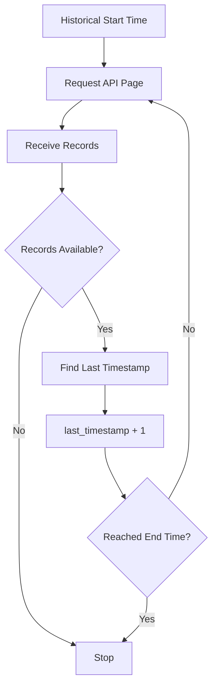

# Long/Short Ratio Collector

## Overview

`collector.py` is responsible for collecting **ETH futures long/short ratio data** from the exchange API.

Its responsibility is strictly **data acquisition**.

```text
Exchange API
     ↓
Long/Short Ratio Collector
     ↓
Raw Long/Short Ratio Data
     ↓
Parser
     ↓
Validator
     ↓
Storage
     ↓
Indicators Analytics
```

The collector does not interpret the long/short ratio or make trading decisions.

---

# Location

```text
D:\Sachin Chakrawarti\eth_bot\data_pipeline\collectors\long_short_ratio\
│
├── collector.py
├── parser.py
├── validator.py
├── config.py
│
└── md\
    ├── collector.md
    ├── parser.md
    ├── validator.md
    └── config.md
```

---

# Responsibility

The collector is responsible for:

* Requesting long/short ratio data.
* Selecting the ETH futures symbol.
* Selecting the aggregation period.
* Selecting the API result limit.
* Supporting historical time ranges.
* Supporting pagination.
* Returning raw API responses.
* Delegating HTTP communication to `RestCollector`.

---

# Non-Responsibilities

The collector does **not**:

* Parse exchange-specific responses.
* Validate normalized records.
* Calculate indicators.
* Calculate signals.
* Predict market direction.
* Predict volatility.
* Generate trades.
* Approve or reject trades.
* Manage risk.
* Execute orders.

The separation is:

```text
Collector
    ↓
Acquisition

Parser
    ↓
Normalization

Validator
    ↓
Data Quality

Analytics
    ↓
Interpretation

Models
    ↓
Prediction

Strategy
    ↓
Trade Signal

Risk Engine
    ↓
Trade Approval / Rejection

Execution Engine
    ↓
Order Execution
```

---

# Main Class

The primary class is:

```python
LongShortRatioCollector
```

It inherits from:

```python
RestCollector
```

This allows the long/short ratio collector to reuse common REST functionality.

Conceptually:

```text
RestCollector
      ↑
      │
LongShortRatioCollector
```

---

# Endpoint

The collector uses:

```text
/futures/data/globalLongShortAccountRatio
```

The endpoint is stored as:

```python
ENDPOINT
```

This keeps the API path centralized instead of scattering it throughout the collector.

---

# Default Symbol

The collector defaults to:

```text
ETHUSDT
```

This matches the ETH futures focus of the project.

Example:

```python
collector = LongShortRatioCollector(
    symbol="ETHUSDT"
)
```

---

# Symbol Normalization

Symbols are normalized to uppercase.

For example:

```text
ethusdt
```

becomes:

```text
ETHUSDT
```

Whitespace is also removed.

Example:

```text
" ETHUSDT "
```

becomes:

```text
ETHUSDT
```

An empty symbol is rejected.

---

# Default Period

The default aggregation period is:

```text
5m
```

This means the collector requests five-minute long/short ratio observations unless another period is specified.

---

# Supported Periods

The collector supports:

```text
5m
15m
30m
1h
2h
4h
6h
12h
1d
```

Unsupported periods are rejected before making the API request.

Example:

```text
10m
```

would be invalid.

---

# Default Limit

The default API limit is:

```text
500
```

The collector allows:

```text
1 ≤ limit ≤ 500
```

This protects the API request from invalid result-size parameters.

---

# Request Object

The module defines:

```python
LongShortRatioRequest
```

This represents long/short ratio request configuration.

Its fields are:

| Field        | Description          |
| ------------ | -------------------- |
| `symbol`     | Futures symbol       |
| `period`     | Aggregation interval |
| `limit`      | Maximum records      |
| `start_time` | Start timestamp      |
| `end_time`   | End timestamp        |

Default values:

```text
symbol     = ETHUSDT
period     = 5m
limit      = 500
start_time = None
end_time   = None
```

---

# Collector Initialization

Example:

```python
collector = LongShortRatioCollector()
```

This creates a collector using the default configuration.

A custom configuration can be supplied:

```python
collector = LongShortRatioCollector(
    symbol="ETHUSDT",
    period="15m",
    limit=500,
)
```

---

# REST Configuration

The collector accepts:

```text
base_url
api_key
api_secret
timeout
```

These are passed to the base REST collector.

Example:

```python
collector = LongShortRatioCollector(
    base_url="...",
    api_key="...",
    api_secret="...",
    timeout=10.0,
)
```

Authentication requirements depend on the exchange endpoint.

---

# `collect()`

The primary acquisition method is:

```python
collect()
```

It supports:

```text
symbol
period
limit
start_time
end_time
```

Example:

```python
data = collector.collect()
```

This requests the latest configured long/short ratio data.

---

# Custom Collection

Example:

```python
data = collector.collect(
    symbol="ETHUSDT",
    period="15m",
    limit=100,
)
```

The collector builds the request parameters and sends them through the base REST collector.

---

# Time-Range Collection

Historical data can be collected using:

```python
collect_range()
```

Example:

```python
data = collector.collect_range(
    start_time=1754006400000,
    end_time=1754092800000,
)
```

Both timestamps use:

```text
Unix milliseconds
```

---

# Time Range Validation

The collector validates that:

```text
start_time >= 0
end_time >= 0
```

and:

```text
start_time <= end_time
```

An invalid range is rejected before making an API request.

---

# Latest Data

For convenience, the collector exposes:

```python
collect_latest()
```

Example:

```python
data = collector.collect_latest()
```

This is intended for current/latest acquisition rather than explicit historical ranges.

---

# Pagination

Long historical periods can contain more records than a single API response can return.

The collector therefore supports:

```python
collect_pages()
```

Example:

```python
pages = collector.collect_pages(
    start_time=start_time,
    end_time=end_time,
)
```

The method repeatedly requests data until the requested range is exhausted.

---

# Pagination Flow

```text
Start Time
    ↓
Request Page 1
    ↓
Extract Last Timestamp
    ↓
Move Start Forward
    ↓
Request Page 2
    ↓
Extract Last Timestamp
    ↓
Move Start Forward
    ↓
...
    ↓
End Time
```

Conceptually:



---

# Pagination Safety

The collector prevents infinite pagination loops.

If the next timestamp does not advance:

```text
next_start <= current_start
```

pagination stops.

This protects the ingestion pipeline from malformed or repeated exchange responses.

---

# Short Page Handling

If an API response contains fewer records than the requested limit:

```text
returned records < requested limit
```

the collector assumes that the available data may have been exhausted and stops pagination.

This reduces unnecessary API calls.

---

# Response Handling

The collector returns the **raw exchange response**.

It does not transform the records.

For example:

```python
response = collector.collect()
```

returns whatever the REST layer returns.

The parser is responsible for converting that response into the internal project schema.

---

# Response Extraction

The collector includes helper logic to handle common response structures.

It can recognize:

```text
list
tuple
```

directly.

It can also look for list-like data under:

```text
data
result
rows
```

when the exchange wraps records inside an object.

---

# Last Timestamp Extraction

Pagination requires knowing the last observation's timestamp.

The collector checks common fields such as:

```text
timestamp
time
T
updateTime
```

The first usable timestamp is converted to an integer.

If no timestamp can be extracted, pagination stops safely.

---

# Parameter Construction

The collector internally builds request parameters such as:

```python
{
    "symbol": "ETHUSDT",
    "period": "5m",
    "limit": 500,
}
```

When a time range is supplied:

```python
{
    "symbol": "ETHUSDT",
    "period": "5m",
    "limit": 500,
    "startTime": 1754006400000,
    "endTime": 1754092800000,
}
```

---

# API Parameter Separation

Internal naming uses:

```text
start_time
end_time
```

while the exchange request uses:

```text
startTime
endTime
```

This keeps the project's Python interface consistent while allowing exchange-specific API parameter names internally.

---

# Validation Before Request

The collector validates:

```text
symbol
period
limit
start_time
end_time
```

before sending the request.

This prevents obvious configuration errors from reaching the exchange API.

---

# Collector Data Flow

The complete long/short ratio pipeline is:

```text
Exchange
   ↓
REST API
   ↓
LongShortRatioCollector
   ↓
Raw Response
   ↓
LongShortRatioParser
   ↓
Normalized Record
   ↓
LongShortRatioValidator
   ↓
Validated Record
   ↓
Storage
```

---

# Recommended File Responsibilities

```text
long_short_ratio/
│
├── collector.py
│   └── Acquire data
│
├── parser.py
│   └── Normalize exchange response
│
├── validator.py
│   └── Validate normalized records
│
└── config.py
    └── Collection configuration
```

Documentation:

```text
md/
├── collector.md
├── parser.md
├── validator.md
└── config.md
```

---

# Relationship With Long/Short Ratio Analytics

The collector only obtains the raw ratio.

For example, it should not calculate:

```text
Long %
Short %
Long/Short change
Extreme positioning
Positioning momentum
Positioning divergence
```

Those belong downstream.

Conceptually:

```text
Raw Long/Short Ratio
        ↓
Parser
        ↓
Validator
        ↓
Indicators Analytics
        ↓
Positioning Features
        ↓
ML Dataset
```

---

# Relationship With ML Models

Long/short ratio data may eventually become model input.

For example:

```text
Long/Short Ratio
        ↓
Historical Features
        ↓
Dataset
        ↓
Direction Model
Volatility Model
Momentum Model
Trend Model
```

The collector itself must remain unaware of those models.

This keeps the data pipeline modular.

---

# Relationship With Risk Engine

The collector has no authority over the risk engine.

```text
Long/Short Ratio Collector
        ↓
Market Data
```

not:

```text
Long/Short Ratio Collector
        ↓
Trade Approval
```

The risk engine operates much later in the trading pipeline.

---

# Error Handling Philosophy

The collector should distinguish between:

### Configuration Errors

Examples:

```text
invalid period
invalid limit
negative timestamp
invalid time range
```

These should fail immediately.

### API Errors

Examples:

```text
HTTP error
authentication error
rate limit
exchange unavailable
network timeout
```

These should be handled by the base REST infrastructure.

### Data Errors

Examples:

```text
missing timestamp
unexpected response structure
invalid record
```

These should ultimately be handled by the parser/validator layer.

---

# Testing

Recommended test location:

```text
D:\Sachin Chakrawarti\eth_bot\
tests\
└── collectors\
    └── long_short_ratio\
        └── test_collector.py
```

---

# Recommended Collector Tests

Tests should cover:

```text
default initialization
custom symbol
symbol normalization
invalid symbol
supported periods
invalid period
valid limits
invalid limits
latest collection
historical collection
invalid timestamp
invalid time range
pagination
empty response
short page
pagination timestamp progression
pagination loop protection
```

---

# Example Acquisition

Conceptually:

```python
collector = LongShortRatioCollector(
    symbol="ETHUSDT",
    period="5m",
)

raw_data = collector.collect_latest()
```

Then:

```text
raw_data
   ↓
parser.py
   ↓
validator.py
   ↓
storage
```

---

# Historical Acquisition

For historical training data:

```python
pages = collector.collect_pages(
    start_time=start_time,
    end_time=end_time,
    symbol="ETHUSDT",
    period="5m",
)
```

The returned pages can then be passed through the parser and validator pipeline.

---

# Production Architecture

The intended architecture is:


---

# Design Principle

The key design principle for `collector.py` is:

> **Collect first, interpret later.**

The collector should remain simple and deterministic.

It acquires exchange data and passes it downstream without embedding:

* trading logic,
* strategy logic,
* risk logic,
* model logic,
* feature engineering logic.

This separation makes the ETH futures data pipeline easier to test, replace, extend, and maintain.

---

# Final Responsibility

`long_short_ratio/collector.py` has one primary responsibility:

> **Acquire raw ETH futures long/short ratio observations from the exchange API, including current and historical data, while handling request configuration and pagination without performing parsing, validation, analytics, strategy, risk management, or execution.**
