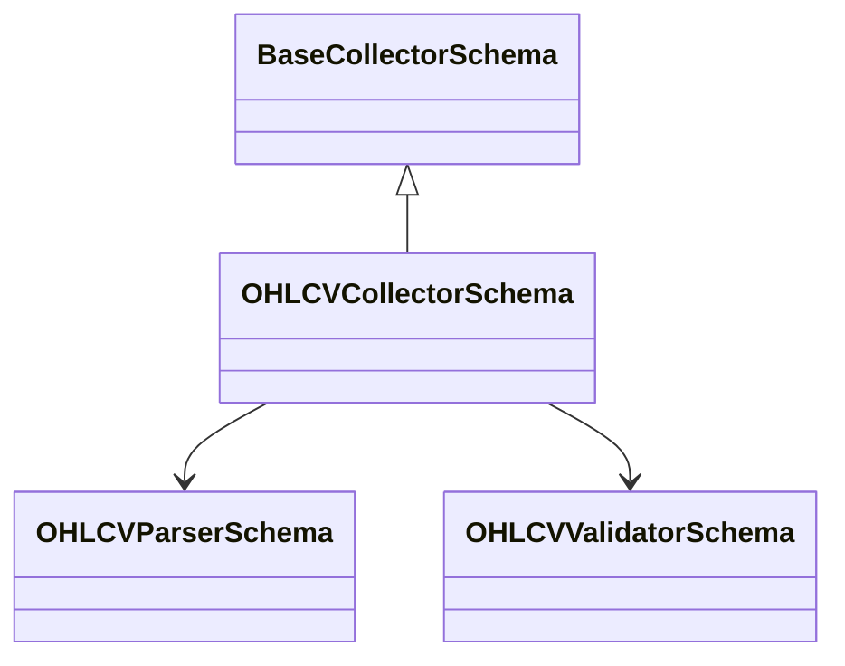
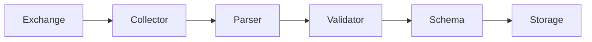
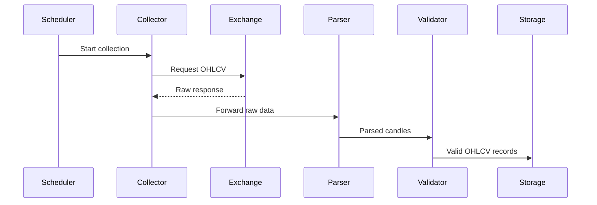

# OHLCV Collector Schema

## Overview

The **OHLCV Collector** is responsible for collecting Open, High, Low, Close, and Volume (OHLCV) market data from supported cryptocurrency exchanges.

It is the first stage of the ETH Bot data pipeline and provides standardized candle data for downstream processing, feature engineering, model training, and live trading.

This document defines the **collector schema** and its responsibilities. It is not an implementation guide.

---

# Purpose

The OHLCV Collector is responsible for:

- Connecting to exchange APIs
- Collecting historical OHLCV candles
- Collecting real-time candle updates
- Supporting incremental synchronization
- Returning raw exchange data
- Forwarding data to the parser

It is **not** responsible for:

- Data parsing
- Data validation
- Feature engineering
- Database storage
- Technical indicator calculation
- Trading logic

---

# Pipeline Position

```mermaid
flowchart LR

Exchange API

-->

OHLCV Collector

-->

OHLCV Parser

-->

OHLCV Validator

-->

Raw OHLCV Schema

-->

Raw Storage
```

---

# Collector Architecture



---

# Responsibilities

| Responsibility | Supported |
|---------------|-----------|
| Historical collection | ✅ |
| Live collection | ✅ |
| Incremental updates | ✅ |
| REST API | ✅ |
| WebSocket | ✅ |
| Retry support | ✅ |
| Rate-limit handling | ✅ |
| Error logging | ✅ |

---

# Data Sources

Supported collection methods:

| Source | Purpose |
|---------|----------|
| REST API | Historical candles |
| WebSocket | Live candle updates |
| Cached storage | Recovery and synchronization |

---

# Supported Timeframes

Example supported intervals:

```text
1m
3m
5m
15m
30m
1h
4h
12h
1d
1w
1M
```

The actual list depends on the exchange.

---

# Collection Modes

## Historical Collection

Downloads historical candles.

Example:

```text
2023-01-01

↓

2026-08-01
```

Used for:

- Backtesting
- Model training
- Dataset generation

---

## Live Collection

Receives new candles continuously through WebSocket or scheduled REST polling.

```text
Current Candle

↓

Next Candle

↓

Next Candle
```

---

## Incremental Collection

Downloads only missing candles.

```text
Database

↓

Last Candle

↓

Exchange

↓

Missing Candles

↓

Append
```

---

# Inputs

| Input | Description |
|--------|-------------|
| Symbol | Trading pair |
| Timeframe | Candle interval |
| Start time | Historical start |
| End time | Historical end |
| Collection mode | Historical / Live / Incremental |

---

# Outputs

The collector forwards raw exchange responses to the parser.

Output schema:

```text
RawOHLCVSchema
```

---

# Configuration

Typical configuration includes:

| Setting | Purpose |
|---------|----------|
| Exchange | Data provider |
| Symbol | ETHUSDT |
| Market type | Futures |
| Timeframe | 1h |
| Rate limit | API protection |
| Retry count | Failure recovery |
| Timeout | Request timeout |

---

# Error Handling

The collector should handle:

- Network failures
- API downtime
- Rate limiting
- Invalid responses
- Authentication failures
- Timeout errors
- Duplicate requests
- Partial downloads

Recovery mechanisms may include:

- Retry with backoff
- Resume from last successful candle
- Logging and alerting

---

# Interaction With Other Components

```mermaid
flowchart TD

Scheduler

-->

OHLCV Collector

Exchange API

-->

OHLCV Collector

OHLCV Collector

-->

Parser

Parser

-->

Validator

Validator

-->

Raw Schema

Raw Schema

-->

Raw Storage
```

---

# Data Flow



---

# Sequence Diagram



---

# Dependencies

The collector depends on:

- Base Collector
- REST Collector
- WebSocket Collector
- Scheduler
- Retry utilities
- Exchange configuration
- Parser
- Validator

---

# Design Principles

```mermaid
mindmap

root((OHLCV Collector))

    Modular

    Reliable

    Exchange Independent

    Fault Tolerant

    Incremental

    Reusable

    Scalable

    Configurable
```

---

# Future Enhancements

Potential future capabilities:

- Multi-exchange aggregation
- Parallel historical downloads
- Automatic gap detection
- Adaptive rate limiting
- Exchange failover
- Streaming persistence
- Distributed collection
- Metrics and health monitoring

---

# Summary

The **OHLCV Collector** is responsible for retrieving raw candle data from supported exchanges and forwarding it to the parsing stage of the data pipeline.

It supports historical, live, and incremental collection while remaining independent of parsing, validation, storage, and trading logic. This separation of responsibilities makes the collector modular, reusable, and scalable within the ETH Bot architecture.

```mermaid
flowchart TD

Exchange API

-->

OHLCV Collector

-->

OHLCV Parser

-->

OHLCV Validator

-->

Raw OHLCV Schema

-->

Raw Storage

-->

Processed Data Pipeline
```