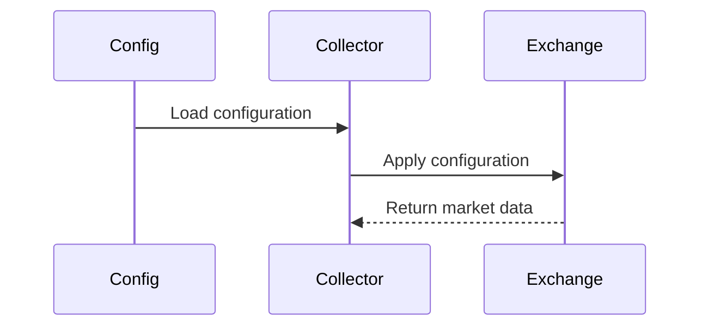
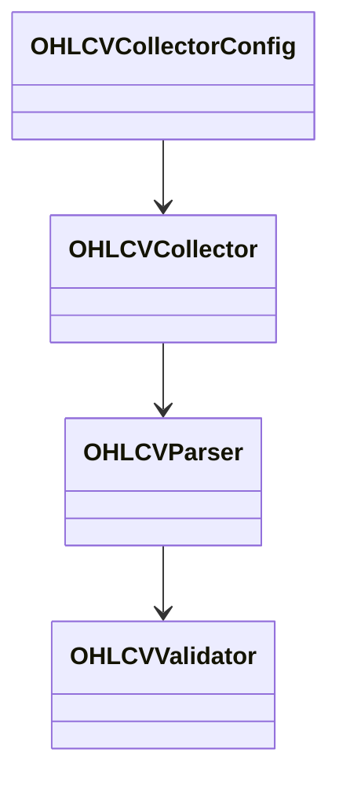

# OHLCV Collector Configuration Schema

## Overview

The **OHLCV Collector Configuration Schema** defines the configurable parameters used by the OHLCV Collector within the ETH Bot data pipeline.

It specifies the configuration structure required to control how OHLCV market data is collected from supported cryptocurrency exchanges.

This schema documents the configuration contract only. Actual configuration values are supplied through external configuration files (for example, `pipeline.yaml`, exchange-specific configuration files, or environment variables).

---

# Purpose

The configuration schema allows the OHLCV Collector to be configured without modifying application code.

It provides configuration for:

- Exchange selection
- Market selection
- Collection mode
- Historical collection
- Live collection
- Retry policy
- Rate limiting
- Validation options
- Output settings
- Logging

---

# Architecture Position

```mermaid
flowchart LR

Configuration Files

-->

OHLCV Configuration

-->

OHLCV Collector

-->

Exchange API
```

---

# Configuration Hierarchy

```text
config/
│
├── pipeline.yaml
├── scheduler.yaml
├── storage.yaml
│
└── exchanges/
    ├── binance.yaml
    ├── bybit.yaml
    └── okx.yaml
```

The schema defines the expected structure used by these configuration files.

---

# Configuration Sections

## Exchange Configuration

| Field | Description |
|--------|-------------|
| exchange | Exchange name |
| market_type | Spot or Futures |

Example

```yaml
exchange: binance

market_type: futures
```

---

## Market Configuration

| Field | Description |
|--------|-------------|
| symbol | Trading pair |
| timeframe | Candle interval |

Example

```yaml
symbol: ETHUSDT

timeframe: 1h
```

---

## Collection Mode

Supported modes:

| Mode | Description |
|------|-------------|
| historical | Download historical candles |
| live | Collect live candles |
| incremental | Download only missing candles |

Example

```yaml
mode: historical
```

---

## Historical Collection

| Field | Description |
|--------|-------------|
| start_time | Beginning of collection |
| end_time | End of collection |
| limit | Maximum candles per request |

Example

```yaml
start_time: 2023-01-01

end_time: 2026-08-01

limit: 1000
```

---

## Live Collection

| Field | Description |
|--------|-------------|
| websocket_enabled | Enable WebSocket streaming |
| polling_interval | REST polling interval (seconds) |

Example

```yaml
websocket_enabled: true

polling_interval: 60
```

---

## Retry Policy

| Field | Description |
|--------|-------------|
| max_retries | Maximum retry attempts |
| retry_delay | Initial retry delay |
| exponential_backoff | Enable exponential retry |

Example

```yaml
max_retries: 5

retry_delay: 2

exponential_backoff: true
```

---

## Network Configuration

| Field | Description |
|--------|-------------|
| timeout | Request timeout |
| rate_limit_per_second | Maximum requests per second |

Example

```yaml
timeout: 30

rate_limit_per_second: 10
```

---

## Output Configuration

| Field | Description |
|--------|-------------|
| output_format | Storage format |
| compression | Compression algorithm |

Supported formats:

```text
parquet

csv

json
```

Example

```yaml
output_format: parquet

compression: snappy
```

---

## Validation Configuration

| Field | Description |
|--------|-------------|
| validate_data | Validate collected data |
| remove_duplicates | Remove duplicate candles |
| fill_missing | Fill missing values |

Example

```yaml
validate_data: true

remove_duplicates: true

fill_missing: false
```

---

## Logging Configuration

| Field | Description |
|--------|-------------|
| log_level | Logging verbosity |

Supported values

```text
DEBUG

INFO

WARNING

ERROR
```

---

# Configuration Flow

```mermaid
flowchart TD

Pipeline Configuration

-->

OHLCV Config

-->

Collector

-->

Exchange

-->

Parser

-->

Validator
```

---

# Runtime Workflow



---

# Example Configuration

```yaml
exchange: binance

market_type: futures

symbol: ETHUSDT

timeframe: 1h

mode: historical

start_time: 2023-01-01

end_time: 2026-08-01

limit: 1000

websocket_enabled: true

polling_interval: 60

max_retries: 5

retry_delay: 2

exponential_backoff: true

timeout: 30

rate_limit_per_second: 10

output_format: parquet

compression: snappy

validate_data: true

remove_duplicates: true

fill_missing: false

log_level: INFO
```

---

# Relationships



---

# Design Principles

```mermaid
mindmap

root((OHLCV Config))

    External Configuration

    Exchange Independent

    Reusable

    Flexible

    Scalable

    Version Controlled

    Environment Aware

    Easy Deployment
```

---

# Best Practices

- Keep configuration separate from implementation.
- Use environment-specific configuration files for development, testing, and production.
- Store API credentials in environment variables or secret managers rather than configuration files.
- Validate configuration values during application startup.
- Version configuration changes alongside the application.

---

# Future Enhancements

Possible future additions:

- Multi-exchange configuration
- Automatic failover settings
- Dynamic timeframe selection
- Proxy configuration
- Regional endpoint selection
- Distributed collection settings
- Health-check configuration
- Metrics and monitoring options

---

# Summary

The **OHLCV Collector Configuration Schema** defines the complete configuration contract for the OHLCV Collector.

By separating configuration from implementation, the ETH Bot data pipeline becomes easier to maintain, deploy, and extend across different exchanges, environments, and collection modes while ensuring consistent and reproducible data collection.

```mermaid
flowchart TD

Configuration Files

-->

OHLCV Configuration Schema

-->

OHLCV Collector

-->

Exchange API

-->

Raw OHLCV Data

-->

Parser

-->

Validator

-->

Raw Storage
```