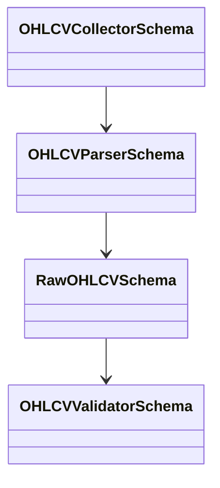
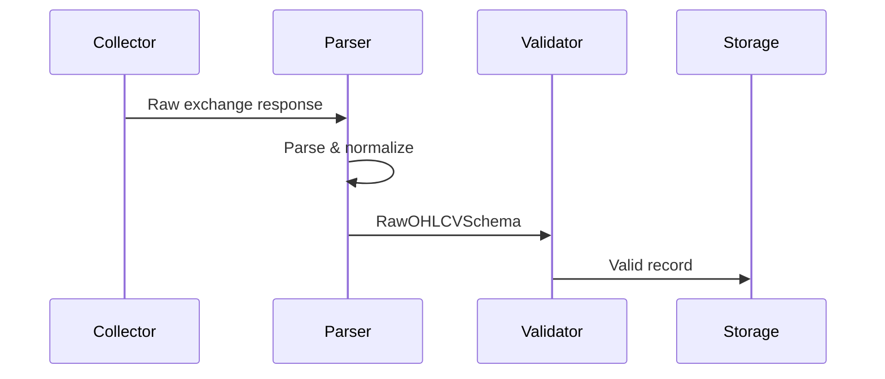

# OHLCV Parser Schema

## Overview

The **OHLCV Parser** is responsible for transforming raw OHLCV data received from cryptocurrency exchanges into the standardized **Raw OHLCV Schema** used throughout the ETH Bot data pipeline.

It converts exchange-specific response formats into a unified internal representation while preserving the original market information.

The parser performs **data transformation only**. It does **not** validate data quality, store records, or calculate technical indicators.

---

# Purpose

The OHLCV Parser is responsible for:

- Parsing REST API responses
- Parsing WebSocket messages
- Mapping exchange fields to the internal schema
- Normalizing timestamps
- Converting numeric values
- Standardizing symbols and timeframes
- Producing `RawOHLCVSchema` objects

The parser is **not** responsible for:

- Downloading market data
- Data validation
- Database storage
- Duplicate detection
- Feature engineering
- Indicator calculation
- Trading decisions

---

# Pipeline Position

```mermaid
flowchart LR

Exchange API

-->

OHLCV Collector

-->

OHLCV Parser

-->

Raw OHLCV Schema

-->

OHLCV Validator

-->

Raw Storage
```

---

# Parser Architecture



---

# Responsibilities

| Responsibility | Supported |
|---------------|-----------|
| Parse REST responses | ✅ |
| Parse WebSocket messages | ✅ |
| Timestamp normalization | ✅ |
| Numeric conversion | ✅ |
| Symbol normalization | ✅ |
| Timeframe normalization | ✅ |
| Raw schema creation | ✅ |

---

# Input

Supported sources:

| Source | Description |
|--------|-------------|
| REST API | Historical OHLCV |
| WebSocket | Live candle updates |

Typical exchange response:

```json
[
  1723036800000,
  "3512.45",
  "3520.18",
  "3508.22",
  "3516.90",
  "1248.56"
]
```

---

# Parsing Process

```mermaid
flowchart TD

Raw Response

-->

Extract Fields

-->

Normalize Values

-->

Convert Data Types

-->

Build Raw OHLCV Schema
```

---

# Field Mapping

Example mapping:

| Exchange Field | Internal Field |
|---------------|----------------|
| Open Time | timestamp |
| Open | open |
| High | high |
| Low | low |
| Close | close |
| Volume | volume |

Additional exchange-specific fields may also be mapped when available.

---

# Timestamp Normalization

The parser converts exchange timestamps into a consistent internal format.

Example:

```text
Exchange

1723036800000

↓

UTC Datetime

2024-08-08T00:00:00Z
```

---

# Numeric Conversion

The parser converts string values into numeric types.

Example:

```text
"3512.45"

↓

3512.45
```

Supported conversions include:

- Open
- High
- Low
- Close
- Volume
- Quote volume
- Trade count

---

# Symbol Normalization

Example:

```text
ETHUSDT

↓

ETHUSDT
```

The parser standardizes symbol formatting across exchanges.

---

# Timeframe Normalization

Example:

```text
60m

↓

1h
```

This ensures a consistent timeframe representation throughout the pipeline.

---

# Output

The parser outputs standardized records using:

```text
RawOHLCVSchema
```

These records are forwarded to the validator.

---

# Data Flow

```mermaid
flowchart LR

Exchange Response

-->

Parser

-->

Raw OHLCV Schema

-->

Validator
```

---

# Runtime Workflow



---

# Error Handling

The parser should gracefully handle:

- Missing fields
- Invalid timestamps
- Incorrect numeric values
- Unexpected response formats
- Empty responses
- Unsupported exchange formats

Recovery strategies may include:

- Skipping invalid records
- Logging parsing errors
- Returning structured parser exceptions

---

# Dependencies

The parser depends on:

- OHLCV Collector
- Raw OHLCV Schema
- Exchange response format
- Time conversion utilities
- Numeric conversion utilities

---

# Relationship With Other Components

```mermaid
flowchart TD

Collector

-->

Parser

-->

Raw Schema

-->

Validator

-->

Storage
```

---

# Design Principles

```mermaid
mindmap

root((OHLCV Parser))

    Exchange Independent

    Deterministic

    Stateless

    Lightweight

    Reusable

    Fast

    Reliable

    Extensible
```

---

# Future Enhancements

Future versions may include:

- Multi-exchange mapping profiles
- Automatic exchange format detection
- Streaming parser optimization
- Batch parsing
- Custom field mapping
- Schema evolution support
- Performance metrics
- Parsing diagnostics

---

# Summary

The **OHLCV Parser** converts raw exchange responses into the standardized **Raw OHLCV Schema** used by the ETH Bot.

By separating parsing from collection and validation, the data pipeline remains modular, exchange-independent, and easy to extend. This design ensures that all downstream components receive consistent, normalized OHLCV data regardless of the originating exchange.

```mermaid
flowchart TD

Exchange API

-->

Collector

-->

Parser

-->

Raw OHLCV Schema

-->

Validator

-->

Raw Storage

-->

Processed Data Pipeline
```