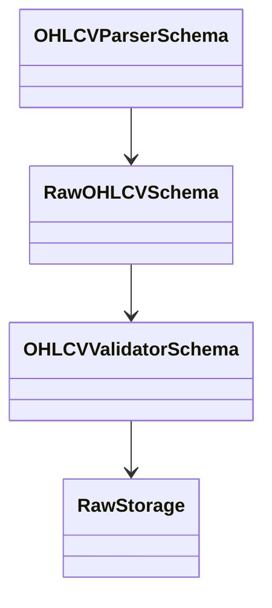
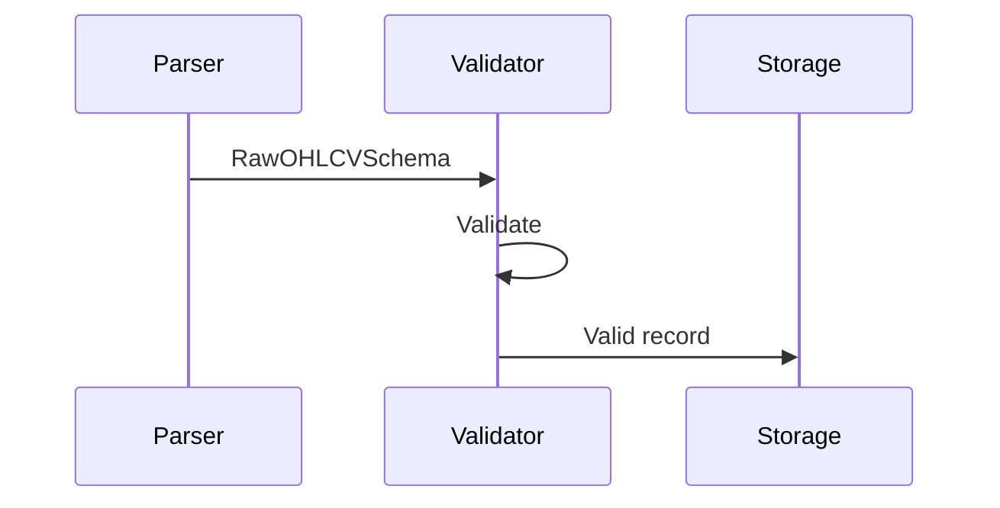

# OHLCV Validator Schema

## Overview

The **OHLCV Validator** is responsible for validating standardized OHLCV records before they are stored in the Raw Data layer.

It verifies that parsed candle data conforms to the **Raw OHLCV Schema**, satisfies business rules, and maintains data quality throughout the ETH Bot data pipeline.

The validator performs **validation only**. It does not collect data, parse exchange responses, calculate indicators, or store records.

---

# Purpose

The OHLCV Validator is responsible for:

- Validating required fields
- Validating timestamps
- Validating OHLC relationships
- Validating volume values
- Validating data types
- Detecting duplicate candles
- Checking chronological order
- Producing validated records

The validator is **not** responsible for:

- Downloading market data
- Parsing exchange responses
- Database storage
- Feature engineering
- Technical indicator calculation
- AI model preparation
- Trading logic

---

# Pipeline Position

```mermaid
flowchart LR

Exchange API

-->

Collector

-->

Parser

-->

Raw OHLCV Schema

-->

OHLCV Validator

-->

Raw Storage
```

---

# Validator Architecture



---

# Responsibilities

| Responsibility | Supported |
|---------------|-----------|
| Required field validation | ✅ |
| Timestamp validation | ✅ |
| Symbol validation | ✅ |
| Timeframe validation | ✅ |
| Price validation | ✅ |
| Volume validation | ✅ |
| Data type validation | ✅ |
| Duplicate detection | ✅ |
| Chronological validation | ✅ |

---

# Input

The validator receives standardized records from the parser.

Input schema:

```text
RawOHLCVSchema
```

Example:

```json
{
  "timestamp": "2026-08-05T12:00:00Z",
  "symbol": "ETHUSDT",
  "timeframe": "1h",
  "open": 3520.25,
  "high": 3532.60,
  "low": 3518.10,
  "close": 3528.40,
  "volume": 1423.84
}
```

---

# Validation Workflow

```mermaid
flowchart TD

Raw OHLCV Record

-->

Required Field Validation

-->

Data Type Validation

-->

Business Rule Validation

-->

Duplicate Detection

-->

Chronological Validation

-->

Validated Record
```

---

# Required Field Validation

Mandatory fields include:

| Field |
|--------|
| timestamp |
| symbol |
| timeframe |
| open |
| high |
| low |
| close |
| volume |

Missing required fields result in validation failure.

---

# Timestamp Validation

Checks include:

- Valid timestamp format
- UTC normalization
- No invalid dates
- No duplicate timestamps for the same symbol/timeframe

Example:

```text
2026-08-05T12:00:00Z

✔ Valid
```

---

# Symbol Validation

Examples:

```text
ETHUSDT

✔ Valid
```

```text
ETH/USD

✖ Invalid
```

Validation rules should match the exchange and project configuration.

---

# Timeframe Validation

Supported examples:

```text
1m
5m
15m
1h
4h
1d
```

---

# OHLC Price Validation

The validator checks logical candle relationships.

Rules:

```text
High ≥ Open

High ≥ Close

High ≥ Low

Low ≤ Open

Low ≤ Close

Low ≤ High
```

Invalid example:

```text
Open = 3500

High = 3490

✖ Invalid
```

---

# Volume Validation

Rules:

```text
Volume ≥ 0
```

Example:

```text
1523.42

✔ Valid
```

Negative values are rejected.

---

# Data Type Validation

Expected types:

| Field | Type |
|--------|------|
| timestamp | datetime |
| symbol | string |
| timeframe | string |
| open | float |
| high | float |
| low | float |
| close | float |
| volume | float |

---

# Duplicate Detection

Duplicate records are identified using:

```text
Symbol

+

Timeframe

+

Timestamp
```

Duplicates may be:

- Rejected
- Ignored
- Replaced

depending on pipeline configuration.

---

# Chronological Validation

Candles must follow ascending time order.

Example:

```text
10:00

↓

11:00

↓

12:00
```

Out-of-order records should be flagged.

---

# Output

Successful validation returns:

```text
Validated RawOHLCVSchema
```

Failed validation returns:

- Validation error
- Structured error message
- Log entry (depending on configuration)

---

# Runtime Workflow



---

# Error Handling

The validator should detect:

- Missing fields
- Invalid timestamps
- Invalid symbols
- Invalid timeframes
- Incorrect data types
- Invalid OHLC relationships
- Negative volume
- Duplicate candles
- Out-of-order records

Configurable actions:

- Reject
- Skip
- Log
- Retry (handled upstream)

---

# Dependencies

The validator depends on:

- RawOHLCVSchema
- Exchange configuration
- Symbol configuration
- Timeframe configuration
- Validation utilities

---

# Relationship With Other Components

```mermaid
flowchart TD

Collector

-->

Parser

-->

RawOHLCVSchema

-->

Validator

-->

Raw Storage
```

---

# Design Principles

```mermaid
mindmap

root((OHLCV Validator))

    Deterministic

    Stateless

    Reliable

    Fast

    Reusable

    Configurable

    Data Quality

    Extensible
```

---

# Future Enhancements

Future improvements may include:

- Exchange-specific validation profiles
- Market holiday awareness
- Gap detection
- Statistical anomaly detection
- Dynamic validation rules
- Cross-exchange consistency checks
- Automated data quality scoring
- Validation metrics dashboard

---

# Summary

The **OHLCV Validator** is responsible for ensuring that standardized OHLCV records are complete, logically consistent, and conform to the project's data quality standards before entering the Raw Storage layer.

By separating validation from collection, parsing, and storage, the ETH Bot maintains a modular and maintainable data pipeline. This design ensures that downstream ETL, feature engineering, and machine learning components always operate on high-quality market data.

```mermaid
flowchart TD

Exchange API

-->

Collector

-->

Parser

-->

RawOHLCVSchema

-->

Validator

-->

Validated OHLCV

-->

Raw Storage

-->

Processed Data Pipeline
```