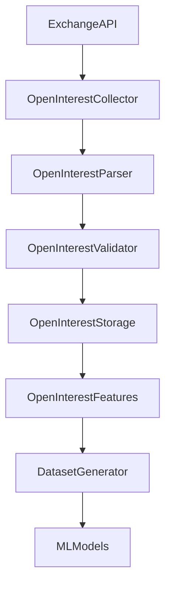
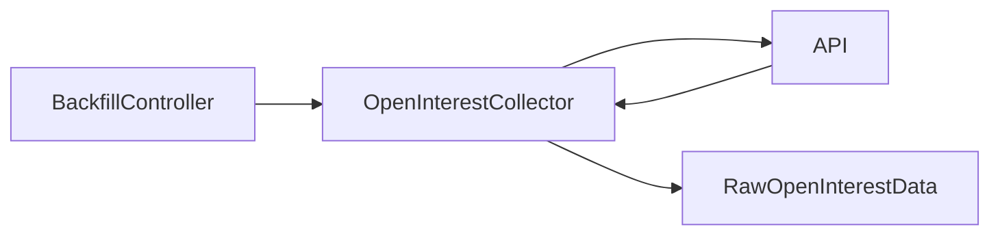

# Open Interest Collector

## Overview

The **Open Interest Collector** is responsible for acquiring open-interest data for the ETH futures market from the exchange and passing the raw response to the parsing layer.

It is part of the ingestion layer of the ETH Bot data pipeline.

```text
Exchange API
     ↓
Open Interest Collector
     ↓
Open Interest Parser
     ↓
Open Interest Validator
     ↓
Raw / Validated Storage
     ↓
Open Interest Features
```

The collector only handles **data acquisition**. It does not interpret open interest or make trading decisions.

---

# Location

```text
D:\Sachin Chakrawarti\eth_bot\data_pipeline\collectors\open_interest\
│
├── collector.py
├── parser.py
├── validator.py
├── config.py
│
└── md\
    ├── collector.md
    ├── parser.md
    ├── validator.md
    └── config.md
```

---

# Main Class

The implementation is:

```python
OpenInterestCollector
```

The class extends the shared REST collector:

```python
RestCollector
```

This keeps common HTTP functionality outside the open-interest-specific collector.

---

# Responsibilities

The collector is responsible for:

* Requesting open-interest data.
* Supporting the ETHUSDT futures market.
* Requesting the latest open-interest records.
* Requesting historical open-interest records.
* Supporting configurable time periods.
* Supporting configurable request limits.
* Handling historical pagination.
* Normalizing request timestamps.
* Extracting records from common API response wrappers.
* Removing duplicate records returned across pagination boundaries.
* Returning raw exchange records.

---

# Non-Responsibilities

The collector does **not**:

* Normalize exchange-specific field names.
* Convert raw strings into standardized data types.
* Validate open-interest values.
* Calculate open-interest features.
* Calculate OI changes.
* Calculate OI momentum.
* Generate trading signals.
* Execute trades.
* Manage risk.
* Write directly to the final feature dataset.

Those responsibilities belong to downstream modules.

---

# Architectural Boundary

The collector follows this rule:

> **Collector = acquire raw data.**

The complete separation is:

```text
Collector
    ↓
Acquire

Parser
    ↓
Normalize

Validator
    ↓
Validate

Features
    ↓
Analyze

Strategy
    ↓
Generate Signal

Risk Engine
    ↓
Approve / Reject

Execution Engine
    ↓
Execute
```

---

# Default Market

The default symbol is:

```text
ETHUSDT
```

This keeps the collector aligned with the ETH futures scope of the trading system.

The symbol remains configurable so the collector can be reused for testing or alternate market environments.

---

# Default Period

The default open-interest interval is:

```text
1h
```

This means the collector is designed to support hourly open-interest history as the default dataset frequency.

The period can be changed through configuration.

---

# Default Request Limit

The default request size is:

```text
500
```

The maximum configured request size is also:

```text
500
```

The collector therefore prevents requests from exceeding the supported exchange/API boundary configured by the module.

---

# Endpoint

The default endpoint is:

```text
/futures/data/openInterestHist
```

The endpoint is configurable rather than being hard-coded throughout the collection logic.

---

# Latest Data Collection

The public method:

```python
collect_latest()
```

requests the latest open-interest records.

Example:

```python
records = collector.collect_latest()
```

The collector builds the request using:

```text
symbol
period
limit
```

and sends the request through the configured REST client.

---

# Latest Request Flow

```text
collect_latest()
      ↓
_build_params()
      ↓
_request()
      ↓
Exchange API
      ↓
_extract_records()
      ↓
Raw Records
```

The returned records are still raw exchange records.

---

# Historical Data Collection

The public method:

```python
collect_historical()
```

is used when historical open-interest data is required.

Example:

```python
records = collector.collect_historical(
    start_time=start_time,
    end_time=end_time,
)
```

The collector repeatedly requests pages until the requested time range is covered or pagination can no longer continue.

---

# Historical Collection Flow

```text
Start Time
    ↓
Build Request
    ↓
Exchange API
    ↓
Receive Page
    ↓
Extract Records
    ↓
Find Latest Timestamp
    ↓
Move Pagination Cursor
    ↓
Request Next Page
    ↓
Repeat
```

---

# Pagination

Historical open-interest data can require multiple API requests.

The collector therefore supports pagination.

Conceptually:

```text
Page 1
  ↓
Page 2
  ↓
Page 3
  ↓
Page 4
  ↓
...
```

Pagination stops when one of the termination conditions is reached.

---

# Pagination Termination Conditions

Historical collection stops when:

1. The API returns no records.
2. The requested end time has been reached.
3. The next timestamp cannot be determined.
4. Pagination makes no forward progress.
5. `max_pages` is reached.
6. The next cursor reaches or exceeds the requested end time.

This prevents accidental infinite request loops.

---

# Maximum Pages

The default maximum number of pages is:

```text
100
```

This provides a safety boundary around historical collection.

The value is configurable.

Example:

```python
collector.max_pages = 200
```

should only be used when the configured exchange/API limits make that appropriate.

---

# Timestamp Normalization

The collector accepts historical boundaries as:

```text
Unix seconds
Unix milliseconds
datetime
```

Examples:

```python
start_time = 1754006400
```

or:

```python
start_time = 1754006400000
```

or:

```python
start_time = datetime(...)
```

The collector converts these to:

```text
Unix milliseconds
```

before sending the request.

---

# Naive Datetime Handling

When a Python `datetime` has no timezone information, the collector interprets it as UTC.

Example:

```python
datetime(
    2026,
    8,
    5,
    12,
    0,
)
```

is treated as:

```text
UTC
```

The final request timestamp is expressed as Unix milliseconds.

---

# Timestamp Safety

Negative timestamps are rejected.

Boolean values are also rejected as timestamps.

This prevents accidental inputs such as:

```python
start_time=True
```

from being interpreted as a valid timestamp.

---

# Unified `collect()` Method

The collector exposes:

```python
collect()
```

as a unified interface.

Without `start_time`:

```python
collector.collect()
```

performs latest-data collection.

With `start_time`:

```python
collector.collect(
    start_time=start_time,
    end_time=end_time,
)
```

performs historical collection.

This gives downstream code a single entry point when the collection mode is dynamic.

---

# Request Parameters

The collector can construct requests using:

```text
symbol
period
limit
startTime
endTime
```

Example conceptual request:

```text
symbol=ETHUSDT
period=1h
limit=500
startTime=<timestamp>
endTime=<timestamp>
```

`startTime` and `endTime` are only included when required.

---

# Response Handling

Exchange APIs may return data in different wrappers.

The collector supports common structures such as:

### Direct list

```json
[
    {
        "symbol": "ETHUSDT",
        "sumOpenInterest": "123456.78"
    }
]
```

### Data wrapper

```json
{
    "data": [
        {
            "symbol": "ETHUSDT",
            "sumOpenInterest": "123456.78"
        }
    ]
}
```

### Result wrapper

```json
{
    "result": [
        {
            "symbol": "ETHUSDT",
            "sumOpenInterest": "123456.78"
        }
    ]
}
```

### Rows wrapper

```json
{
    "rows": [
        {
            "symbol": "ETHUSDT",
            "sumOpenInterest": "123456.78"
        }
    ]
}
```

### List wrapper

```json
{
    "list": [
        {
            "symbol": "ETHUSDT",
            "sumOpenInterest": "123456.78"
        }
    ]
}
```

---

# `_extract_records()`

The method:

```python
_extract_records()
```

extracts raw records from common exchange response structures.

Its purpose is **response extraction**, not field normalization.

For example, it does not convert:

```text
sumOpenInterest
```

into:

```text
open_interest
```

That belongs to:

```text
parser.py
```

---

# Raw Data Preservation

The collector should preserve the exchange response values.

For example:

```json
{
    "symbol": "ETHUSDT",
    "sumOpenInterest": "123456.78",
    "timestamp": 1754006400000
}
```

should remain structurally unchanged when returned by the collector.

The parser later converts it into the standardized schema.

---

# Collector → Parser Contract

The intended relationship is:

```text
OpenInterestCollector
        ↓
Raw Exchange Record
        ↓
OpenInterestParser
        ↓
Standardized Open Interest Record
```

The collector therefore should not duplicate parser logic.

---

# Pagination Cursor

The collector determines the next pagination position from common timestamp fields:

```text
timestamp
time
T
openTime
open_time
```

The latest timestamp in the current page is selected.

The next request begins after that timestamp.

Conceptually:

```text
Current page:

T1
T2
T3
T4
T5

Next cursor:

T5 + 1
```

This reduces the possibility of requesting the exact same page repeatedly.

---

# Duplicate Removal

Pagination APIs can sometimes return overlapping records.

The collector therefore performs a final deduplication step.

The deduplication key is conceptually:

```text
symbol + timestamp
```

Example:

```text
ETHUSDT + 1754006400000
```

appearing twice results in only one record in the returned collection.

---

# Why Deduplication Exists in the Collector

Deduplication here is a **collection safeguard**, not the final data-quality validation.

The validator still has responsibility for identifying duplicates in the standardized dataset.

The layers therefore remain:

```text
Collector
    ↓
Prevent obvious pagination duplication

Validator
    ↓
Enforce dataset-level data quality
```

---

# REST Client

The collector expects a REST client to be supplied.

Example conceptually:

```python
collector = OpenInterestCollector(
    client=rest_client
)
```

The collector does not create exchange-specific networking logic internally.

The shared REST infrastructure handles common HTTP concerns.

---

# Base REST Collector

The inheritance relationship is:

```text
RestCollector
      ↑
      │
OpenInterestCollector
```

The base class should provide shared functionality such as:

* HTTP execution.
* Authentication where required.
* Timeouts.
* Retry integration.
* Common request handling.
* Network error handling.

The open-interest collector should remain focused on open-interest-specific request construction and pagination.

---

# Request Method

The collector delegates requests through:

```python
_request()
```

The method attempts to use the shared collector request interface.

If the base class exposes:

```python
request()
```

that interface is preferred.

Otherwise, the configured REST client may expose:

```python
client.get()
```

The collector therefore remains compatible with the shared REST architecture while keeping the exchange request details localized.

---

# Configuration

The collector can receive configuration either as:

```text
Mapping
```

or:

```text
Configuration object
```

For example:

```python
config = {
    "symbol": "ETHUSDT",
    "period": "1h",
    "limit": 500,
}
```

or an object with equivalent attributes.

---

# Configuration Values

Supported configuration values include:

```text
symbol
period
limit
max_pages
endpoint
```

---

# Configuration Validation

The collector validates configuration during initialization.

Invalid configurations include:

```text
empty symbol
non-string symbol
empty period
non-string period
limit <= 0
limit > 500
max_pages <= 0
```

This prevents invalid requests from reaching the exchange.

---

# Error Handling

The collector should fail explicitly when:

* No REST client is configured.
* The REST client does not provide a supported request method.
* The API response has an unsupported structure.
* Invalid pagination timestamps are encountered.
* Historical timestamps are invalid.
* Configuration is invalid.

It should not silently fabricate missing open-interest data.

---

# No Feature Engineering

The collector should never calculate:

```text
open_interest_change
open_interest_change_pct
open_interest_momentum
open_interest_ma
open_interest_zscore
open_interest_price_divergence
```

These are downstream features.

The collector only obtains the underlying data.

---

# Open Interest Data Flow



---

# Relationship With Other Market Data

Open interest should eventually be combined with other ETH futures data.

For example:

```text
OHLCV
Trades
Order Book
Funding Rate
Open Interest
Liquidations
Long/Short Ratio
Options
Market Sentiment
On-chain Data
```

The collector should keep open-interest acquisition independent from those other collectors.

---

# Why Separate Collectors Exist

The data sources have different:

* API endpoints.
* Request parameters.
* Update frequencies.
* Historical availability.
* Response schemas.
* Pagination behavior.
* Rate limits.

Therefore:

```text
ohlcv/
trades/
orderbook/
funding_rate/
open_interest/
liquidations/
```

should remain separate collector modules while sharing common infrastructure.

---

# Interaction With Scheduler

The scheduler can trigger open-interest collection periodically.

Conceptually:

```text
Scheduler
    ↓
OpenInterestCollector
    ↓
Latest Open Interest
    ↓
Parser
    ↓
Validator
    ↓
Storage
```

For example, if the configured period is hourly, the scheduler can periodically request the newest available observation.

The collector itself should not contain scheduling loops.

---

# Collector and Scheduler Separation

The collector answers:

> How do I retrieve open-interest data?

The scheduler answers:

> When should open-interest data be retrieved?

This keeps both components independently testable.

---

# Historical Backfill

The collector can also support historical backfilling.

Example:

```text
5 years
   ↓
Month / week / API page
   ↓
Open Interest Collector
   ↓
Historical Records
```

The exact backfill orchestration should remain outside the collector.

The collector should provide the primitive required to retrieve a requested historical range.

---

# Historical Data Flow



---

# Data Quality Boundary

The collector does not decide whether an observation is scientifically or statistically valid.

For example, if the exchange returns:

```text
sumOpenInterest = "0"
```

the collector should not automatically decide that this is invalid.

That decision belongs to:

```text
open_interest/validator.py
```

This prevents collection logic from being mixed with domain validation.

---

# Testing

Recommended test location:

```text
tests/
└── collectors/
    └── open_interest/
        └── test_collector.py
```

Tests should cover:

### Configuration

```text
default symbol
custom symbol
default period
custom period
valid limit
invalid limit
invalid max_pages
```

### Latest Collection

```text
latest request
custom symbol
custom period
custom limit
empty response
wrapped response
```

### Historical Collection

```text
start timestamp
end timestamp
pagination
single page
multiple pages
empty page
pagination termination
maximum page limit
```

### Timestamp Handling

```text
Unix seconds
Unix milliseconds
datetime
timezone-aware datetime
timezone-naive datetime
negative timestamp
boolean timestamp
```

### Response Extraction

```text
list
data wrapper
result wrapper
rows wrapper
list wrapper
invalid response
```

### Deduplication

```text
duplicate symbol/timestamp
different timestamps
different symbols
```

---

# Example Latest Collection

Conceptually:

```python
collector = OpenInterestCollector(
    client=rest_client
)

records = collector.collect_latest()
```

The result is raw exchange data:

```python
[
    {
        "symbol": "ETHUSDT",
        "sumOpenInterest": "123456.78",
        "timestamp": 1754006400000,
    }
]
```

The collector does not convert:

```text
sumOpenInterest
```

into the internal field name.

That occurs in the parser.

---

# Example Historical Collection

```python
records = collector.collect_historical(
    start_time=1754006400000,
    end_time=1756684800000,
)
```

The collector may internally make several API requests:

```text
Request 1
    ↓
Page 1

Request 2
    ↓
Page 2

Request 3
    ↓
Page 3

...
```

The final returned list contains the collected raw records.

---

# Example Unified Collection

```python
records = collector.collect(
    start_time=1754006400000,
    end_time=1756684800000,
)
```

For latest data:

```python
records = collector.collect()
```

This makes the collector easier to integrate with generic ingestion components.

---

# Design Principles

The Open Interest Collector should remain:

* Focused.
* Stateless between collection calls.
* Exchange-aware only where required.
* Independent of feature engineering.
* Independent of trading logic.
* Independent of storage.
* Reusable by scheduled ingestion.
* Reusable by historical backfill.
* Safe against pagination loops.
* Easy to unit test.

---

# Complete Module Responsibility

```text
open_interest/
│
├── collector.py
│   └── Acquire raw open-interest data
│
├── parser.py
│   └── Normalize exchange response
│
├── validator.py
│   └── Validate standardized records
│
└── config.py
    └── Configure collection behavior
```

The collector therefore has one primary responsibility:

> **Acquire reliable raw open-interest observations from the exchange and hand them to the parser without mixing collection logic with analytics or trading logic.**
