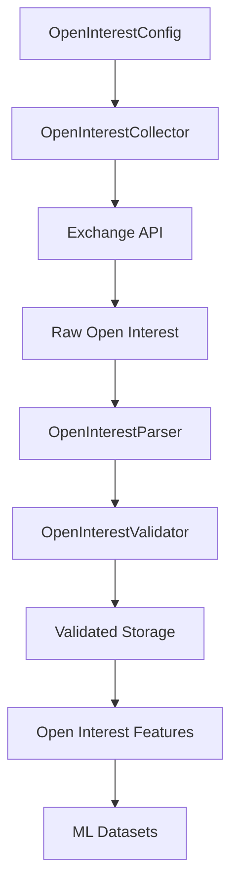

# Open Interest Collector Configuration

## Overview

`config.py` defines the configuration used by:

```text
data_pipeline/
└── collectors/
    └── open_interest/
        ├── collector.py
        ├── parser.py
        ├── validator.py
        ├── config.py
        │
        └── md/
            └── config.md
```

The configuration module centralizes the settings required to collect ETH futures open-interest data.

The collector should obtain its behavior from this configuration instead of scattering constants throughout `collector.py`.

---

## Purpose

The configuration controls:

* Trading symbol.
* Open-interest period.
* API endpoint.
* Request limit.
* Maximum API limit.
* Historical pagination limit.
* Request timeout.
* Duplicate handling.
* Timestamp normalization.
* Optional collection-time validation.

It does **not** perform collection itself.

---

# Configuration Architecture

```text
OpenInterestConfig
        │
        ├── Market settings
        │
        ├── API settings
        │
        ├── Request settings
        │
        ├── Pagination settings
        │
        ├── Timeout settings
        │
        └── Collection behavior
                │
                ↓
       OpenInterestCollector
```

---

# Main Configuration Class

The primary configuration object is:

```python
OpenInterestConfig
```

It is implemented as a frozen dataclass.

Conceptually:

```python
@dataclass(frozen=True)
class OpenInterestConfig:
    ...
```

`frozen=True` prevents accidental modification after configuration creation.

This is useful because the collector should receive a stable configuration for each execution context.

---

# Default Configuration

The default configuration is:

```text
symbol                  = ETHUSDT
period                  = 1h
endpoint                = /futures/data/openInterestHist
limit                   = 500
max_limit               = 500
max_pages               = 100
request_timeout         = 10.0
deduplicate_records     = True
normalize_timestamps   = True
validate_on_collection  = False
```

These values are intended as sensible defaults for the ETH futures data pipeline.

---

# Symbol

```python
symbol: str = "ETHUSDT"
```

The default market is:

```text
ETHUSDT
```

This keeps the collector aligned with the project's ETH futures scope.

The symbol remains configurable so that testing or future multi-market support does not require modifying collector logic.

Example:

```python
config = OpenInterestConfig(
    symbol="ETHUSDT"
)
```

---

# Period

```python
period: str = "1h"
```

The default collection interval is:

```text
1h
```

This represents hourly open-interest observations.

The period can be changed when the exchange supports other intervals.

Example:

```python
config = OpenInterestConfig(
    period="4h"
)
```

The collector should not interpret the meaning of the period. It simply passes the configured value to the exchange request.

---

# API Endpoint

```python
endpoint: str = "/futures/data/openInterestHist"
```

The endpoint identifies the exchange API route used for historical open-interest data.

Keeping the endpoint in configuration provides a single location for changing the API route if the exchange interface changes.

The endpoint must:

* Be a string.
* Not be empty.
* Start with `/`.

Example:

```python
OpenInterestConfig(
    endpoint="/futures/data/openInterestHist"
)
```

---

# Request Limit

```python
limit: int = 500
```

`limit` determines how many records the collector requests per API call.

Example:

```text
limit = 500
```

means the collector requests up to 500 records in one page.

A smaller value can be configured when required:

```python
OpenInterestConfig(
    limit=100
)
```

---

# Maximum Request Limit

```python
max_limit: int = 500
```

This provides an upper safety boundary.

The configuration enforces:

```text
limit ≤ max_limit
```

For example:

```python
OpenInterestConfig(
    limit=1000,
    max_limit=500
)
```

is rejected.

This prevents the collector from constructing requests larger than the configured API boundary.

---

# Historical Pagination

```python
max_pages: int = 100
```

This is the maximum number of API pages that one historical collection operation can request.

Conceptually:

```text
Historical Request
      ↓
Page 1
      ↓
Page 2
      ↓
Page 3
      ↓
...
      ↓
Page 100
      ↓
STOP
```

The limit protects against:

* Infinite pagination.
* Incorrect timestamp cursors.
* Unexpected API behavior.
* Accidental huge historical requests.

---

# Request Timeout

```python
request_timeout: float = 10.0
```

The default network request timeout is:

```text
10 seconds
```

The configuration should use a positive value.

Invalid:

```python
request_timeout=0
```

Invalid:

```python
request_timeout=-5
```

Valid:

```python
request_timeout=10
```

---

# Deduplication

```python
deduplicate_records: bool = True
```

When enabled, the collection layer can remove duplicate records that occur during pagination.

This is particularly useful when two API pages overlap.

Conceptually:

```text
Page 1
 ├── T1
 ├── T2
 └── T3

Page 2
 ├── T3
 ├── T4
 └── T5
```

With deduplication enabled:

```text
T1
T2
T3
T4
T5
```

is returned instead of:

```text
T1
T2
T3
T3
T4
T5
```

---

# Timestamp Normalization

```python
normalize_timestamps: bool = True
```

When enabled, the collector can normalize supported timestamp inputs into Unix milliseconds.

Supported input forms include:

```text
Unix seconds
Unix milliseconds
datetime
```

The normalized representation used by the API request is:

```text
Unix milliseconds
```

This keeps request construction consistent.

---

# Collection-Time Validation

```python
validate_on_collection: bool = False
```

By default, collection-time validation is disabled.

The normal architecture is:

```text
Collector
    ↓
Parser
    ↓
Validator
```

Therefore, the collector should not normally perform domain validation itself.

If this option is enabled by the integration layer, the collector can participate in an additional validation step.

This option should not replace:

```text
open_interest/validator.py
```

---

# Configuration Validation

Validation occurs automatically when:

```python
OpenInterestConfig(...)
```

is created.

The configuration validates:

```text
symbol
period
endpoint
limit
max_limit
max_pages
request_timeout
```

This means invalid configuration fails early.

---

# Symbol Validation

The symbol must be a non-empty string.

Invalid:

```python
OpenInterestConfig(
    symbol=""
)
```

Invalid:

```python
OpenInterestConfig(
    symbol=None
)
```

Valid:

```python
OpenInterestConfig(
    symbol="ETHUSDT"
)
```

The configuration does not verify that the exchange currently lists the symbol.

That is an exchange/API concern.

---

# Period Validation

The period must be a non-empty string.

Invalid:

```python
OpenInterestConfig(
    period=""
)
```

Invalid:

```python
OpenInterestConfig(
    period=None
)
```

Valid:

```python
OpenInterestConfig(
    period="1h"
)
```

The exchange remains responsible for determining whether a particular period is supported.

---

# Endpoint Validation

The endpoint must be a non-empty string beginning with `/`.

Valid:

```text
/futures/data/openInterestHist
```

Invalid:

```text
futures/data/openInterestHist
```

Invalid:

```text
""
```

This catches configuration mistakes before network requests begin.

---

# Limit Validation

The following relationship must always hold:

```text
0 < limit ≤ max_limit
```

For example:

```python
OpenInterestConfig(
    limit=500,
    max_limit=500
)
```

is valid.

But:

```python
OpenInterestConfig(
    limit=0
)
```

is invalid.

And:

```python
OpenInterestConfig(
    limit=600,
    max_limit=500
)
```

is invalid.

---

# Maximum Pages Validation

The requirement is:

```text
max_pages > 0
```

Therefore:

```python
max_pages=100
```

is valid.

While:

```python
max_pages=0
```

is invalid.

---

# Timeout Validation

The requirement is:

```text
request_timeout > 0
```

Example:

```python
request_timeout=10.0
```

is valid.

---

# Frozen Configuration

The configuration is immutable after creation.

Example:

```python
config = OpenInterestConfig()

config.symbol = "BTCUSDT"
```

should fail.

This protects the collector from unexpected runtime configuration mutation.

If a different configuration is required, create a new configuration object.

---

# Default Configuration Object

The module exposes:

```python
DEFAULT_OPEN_INTEREST_CONFIG
```

This contains the standard settings.

Example:

```python
from data_pipeline.collectors.open_interest.config import (
    DEFAULT_OPEN_INTEREST_CONFIG,
)
```

The object can then be passed to the collector.

---

# Default Configuration Factory

The module provides:

```python
get_default_config()
```

Example:

```python
config = get_default_config()
```

This returns the default `OpenInterestConfig`.

The factory provides a clean API for other modules without requiring callers to know how the default configuration is constructed.

---

# Custom Configuration Factory

The module also provides:

```python
create_config()
```

Example:

```python
config = create_config(
    symbol="ETHUSDT",
    period="1h",
    limit=500,
    max_pages=100,
)
```

The factory returns a validated:

```text
OpenInterestConfig
```

object.

---

# Configuration Serialization

The configuration provides:

```python
to_dict()
```

Example:

```python
config.to_dict()
```

returns a structure similar to:

```python
{
    "symbol": "ETHUSDT",
    "period": "1h",
    "endpoint": "/futures/data/openInterestHist",
    "limit": 500,
    "max_limit": 500,
    "max_pages": 100,
    "request_timeout": 10.0,
    "deduplicate_records": True,
    "normalize_timestamps": True,
    "validate_on_collection": False,
}
```

This is useful for:

* Logging.
* Configuration snapshots.
* Debugging.
* Reproducibility.
* Monitoring.

---

# Collector Integration

The collector receives the configuration:

```text
OpenInterestConfig
       ↓
OpenInterestCollector
```

Conceptually:

```python
config = OpenInterestConfig(
    symbol="ETHUSDT",
    period="1h",
    limit=500,
)

collector = OpenInterestCollector(
    config=config,
    client=rest_client,
)
```

The collector then reads:

```text
config.symbol
config.period
config.limit
config.max_pages
config.endpoint
```

rather than maintaining separate configuration constants.

---

# Configuration vs Collector

The separation is:

| Component       | Responsibility             |
| --------------- | -------------------------- |
| `config.py`     | Define collection settings |
| `collector.py`  | Make API requests          |
| `parser.py`     | Normalize API responses    |
| `validator.py`  | Validate normalized data   |
| Feature layer   | Calculate OI analytics     |
| Strategy engine | Generate trading decisions |
| Risk engine     | Approve/reject trades      |

This separation keeps the ingestion architecture clean.

---

# Configuration vs Environment Variables

Environment variables should generally be used for deployment-specific secrets and infrastructure settings, such as:

```text
API_KEY
API_SECRET
BASE_URL
```

The open-interest configuration should primarily contain behavioral settings such as:

```text
symbol
period
limit
max_pages
timeout
```

API credentials should not be hard-coded in `config.py`.

---

# Configuration Reproducibility

Because collection behavior is configuration-driven, a historical dataset can record the configuration used to create it.

For example:

```text
Dataset
│
├── source
│   └── exchange
│
├── symbol
│   └── ETHUSDT
│
├── period
│   └── 1h
│
├── request_limit
│   └── 500
│
└── collection configuration
```

This helps reproduce historical ingestion behavior.

---

# Recommended Usage

```python
from data_pipeline.collectors.open_interest.config import (
    OpenInterestConfig,
)
from data_pipeline.collectors.open_interest.collector import (
    OpenInterestCollector,
)

config = OpenInterestConfig(
    symbol="ETHUSDT",
    period="1h",
    limit=500,
    max_pages=100,
    request_timeout=10.0,
)

collector = OpenInterestCollector(
    config=config,
    client=rest_client,
)

records = collector.collect_latest()
```

---

# Data Flow



---

# Design Principles

`config.py` should remain:

* Small.
* Declarative.
* Immutable where possible.
* Validated at construction.
* Independent of networking.
* Independent of parsing.
* Independent of storage.
* Independent of feature engineering.
* Independent of strategy logic.
* Independent of risk management.

The configuration should answer:

> **How should the Open Interest Collector operate?**

It should not answer:

> **Should the trading system take a position?**

That decision remains entirely outside the collector configuration.

---

# Final Module Contract

```text
open_interest/
│
├── config.py
│   └── Collection configuration
│
├── collector.py
│   └── Data acquisition
│
├── parser.py
│   └── Data normalization
│
└── validator.py
    └── Data-quality validation
```

The key architectural rule is:

> **`config.py` defines how open-interest data is collected; it does not collect, interpret, or trade on that data.**
