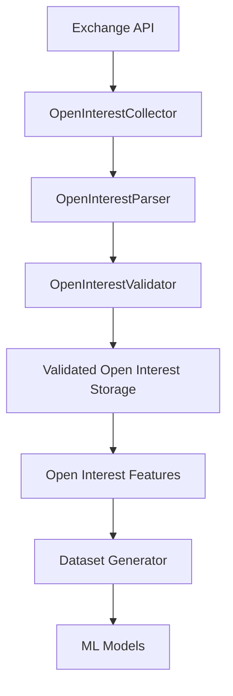

# Open Interest Parser

## Overview

`parser.py` converts raw exchange open-interest responses into the internal open-interest schema used by the ETH Bot data pipeline.

The parser sits between the collector and validator:

```text
Exchange API
     ↓
OpenInterestCollector
     ↓
OpenInterestParser
     ↓
OpenInterestValidator
     ↓
Storage
     ↓
Features
```

The parser is responsible for **normalization**, not data-quality validation or trading logic.

---

# Location

```text
D:\Sachin Chakrawarti\eth_bot\data_pipeline\collectors\open_interest\
│
├── collector.py
├── parser.py
├── validator.py
├── config.py
│
└── md\
    ├── collector.md
    ├── parser.md
    ├── validator.md
    └── config.md
```

---

# Main Class

The primary class is:

```python
OpenInterestParser
```

The parser provides two main operations:

```python
parse()
parse_record()
```

---

# Responsibilities

The parser is responsible for:

* Extracting records from raw exchange responses.
* Supporting common response wrappers.
* Mapping exchange-specific field names to internal names.
* Converting numeric values to `float`.
* Normalizing timestamps.
* Converting timestamps into UTC `datetime`.
* Extracting the trading symbol.
* Extracting open-interest quantity.
* Extracting open-interest value/notional when available.
* Preserving source/exchange metadata.
* Returning normalized records.

---

# Non-Responsibilities

The parser does **not**:

* Make API requests.
* Retry failed requests.
* Schedule collection.
* Store records.
* Decide whether a record is valid.
* Remove statistically abnormal observations.
* Calculate open-interest indicators.
* Generate trading signals.
* Reject trades.
* Execute orders.

The separation is:

```text
Collector
    ↓
Acquire

Parser
    ↓
Normalize

Validator
    ↓
Validate

Feature Engine
    ↓
Analyze
```

---

# Raw Exchange Data

An exchange may return data such as:

```json
{
    "symbol": "ETHUSDT",
    "sumOpenInterest": "123456.78",
    "sumOpenInterestValue": "345678901.23",
    "timestamp": 1754006400000
}
```

The parser converts this into an internal representation such as:

```python
{
    "timestamp": 1754006400000,
    "datetime": datetime(...),
    "symbol": "ETHUSDT",
    "open_interest": 123456.78,
    "open_interest_value": 345678901.23
}
```

The important transformation is:

```text
Exchange-specific schema
          ↓
Internal schema
```

---

# `parse()`

The public method:

```python
parse(response)
```

parses a complete exchange response.

Example:

```python
parser = OpenInterestParser()

records = parser.parse(response)
```

It first extracts individual records and then passes each record to:

```python
parse_record()
```

---

# Parse Flow

```text
parse(response)
      ↓
_extract_records()
      ↓
For each raw record
      ↓
parse_record()
      ↓
Normalized records
```

---

# `parse_record()`

The method:

```python
parse_record(record)
```

normalizes a single raw record.

Example:

```python
parsed = parser.parse_record(
    {
        "symbol": "ETHUSDT",
        "sumOpenInterest": "123456.78",
        "timestamp": 1754006400000,
    }
)
```

The parser produces a normalized representation.

---

# Response Extraction

The parser supports several common exchange response structures.

### Direct list

```json
[
    {
        "symbol": "ETHUSDT",
        "sumOpenInterest": "123456.78"
    }
]
```

### `data`

```json
{
    "data": [
        {
            "symbol": "ETHUSDT",
            "sumOpenInterest": "123456.78"
        }
    ]
}
```

### `result`

```json
{
    "result": [
        {
            "symbol": "ETHUSDT",
            "sumOpenInterest": "123456.78"
        }
    ]
}
```

### `rows`

```json
{
    "rows": [
        {
            "symbol": "ETHUSDT",
            "sumOpenInterest": "123456.78"
        }
    ]
}
```

### `list`

```json
{
    "list": [
        {
            "symbol": "ETHUSDT",
            "sumOpenInterest": "123456.78"
        }
    ]
}
```

This makes the parser tolerant of common exchange response wrappers.

---

# `_extract_records()`

The method:

```python
_extract_records()
```

extracts the actual record list from the response.

It does not normalize the records.

Its responsibility is only:

```text
Response
   ↓
List[Mapping]
```

If the response is already a list, it uses the list directly.

If the response contains a supported wrapper, it extracts the wrapped list.

---

# Symbol Normalization

The parser supports several possible exchange field names:

```text
symbol
s
instType
```

The first available value is selected.

For example:

```json
{
    "s": "ETHUSDT"
}
```

becomes:

```python
{
    "symbol": "ETHUSDT"
}
```

The value is converted to a string and whitespace is removed.

---

# Open Interest Quantity

The parser recognizes common open-interest quantity fields:

```text
sumOpenInterest
openInterest
open_interest
oi
openInterestAmount
```

These are mapped to:

```text
open_interest
```

For example:

```text
"123456.78"
```

becomes:

```python
123456.78
```

with type:

```text
float
```

---

# Open Interest Value

Some exchange responses provide the notional/value of open interest.

Supported source fields include:

```text
sumOpenInterestValue
openInterestValue
open_interest_value
oiValue
openInterestNotional
```

These are normalized to:

```text
open_interest_value
```

Example:

```text
"345678901.23"
```

becomes:

```python
345678901.23
```

---

# Difference Between Quantity and Value

The parser keeps these concepts separate:

```text
open_interest
        ↓
Quantity of open contracts / underlying amount

open_interest_value
        ↓
Notional or monetary value of open interest
```

They should not be combined into one field.

This distinction is important for downstream analysis.

---

# Timestamp Normalization

The parser supports common timestamp fields:

```text
timestamp
time
T
openTime
open_time
```

All supported timestamp representations are converted to:

```text
Unix milliseconds
```

Example:

```text
1754006400
```

is interpreted as seconds and converted to:

```text
1754006400000
```

A value already expressed in milliseconds remains in milliseconds.

---

# Datetime Generation

After timestamp normalization, the parser also generates:

```text
datetime
```

using UTC.

For example:

```python
datetime.fromtimestamp(
    timestamp / 1000,
    tz=timezone.utc,
)
```

This gives the normalized record both machine-friendly and human-readable time representations.

---

# Why Keep Both Fields?

The internal record can contain:

```text
timestamp
datetime
```

`timestamp` is useful for:

* Sorting.
* Joins.
* Database indexing.
* Pagination.
* Time-series processing.

`datetime` is useful for:

* Debugging.
* Logging.
* Human-readable analysis.
* Data inspection.

---

# Timezone

All generated datetimes are timezone-aware UTC values.

The parser therefore avoids silently mixing:

```text
local time
```

with:

```text
UTC
```

which is especially important for 24/7 crypto markets.

---

# Timestamp Safety

Boolean timestamp values are not interpreted as timestamps.

For example:

```python
timestamp=True
```

does not become:

```text
1 millisecond
```

Invalid timestamp values result in:

```text
None
```

and a record without a usable timestamp is skipped by `parse_record()`.

---

# Source Metadata

The parser can extract source metadata from:

```text
source
exchange
venue
```

and normalize it to:

```text
source
```

Example:

```json
{
    "exchange": "binance"
}
```

becomes:

```python
{
    "source": "binance"
}
```

If no source metadata exists, the field is omitted.

---

# Missing Values

The parser does not manufacture values when an exchange field is missing.

For example, if:

```text
openInterestValue
```

is unavailable, it does not calculate it automatically.

Instead, the field is omitted from the parsed record.

This prevents assumptions from being introduced during parsing.

---

# `None` Removal

The parser uses:

```python
_remove_none_values()
```

to remove fields whose values could not be extracted.

For example:

```python
{
    "timestamp": 1754006400000,
    "symbol": "ETHUSDT",
    "open_interest": 123456.78,
    "open_interest_value": None,
}
```

becomes:

```python
{
    "timestamp": 1754006400000,
    "symbol": "ETHUSDT",
    "open_interest": 123456.78,
}
```

This keeps parsed records compact.

---

# Numeric Conversion

The parser converts numeric strings into Python `float` values.

Example:

```text
"123456.78"
```

becomes:

```python
123456.78
```

This allows downstream modules to perform mathematical operations without repeatedly converting strings.

---

# Invalid Numeric Values

If an exchange sends a non-numeric value:

```text
"unknown"
```

the parser does not fabricate a number.

The value becomes:

```text
None
```

and is subsequently removed from the parsed record.

The validator is responsible for deciding whether the missing value makes the complete record invalid.

---

# Parser vs Validator

This distinction is important.

### Parser

Answers:

> What does this exchange response mean in our internal schema?

### Validator

Answers:

> Is this normalized record acceptable for our dataset?

Example:

```text
Raw:
sumOpenInterest = "unknown"
```

Parser:

```text
open_interest = None
```

Validator:

```text
Record rejected
```

The parser should not absorb the validator's responsibility.

---

# No Feature Calculations

The parser should not calculate:

```text
open_interest_change
open_interest_change_pct
open_interest_momentum
open_interest_zscore
open_interest_ma
open_interest_price_divergence
```

Those belong to the feature/analytics layer.

The parser only produces the base observation.

---

# Normalized Schema

The primary normalized fields are:

| Field                 | Type       | Description                                  |
| --------------------- | ---------- | -------------------------------------------- |
| `timestamp`           | `int`      | Unix timestamp in milliseconds               |
| `datetime`            | `datetime` | UTC timestamp                                |
| `symbol`              | `str`      | Trading symbol                               |
| `open_interest`       | `float`    | Open-interest quantity                       |
| `open_interest_value` | `float`    | Open-interest value/notional, when available |
| `source`              | `str`      | Exchange/source metadata, when available     |

Optional fields are omitted when unavailable.

---

# Example Transformation

### Raw

```json
{
    "symbol": "ETHUSDT",
    "sumOpenInterest": "125000.50",
    "sumOpenInterestValue": "312500000.00",
    "timestamp": 1754006400000
}
```

### Parsed

```python
{
    "timestamp": 1754006400000,
    "datetime": datetime(..., tzinfo=UTC),
    "symbol": "ETHUSDT",
    "open_interest": 125000.50,
    "open_interest_value": 312500000.00
}
```

---

# Data Pipeline Position



---

# Collector → Parser Contract

The collector returns:

```text
Raw exchange records
```

The parser returns:

```text
Normalized internal records
```

Therefore:

```text
collector.py
    ↓
Raw API representation

parser.py
    ↓
Internal representation
```

This boundary allows the exchange API schema to change without forcing the rest of the ML pipeline to understand exchange-specific field names.

---

# Parser → Validator Contract

The parser guarantees normalization of supported fields.

The validator then checks rules such as:

```text
timestamp exists
symbol exists
open_interest exists
open_interest >= 0
timestamp is valid
symbol is expected
record is not duplicated
```

The exact validation rules belong to:

```text
validator.py
```

---

# Error Philosophy

The parser should:

* Fail explicitly on unsupported response structures.
* Return an empty list for an empty response.
* Return `None` for unparseable optional fields.
* Skip records without a usable timestamp.
* Avoid inventing missing values.
* Avoid silently changing the meaning of exchange data.

---

# Testing

Recommended test location:

```text
tests/
└── collectors/
    └── open_interest/
        └── test_parser.py
```

Tests should cover:

### Response extraction

```text
direct list
data wrapper
result wrapper
rows wrapper
list wrapper
empty response
invalid response
```

### Symbol parsing

```text
symbol
s
instType
missing symbol
```

### Open-interest parsing

```text
sumOpenInterest
openInterest
open_interest
oi
openInterestAmount
```

### Open-interest value

```text
sumOpenInterestValue
openInterestValue
open_interest_value
oiValue
openInterestNotional
```

### Timestamp parsing

```text
timestamp
time
T
openTime
open_time
Unix seconds
Unix milliseconds
datetime
invalid timestamp
negative timestamp
boolean timestamp
```

### Numeric conversion

```text
integer
float
numeric string
invalid string
None
boolean
```

### Source metadata

```text
source
exchange
venue
missing source
```

---

# Example Usage

```python
from data_pipeline.collectors.open_interest.parser import (
    OpenInterestParser,
)

parser = OpenInterestParser()

records = parser.parse(
    response
)
```

For a single record:

```python
record = parser.parse_record(
    {
        "symbol": "ETHUSDT",
        "sumOpenInterest": "125000.50",
        "timestamp": 1754006400000,
    }
)
```

---

# Design Principles

The parser should remain:

* Deterministic.
* Stateless.
* Exchange-schema aware.
* Independent of network operations.
* Independent of storage.
* Independent of feature engineering.
* Independent of trading strategy.
* Independent of risk management.

Its core purpose is:

> **Convert raw exchange open-interest data into a consistent internal representation without deciding whether the data is valid or useful for trading.**

---

# Complete Module Contract

```text
open_interest/
│
├── collector.py
│   └── Acquire raw exchange data
│
├── parser.py
│   └── Normalize raw exchange data
│
├── validator.py
│   └── Validate normalized data
│
└── config.py
    └── Configure collection behavior
```

The key rule is:

> **`parser.py` translates the exchange schema into the ETH Bot schema; it does not perform data-quality validation or trading analysis.**
