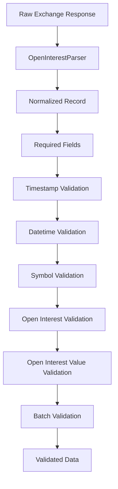

# Open Interest Validator

## Overview

`validator.py` validates normalized open-interest records produced by:

```text
data_pipeline/collectors/open_interest/parser.py
```

Its purpose is to ensure that open-interest data is structurally and numerically suitable for downstream storage and feature generation.

The validation flow is:

```text
Exchange API
    ↓
OpenInterestCollector
    ↓
OpenInterestParser
    ↓
OpenInterestValidator
    ↓
Validated Open Interest Data
    ↓
Features / Datasets
```

The validator operates **after parsing**.

---

# Location

```text
D:\Sachin Chakrawarti\eth_bot\data_pipeline\collectors\open_interest\
│
├── collector.py
├── parser.py
├── validator.py
├── config.py
│
└── md\
    ├── collector.md
    ├── parser.md
    ├── validator.md
    └── config.md
```

---

# Main Class

The main validator is:

```python
OpenInterestValidator
```

It provides validation at two levels:

```text
Single record
    ↓
validate()
validate_record()

Multiple records
    ↓
validate_records()
collect_errors()
```

---

# Responsibilities

The validator checks:

* Required fields.
* Timestamp type.
* Timestamp range.
* Datetime type.
* Datetime timezone awareness.
* Symbol type.
* Symbol presence.
* Open-interest type.
* Open-interest sign.
* Open-interest value type.
* Open-interest value sign.
* Duplicate timestamps.
* Chronological ordering.

---

# Non-Responsibilities

The validator does **not**:

* Make exchange API requests.
* Parse raw exchange responses.
* Convert exchange field names.
* Fetch historical data.
* Calculate indicators.
* Calculate ML features.
* Generate trading signals.
* Approve trades.
* Reject trades in the risk engine.

The validator answers:

> **Is this normalized data structurally and numerically acceptable?**

It does not answer:

> **Should the trading system trade?**

---

# Required Fields

The validator requires:

```python
REQUIRED_FIELDS = (
    "timestamp",
    "symbol",
    "open_interest",
)
```

Therefore every valid record must contain:

```text
timestamp
symbol
open_interest
```

`open_interest_value` is optional because not every source necessarily provides it.

---

# Required Field Validation

Example valid record:

```python
{
    "timestamp": 1754006400000,
    "symbol": "ETHUSDT",
    "open_interest": 125000.5,
}
```

Example invalid record:

```python
{
    "timestamp": 1754006400000,
    "symbol": "ETHUSDT",
}
```

The validator reports:

```text
missing required field 'open_interest'
```

---

# `validate()`

The public method:

```python
validate(record)
```

validates a single record.

Example:

```python
validator = OpenInterestValidator()

validator.validate(record)
```

If the record is valid:

```text
True
```

is returned.

If validation fails:

```text
OpenInterestValidationError
```

is raised.

---

# `validate_record()`

The method:

```python
validate_record(record)
```

returns a list of validation errors.

Example:

```python
errors = validator.validate_record(record)
```

A valid record produces:

```python
[]
```

An invalid record may produce:

```python
[
    "open_interest cannot be negative."
]
```

This method is useful when the caller wants to inspect validation failures without immediately raising an exception.

---

# Validation Flow

For each record:

```text
Record
  ↓
Required fields
  ↓
Timestamp
  ↓
Datetime
  ↓
Symbol
  ↓
Open interest
  ↓
Open interest value
  ↓
Validation result
```

---

# Timestamp Validation

The parser normalizes timestamps to:

```text
Unix milliseconds
```

The validator therefore requires:

```python
timestamp: int
```

Boolean values are rejected because Python considers:

```python
True
False
```

to be subclasses of `int`.

For example:

```python
{
    "timestamp": True
}
```

is invalid.

---

# Timestamp Range

The validator also performs a basic sanity check.

The supported range is approximately:

```text
2000-01-01
        ↓
2100-01-01
```

This catches common timestamp-unit errors.

For example, accidentally passing:

```text
Unix seconds
```

instead of:

```text
Unix milliseconds
```

can result in a timestamp that is far too small.

---

# Negative Timestamp

Negative timestamps are rejected.

Invalid:

```python
{
    "timestamp": -1000
}
```

Reason:

```text
timestamp cannot be negative.
```

---

# Datetime Validation

The parser may provide:

```python
datetime
```

alongside:

```python
timestamp
```

If `datetime` is present, the validator requires it to be a Python `datetime` object.

Invalid:

```python
{
    "datetime": "2026-01-01"
}
```

Valid:

```python
{
    "datetime": datetime(..., tzinfo=UTC)
}
```

---

# Timezone-Aware Datetime

Naive datetimes are rejected.

Invalid:

```python
datetime(2026, 1, 1)
```

because no timezone information is attached.

Valid:

```python
datetime(
    2026,
    1,
    1,
    tzinfo=timezone.utc,
)
```

This prevents accidental mixing of local time and UTC.

---

# Symbol Validation

The symbol must be a string.

Valid:

```python
"ETHUSDT"
```

Invalid:

```python
12345
```

Invalid:

```python
""
```

The validator also rejects whitespace-only values.

Example:

```python
"   "
```

is invalid.

---

# Open Interest Validation

The main field is:

```text
open_interest
```

It must be numeric.

Valid:

```python
125000.50
```

Valid:

```python
125000
```

Invalid:

```python
"unknown"
```

Invalid:

```python
None
```

Because `open_interest` is required, missing or `None` values are already caught by required-field validation.

---

# Open Interest Cannot Be Negative

Open interest represents a quantity, so:

```text
open_interest >= 0
```

is required.

Valid:

```python
0
```

Valid:

```python
125000.50
```

Invalid:

```python
-500
```

The validator reports:

```text
open_interest cannot be negative.
```

---

# Finite Numeric Values

The validator rejects non-finite floating-point values.

Invalid:

```python
float("nan")
```

Invalid:

```python
float("inf")
```

Invalid:

```python
float("-inf")
```

This prevents corrupted numerical values from entering downstream datasets.

---

# Open Interest Value

The optional field:

```text
open_interest_value
```

is validated when present.

It must be numeric.

Valid:

```python
312500000.0
```

Invalid:

```python
"unknown"
```

---

# Open Interest Value Cannot Be Negative

When supplied:

```text
open_interest_value >= 0
```

is required.

Valid:

```python
0
```

Valid:

```python
312500000.0
```

Invalid:

```python
-100000
```

---

# Numeric Validation Helper

The validator uses:

```python
_validate_numeric()
```

for common numeric checks.

It verifies:

```text
numeric type
    ↓
not boolean
    ↓
finite value
```

This avoids duplicating the same validation logic for:

```text
open_interest
open_interest_value
```

---

# Single Record Validation

Example:

```python
record = {
    "timestamp": 1754006400000,
    "symbol": "ETHUSDT",
    "open_interest": 125000.50,
}
```

Running:

```python
validator.validate(record)
```

returns:

```text
True
```

---

# Invalid Single Record

Example:

```python
record = {
    "timestamp": 1754006400000,
    "symbol": "ETHUSDT",
    "open_interest": -500,
}
```

Running:

```python
validator.validate(record)
```

raises:

```text
OpenInterestValidationError
```

with:

```text
open_interest cannot be negative.
```

---

# Multiple Record Validation

The method:

```python
validate_records(records)
```

validates a sequence of records.

Example:

```python
validator.validate_records(records)
```

If every record is valid:

```text
True
```

is returned.

If any record fails:

```text
OpenInterestValidationError
```

is raised.

---

# `collect_errors()`

The method:

```python
collect_errors(records)
```

is useful when all validation errors need to be collected before deciding what to do.

Example:

```python
errors = validator.collect_errors(records)
```

Result:

```python
[
    "record[4]: open_interest cannot be negative.",
    "record[8]: missing required field 'timestamp'.",
]
```

This is useful for batch-data diagnostics.

---

# Record Index

Collection-level errors include the record index.

For example:

```text
record[25]: timestamp is not in chronological order.
```

This makes debugging large datasets easier.

---

# Duplicate Detection

The validator can reject duplicate timestamps.

Duplicates are identified using:

```text
(symbol, timestamp)
```

rather than timestamp alone.

This is important because the same timestamp could legitimately exist for different symbols in a multi-market system.

Example:

```text
ETHUSDT + timestamp A
ETHUSDT + timestamp A
```

is a duplicate.

But:

```text
ETHUSDT + timestamp A
BTCUSDT + timestamp A
```

is not considered a duplicate.

---

# Duplicate Validation

The option is:

```python
reject_duplicates=True
```

By default, duplicate records are rejected.

Example:

```python
validator.validate_records(
    records,
    reject_duplicates=True,
)
```

---

# Chronological Ordering

The validator can optionally require timestamps to be in chronological order.

Enable with:

```python
require_chronological_order=True
```

Example:

```python
validator.validate_records(
    records,
    require_chronological_order=True,
)
```

Valid:

```text
10:00
11:00
12:00
13:00
```

Invalid:

```text
10:00
12:00
11:00
13:00
```

---

# Why Ordering Is Optional

Some storage systems or collectors may intentionally return records in reverse order.

Therefore chronological ordering is not automatically required.

The caller can choose:

```text
strict chronological validation
```

or:

```text
order-independent validation
```

---

# Duplicate vs Ordering

These are separate checks.

Duplicate detection asks:

> Does the same symbol have the same timestamp more than once?

Chronological validation asks:

> Are records arranged in non-decreasing timestamp order?

A dataset can therefore be:

```text
chronologically ordered
```

but still contain duplicates.

Both checks are useful.

---

# Validation Architecture



---

# Validator and Parser Separation

The parser performs:

```text
"sumOpenInterest"
        ↓
"open_interest"
```

The validator performs:

```text
open_interest >= 0
```

Therefore:

```text
Parser
    = normalization

Validator
    = quality control
```

This separation is important for maintainability.

---

# Validator and Feature Engineering Separation

The validator does not calculate:

```text
open_interest_change
open_interest_change_pct
open_interest_zscore
open_interest_ma
open_interest_momentum
open_interest_price_divergence
```

Those belong to:

```text
data_pipeline/
└── schema/
    └── features/
```

The validator only confirms that the underlying raw observation is usable.

---

# Validator and Risk Engine Separation

The validator must not decide:

```text
TAKE_TRADE
HOLD
REJECT_TRADE
```

Those decisions belong to the trading system's strategy/risk architecture.

The data pipeline only ensures that the data supplied to those systems is trustworthy.

---

# Recommended Validation Flow

```text
Exchange
   ↓
Collector
   ↓
Parser
   ↓
Validator
   ↓
Raw/Validated Storage
   ↓
Indicators Analytics
   ↓
Dataset Generator
   ↓
ML Models
   ↓
Strategy Engine
   ↓
Risk Engine
   ↓
Execution
```

---

# Example Valid Dataset

```python
records = [
    {
        "timestamp": 1754006400000,
        "symbol": "ETHUSDT",
        "open_interest": 125000.0,
        "open_interest_value": 312500000.0,
    },
    {
        "timestamp": 1754010000000,
        "symbol": "ETHUSDT",
        "open_interest": 126500.0,
        "open_interest_value": 316250000.0,
    },
]
```

Validation:

```python
validator.validate_records(
    records,
    require_chronological_order=True,
)
```

Result:

```text
True
```

---

# Example Invalid Dataset

```python
records = [
    {
        "timestamp": 1754006400000,
        "symbol": "ETHUSDT",
        "open_interest": 125000.0,
    },
    {
        "timestamp": 1754006400000,
        "symbol": "ETHUSDT",
        "open_interest": 126000.0,
    },
]
```

With:

```python
reject_duplicates=True
```

the validator reports:

```text
record[1]: duplicate timestamp for symbol ETHUSDT
```

---

# Testing

Recommended test location:

```text
tests/
└── collectors/
    └── open_interest/
        └── test_validator.py
```

Tests should cover:

### Required fields

```text
missing timestamp
missing symbol
missing open_interest
None timestamp
None symbol
None open_interest
```

### Timestamp

```text
valid milliseconds
negative timestamp
seconds instead of milliseconds
boolean
non-integer
too old
too far in future
```

### Datetime

```text
valid UTC datetime
naive datetime
non-datetime value
```

### Symbol

```text
ETHUSDT
empty string
whitespace
non-string
```

### Open interest

```text
positive value
zero
negative value
integer
float
NaN
Infinity
non-numeric value
```

### Open-interest value

```text
positive value
zero
negative value
NaN
Infinity
non-numeric value
missing optional field
```

### Batch validation

```text
valid sequence
duplicate timestamps
multiple symbols
chronological order
out-of-order timestamps
empty dataset
```

---

# Empty Dataset

An empty list contains no invalid records.

Therefore:

```python
validator.validate_records([])
```

can return:

```text
True
```

This does not mean that an empty dataset is useful for trading.

It only means that there are no records within the supplied collection that violate record-level validation rules.

Dataset availability checks belong to the pipeline orchestration layer.

---

# Error Handling

The validator exposes two useful patterns.

### Strict validation

```python
validator.validate(record)
```

Raises immediately when invalid.

### Diagnostic validation

```python
errors = validator.validate_record(record)
```

Returns errors without raising.

For batches:

```python
errors = validator.collect_errors(records)
```

returns all detected errors.

This gives the pipeline flexibility between:

```text
fail-fast
```

and:

```text
collect-and-report
```

behavior.

---

# Design Principles

`validator.py` should remain:

* Deterministic.
* Stateless.
* Strict about required fields.
* Strict about numerical validity.
* Independent of networking.
* Independent of storage.
* Independent of ML models.
* Independent of strategy logic.
* Independent of risk management.

The validator should reject **bad data**, not **bad trades**.

---

# Complete Module Contract

```text
open_interest/
│
├── collector.py
│   └── Acquire raw exchange data
│
├── parser.py
│   └── Normalize exchange data
│
├── validator.py
│   └── Validate normalized data
│
└── config.py
    └── Configure collection behavior
```

The core contract is:

> **`validator.py` ensures that normalized open-interest records satisfy the structural, type, timestamp, numerical, duplicate, and ordering rules required by the data pipeline.**
