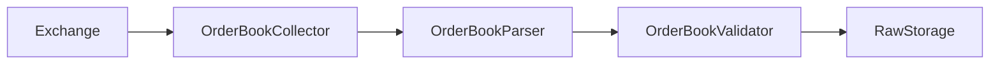
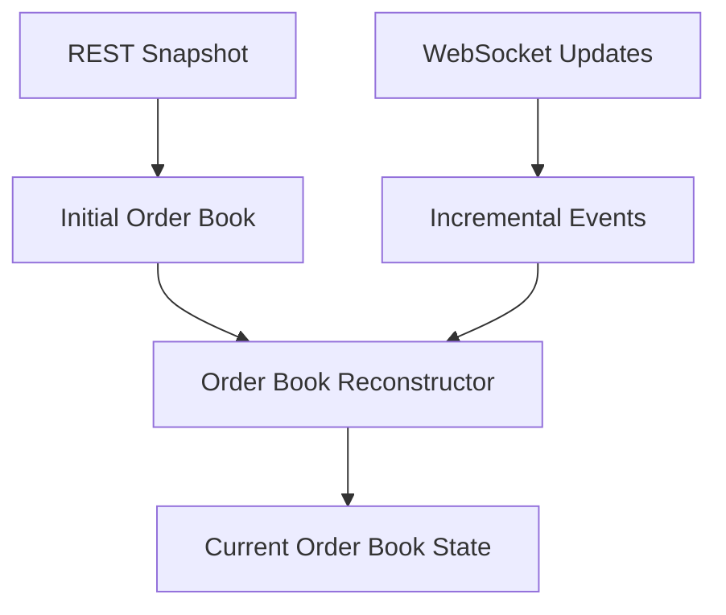
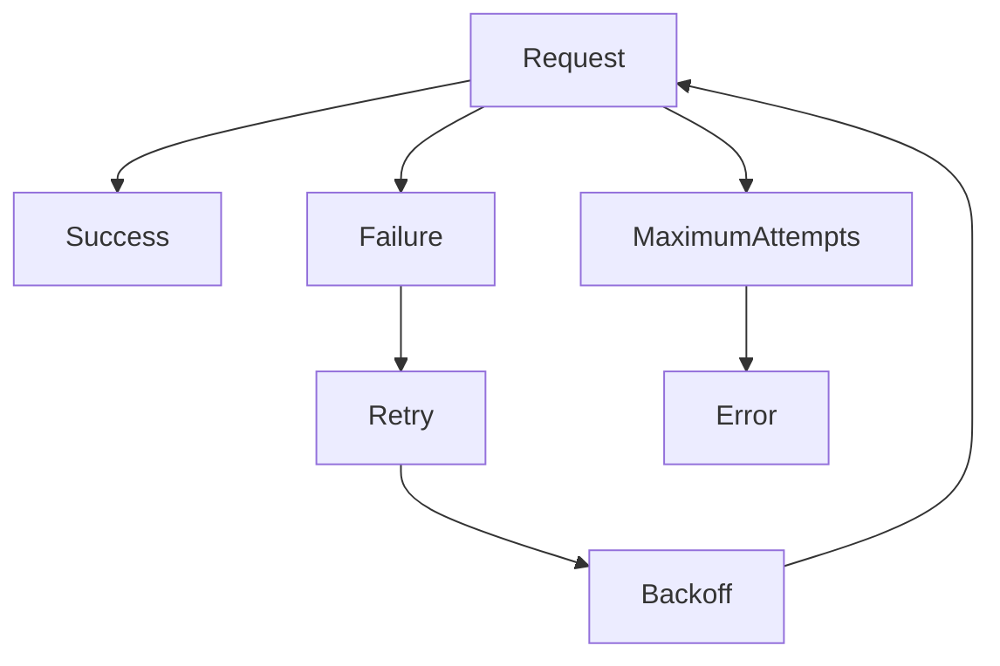
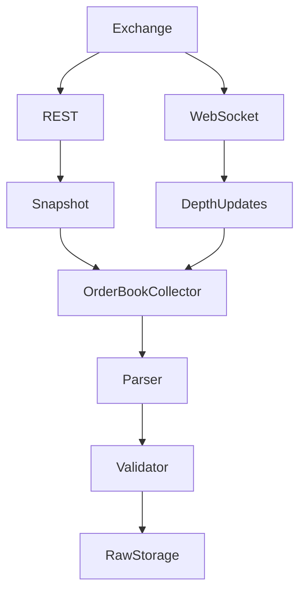
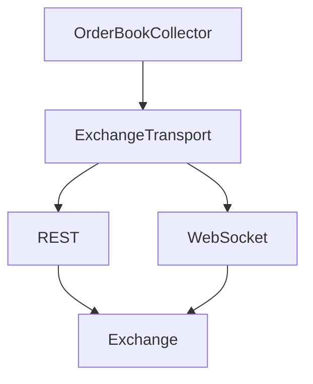

# Order Book Collector

## Overview

The **Order Book Collector** is a runtime component of the ETH Bot data pipeline responsible for acquiring order-book market data for ETH futures.

It supports:

* REST order-book snapshots.
* WebSocket order-book depth updates.
* Retry handling.
* Parser integration.
* Validator integration.

The collector is responsible for **data acquisition**. Order-book parsing, reconstruction, validation, feature engineering, and storage are handled by separate components.

---

# Location

```text
data_pipeline/
└── collectors/
    └── orderbook/
        ├── collector.py
        ├── parser.py
        ├── validator.py
        ├── config.py
        │
        └── md/
            └── collector.md
```

---

# Responsibilities

The Order Book Collector is responsible for:

* Requesting order-book snapshots.
* Receiving live order-book updates.
* Connecting to REST transport.
* Connecting to WebSocket transport.
* Applying retry handling to REST requests.
* Passing raw responses to the parser.
* Passing parsed data to the validator.

The collector is **not** responsible for:

* Parsing exchange-specific payloads.
* Reconstructing the order book.
* Validating price levels.
* Detecting crossed books.
* Calculating bid/ask imbalance.
* Calculating spread.
* Calculating order-book features.
* Persistent storage.
* ML feature generation.
* Strategy decisions.
* Risk management.
* Order execution.

---

# Pipeline Position



---

# Collection Architecture

Order-book collection has two complementary data paths:

```text
                    Exchange
                       │
             ┌─────────┴─────────┐
             │                   │
            REST             WebSocket
             │                   │
             ▼                   ▼
       Full Snapshot       Incremental Updates
             │                   │
             └─────────┬─────────┘
                       ▼
              OrderBook Pipeline
```

The REST snapshot provides the initial state, while WebSocket updates provide ongoing changes.

---

# REST Snapshot Collection

The collector can request a current order-book snapshot through the REST transport.

```text
REST API
   │
   ▼
Order Book Snapshot
   │
   ▼
OrderBookCollector
   │
   ▼
OrderBookParser
```

A snapshot generally contains:

```text
Bids
Asks
Timestamp
Update Identifier
```

The exact fields depend on the exchange.

---

# WebSocket Collection

The collector can subscribe to a live depth stream.

```text
Exchange WebSocket
        │
        ▼
Depth Update
        │
        ▼
OrderBookCollector
        │
        ▼
Callback
```

Live updates may contain:

* Bid updates.
* Ask updates.
* Price levels.
* Quantity changes.
* Update IDs.
* Event timestamps.

---

# Snapshot + Incremental Updates

A reliable order-book system generally requires:



The `OrderBookCollector` should only acquire the two data streams.

The **reconstruction logic should remain outside the collector**.

---

# Configuration

The collector uses configuration such as:

| Parameter     | Description                 |
| ------------- | --------------------------- |
| `symbol`      | Trading symbol              |
| `market_type` | Market type                 |
| `depth_limit` | Number of order-book levels |
| `max_retries` | Maximum REST retry attempts |
| `retry_delay` | Initial retry delay         |

Example:

```python
symbol = "ETHUSDT"

market_type = "futures"

depth_limit = 100

max_retries = 5
```

---

# Symbol

The default symbol is:

```text
ETHUSDT
```

The collector normalizes the configured symbol to uppercase.

Example:

```text
ethusdt
    ↓
ETHUSDT
```

The WebSocket stream can then use the exchange-specific lowercase representation if required.

---

# Depth Limit

The depth limit controls the requested number of order-book levels.

Example:

```text
depth_limit = 100
```

Conceptually:

```text
Bids
├── Level 1
├── Level 2
├── Level 3
├── ...
└── Level 100

Asks
├── Level 1
├── Level 2
├── Level 3
├── ...
└── Level 100
```

The exact supported limits depend on the exchange.

---

# Retry Handling

REST requests use retry handling for temporary failures.



The collector uses exponential backoff:

```text
delay = retry_delay × 2^(attempt - 1)
```

This reduces repeated requests during temporary exchange or network failures.

---

# Error Handling

Potential failures include:

* REST timeout.
* Network interruption.
* Exchange API failure.
* Rate limiting.
* Invalid response.
* WebSocket disconnection.
* WebSocket subscription failure.
* Exchange maintenance.

Persistent failures should be propagated to monitoring and logging systems.

The collector should not silently discard failures.

---

# Parser Integration

The collector passes raw data to `parser.py`.

```text
OrderBookCollector
        │
        ▼
Raw Exchange Response
        │
        ▼
OrderBookParser
        │
        ▼
Standardized Order Book
```

The parser handles:

* Field extraction.
* Field mapping.
* Numeric conversion.
* Timestamp normalization.
* Bid/ask normalization.
* Exchange-specific payload structures.

---

# Validator Integration

After parsing, data is passed to the validator.

```text
Parser
  │
  ▼
Standardized Order Book
  │
  ▼
Validator
  │
  ├── Valid
  │     │
  │     ▼
  │   Storage
  │
  └── Invalid
        │
        ▼
     Monitoring
```

The validator handles data-quality checks rather than the collector.

---

# Order Book State

The collector should not maintain the authoritative order-book state.

Preferred architecture:

```text
Collector
    │
    ├── Snapshot
    │
    └── Updates
          │
          ▼
OrderBook Parser / Reconstructor
          │
          ▼
Current Order Book
```

This makes the acquisition layer stateless and easier to restart.

---

# Data Flow



---

# Runtime Processing

For REST snapshots:

```python
raw_data = collector.collect_snapshot()

parsed_data = collector.parse(raw_data)

validated_data = collector.validate(parsed_data)
```

The convenience method performs:

```python
validated_data = collector.collect_and_process()
```

which represents:

```text
Collect
  ↓
Parse
  ↓
Validate
```

---

# Live Processing

Live collection uses a callback:

```python
collector.collect_live(
    callback=handle_orderbook_event
)
```

The callback receives the raw WebSocket event.

The downstream pipeline can then perform:

```text
Raw Event
    ↓
Parser
    ↓
Validator
    ↓
Reconstructor
    ↓
Current Order Book
```

---

# Exchange Independence

Exchange-specific stream names and API details should not become distributed throughout the collector.

Preferred architecture:



This allows the same order-book collection architecture to support different exchanges.

---

# Relationship With Order-Book Features

The collector does **not** calculate features.

For example, these belong downstream:

```text
Bid-Ask Spread
Order Book Imbalance
Bid Volume
Ask Volume
Depth Imbalance
Liquidity
Market Depth
Pressure
```

The pipeline should remain:

```text
Order Book Collector
        ↓
Order Book Parser
        ↓
Order Book Validator
        ↓
Order Book State
        ↓
Order Book Features
```

---

# Data Storage

The collector should not directly manage persistent storage.

Preferred flow:

```text
Exchange
   ↓
Collector
   ↓
Parser
   ↓
Validator
   ↓
Raw Storage
   ↓
Processed Storage
```

This preserves separation between acquisition and storage.

---

# Testing

Recommended tests include:

* REST snapshot collection.
* Custom depth limits.
* Missing REST collector.
* REST retry behavior.
* Maximum retry failure.
* WebSocket subscription.
* Missing WebSocket collector.
* Stream construction.
* Parser integration.
* Validator integration.
* Empty responses.
* Exchange failures.

Recommended location:

```text
tests/
└── collectors/
    └── orderbook/
        └── test_collector.py
```

---

# Design Principles

The Order Book Collector should be:

* Modular.
* Stateless where possible.
* Fault tolerant.
* Exchange-independent.
* Configurable.
* Testable.
* Observable.
* Restartable.
* Separate from parsing.
* Separate from validation.
* Separate from order-book reconstruction.
* Separate from feature engineering.

---

# Critical Order-Book Principle

Order-book data is fundamentally different from trade data.

A trade is an individual market event:

```text
Trade
  ↓
Parser
  ↓
Validator
```

An order book is a **state that changes through a sequence of updates**:

```text
Snapshot
   +
Update 1
   +
Update 2
   +
Update 3
   +
...
   ↓
Current Order Book
```

Therefore, the ETH Bot should preserve the update identifiers and sequencing information required to reconstruct the book correctly.

The collector's job is to ensure those raw events are reliably acquired.

---

# Summary

The **Order Book Collector** is responsible for acquiring ETH futures order-book snapshots and live depth updates.

Its core flow is:

```text
                 Exchange
                    │
          ┌─────────┴─────────┐
          │                   │
         REST             WebSocket
          │                   │
          ▼                   ▼
      Snapshot          Depth Updates
          │                   │
          └─────────┬─────────┘
                    ▼
          OrderBookCollector
                    ↓
               Parser
                    ↓
              Validator
                    ↓
             Order Book State
                    ↓
             Raw / Processed
```

The key architectural rule is:

```text
Collector  = Acquire

Parser     = Transform

Validator  = Verify

Reconstructor = Build State

Features   = Analyze
```

This separation keeps the order-book ingestion layer reliable enough to support downstream market-microstructure analysis, feature generation, model training, backtesting, and real-time ETH futures decision systems.
