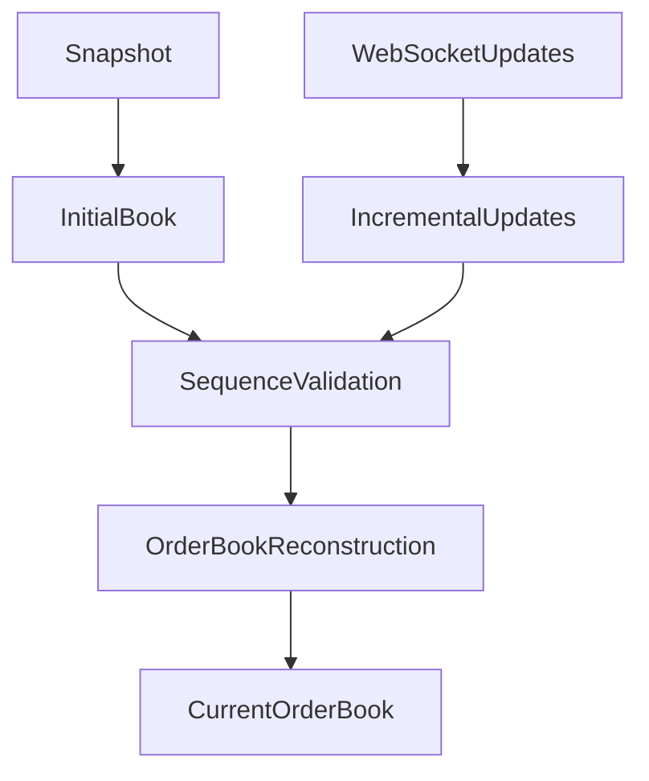
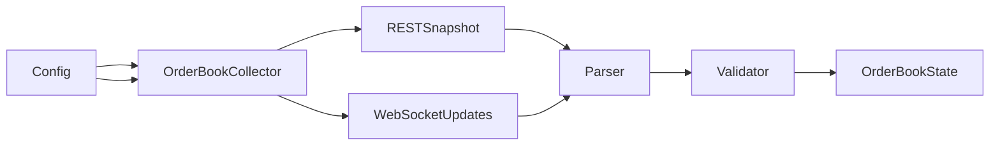
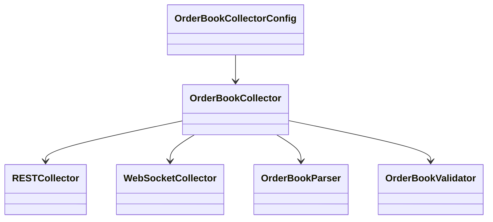

# Order Book Collector Configuration

## Overview

The **Order Book Collector Configuration** defines the runtime settings used by the Order Book Collector to acquire ETH futures order-book data.

It controls:

* Exchange and market selection.
* Trading symbol.
* REST snapshot collection.
* Order-book depth.
* WebSocket collection.
* Reconnection behavior.
* REST retry behavior.
* Network limits.
* Order-book synchronization requirements.
* Raw-data handling.
* Logging.

The configuration contains operational settings only. API credentials and secrets must be supplied through secure environment variables or a dedicated secret-management system.

---

# Location

```text
data_pipeline/
└── collectors/
    └── orderbook/
        ├── collector.py
        ├── parser.py
        ├── validator.py
        ├── config.py
        │
        └── md/
            └── config.md
```

---

# Configuration Architecture

```mermaid
flowchart TD

Configuration

-->

OrderBookCollectorConfig

-->

OrderBookCollector

-->

REST / WebSocket

-->

Exchange
```

---

# Exchange Configuration

| Field         | Description         | Default   |
| ------------- | ------------------- | --------- |
| `exchange`    | Exchange identifier | `binance` |
| `market_type` | Market category     | `futures` |

Example:

```yaml
exchange: binance
market_type: futures
```

The collector architecture should remain exchange-independent even if Binance is the initial exchange.

---

# Market Configuration

## Symbol

```yaml
symbol: ETHUSDT
```

The default market is ETH/USDT futures.

The collector normalizes the symbol to uppercase internally.

```text
ethusdt
   ↓
ETHUSDT
```

---

# Snapshot Configuration

| Field               | Description                         | Default |
| ------------------- | ----------------------------------- | ------: |
| `snapshot_enabled`  | Enable REST snapshots               |  `true` |
| `depth_limit`       | Number of requested levels          |   `100` |
| `snapshot_interval` | Optional periodic snapshot interval |  `null` |

Example:

```yaml
snapshot_enabled: true

depth_limit: 100

snapshot_interval: null
```

A snapshot provides the initial state of the order book.

---

# Order-Book Depth

`depth_limit` controls how many bid and ask levels are requested.

Example:

```text
depth_limit: 100
```

Conceptually:

```text
Bids
├── Level 1
├── Level 2
├── Level 3
├── ...
└── Level 100

Asks
├── Level 1
├── Level 2
├── Level 3
├── ...
└── Level 100
```

The exact supported depth limits depend on the exchange.

---

# Live Collection

| Field               | Description                | Default |
| ------------------- | -------------------------- | ------: |
| `live_enabled`      | Enable live collection     |  `true` |
| `websocket_enabled` | Enable WebSocket transport |  `true` |

Example:

```yaml
live_enabled: true

websocket_enabled: true
```

Live collection provides incremental order-book updates.

---

# WebSocket Reconnection

| Field                    | Description                | Default |
| ------------------------ | -------------------------- | ------: |
| `reconnect_enabled`      | Automatically reconnect    |  `true` |
| `reconnect_delay`        | Initial reconnect delay    |   `2.0` |
| `max_reconnect_attempts` | Maximum reconnect attempts |    `10` |

Example:

```yaml
reconnect_enabled: true

reconnect_delay: 2.0

max_reconnect_attempts: 10
```

The reconnect delay should normally use exponential backoff rather than repeatedly reconnecting at maximum speed.

---

# REST Retry

| Field                 | Description                 | Default |
| --------------------- | --------------------------- | ------: |
| `max_retries`         | Maximum REST retry attempts |     `5` |
| `retry_delay`         | Initial retry delay         |   `2.0` |
| `exponential_backoff` | Enable exponential backoff  |  `true` |

Example:

```yaml
max_retries: 5

retry_delay: 2.0

exponential_backoff: true
```

Conceptually:

```text
Attempt 1
   ↓
Failure
   ↓
2 seconds
   ↓
Attempt 2
   ↓
Failure
   ↓
4 seconds
   ↓
Attempt 3
```

---

# Network Configuration

| Field                   | Description               | Default |
| ----------------------- | ------------------------- | ------: |
| `timeout`               | Network request timeout   |    `30` |
| `rate_limit_per_second` | Maximum REST request rate |    `10` |

Example:

```yaml
timeout: 30

rate_limit_per_second: 10
```

Rate limiting should preferably be implemented by the shared transport layer rather than independently inside each collector.

---

# Order-Book Synchronization

Order-book synchronization is a critical part of the configuration.

```yaml
require_snapshot_before_updates: true

validate_update_sequence: true

preserve_update_id: true
```

These settings support the following process:



---

# Snapshot Before Updates

```yaml
require_snapshot_before_updates: true
```

The collector should require an initial REST snapshot before incremental WebSocket updates are treated as part of the current order-book state.

This helps establish a known starting point.

---

# Update Sequence Validation

```yaml
validate_update_sequence: true
```

Order-book updates are sequence-sensitive.

Conceptually:

```text
Update 1001
     ↓
Update 1002
     ↓
Update 1003
     ↓
Update 1004
```

If the system detects:

```text
1001
1002
1004
```

then update `1003` may have been missed.

The system should detect the gap and trigger an appropriate recovery procedure, normally involving a fresh snapshot.

---

# Update ID Preservation

```yaml
preserve_update_id: true
```

Update identifiers should be retained because they are useful for:

* Sequence verification.
* Gap detection.
* Order-book reconstruction.
* Debugging.
* Data-quality analysis.
* Recovery procedures.

---

# Raw Data Configuration

| Field                   | Description                | Default |
| ----------------------- | -------------------------- | ------: |
| `preserve_raw_response` | Preserve exchange response |  `true` |
| `batch_size`            | Processing batch size      |   `100` |

Example:

```yaml
preserve_raw_response: true

batch_size: 100
```

Preserving raw responses makes it possible to reprocess data if the parser or schema changes later.

---

# Logging

Supported levels:

```text
DEBUG
INFO
WARNING
ERROR
```

Default:

```yaml
log_level: INFO
```

The collector should produce useful operational logs for:

* Snapshot requests.
* WebSocket connections.
* Reconnections.
* Sequence gaps.
* Retry attempts.
* Exchange errors.
* Collector shutdown.

---

# Complete Configuration Example

```yaml
exchange: binance

market_type: futures

symbol: ETHUSDT

snapshot_enabled: true

depth_limit: 100

snapshot_interval: null

live_enabled: true

websocket_enabled: true

reconnect_enabled: true

reconnect_delay: 2.0

max_reconnect_attempts: 10

max_retries: 5

retry_delay: 2.0

exponential_backoff: true

timeout: 30

rate_limit_per_second: 10

require_snapshot_before_updates: true

validate_update_sequence: true

preserve_update_id: true

preserve_raw_response: true

batch_size: 100

log_level: INFO

version: "1.0"
```

---

# Runtime Flow



---

# Configuration and Reconstruction

The configuration controls acquisition and synchronization requirements, but it should not contain order-book analytics.

The separation should remain:

```text
Collector Configuration
        │
        ▼
Data Acquisition
        │
        ▼
Order Book State
        │
        ▼
Order Book Features
```

Features such as:

```text
Bid-Ask Spread
Order Book Imbalance
Bid Volume
Ask Volume
Depth Imbalance
Liquidity
Price Pressure
```

belong in:

```text
data_pipeline/
└── schema/
    └── features/
        └── orderbook_features.py
```

---

# Security

The configuration must not contain:

```text
API_KEY
API_SECRET
PRIVATE_KEY
PASSWORD
```

Credentials should be provided through:

```text
Environment Variables
        │
        ▼
Secret Management
        │
        ▼
Exchange Transport
```

---

# Configuration Validation

Before starting the collector, configuration should be validated.

Examples:

```text
symbol != empty

depth_limit > 0

max_retries >= 0

retry_delay >= 0

timeout > 0

rate_limit_per_second > 0

max_reconnect_attempts >= 0

reconnect_delay >= 0

batch_size > 0
```

Invalid configuration should prevent startup rather than producing unreliable order-book data.

---

# Relationship With Other Components



---

# Design Principles

The configuration should be:

* Externalized.
* Validated.
* Reproducible.
* Exchange-independent where possible.
* Free of secrets.
* Easy to override.
* Suitable for historical and live collection.
* Designed for reliable order-book synchronization.

---

# Critical Design Rule

The order-book collector should preserve the distinction between **acquisition** and **state reconstruction**.

```text
Collector
    ↓
Acquire Snapshot
    +
Acquire Updates
    ↓
Parser
    ↓
Validator
    ↓
Reconstructor
    ↓
Current Order Book
    ↓
Order-Book Features
```

The collector should not become responsible for calculating spread, imbalance, liquidity, or other market-microstructure features.

---

# Summary

The **Order Book Collector Configuration** defines how the ETH futures bot acquires and synchronizes order-book data.

Its core configuration flow is:

```text
Configuration
      ↓
OrderBookCollector
      ↓
┌───────────────┐
│ REST Snapshot │
│       +       │
│ WebSocket     │
│ Updates       │
└───────┬───────┘
        ↓
     Parser
        ↓
    Validator
        ↓
  Reconstruction
        ↓
 Current Order Book
        ↓
 Order-Book Features
```

The most important settings are the snapshot requirement, update-sequence validation, and preservation of update identifiers. These provide the foundation for maintaining a reliable real-time ETH futures order book.
