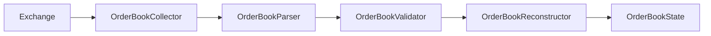
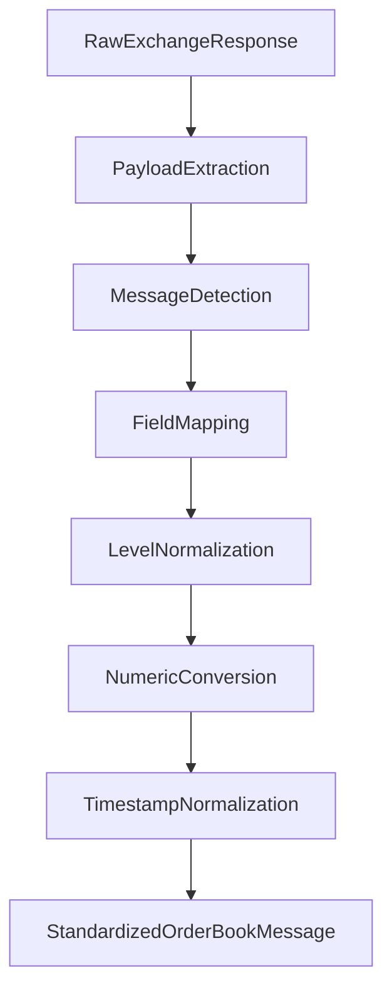
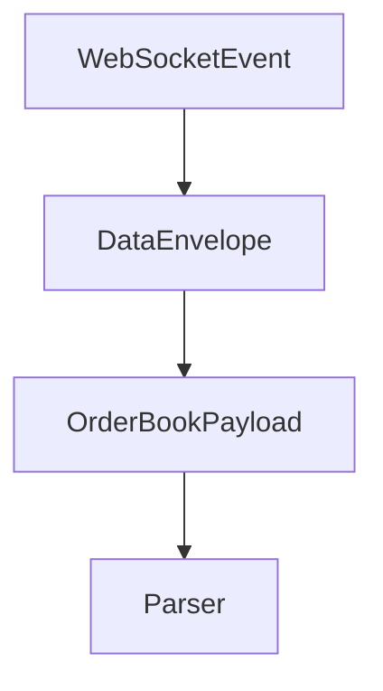
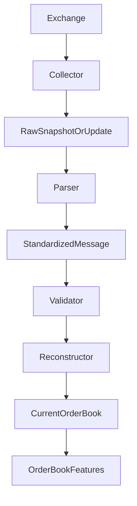
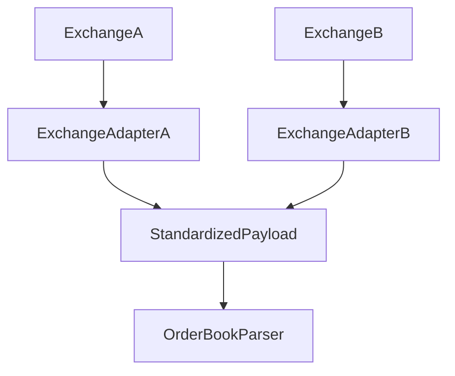

# Order Book Parser

## Overview

The **Order Book Parser** is a runtime component of the ETH Bot data pipeline responsible for transforming exchange-specific order-book responses into a standardized internal representation.

It supports two primary message types:

* REST order-book snapshots.
* WebSocket incremental depth updates.

The parser performs **extraction, mapping, and normalization**. It does not maintain the live order-book state.

---

# Location

```text
data_pipeline/
└── collectors/
    └── orderbook/
        ├── collector.py
        ├── parser.py
        ├── validator.py
        ├── config.py
        │
        └── md/
            ├── collector.md
            ├── config.md
            └── parser.md
```

---

# Responsibilities

The Order Book Parser is responsible for:

* Parsing REST snapshots.
* Parsing WebSocket depth updates.
* Detecting snapshot versus update messages.
* Extracting exchange payloads from event envelopes.
* Normalizing symbol fields.
* Normalizing timestamps.
* Converting price values to numeric values.
* Converting quantity values to numeric values.
* Normalizing bid levels.
* Normalizing ask levels.
* Preserving update identifiers.

The parser is **not** responsible for:

* Making API requests.
* Managing WebSocket connections.
* Validating business rules.
* Reconstructing the complete order book.
* Applying incremental updates.
* Detecting sequence gaps.
* Storing data.
* Calculating spread.
* Calculating order-book imbalance.
* Generating ML features.
* Making trading decisions.

---

# Pipeline Position



The parser sits between **data acquisition** and **data validation/reconstruction**.

---

# Parser Architecture



---

# Supported Message Types

The parser supports:

```text
snapshot
update
```

## Snapshot

A snapshot represents a complete order-book state received from a REST endpoint.

Conceptually:

```text
Snapshot
├── Symbol
├── Timestamp
├── Last Update ID
├── Bids
└── Asks
```

---

## Incremental Update

An incremental update represents changes to selected bid and ask price levels.

Conceptually:

```text
Update
├── Symbol
├── Timestamp
├── First Update ID
├── Final Update ID
├── Bids
└── Asks
```

---

# REST Snapshot

A REST response may contain:

```json
{
  "symbol": "ETHUSDT",
  "lastUpdateId": 123456,
  "bids": [
    ["3520.10", "10.5"],
    ["3520.00", "8.2"]
  ],
  "asks": [
    ["3520.20", "7.1"],
    ["3520.30", "12.4"]
  ]
}
```

The parser converts this exchange representation into a standardized structure.

---

# Standardized Snapshot

The result becomes conceptually:

```python
{
    "message_type": "snapshot",
    "symbol": "ETHUSDT",
    "timestamp": ...,
    "last_update_id": 123456,
    "first_update_id": None,
    "final_update_id": None,
    "bids": [
        {
            "price": 3520.10,
            "quantity": 10.5
        }
    ],
    "asks": [
        {
            "price": 3520.20,
            "quantity": 7.1
        }
    ]
}
```

The parser therefore removes exchange-specific naming differences while preserving the information required downstream.

---

# WebSocket Update

A WebSocket depth message may contain:

```json
{
  "data": {
    "symbol": "ETHUSDT",
    "event_time": 1785931200000,
    "firstUpdateId": 123457,
    "finalUpdateId": 123460,
    "bids": [
      ["3520.10", "5.0"]
    ],
    "asks": [
      ["3520.20", "0.0"]
    ]
  }
}
```

The parser first unwraps the `data` payload and then normalizes it.

---

# Standardized Update

The result becomes:

```python
{
    "message_type": "update",
    "symbol": "ETHUSDT",
    "timestamp": ...,
    "last_update_id": None,
    "first_update_id": 123457,
    "final_update_id": 123460,
    "bids": [
        {
            "price": 3520.10,
            "quantity": 5.0
        }
    ],
    "asks": [
        {
            "price": 3520.20,
            "quantity": 0.0
        }
    ]
}
```

A quantity of `0.0` is intentionally preserved because an incremental order-book update may use zero quantity to indicate removal of a price level.

The validator or reconstructor should determine whether that representation is valid for the particular exchange protocol.

---

# Payload Unwrapping

WebSocket messages frequently contain an outer event envelope:

```text
Event
└── data
    └── Order Book Update
```

The parser extracts the actual payload before processing it.



---

# Message Type Detection

When the caller does not explicitly provide a message type, the parser attempts to detect it.

Update messages commonly contain:

```text
U
u
firstUpdateId
finalUpdateId
```

Snapshot messages commonly contain:

```text
lastUpdateId
```

The parser uses these fields to distinguish the two message types.

For maximum reliability, callers can explicitly specify:

```python
parser.parse(
    raw_data,
    message_type="snapshot"
)
```

or:

```python
parser.parse(
    raw_data,
    message_type="update"
)
```

---

# Field Mapping

The parser supports common exchange naming variations.

| Standard Field    | Supported Input Fields                      |
| ----------------- | ------------------------------------------- |
| `symbol`          | `symbol`, `s`                               |
| `timestamp`       | `timestamp`, `time`, `T`, `event_time`, `E` |
| `last_update_id`  | `last_update_id`, `lastUpdateId`            |
| `first_update_id` | `first_update_id`, `firstUpdateId`, `U`     |
| `final_update_id` | `final_update_id`, `finalUpdateId`, `u`     |
| `bids`            | `bids`, `b`, `bid_updates`                  |
| `asks`            | `asks`, `a`, `ask_updates`                  |

Exchange-specific mappings can be extended through an adapter layer.

---

# Price Level Normalization

Order-book levels may arrive as arrays:

```text
[
    "3520.25",
    "1.50"
]
```

The parser converts them into:

```python
{
    "price": 3520.25,
    "quantity": 1.50
}
```

This provides a consistent representation for downstream components.

---

# Supported Level Formats

The parser can handle array-style levels:

```python
[
    price,
    quantity
]
```

and mapping-style levels:

```python
{
    "price": price,
    "quantity": quantity
}
```

Common exchange aliases such as `p`, `q`, and `qty` are also supported.

---

# Numeric Conversion

Exchange APIs frequently return prices and quantities as strings.

Example:

```text
"3520.25"
```

becomes:

```text
3520.25
```

Likewise:

```text
"1.500"
```

becomes:

```text
1.5
```

Numeric conversion belongs to the parser because it is a **representation transformation**, not a validation rule.

---

# Timestamp Normalization

The parser supports:

* Python `datetime`.
* Unix timestamps.
* Unix millisecond timestamps.
* Numeric timestamp strings.
* ISO-8601 timestamps.

All timestamps are normalized to UTC-aware `datetime` objects.

Conceptually:

```text
Exchange Timestamp
        ↓
Timestamp Parser
        ↓
UTC-aware datetime
```

---

# Update Identifiers

Update identifiers are critical for order-book synchronization.

For example:

```text
First Update ID = 1001
Final Update ID = 1005
```

means that the update represents a range of sequence identifiers.

The parser preserves these values.

It does **not** decide whether the update should be applied.

---

# Parser vs Reconstructor

This distinction is critical.

## Parser

```text
Raw Message
    ↓
Extract
    ↓
Normalize
    ↓
Standardized Message
```

## Reconstructor

```text
Snapshot
    +
Update 1
    +
Update 2
    +
Update 3
    ↓
Current Order Book
```

The parser must not become responsible for maintaining the current book.

---

# Sequence Validation Boundary

The parser preserves:

```text
first_update_id
final_update_id
last_update_id
```

The validator/reconstructor uses these values to determine whether the update sequence is valid.

Example:

```text
Snapshot
last_update_id = 1000

Update:
first_update_id = 1001
final_update_id = 1005
```

This can be passed downstream for sequence verification.

If the next update begins at:

```text
1006
```

the sequence is continuous.

If it unexpectedly begins at:

```text
1010
```

there may be a missing update range.

The parser should **not repair or reorder the stream**.

---

# Zero Quantity Updates

A zero quantity is not automatically invalid for an incremental order-book update.

Example:

```python
{
    "price": 3520.25,
    "quantity": 0.0
}
```

This can represent deletion of the price level.

Therefore, the parser preserves zero quantities.

The reconstruction layer can interpret:

```text
quantity = 0
```

as:

```text
Remove price level
```

when required by the exchange protocol.

This is different from trade data, where a zero trade quantity would generally be invalid.

---

# Error Handling

The parser raises errors when it cannot safely transform the payload.

Possible errors include:

* `None` input.
* Non-mapping order-book payload.
* Unknown message type.
* Invalid price.
* Invalid quantity.
* Invalid update ID.
* Invalid timestamp.
* Invalid order-book level.
* Missing required level fields.
* Unsupported payload structure.

The parser should not silently manufacture missing market data.

---

# Parser Output

The parser produces standardized messages with the following conceptual structure:

```text
OrderBookMessage
│
├── message_type
├── symbol
├── timestamp
├── last_update_id
├── first_update_id
├── final_update_id
├── bids
│   ├── price
│   └── quantity
│
└── asks
    ├── price
    └── quantity
```

---

# Runtime Integration

The collector can invoke the parser:

```python
raw_data = collector.collect_snapshot()

parsed = parser.parse(
    raw_data,
    message_type="snapshot"
)
```

For live updates:

```python
parsed = parser.parse(
    websocket_event,
    message_type="update"
)
```

The parsed result then proceeds to validation.

---

# Complete Runtime Flow



---

# Relationship With Order-Book Features

The parser must not calculate market-microstructure metrics.

The following belong downstream:

```text
Bid-Ask Spread
Order Book Imbalance
Bid Volume
Ask Volume
Depth Imbalance
Liquidity
Price Pressure
Book Slope
Depth Concentration
```

Preferred architecture:

```text
Raw Order Book
      ↓
Parser
      ↓
Validator
      ↓
Reconstructor
      ↓
Current Order Book
      ↓
Order Book Features
```

---

# Exchange Independence

The parser should remain as exchange-independent as practical.

Exchange-specific differences should ideally be isolated through adapters:



This prevents the parser from accumulating large numbers of exchange-specific branches.

---

# Testing

Recommended tests include:

## Snapshot Tests

* Valid REST snapshot.
* Missing bids.
* Missing asks.
* Invalid price.
* Invalid quantity.
* Invalid update ID.
* Empty order book.

## Update Tests

* Valid WebSocket update.
* Event envelope handling.
* First update ID parsing.
* Final update ID parsing.
* Bid updates.
* Ask updates.
* Zero-quantity level updates.

## Timestamp Tests

* Unix seconds.
* Unix milliseconds.
* ISO-8601.
* UTC datetime.
* Naive datetime.

## Error Tests

* `None`.
* Invalid payload type.
* Invalid level type.
* Invalid numeric values.
* Unknown message type.

Recommended location:

```text
tests/
└── collectors/
    └── orderbook/
        └── test_parser.py
```

---

# Design Principles

The Order Book Parser should be:

* Deterministic.
* Stateless.
* Fast.
* Reusable.
* Testable.
* Exchange-aware through adapters.
* Independent of storage.
* Independent of validation.
* Independent of reconstruction.
* Independent of feature engineering.
* Careful not to discard sequence information.

---

# Critical Design Rule

The parser must preserve the distinction between a **snapshot** and an **incremental update**.

```text
Snapshot
    ↓
Complete Initial State


Update
    ↓
Change to Existing State
```

These two message types should never be merged into a single ambiguous representation.

The parser's job is:

```text
Acquire → Parse → Normalize
```

not:

```text
Acquire → Parse → Reconstruct → Analyze
```

---

# Summary

The **Order Book Parser** converts exchange-specific order-book messages into standardized snapshot and incremental-update records.

Its core flow is:

```text
Exchange Response
       ↓
Payload Extraction
       ↓
Message Detection
       ↓
Field Mapping
       ↓
Level Normalization
       ↓
Numeric Conversion
       ↓
Timestamp Normalization
       ↓
Sequence Metadata Preservation
       ↓
Standardized Order Book Message
       ↓
Validator
       ↓
Order Book Reconstructor
```

The key principle is that **parsing and reconstruction remain separate**. The parser preserves the information needed to reconstruct the ETH futures order book accurately without owning the live order-book state itself.
