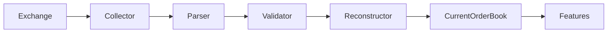
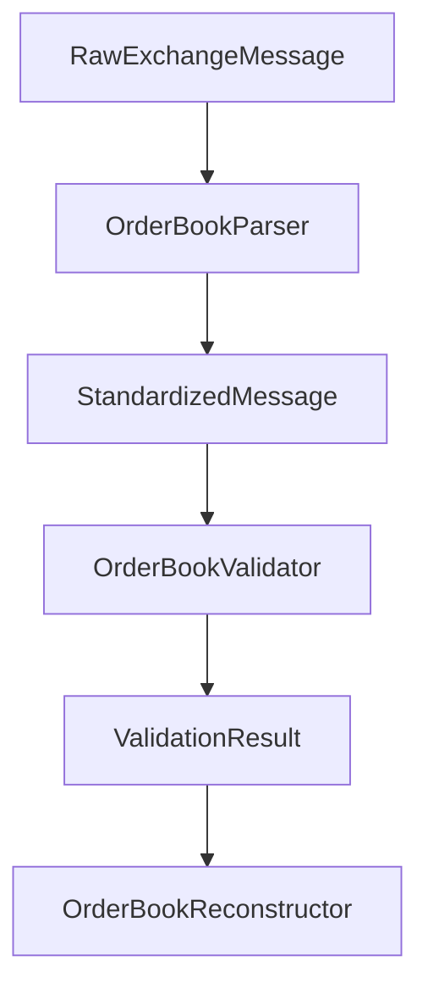
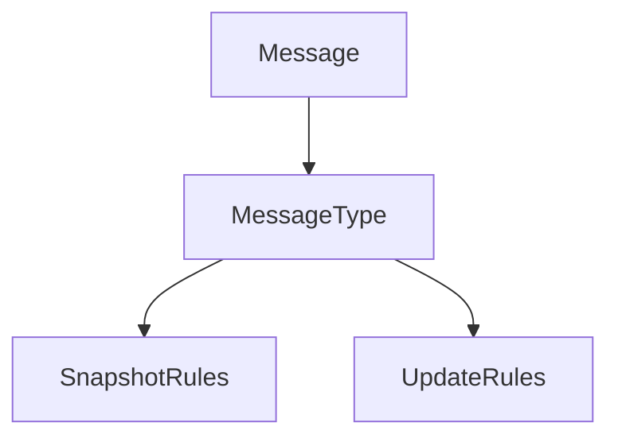
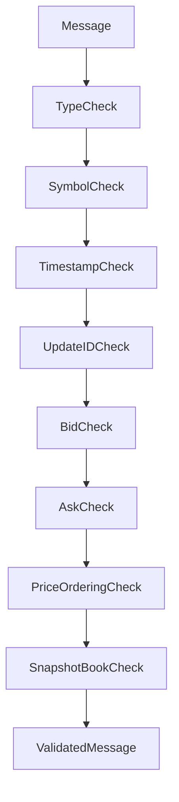

# Order Book Validator

## Overview

The **Order Book Validator** validates standardized order-book messages produced by the `OrderBookParser`.

It acts as a quality gate between parsing and order-book reconstruction.

The validator checks:

* Message type.
* Symbol.
* Timestamp.
* Update identifiers.
* Bid levels.
* Ask levels.
* Price validity.
* Quantity validity.
* Price ordering.
* Snapshot bid/ask relationship.

The validator does **not** reconstruct the live order book.

---

# Location

```text
data_pipeline/
└── collectors/
    └── orderbook/
        ├── collector.py
        ├── parser.py
        ├── validator.py
        ├── config.py
        │
        └── md/
            ├── collector.md
            ├── config.md
            ├── parser.md
            └── validator.md
```

---

# Pipeline Position



The validator is therefore a **data-quality boundary**, not an order-book processing engine.

---

# Responsibilities

The validator is responsible for:

* Validating standardized message structure.
* Validating snapshot messages.
* Validating incremental updates.
* Validating symbols.
* Validating timestamps.
* Validating update IDs.
* Validating bid levels.
* Validating ask levels.
* Checking numeric values.
* Checking price ordering.
* Detecting crossed or locked snapshots.
* Allowing valid zero-quantity update levels.

The validator is not responsible for:

* Calling exchange APIs.
* Managing WebSocket connections.
* Parsing exchange-specific payloads.
* Reconstructing the current book.
* Applying updates.
* Detecting historical missing updates across multiple messages.
* Calculating order-book features.
* Storing data.
* Making trading decisions.

---

# Validation Architecture



---

# Supported Message Types

The validator supports two message types:

```text
snapshot
update
```

Any other value is rejected.

Example:

```python
message_type = "snapshot"
```

Valid.

```python
message_type = "update"
```

Valid.

```python
message_type = "trade"
```

Invalid for the order-book validator.

---

# Standardized Message Structure

The validator expects the parser to produce a structure similar to:

```python
{
    "message_type": "snapshot",
    "symbol": "ETHUSDT",
    "timestamp": ...,
    "last_update_id": 123456,
    "first_update_id": None,
    "final_update_id": None,
    "bids": [
        {
            "price": 3520.10,
            "quantity": 10.5
        }
    ],
    "asks": [
        {
            "price": 3520.20,
            "quantity": 7.1
        }
    ],
}
```

For an incremental update:

```python
{
    "message_type": "update",
    "symbol": "ETHUSDT",
    "timestamp": ...,
    "last_update_id": None,
    "first_update_id": 123457,
    "final_update_id": 123460,
    "bids": [
        {
            "price": 3520.10,
            "quantity": 5.0
        }
    ],
    "asks": [
        {
            "price": 3520.20,
            "quantity": 0.0
        }
    ],
}
```

---

# Message Type Validation

The validator accepts:

```text
snapshot
update
```

The message type determines which additional validation rules are applied.



---

# Symbol Validation

The symbol must be a non-empty string.

Valid:

```text
ETHUSDT
```

Invalid:

```text
""
```

Invalid:

```text
None
```

Invalid:

```text
3520
```

The validator checks that a usable market identifier is present.

---

# Timestamp Validation

The timestamp must be a `datetime` object.

It must also be timezone-aware.

Valid conceptually:

```python
datetime(
    ...,
    tzinfo=timezone.utc
)
```

Invalid:

```python
datetime(...)
```

when no timezone information is attached.

The parser is responsible for converting exchange timestamps into this representation.

The validator is responsible for ensuring the conversion produced a valid timestamp.

---

# Snapshot Update ID

A snapshot must contain:

```text
last_update_id
```

The value must be a positive integer.

Example:

```text
last_update_id = 123456
```

Invalid:

```text
last_update_id = 0
```

Invalid:

```text
last_update_id = -1
```

Invalid:

```text
last_update_id = None
```

The snapshot's `last_update_id` establishes the point from which incremental updates can be synchronized.

---

# Incremental Update IDs

An incremental update must contain:

```text
first_update_id
final_update_id
```

Example:

```text
first_update_id = 123457
final_update_id = 123460
```

The validator requires:

```text
first_update_id <= final_update_id
```

Therefore:

```text
123457 → 123460
```

is valid.

But:

```text
123460 → 123457
```

is invalid.

---

# Sequence Validation Boundary

The validator verifies the **internal consistency of one update**.

For example:

```text
first_update_id = 1001
final_update_id = 1005
```

is structurally valid.

However, the validator should not assume that the next message is correct.

For example:

```text
Update 1:
1001 → 1005

Update 2:
1010 → 1015
```

The missing range:

```text
1006 → 1009
```

requires cross-message sequence tracking.

That responsibility belongs to the order-book reconstruction/synchronization layer.

Therefore:

```text
Validator
    ↓
Validate individual message

Reconstructor / Synchronizer
    ↓
Validate sequence continuity across messages
```

---

# Bid Validation

Bids must be represented as a list.

Each level must contain:

```text
price
quantity
```

Example:

```python
{
    "price": 3520.10,
    "quantity": 10.5
}
```

---

# Ask Validation

Asks follow the same structural requirements:

```python
{
    "price": 3520.20,
    "quantity": 7.1
}
```

Both bids and asks must contain valid numeric values.

---

# Price Validation

Prices must:

* Be numeric.
* Be finite.
* Be greater than zero.

Valid:

```text
3520.25
```

Invalid:

```text
0
```

Invalid:

```text
-3520.25
```

Invalid:

```text
NaN
```

Invalid:

```text
Infinity
```

---

# Quantity Validation

Quantities must be numeric and finite.

For snapshots:

```text
quantity > 0
```

For incremental updates:

```text
quantity >= 0
```

This distinction is intentional.

---

# Zero-Quantity Updates

A zero quantity has a special meaning for order-book updates.

Example:

```python
{
    "price": 3520.25,
    "quantity": 0.0
}
```

This may mean:

```text
Remove the 3520.25 price level.
```

Therefore:

```text
Snapshot quantity = 0
```

is invalid.

But:

```text
Update quantity = 0
```

can be valid.

The validator preserves this distinction.

---

# Bid Price Ordering

Within a standardized bid list, prices should normally be ordered from highest to lowest.

Example:

```text
3520.10
3519.90
3519.50
3519.00
```

Valid.

This allows:

```text
bids[0]
```

to represent the best bid.

Invalid ordering:

```text
3519.50
3520.10
3519.00
```

The validator can reject this ordering.

---

# Ask Price Ordering

Ask prices should normally be ordered from lowest to highest.

Example:

```text
3520.20
3520.40
3520.80
3521.00
```

Valid.

This allows:

```text
asks[0]
```

to represent the best ask.

Invalid ordering:

```text
3520.80
3520.20
3521.00
```

---

# Best Bid and Best Ask

For a valid snapshot:

```text
best_bid < best_ask
```

Conceptually:

```text
Best Bid
   ↓
3520.10

Best Ask
   ↓
3520.20
```

Therefore:

```text
3520.10 < 3520.20
```

is valid.

---

# Crossed Book

A crossed book occurs when:

```text
best_bid >= best_ask
```

Example:

```text
Best Bid = 3520.30
Best Ask = 3520.20
```

This produces:

```text
3520.30 >= 3520.20
```

and the snapshot is rejected.

---

# Locked Book

A locked book occurs when:

```text
best_bid == best_ask
```

Example:

```text
Best Bid = 3520.20
Best Ask = 3520.20
```

The validator's snapshot rule rejects this because the expected relationship is:

```text
best_bid < best_ask
```

---

# Why Crossed-Book Validation Matters

A crossed snapshot may indicate:

* Corrupted data.
* Incorrect parsing.
* Incorrect sorting.
* Inconsistent exchange payload.
* Incorrect snapshot processing.
* Data synchronization problems.

It should not silently flow into feature engineering.

---

# Validation Flow



If any required validation fails, the message can be rejected.

---

# Strict and Non-Strict Modes

The validator supports:

```python
reject_invalid=True
```

by default.

In strict mode:

```text
Invalid message
      ↓
Validation error
      ↓
Reject
```

A non-strict configuration can collect validation errors without immediately raising an exception.

This can be useful for diagnostics and data-quality monitoring.

---

# Validation API

## General Validation

```python
validator.validate(message)
```

Returns the message when validation succeeds.

---

## Error Collection

```python
errors = validator.validate_message(message)
```

Returns:

```text
[]
```

when the message is valid.

Otherwise:

```text
[
    "error 1",
    "error 2"
]
```

---

## Boolean Validation

```python
validator.is_valid(message)
```

Returns:

```text
True
```

or:

```text
False
```

---

# Snapshot Validation

The dedicated snapshot method:

```python
validator.validate_snapshot(message)
```

requires:

```text
message_type == "snapshot"
```

and applies all standard snapshot rules.

---

# Update Validation

The dedicated update method:

```python
validator.validate_update(message)
```

requires:

```text
message_type == "update"
```

and applies incremental-update rules.

---

# Error Handling

The validator should fail explicitly rather than silently modifying invalid market data.

Examples of invalid conditions:

```text
Invalid message type
Missing symbol
Empty symbol
Invalid timestamp
Naive timestamp
Missing snapshot update ID
Missing update sequence ID
Reversed update ID range
Invalid price
Invalid quantity
Non-finite price
Non-finite quantity
Incorrect bid ordering
Incorrect ask ordering
Crossed snapshot
Locked snapshot
```

---

# Parser and Validator Relationship

The parser transforms representation.

```text
Exchange Payload
       ↓
Parser
       ↓
Standardized Message
```

The validator verifies correctness.

```text
Standardized Message
       ↓
Validator
       ↓
Valid / Invalid
```

They should remain separate.

---

# Validator and Reconstructor Relationship

The validator performs message-level validation.

The reconstructor performs state-level processing.

```text
Parser
   ↓
Validator
   ↓
┌───────────────────────────┐
│ Valid Snapshot / Update   │
└──────────────┬────────────┘
               ↓
       Order Book Sync
               ↓
      Order Book Reconstruction
               ↓
        Current Book State
```

The validator does not mutate the current book.

---

# Validator and Feature Engineering

Order-book features belong downstream.

Examples:

```text
Bid-Ask Spread
Order Book Imbalance
Depth Imbalance
Bid Volume
Ask Volume
Liquidity
Price Pressure
Depth Concentration
```

The architecture should remain:

```text
Raw Data
   ↓
Parser
   ↓
Validator
   ↓
Reconstructor
   ↓
Order Book State
   ↓
Order Book Features
```

---

# Data Quality Principle

Invalid market data should not be allowed to silently contaminate:

```text
Processed Data
       ↓
Features
       ↓
Datasets
       ↓
ML Models
       ↓
Trading Strategy
       ↓
Risk Engine
```

Therefore, validation occurs as early as possible after parsing.

---

# Recommended Validation Tests

The validator should have dedicated tests for:

## Message Tests

```text
Valid snapshot
Valid update
Invalid message type
```

## Symbol Tests

```text
Valid symbol
Missing symbol
Empty symbol
Non-string symbol
```

## Timestamp Tests

```text
Valid UTC timestamp
Naive timestamp
Missing timestamp
Invalid timestamp
```

## Snapshot Tests

```text
Valid last_update_id
Missing last_update_id
Zero update ID
Negative update ID
```

## Update Tests

```text
Valid first/final IDs
first_update_id > final_update_id
Missing first_update_id
Missing final_update_id
```

## Level Tests

```text
Valid bid
Valid ask
Invalid price
Negative price
Zero price
Invalid quantity
Negative quantity
Zero update quantity
```

## Ordering Tests

```text
Correct bid ordering
Incorrect bid ordering
Correct ask ordering
Incorrect ask ordering
```

## Book Integrity Tests

```text
Valid best bid / ask
Crossed book
Locked book
```

Recommended location:

```text
tests/
└── collectors/
    └── orderbook/
        └── test_validator.py
```

---

# Example Valid Snapshot

```python
{
    "message_type": "snapshot",
    "symbol": "ETHUSDT",
    "timestamp": utc_timestamp,
    "last_update_id": 1000,
    "first_update_id": None,
    "final_update_id": None,
    "bids": [
        {
            "price": 3520.10,
            "quantity": 10.0
        },
        {
            "price": 3519.90,
            "quantity": 8.0
        }
    ],
    "asks": [
        {
            "price": 3520.20,
            "quantity": 7.0
        },
        {
            "price": 3520.40,
            "quantity": 9.0
        }
    ]
}
```

Validation:

```text
message_type       ✓
symbol             ✓
timestamp          ✓
last_update_id     ✓
bid ordering       ✓
ask ordering       ✓
best bid < ask     ✓
quantity > 0       ✓
```

Result:

```text
VALID
```

---

# Example Valid Update

```python
{
    "message_type": "update",
    "symbol": "ETHUSDT",
    "timestamp": utc_timestamp,
    "last_update_id": None,
    "first_update_id": 1001,
    "final_update_id": 1003,
    "bids": [
        {
            "price": 3520.10,
            "quantity": 5.0
        }
    ],
    "asks": [
        {
            "price": 3520.20,
            "quantity": 0.0
        }
    ]
}
```

The zero ask quantity is allowed because this is an incremental update.

Result:

```text
VALID
```

---

# Example Invalid Snapshot

```python
{
    "message_type": "snapshot",
    "symbol": "ETHUSDT",
    "timestamp": utc_timestamp,
    "last_update_id": 1000,
    "bids": [
        {
            "price": 3520.30,
            "quantity": 10.0
        }
    ],
    "asks": [
        {
            "price": 3520.20,
            "quantity": 7.0
        }
    ]
}
```

Here:

```text
best_bid = 3520.30
best_ask = 3520.20
```

Therefore:

```text
best_bid >= best_ask
```

Result:

```text
INVALID
```

---

# Important Architectural Boundary

The validator checks:

```text
"Is this individual order-book message valid?"
```

The reconstruction/synchronization layer checks:

```text
"Can this message safely be applied to our current order book?"
```

These are different questions.

For example:

```text
Snapshot:
last_update_id = 1000

Update:
first_update_id = 1050
final_update_id = 1055
```

The update itself may be structurally valid.

But the sequence may be unusable because updates `1001–1049` are missing.

That cross-message decision belongs to the synchronization/reconstruction layer.

---

# Complete Order-Book Pipeline

```mermaid
flowchart LR

Exchange
    -->
Collectors

Collectors
    -->
Parser

Parser
    -->
Validator

Validator
    -->
Synchronization

Synchronization
    -->
Reconstruction

Reconstruction
    -->
CurrentOrderBook

CurrentOrderBook
    -->
OrderBookFeatures

OrderBookFeatures
    -->
ProcessedData

ProcessedData
    -->
Datasets

Datasets
    -->
MLModels
```



---

# Design Principles

The Order Book Validator should be:

* Strict.
* Deterministic.
* Stateless.
* Fast.
* Reusable.
* Independently testable.
* Explicit about errors.
* Conservative with market data.
* Independent of storage.
* Independent of feature engineering.
* Independent of trading logic.

Most importantly, it should **never silently repair invalid order-book data**.

---

# Summary

The **Order Book Validator** is the quality-control layer between parsing and order-book reconstruction.

Its primary flow is:

```text
Exchange Payload
       ↓
Parser
       ↓
Standardized Message
       ↓
Validator
       ↓
┌─────────────────┐
│ Valid Message   │
└────────┬────────┘
         ↓
Synchronization
         ↓
Order Book Reconstruction
         ↓
Current Order Book
         ↓
Order Book Features
```

The validator verifies message-level integrity, while synchronization and reconstruction remain responsible for maintaining the correct live ETH futures order-book state.

This separation keeps the data pipeline reliable and prevents malformed order-book messages from reaching downstream feature generation and ML datasets.
