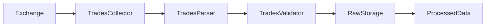
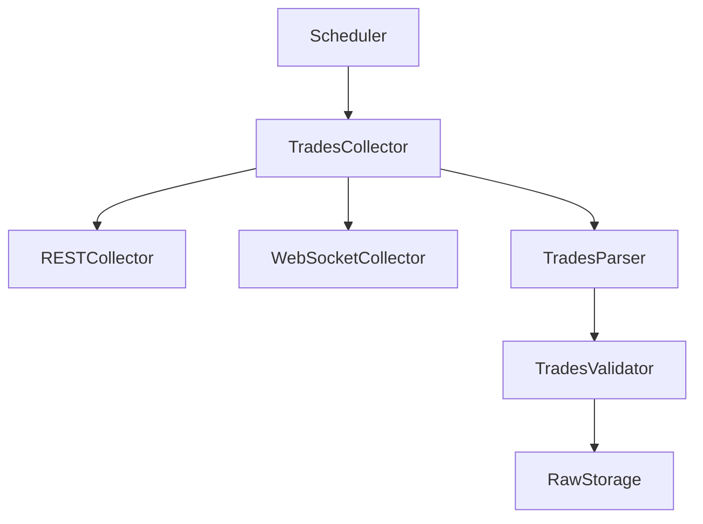
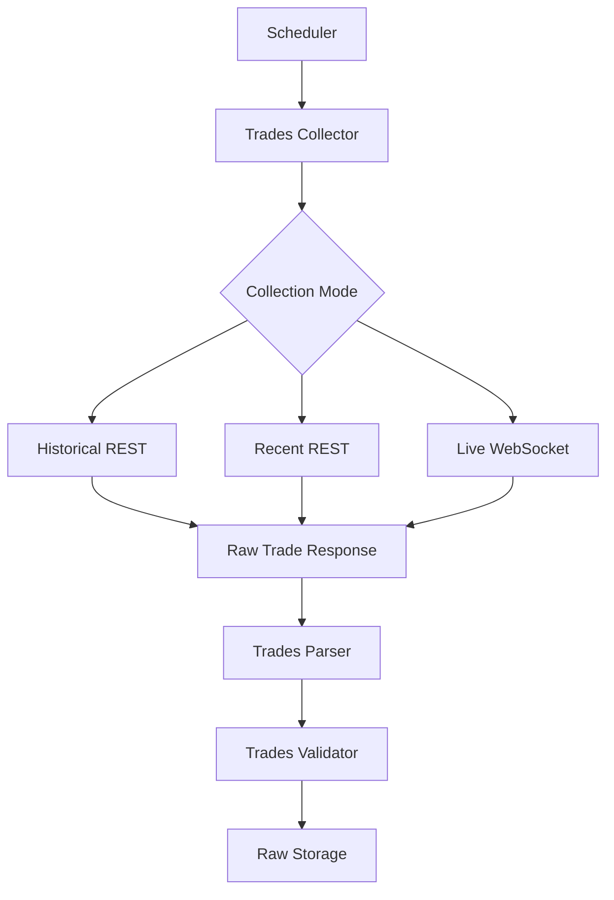
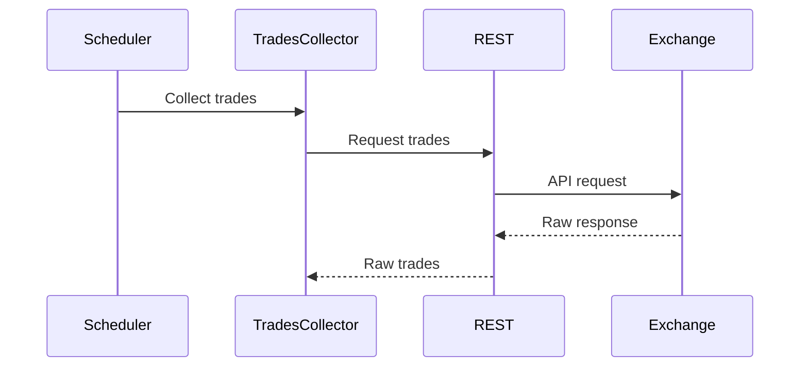
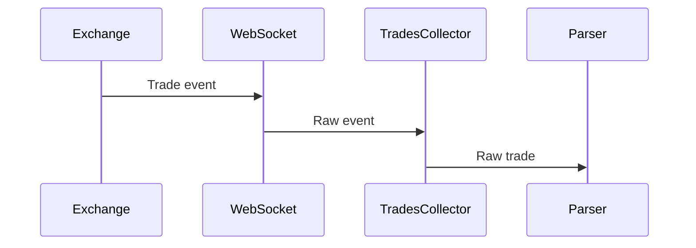
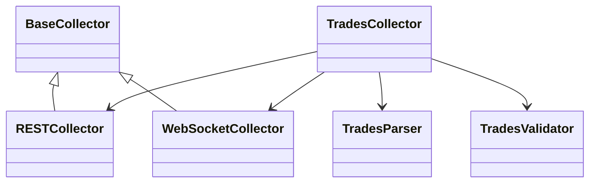
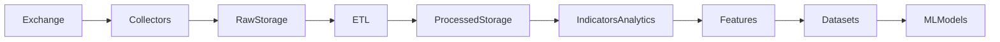

# Trades Collector

## Overview

The **Trades Collector** is a runtime component of the ETH Bot data pipeline responsible for collecting individual trade executions from supported cryptocurrency exchanges.

It supports both historical and real-time trade collection and passes raw exchange responses to the parsing and validation layers.

The collector is responsible for **data acquisition only**. Parsing, validation, storage, feature engineering, and trading decisions are handled by separate components.

---

## Location

```text
data_pipeline/
└── collectors/
    └── trades/
        ├── collector.py
        ├── collector.md
        ├── parser.py
        ├── validator.py
        └── config.py
```

---

## Responsibilities

The Trades Collector is responsible for:

* Collecting historical trades.
* Collecting recent trades.
* Receiving real-time trades.
* Supporting REST-based collection.
* Supporting WebSocket-based collection.
* Handling retryable request failures.
* Passing raw data to the parser.
* Passing parsed data to the validator.

The collector is **not** responsible for:

* Parsing exchange-specific responses.
* Data validation.
* Persistent storage.
* Feature engineering.
* Technical indicators.
* ML dataset generation.
* Model inference.
* Strategy decisions.
* Risk management.
* Trade execution.

---

# Pipeline Position



---

# Architecture



---

# Collection Modes

## Historical Collection

Historical trade data is retrieved through REST APIs.

```text
Start Time
    │
    ▼
REST API
    │
    ▼
Historical Trades
    │
    ▼
Parser
```

Typical uses:

* Historical dataset construction.
* Market microstructure analysis.
* Backtesting research.
* Feature generation.
* Model training.

---

## Recent Trade Collection

The collector can request the most recent trades from the exchange.

```text
Exchange
   │
   ▼
Recent Trades
   │
   ▼
Trades Collector
```

This is useful for:

* Pipeline recovery.
* Incremental synchronization.
* Gap filling.
* Startup synchronization.

---

## Live Trade Collection

Real-time trades are received through WebSocket streams.

```text
Exchange WebSocket
        │
        ▼
Trades Collector
        │
        ▼
Callback
        │
        ▼
Parser
```

Live collection is useful for:

* Real-time market monitoring.
* Order-flow analysis.
* Trade-flow features.
* Market microstructure signals.

---

# Inputs

The collector accepts configuration such as:

| Input         | Description                 |
| ------------- | --------------------------- |
| `symbol`      | Trading symbol              |
| `market_type` | Spot or futures             |
| `start_time`  | Historical start timestamp  |
| `end_time`    | Historical end timestamp    |
| `limit`       | Maximum records per request |
| `max_retries` | Retry attempts              |
| `retry_delay` | Initial retry delay         |

Example:

```text
symbol = ETHUSDT

market_type = futures

start_time = 2026-01-01

end_time = 2026-08-01

limit = 1000
```

---

# Output

The collector initially produces **raw exchange responses**.

```text
Raw Exchange Response
        │
        ▼
Trades Parser
        │
        ▼
Raw Trades Schema
```

The collector itself should not assume that the exchange response already matches the internal schema.

---

# Collection Flow



---

# Retry Strategy

The collector should use retry handling for temporary failures.

Example:

```text
Attempt 1
   │
   ├── Failure
   ▼
Wait
   │
   ▼
Attempt 2
   │
   ├── Failure
   ▼
Wait Longer
   │
   ▼
Attempt 3
```

An exponential backoff strategy can be used:

```text
delay = retry_delay × 2^(attempt - 1)
```

Permanent failures should eventually be propagated to the monitoring layer.

---

# Error Handling

The collector should account for:

* Network failures.
* Connection timeouts.
* Exchange API errors.
* Rate limits.
* WebSocket disconnections.
* Temporary exchange outages.
* Invalid responses.
* Request failures.

The collector should not silently discard persistent failures.

Errors should be passed to the appropriate logging and monitoring systems.

---

# REST Collection

REST collection should be delegated to the shared REST collector.



---

# WebSocket Collection

Real-time collection should use the shared WebSocket collector.



---

# Parsing and Validation

The collector delegates processing to downstream components.

```text
TradesCollector
      │
      ▼
TradesParser
      │
      ▼
RawTradesSchema
      │
      ▼
TradesValidator
      │
      ▼
Validated Trades
```

This separation prevents the collector from becoming responsible for data transformation and quality control.

---

# Dependency Structure



---

# Configuration

The collector should receive its configuration from the configuration layer.

Example:

```yaml
symbol: ETHUSDT

market_type: futures

max_retries: 5

retry_delay: 2

historical_enabled: true

live_enabled: true
```

The collector should not contain exchange credentials directly.

API keys and secrets should be supplied through secure environment variables or a secret-management system.

---

# Data Integrity

The collector should preserve the raw exchange response as much as practical.

The following transformations belong downstream:

```text
Collection
    │
    ▼
Raw Response
    │
    ▼
Parsing
    │
    ▼
Normalization
    │
    ▼
Validation
```

This allows the raw data layer to remain useful for:

* Reprocessing.
* Debugging.
* Schema migration.
* Historical reconstruction.
* Data-quality investigation.

---

# Relationship With the Data Pipeline



The Trades Collector therefore belongs strictly to the **data acquisition layer**.

---

# Design Principles

The collector should be:

* Modular.
* Exchange-agnostic.
* Fault tolerant.
* Reusable.
* Testable.
* Configurable.
* Observable.
* Stateless where possible.

---

# Exchange Independence

Exchange-specific behavior should be isolated in the shared exchange transport layer.

Avoid placing exchange-specific URLs or WebSocket stream names directly throughout `TradesCollector`.

Preferred architecture:

```text
TradesCollector
       │
       ▼
Exchange Transport
       │
   ┌───┴────┐
   ▼        ▼
REST    WebSocket
   │        │
   └───┬────┘
       ▼
    Exchange
```

This allows another exchange to be added without rewriting the trade collection logic.

---

# Testing

The collector should have tests covering:

* Historical collection.
* Recent collection.
* Live collection.
* Retry behavior.
* Request failures.
* WebSocket disconnection.
* Invalid configuration.
* Parser integration.
* Validator integration.

Example test structure:

```text
tests/
└── collectors/
    └── trades/
        ├── test_collector.py
        ├── test_parser.py
        └── test_validator.py
```

---

# Summary

The **Trades Collector** is the runtime acquisition component responsible for retrieving individual trade executions for the ETH futures data pipeline.

Its primary responsibility is:

```text
Exchange
   ↓
Collect
   ↓
Raw Trade Data
   ↓
Parser
   ↓
Validator
   ↓
Raw Storage
```

Keeping collection, parsing, validation, and storage separate ensures that the ETH Bot can scale from historical research to real-time market-data collection without coupling acquisition logic to downstream ML, strategy, risk, or execution systems.
