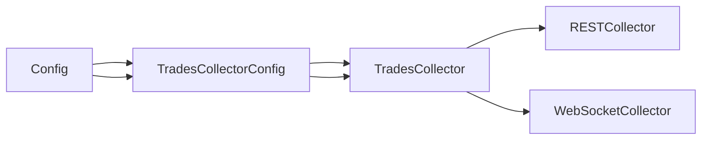
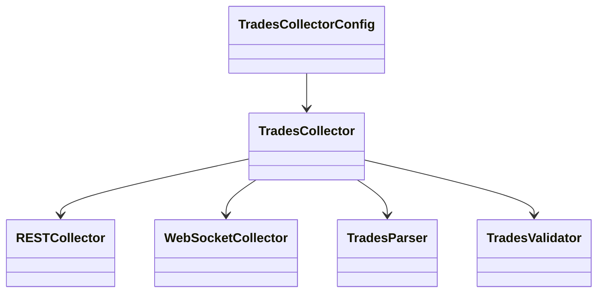

# Trades Collector Configuration

## Overview

The **Trades Collector Configuration** defines the runtime settings used by the Trades Collector to collect individual trade executions from supported cryptocurrency exchanges.

It controls exchange selection, market configuration, collection modes, historical retrieval, WebSocket behavior, retry handling, rate limiting, and runtime logging.

The configuration contains **operational settings only**. API credentials and secrets must be supplied through environment variables or a dedicated secret-management system.

---

# Location

```text
data_pipeline/
└── collectors/
    └── trades/
        ├── collector.py
        ├── parser.py
        ├── validator.py
        ├── config.py
        │
        └── md/
            └── config.md
```

---

# Configuration Architecture

```mermaid
flowchart TD

Environment

-->

Runtime Configuration

-->

Trades Collector

-->

REST / WebSocket

-->

Exchange
```

---

# Configuration Sections

## Exchange

| Field         | Description         | Example   |
| ------------- | ------------------- | --------- |
| `exchange`    | Exchange identifier | `binance` |
| `market_type` | Market category     | `futures` |

Example:

```yaml
exchange: binance
market_type: futures
```

The collector is currently intended primarily for the ETH futures pipeline.

---

# Market

## Symbol

```yaml
symbol: ETHUSDT
```

This identifies the market from which trade executions are collected.

---

# Collection Modes

The collector supports three collection modes.

| Setting               | Purpose                            |
| --------------------- | ---------------------------------- |
| `historical_enabled`  | Enable historical trade collection |
| `live_enabled`        | Enable real-time trade collection  |
| `incremental_enabled` | Enable incremental synchronization |

Example:

```yaml
historical_enabled: true
live_enabled: true
incremental_enabled: true
```

---

# Historical Collection

Historical collection uses the REST transport layer.

| Field        | Description                         |
| ------------ | ----------------------------------- |
| `start_time` | Historical collection start         |
| `end_time`   | Historical collection end           |
| `limit`      | Maximum records requested per batch |

Example:

```yaml
start_time: "2026-01-01T00:00:00Z"
end_time: "2026-08-01T00:00:00Z"
limit: 1000
```

If `start_time` or `end_time` is not provided, the collector can use the exchange's default behavior or incremental synchronization logic.

---

# WebSocket Configuration

Real-time trade collection uses the WebSocket transport layer.

| Field                    | Description                 |
| ------------------------ | --------------------------- |
| `websocket_enabled`      | Enable WebSocket collection |
| `reconnect_enabled`      | Automatically reconnect     |
| `reconnect_delay`        | Initial reconnect delay     |
| `max_reconnect_attempts` | Maximum reconnect attempts  |

Example:

```yaml
websocket_enabled: true

reconnect_enabled: true

reconnect_delay: 2.0

max_reconnect_attempts: 10
```

---

# Retry Configuration

REST request failures should use retry handling.

| Field                 | Description                    |
| --------------------- | ------------------------------ |
| `max_retries`         | Maximum request retry attempts |
| `retry_delay`         | Initial retry delay            |
| `exponential_backoff` | Enable exponential backoff     |

Example:

```yaml
max_retries: 5

retry_delay: 2.0

exponential_backoff: true
```

---

# Retry Flow

```mermaid
flowchart TD

Request

-->

Success

Request

-->

Failure

-->

Retry

-->

Success

Retry

-->

Failure

-->

Backoff

-->

Retry

Backoff

-->

Maximum Attempts

-->

Error
```

---

# Network Configuration

| Field                   | Description                |
| ----------------------- | -------------------------- |
| `timeout`               | Request timeout in seconds |
| `rate_limit_per_second` | Maximum request rate       |

Example:

```yaml
timeout: 30

rate_limit_per_second: 10
```

Rate limiting should be enforced by the shared transport layer rather than duplicated inside every data collector.

---

# Data Handling

| Field                   | Description                         |
| ----------------------- | ----------------------------------- |
| `preserve_raw_response` | Preserve original exchange response |
| `batch_size`            | Processing batch size               |

Example:

```yaml
preserve_raw_response: true

batch_size: 1000
```

Preserving raw responses can be useful for:

* Debugging.
* Parser improvements.
* Schema migration.
* Data-quality investigations.
* Reprocessing.

---

# Logging

Supported log levels:

```text
DEBUG
INFO
WARNING
ERROR
```

Example:

```yaml
log_level: INFO
```

---

# Complete Example

```yaml
exchange: binance

market_type: futures

symbol: ETHUSDT

historical_enabled: true

live_enabled: true

incremental_enabled: true

start_time: "2026-01-01T00:00:00Z"

end_time: "2026-08-01T00:00:00Z"

limit: 1000

websocket_enabled: true

reconnect_enabled: true

reconnect_delay: 2.0

max_reconnect_attempts: 10

max_retries: 5

retry_delay: 2.0

exponential_backoff: true

timeout: 30

rate_limit_per_second: 10

preserve_raw_response: true

batch_size: 1000

log_level: INFO
```

---

# Configuration Flow



---

# Runtime Data Flow

```mermaid
flowchart TD

TradesCollectorConfig

-->

TradesCollector

-->

Raw Trade Response

-->

TradesParser

-->

TradesValidator

-->

Raw Storage
```

---

# Security

The runtime configuration must **not** contain:

```text
API_KEY
API_SECRET
PRIVATE_KEY
PASSWORD
TOKEN
```

Instead, sensitive credentials should be supplied through:

```text
Environment Variables
        │
        ▼
Secret Management
        │
        ▼
Exchange Transport
```

Example:

```text
BINANCE_API_KEY
BINANCE_API_SECRET
```

The exact environment-variable names should be centralized in the exchange/transport configuration layer.

---

# Configuration Validation

Configuration should be validated before the collector starts.

Examples:

```text
symbol != empty

market_type ∈ {spot, futures}

limit > 0

max_retries >= 0

retry_delay >= 0

timeout > 0

rate_limit_per_second > 0

batch_size > 0
```

Invalid configuration should prevent the collector from starting rather than producing partially configured data.

---

# Relationship With Other Components



---

# Design Principles

The configuration should be:

* Externalized.
* Validated.
* Reproducible.
* Environment-aware.
* Exchange-independent where possible.
* Free of secrets.
* Versioned.
* Easy to override.
* Compatible with historical and live collection.

---

# Recommended Configuration Separation

Keep the responsibilities separated:

```text
config/
│
├── pipeline.yaml
├── scheduler.yaml
├── storage.yaml
│
└── exchanges/
    ├── binance.yaml
    ├── bybit.yaml
    └── okx.yaml
```

The collector-specific runtime configuration should describe **how trade collection operates**, while exchange transport configuration should describe **how to communicate with a particular exchange**.

---

# Summary

The **Trades Collector Configuration** provides the runtime controls required for historical, incremental, and real-time trade collection.

Its primary flow is:

```text
Configuration
      ↓
TradesCollectorConfig
      ↓
TradesCollector
      ↓
REST / WebSocket
      ↓
Raw Trade Data
      ↓
Parser
      ↓
Validator
      ↓
Raw Storage
```

Keeping configuration, collection, transport, parsing, and validation as separate layers gives the ETH Bot a cleaner and more scalable data acquisition architecture.
