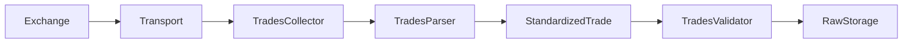
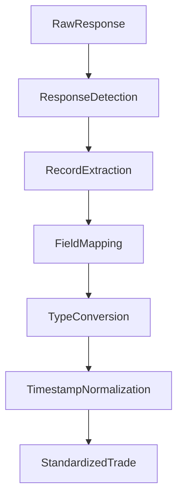
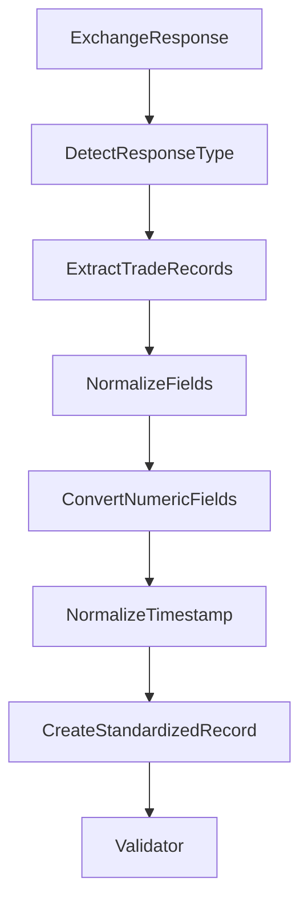
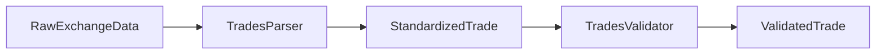
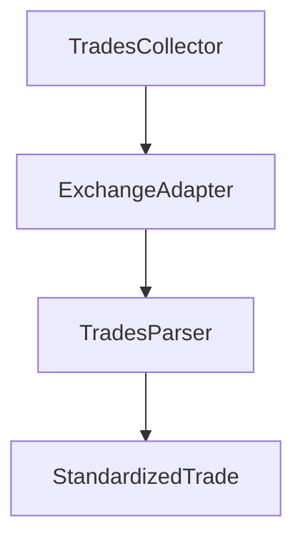
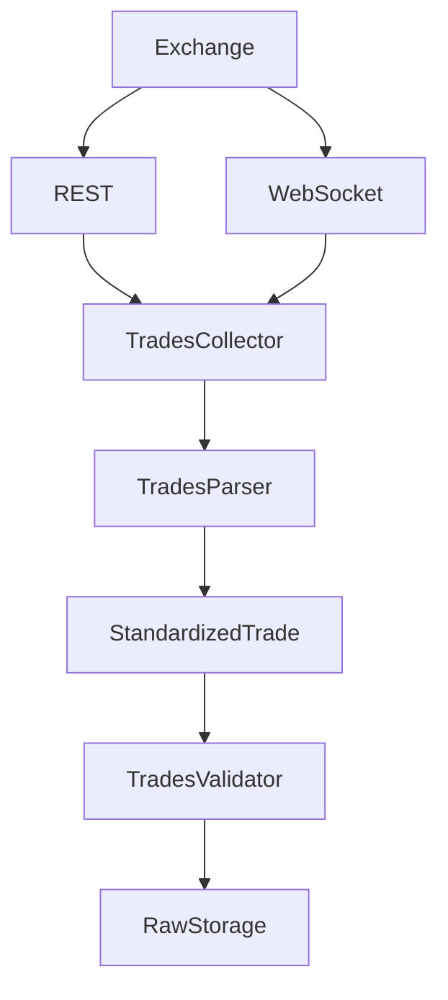
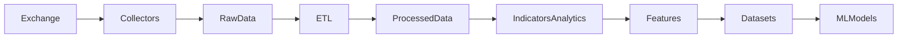

# Trades Parser

## Overview

The **Trades Parser** is a runtime component of the ETH Bot data pipeline responsible for transforming exchange-specific raw trade responses into a standardized internal trade representation.

It supports both REST API responses and WebSocket trade events.

The parser performs **data transformation and normalization only**. Data-quality checks belong to the Trades Validator.

---

# Location

```text
data_pipeline/
└── collectors/
    └── trades/
        ├── collector.py
        ├── parser.py
        ├── validator.py
        ├── config.py
        │
        └── md/
            └── parser.md
```

---

# Responsibilities

The Trades Parser is responsible for:

* Parsing REST trade responses.
* Parsing WebSocket trade events.
* Extracting trade records.
* Mapping exchange-specific field names.
* Normalizing timestamps.
* Converting numeric values.
* Normalizing boolean fields.
* Producing standardized trade records.

The parser is **not** responsible for:

* Collecting data.
* API requests.
* WebSocket connection management.
* Data validation.
* Duplicate detection.
* Persistent storage.
* Feature engineering.
* Technical indicators.
* ML dataset generation.
* Trading decisions.

---

# Pipeline Position



---

# Parser Architecture



---

# Input Sources

The parser supports two primary input sources.

## REST API

REST endpoints commonly return:

```text
List
```

or:

```text
Object containing a list of trades
```

Example:

```json
[
  {
    "id": 10001,
    "price": "3520.25",
    "qty": "0.15",
    "time": 1785931200000
  }
]
```

---

## WebSocket

WebSocket messages commonly contain a trade event inside an event envelope.

Example:

```json
{
  "data": {
    "id": 10001,
    "price": "3520.25",
    "qty": "0.15",
    "time": 1785931200000
  }
}
```

The parser extracts the actual trade payload before normalization.

---

# Standardized Trade Representation

The parser produces a common internal representation:

```python
{
    "trade_id": ...,
    "symbol": ...,
    "price": ...,
    "quantity": ...,
    "timestamp": ...,
    "is_buyer_maker": ...
}
```

The exact final schema must remain synchronized with:

```text
data_pipeline/schema/raw/trades.py
```

---

# Field Mapping

Different exchanges may use different field names.

| Standard Field   | Possible Exchange Fields               |
| ---------------- | -------------------------------------- |
| `trade_id`       | `trade_id`, `tradeId`, `id`, `a`       |
| `symbol`         | `symbol`, `s`                          |
| `price`          | `price`, `p`                           |
| `quantity`       | `quantity`, `qty`, `q`                 |
| `timestamp`      | `timestamp`, `time`, `T`, `trade_time` |
| `is_buyer_maker` | `is_buyer_maker`, `isBuyerMaker`, `m`  |

The parser maps these exchange-specific representations into the standardized field names.

---

# Parsing Flow



---

# Response Handling

The parser supports:

```text
None
Mapping
List
Tuple
```

Unsupported response types should raise a structured error rather than silently producing incorrect data.

---

# Mapping-Based Responses

For mapping responses, the parser checks common payload containers:

```text
data
trades
result
```

If none are present, the mapping itself can be interpreted as a single trade event.

---

# List-Based Responses

A list may contain:

```text
Dictionary records
```

or:

```text
Array records
```

Dictionary example:

```json
{
  "id": 10001,
  "price": "3520.25",
  "qty": "0.15"
}
```

Array example:

```text
[
    trade_id,
    price,
    quantity,
    timestamp,
    is_buyer_maker
]
```

Exchange-specific array layouts should be handled by an exchange adapter when necessary.

---

# Numeric Normalization

Price and quantity values may arrive as strings.

Example:

```text
"3520.25"
```

becomes:

```text
3520.25
```

The parser converts numeric fields into Python numeric types so downstream components receive consistent data.

---

# Timestamp Normalization

The parser supports:

* Unix timestamps.
* Unix millisecond timestamps.
* Numeric timestamp strings.
* ISO-8601 strings.
* Python `datetime` objects.

All timestamps are normalized to UTC-aware `datetime` values.

Example:

```text
1785931200000

↓

UTC datetime
```

---

# Boolean Normalization

Boolean fields may arrive as:

```text
true
false
```

or:

```text
"true"
"false"
```

or:

```text
1
0
```

These representations are normalized into Python boolean values.

---

# Error Handling

The parser should raise errors for malformed input rather than silently corrupting data.

Possible parsing errors include:

* Unsupported response type.
* Unsupported trade record type.
* Missing expected array fields.
* Invalid numeric values.
* Invalid timestamps.
* Invalid boolean values.
* Unsupported payload structure.

Example:

```text
Raw Response
     │
     ▼
Parsing Error
     │
     ▼
Exception
     │
     ▼
Monitoring / Logging
```

---

# Validation Boundary

The parser and validator have different responsibilities.

```text
Parser
──────
Transform
Normalize
Convert
Extract
Map


Validator
─────────
Check
Reject
Detect
Verify
```

For example:

```text
"3520.25"
```

→ Parser:

```text
3520.25
```

The validator then determines whether the resulting price is valid according to the trade schema and business rules.

---

# Parser and Validator Flow



---

# Exchange Independence

The parser should avoid becoming tightly coupled to one exchange.

Preferred design:



Exchange-specific mappings can therefore be isolated from the generic parser.

This becomes especially important if the ETH Bot later supports multiple exchanges.

---

# Runtime Integration

The collector can use the parser through dependency injection:

```python
parser = TradesParser()

parsed_data = parser.parse(raw_data)
```

For live WebSocket events:

```python
parsed_data = parser.parse_websocket(raw_event)
```

For REST responses:

```python
parsed_data = parser.parse_rest(raw_data)
```

---

# Data Flow



---

# Testing

The parser should be tested against:

* Valid REST responses.
* Valid WebSocket events.
* Mapping responses.
* List responses.
* Array-based records.
* Numeric strings.
* Numeric timestamps.
* ISO timestamps.
* Boolean representations.
* Empty responses.
* Malformed responses.
* Unsupported response types.

Recommended structure:

```text
tests/
└── collectors/
    └── trades/
        └── test_parser.py
```

---

# Design Principles

The parser should be:

* Deterministic.
* Stateless.
* Fast.
* Reusable.
* Exchange-aware through adapters.
* Easy to test.
* Independent of storage.
* Independent of validation.
* Independent of trading logic.

---

# Relationship With the Data Pipeline



The Trades Parser belongs entirely to the **data acquisition and normalization stage**.

---

# Summary

The **Trades Parser** converts raw exchange trade responses into a standardized representation for the ETH Bot data pipeline.

Its primary responsibility is:

```text
Raw Exchange Response
        ↓
Extract
        ↓
Map
        ↓
Normalize
        ↓
Type Conversion
        ↓
Standardized Trade
        ↓
Validator
        ↓
Raw Storage
```

Separating parsing from validation ensures that the parser remains focused on transformation while the validator remains responsible for data quality and business rules.
