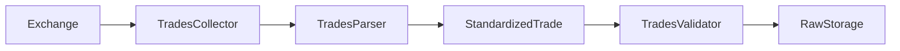
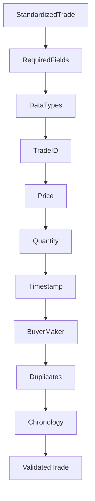
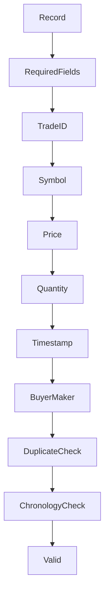
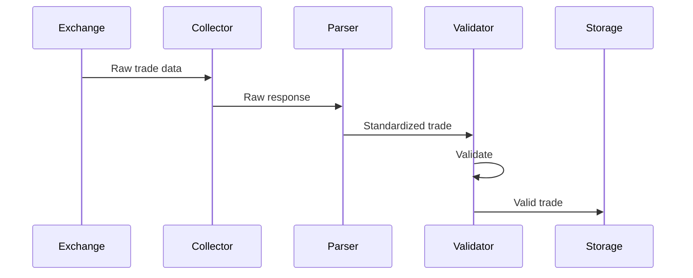
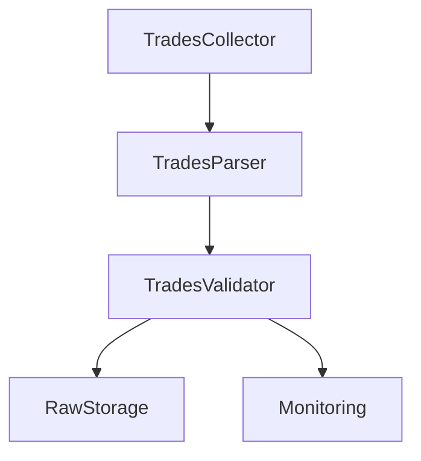

# Trades Validator

## Overview

The **Trades Validator** is a runtime component of the ETH Bot data pipeline responsible for verifying that standardized trade records produced by `TradesParser` satisfy the required data-quality rules before entering Raw Storage.

The validator checks structural integrity, data types, numeric values, timestamps, duplicate trade IDs, and chronological ordering.

The validator performs **validation only**. It does not collect, parse, repair, store, or transform trade data.

---

# Location

```text
data_pipeline/
└── collectors/
    └── trades/
        ├── collector.py
        ├── parser.py
        ├── validator.py
        ├── config.py
        │
        └── md/
            ├── config.md
            ├── parser.md
            └── validator.md
```

---

# Responsibilities

The Trades Validator is responsible for:

* Checking required fields.
* Validating trade IDs.
* Validating symbols.
* Validating prices.
* Validating quantities.
* Validating timestamps.
* Validating timezone awareness.
* Validating buyer/maker flags.
* Detecting duplicate trade IDs.
* Checking chronological ordering.
* Reporting validation failures.

The validator is **not** responsible for:

* Exchange communication.
* REST requests.
* WebSocket connections.
* Parsing exchange responses.
* Data transformation.
* Data correction.
* Persistent storage.
* Feature engineering.
* Technical indicators.
* ML models.
* Trading strategies.
* Risk management.

---

# Pipeline Position



---

# Validation Architecture



---

# Input

The validator expects standardized trade records generated by `TradesParser`.

Example:

```python
{
    "trade_id": 10001,
    "symbol": "ETHUSDT",
    "price": 3520.25,
    "quantity": 0.15,
    "timestamp": datetime(...),
    "is_buyer_maker": True
}
```

The exact structure should remain synchronized with the project's raw trade schema.

---

# Required Fields

The validator requires:

```text
trade_id
price
quantity
timestamp
```

Optional fields may include:

```text
symbol
is_buyer_maker
```

Missing required fields cause validation failure.

---

# Trade ID Validation

`trade_id` must be:

* An integer, or
* A non-empty string.

Invalid examples:

```text
trade_id = None
trade_id = True
trade_id = []
trade_id = ""
```

Valid examples:

```text
trade_id = 10001

trade_id = "10001"
```

---

# Symbol Validation

When supplied, `symbol` must be a non-empty string.

Example:

```text
ETHUSDT
```

Valid:

```text
"ETHUSDT"
```

Invalid:

```text
""
None
12345
```

Symbol-format validation can be extended through exchange-specific configuration.

---

# Price Validation

Trade price must be numeric and greater than zero.

Rule:

```text
price > 0
```

Valid:

```text
3520.25
```

Invalid:

```text
0
-3520.25
"3520.25"
```

The string-to-number conversion belongs to the parser, not the validator.

---

# Quantity Validation

Trade quantity must be numeric and greater than zero.

Rule:

```text
quantity > 0
```

Valid:

```text
0.15
```

Invalid:

```text
0
-0.15
"0.15"
```

A malformed negative quantity must be rejected rather than automatically converted to a positive value.

---

# Timestamp Validation

The timestamp must be a Python `datetime` object.

It must also be timezone-aware.

Valid:

```text
2026-08-05 12:00:00+00:00
```

Invalid:

```text
2026-08-05 12:00:00
```

The parser is responsible for converting exchange timestamps into UTC-aware datetime values.

---

# Buyer/Maker Validation

The optional `is_buyer_maker` field must be a boolean when present.

Valid:

```text
True
False
```

Invalid:

```text
"true"
"false"
1
0
```

String and numeric representations should be normalized by the parser before validation.

---

# Duplicate Detection

The validator can detect duplicate trade IDs.

Example:

```text
Trade 10001
Trade 10002
Trade 10003
Trade 10002  ← Duplicate
```

Duplicate detection helps prevent repeated trade records from entering Raw Storage.

The uniqueness rule should ultimately be based on the project's trade identity model.

---

# Chronological Validation

When enabled, trade timestamps are checked for chronological ordering.

Expected:

```text
10:00:01
10:00:02
10:00:03
10:00:04
```

Invalid ordering:

```text
10:00:01
10:00:04
10:00:02
```

Out-of-order records should be reported rather than silently reordered.

---

# Validation Result

A valid record is passed downstream:

```text
Standardized Trade
       │
       ▼
   Validator
       │
       ▼
 Valid Trade
       │
       ▼
 Raw Storage
```

An invalid record produces a validation error:

```text
Standardized Trade
       │
       ▼
   Validator
       │
       ▼
 Validation Error
       │
       ▼
 Logging / Monitoring
```

---

# Error Handling

The validator can operate in two modes.

## Reject Invalid Records

```python
reject_invalid = True
```

A validation failure raises an exception.

This is the preferred mode for critical data-quality failures.

---

## Skip Invalid Records

```python
reject_invalid = False
```

Invalid records are skipped while valid records continue through the pipeline.

This mode may be useful for high-volume historical ingestion where isolated malformed records should not stop the entire batch.

Invalid records should still be logged.

---

# Empty Data

The validator supports configurable handling of empty input.

```python
allow_empty = True
```

An empty collection can therefore be treated as a valid no-data result rather than an error.

This is useful when an exchange legitimately returns no trades for a requested interval.

---

# Validation Sequence



---

# Parser Boundary

The parser and validator have deliberately different responsibilities.

## Parser

```text
Extract
Map
Convert
Normalize
```

## Validator

```text
Check
Verify
Reject
Report
```

Example:

```text
Exchange:
"price": "3520.25"

        ↓

Parser:

price = 3520.25

        ↓

Validator:

price > 0

        ↓

Valid
```

The validator should not convert `"3520.25"` itself.

---

# No Automatic Data Repair

The validator should not silently modify invalid records.

For example:

```text
quantity = -2.5
```

must not become:

```text
quantity = 2.5
```

Likewise:

```text
price = 0
```

must not be replaced with another value.

The correct workflow is:

```text
Invalid Data
     ↓
Validation Failure
     ↓
Log / Monitor
     ↓
Reject or Skip
```

This preserves data integrity and makes upstream data problems visible.

---

# Integration

The validator can be used directly:

```python
validator = TradesValidator()

validated = validator.validate(
    records
)
```

For a single record:

```python
validated = validator.validate_one(
    record
)
```

For a quick validity check:

```python
is_valid = validator.is_valid(
    record
)
```

---

# Runtime Data Flow



---

# Testing

The validator should have dedicated tests covering:

* Missing required fields.
* Invalid trade IDs.
* Empty trade IDs.
* Invalid symbols.
* Zero prices.
* Negative prices.
* Non-numeric prices.
* Zero quantities.
* Negative quantities.
* Non-numeric quantities.
* Invalid timestamps.
* Naive timestamps.
* Invalid buyer/maker values.
* Duplicate trade IDs.
* Out-of-order timestamps.
* Empty input.
* Reject mode.
* Skip mode.

Recommended location:

```text
tests/
└── collectors/
    └── trades/
        └── test_validator.py
```

---

# Design Principles

The Trades Validator should be:

* Deterministic.
* Strict.
* Stateless.
* Reusable.
* Testable.
* Configurable.
* Observable.
* Non-destructive.
* Independent of exchange transport.
* Independent of storage.
* Independent of trading logic.

---

# Relationship With Other Components



The validator is the final quality gate between standardized trade data and Raw Storage.

---

# Future Enhancements

Possible future validation capabilities include:

* Exchange-specific validation profiles.
* Trade ID continuity checks.
* Timestamp gap detection.
* Price anomaly detection.
* Quantity anomaly detection.
* Cross-source consistency checks.
* Batch-level validation statistics.
* Data-quality scoring.
* Validation metrics.
* Dead-letter storage for rejected records.

These should be added without turning the validator into a data-cleaning or feature-engineering component.

---

# Summary

The **Trades Validator** ensures that standardized trade records are structurally correct, type-safe, logically valid, and suitable for downstream storage.

Its core responsibility is:

```text
Standardized Trade
       ↓
Required Fields
       ↓
Type Validation
       ↓
Value Validation
       ↓
Timestamp Validation
       ↓
Duplicate Detection
       ↓
Chronological Validation
       ↓
Validated Trade
       ↓
Raw Storage
```

The separation between **Collector → Parser → Validator** keeps the ETH Bot data pipeline modular:

```text
Collector = Acquire

Parser = Transform

Validator = Verify
```

This separation is especially important for the ETH futures pipeline because raw trade data will later support order-flow analysis, feature generation, model training, backtesting, and real-time decision systems.
