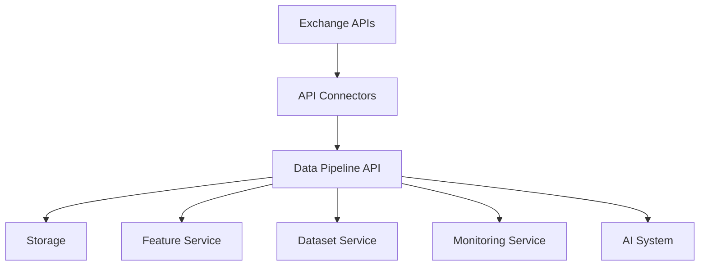
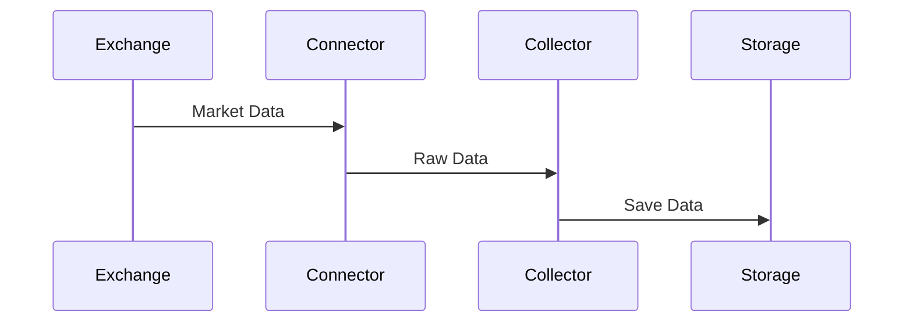

# ETH Bot Data Pipeline - API Design

## Overview

The API layer provides communication between the Data Pipeline components and external systems.

It allows:

- Market data collection
- Internal service communication
- Data access
- Pipeline control
- Monitoring integration
- AI model data retrieval


The API layer connects:


```
Exchange APIs

↓

Data Pipeline API

↓

Storage

↓

AI Models

↓

Trading System
```


---

# API Architecture





---

# API Design Principles


The API system follows:


## Reliability

- Retry failed requests
- Handle API failures
- Maintain connection stability


---

## Security

- Secure credentials
- Validate requests
- Limit access


---

## Scalability

- Support more exchanges
- Support more models
- Handle higher data volume


---

## Versioning

All APIs should support versions.


Example:


```
/api/v1/
```


---

# API Layers


```
api/

├── exchange/

├── data/

├── features/

├── datasets/

├── monitoring/

└── system/
```


---

# 1. Exchange API Layer


## Purpose


Connect with external exchanges.


Sources:


```
REST API

WebSocket API
```


---

# Exchange Connector


Folder:


```
sources/


├── exchange_api.py

└── websocket.py
```


---

# REST API Usage


Used for:


- Historical candles
- Funding rate
- Open interest
- Account information


---

# WebSocket Usage


Used for:


- Live prices
- Order book
- Trades
- Liquidations


---

# Exchange API Flow





---

# 2. Market Data API


## Purpose


Provide access to collected market data.


Base path:


```
/api/v1/market/
```


---

# Get OHLCV Data


Endpoint:


```
GET /market/ohlcv
```


Parameters:


```
symbol

timeframe

start_time

end_time
```


Example:


```
ETHUSDT

1H

2026-08-01

2026-08-05
```


Response:


```json
{
 "symbol":"ETHUSDT",
 "timeframe":"1H",
 "data":[
  {
   "timestamp":"2026-08-05 10:00",
   "open":3500,
   "high":3550,
   "low":3480,
   "close":3530,
   "volume":25000
  }
 ]
}
```


---

# Get Derivative Data


Endpoint:


```
GET /market/derivatives
```


Returns:


```
Open Interest

Funding Rate

Liquidations

Long Short Ratio
```


---

# Get Order Book


Endpoint:


```
GET /market/orderbook
```


Response:


```json
{
 "bids":[
  [3500,10]
 ],

 "asks":[
  [3501,8]
 ]
}
```


---

# 3. Feature API


## Purpose


Provide AI-ready features.


Base path:


```
/api/v1/features/
```


---

# Get Features


Endpoint:


```
GET /features
```


Parameters:


```
symbol

timeframe

feature_set
```


Example:


```
feature_set=trend
```


---

# Feature Response


```json
{
 "timestamp":"2026-08-05 10:00",

 "features":{

  "rsi":55,

  "ema20":3520,

  "atr":40

 }
}
```


---

# Feature Groups


Available:


```
price

trend

momentum

volatility

volume

derivatives

order_flow
```


---

# 4. Indicator API


## Purpose


Provide calculated technical indicators.


Endpoint:


```
GET /indicators
```


---

# Response Example


```json
{
 "timestamp":"2026-08-05 10:00",

 "indicators":{

 "rsi":60,

 "macd":12,

 "atr":45

 }
}
```


---

# 5. Dataset API


## Purpose


Provide datasets for training.


Base path:


```
/api/v1/datasets/
```


---

# List Datasets


Endpoint:


```
GET /datasets
```


Response:


```json
[
 "lstm_v1",

 "xgboost_v1",

 "lightgbm_v1"
]
```


---

# Download Dataset


Endpoint:


```
GET /datasets/{name}
```


Returns:


```
Parquet

CSV

NumPy
```


---

# Dataset Metadata


Endpoint:


```
GET /datasets/{name}/metadata
```


Example:


```json
{
 "model":"LSTM",

 "features":50,

 "sequence_length":168,

 "target":"direction"
}
```


---

# 6. Pipeline Control API


## Purpose


Control pipeline operations.


Base path:


```
/api/v1/system/
```


---

# Start Pipeline


Endpoint:


```
POST /pipeline/start
```


---

# Stop Pipeline


Endpoint:


```
POST /pipeline/stop
```


---

# Pipeline Status


Endpoint:


```
GET /pipeline/status
```


Response:


```json
{
 "status":"running",

 "last_update":"2026-08-05 10:00"
}
```


---

# 7. Monitoring API


## Purpose


Expose system health.


Endpoint:


```
GET /health
```


Response:


```json
{
 "status":"healthy",

 "services":{

 "database":"ok",

 "collector":"ok",

 "etl":"ok"

 }
}
```


---

# Metrics Endpoint


Endpoint:


```
GET /metrics
```


Returns:


```
CPU

Memory

Jobs

Data freshness

Errors
```


---

# 8. Authentication


## Purpose


Protect API access.


Methods:


```
API Key

JWT Token

OAuth
```


---

# API Key Example


Header:


```
Authorization:

Bearer API_KEY
```


---

# 9. Rate Limiting


Prevent abuse.


Example:


```
100 requests/minute
```


Higher limits for:


- Internal services
- AI models


---

# 10. Error Handling


Standard format:


```json
{
 "error":{

 "code":"DATA_NOT_FOUND",

 "message":"No data available"

 }
}
```


---

# Error Codes


```
400

Bad Request


401

Unauthorized


404

Not Found


429

Rate Limit


500

Server Error
```


---

# 11. API Logging


Every request logs:


```
Timestamp

Endpoint

User

Response Time

Status Code
```


---

# 12. API Folder Structure


```
api/


├── routes/


│   ├── market.py

│   ├── features.py

│   ├── datasets.py

│   ├── monitoring.py


├── services/


│   ├── market_service.py

│   ├── feature_service.py


├── auth/


│   └── security.py


└── main.py
```


---

# 13. Recommended Technology Stack


## Framework


```
FastAPI
```


Advantages:


- High performance
- Async support
- Automatic documentation


---

## Validation


```
Pydantic
```


---

## Server


```
Uvicorn

Gunicorn
```


---

# 14. API Documentation


Use:


```
OpenAPI

Swagger UI
```


Available:


```
/docs
```


---

# 15. Future Improvements


Possible additions:


- GraphQL API
- Streaming API
- WebSocket internal API
- API gateway
- Service authentication
- Distributed services


---

# Summary


The API layer provides a standard communication interface between:

```
Exchange

↓

Data Pipeline

↓

Features

↓

AI Models

↓

Trading System
```


Document Version:

```
v1.0
```