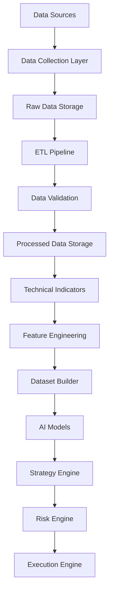
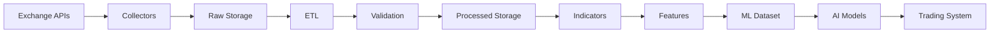
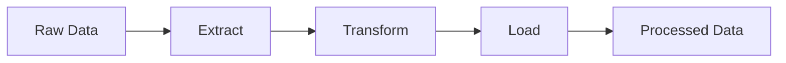
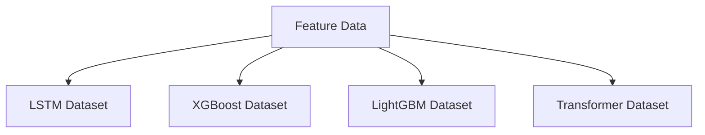
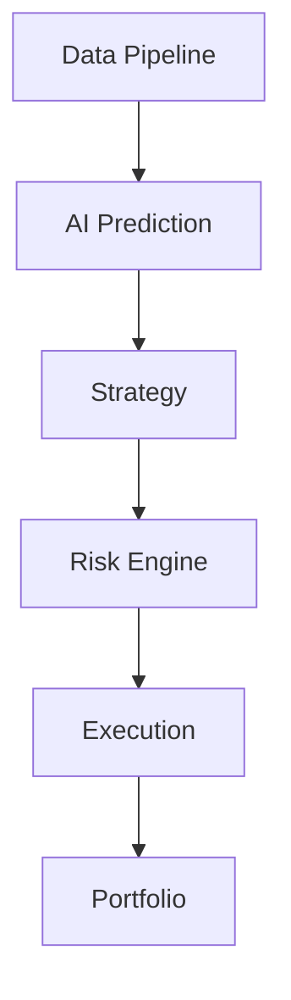
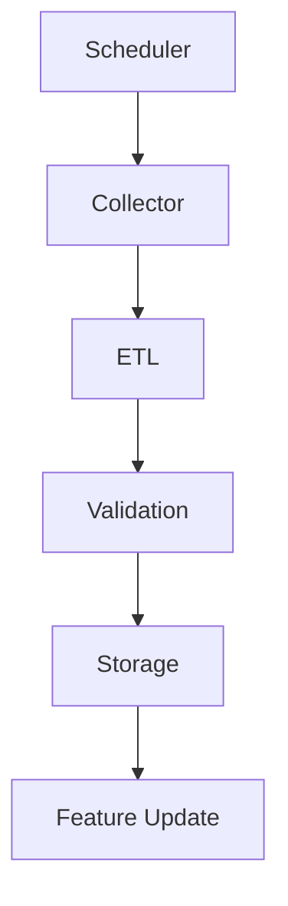
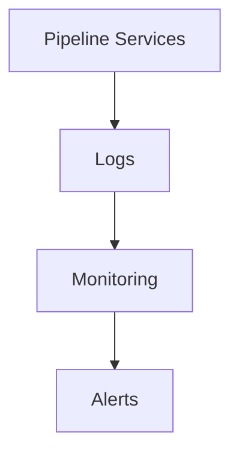

# ETH Bot Data Pipeline Architecture

## Overview

The Data Pipeline is the foundation layer of the ETH Futures AI Trading System.

It manages the complete lifecycle of market data:

- Data collection
- Data storage
- Data processing
- Data validation
- Indicator generation
- Feature creation
- Dataset preparation
- AI model input


The pipeline is designed to support:

- LSTM
- XGBoost
- LightGBM
- CatBoost
- Transformer
- Future ML/DL models


---

# Architecture Goals

The architecture should provide:

- Reliable 24/7 data collection
- Historical data preservation
- Reproducible datasets
- Scalable processing
- Model-independent data layer
- Automated quality checks
- Easy expansion


---

# High Level Architecture





---

# Complete System Flow





---

# Data Pipeline Layers


## Layer 1: Data Sources


Responsible for providing market information.


Sources:


### Exchange REST API

Used for:

- Historical OHLCV
- Funding Rate
- Open Interest
- Mark Price
- Index Price


### Exchange WebSocket

Used for:

- Real-time trades
- Order book updates
- Liquidations
- Live price movement


### Historical Data

Used for:

- Model training
- Backtesting
- Research


---

# Layer 2: Data Collection


Responsible for collecting market data.


Components:


```
collectors/

├── ohlcv_collector.py

├── funding_collector.py

├── oi_collector.py

├── orderbook_collector.py

├── liquidation_collector.py

└── options_collector.py
```


Responsibilities:

- API communication
- Data downloading
- WebSocket handling
- Error retry
- Timestamp management


---

# Layer 3: Raw Data Storage


Raw storage keeps original exchange data.


Rules:

- No modification
- No feature calculation
- No cleaning


Purpose:

- Data recovery
- Reprocessing
- Audit history


Example:


```
storage/raw/

├── ohlcv/

├── open_interest/

├── funding_rate/

├── mark_price/

├── index_price/

├── order_book/

├── liquidations/

└── options/
```


---

# Layer 4: ETL Pipeline


ETL means:

- Extract
- Transform
- Load


Architecture:





---

## Extract


Collect data from:

- API
- WebSocket
- Historical files


---

## Transform


Operations:

- Timestamp normalization
- Data type conversion
- Missing data handling
- Duplicate removal
- Outlier detection
- Data aggregation


---

## Load


Store cleaned data into processed storage.


---

# Layer 5: Data Validation


The validation layer ensures data quality.


Checks:


## Completeness

Verify:

- Missing candles
- Missing timestamps


## Accuracy

Verify:

- Valid prices
- Valid volume
- Correct OHLC relationships


## Consistency

Verify:

- Duplicate records
- Correct ordering


## Freshness

Verify:

- Latest data availability
- Pipeline delay


---

# Layer 6: Processed Data Storage


Processed data is clean and standardized.


Example:


```
storage/processed/

├── eth_1h.parquet

├── eth_1d.parquet

├── derivatives.parquet

└── orderbook.parquet
```


Used by:

- Indicators
- Features
- AI models


---

# Layer 7: Technical Indicators


Indicators are calculated from processed data.


Categories:


## Trend Indicators

Examples:

- EMA
- SMA
- MACD
- ADX


## Momentum Indicators

Examples:

- RSI
- ROC
- Stochastic RSI


## Volatility Indicators

Examples:

- ATR
- Bollinger Bands
- Historical Volatility


## Volume Indicators

Examples:

- OBV
- Volume Change


---

# Layer 8: Feature Engineering


Feature engineering converts market data into AI inputs.


Feature categories:


## Price Features

Examples:

- Returns
- Log returns
- Candle size
- Price change


## Trend Features

Examples:

- EMA distance
- Trend strength
- Trend direction


## Volatility Features

Examples:

- ATR change
- Volatility percentage


## Derivatives Features

Examples:

- Open interest change
- Funding change
- Liquidation pressure


## Market Structure Features

Examples:

- Order book imbalance
- Spread
- Liquidity


---

# Layer 9: Dataset Builder


Creates datasets for different AI models.


Architecture:





---

# LSTM Data Flow


LSTM requires sequential data.


Example:


```
Previous 168 candles

        |

        v

      LSTM

        |

        v

 Future Prediction
```


Example output:

- Direction probability
- Trend prediction
- Volatility prediction


---

# ML Model Data Flow


XGBoost and LightGBM use tabular data.


Example:


```
Feature 1

Feature 2

Feature 3

...

Target
```


---

# AI Model Layer


The Data Pipeline does not decide trades.


It only provides predictions.


AI layer:


```
Market Data

↓

Features

↓

AI Models

↓

Predictions

↓

Strategy
```


---

# Integration With Trading System





---

# Automation Architecture





---

# Operating Schedule


## Every Hour

Tasks:

- Collect 1H OHLCV
- Update indicators
- Generate features


## Daily

Tasks:

- Collect 1D OHLCV
- Run validation report
- Archive data


## Real-Time

Tasks:

- Order book updates
- Trades
- Liquidations


---

# Monitoring Architecture





Monitor:

- API status
- Data freshness
- Storage usage
- Pipeline errors
- Processing time


---

# Future Expansion


Possible additions:


- Multiple exchanges
- Multiple assets
- Kafka streaming
- Feature store
- Real-time inference
- Cloud deployment
- Distributed processing


---

# Final Architecture Summary


```
Exchange Data

↓

Collectors

↓

Raw Storage

↓

ETL

↓

Validation

↓

Processed Data

↓

Indicators

↓

Features

↓

Datasets

↓

AI Models

↓

Strategy

↓

Risk Engine

↓

Execution
```


---

# Document Status

Architecture Version:

```
v1.0
```

System:

```
ETH Futures AI Trading Bot
```