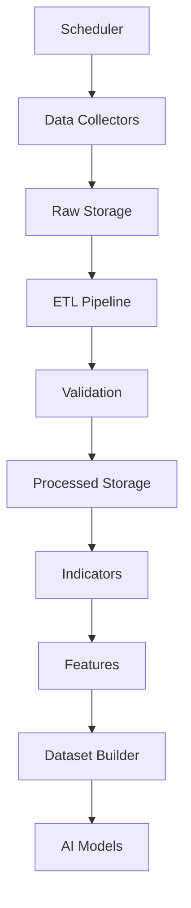
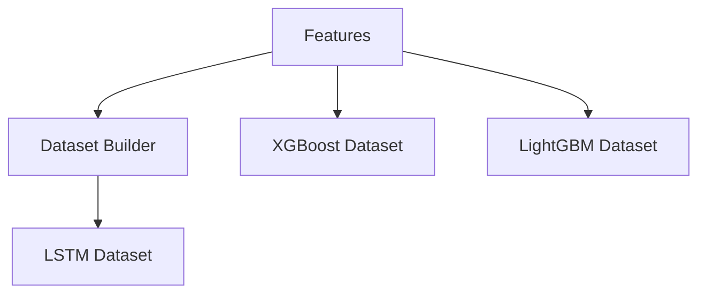
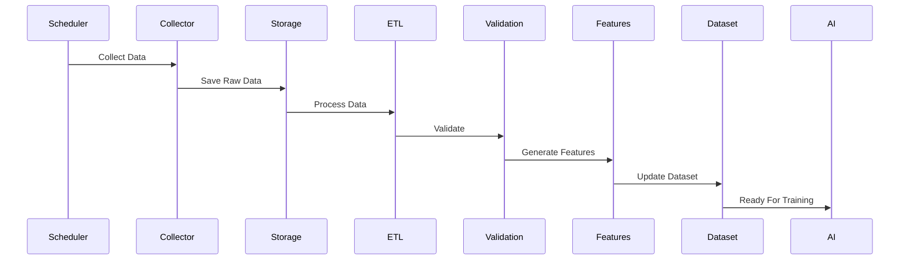

# ETH Bot Data Pipeline - Automation

## Overview

Automation controls the continuous operation of the ETH Futures AI Trading System Data Pipeline.

The automation layer is responsible for:

- 24/7 data collection
- Scheduled ETL execution
- Data validation
- Feature updates
- Dataset generation
- Monitoring
- Error recovery


The goal is to create a fully automated data system that requires minimum manual operation.


---

# Automation Architecture





---

# Automation Layers


```
automation/

├── scheduler/

├── jobs/

├── workers/

├── monitoring/

└── recovery/
```


---

# 1. Scheduler Layer


## Purpose


Controls when tasks run.


Responsibilities:


- Start jobs
- Manage timing
- Handle retries
- Track execution


---

# Scheduler Options


## Simple Scheduler


For first version:


```
APScheduler
```


Advantages:


- Easy setup
- Python based
- Good for small systems


---

## Production Scheduler


Options:


```
Apache Airflow

Prefect

Dagster
```


Advantages:


- Workflow management
- Monitoring
- Dependency handling


---

# Scheduler Flow


---

# 2. Data Collection Automation


## Purpose


Automatically collect market data.


Tasks:


- OHLCV collection
- Funding rate collection
- Open interest collection
- Order book updates
- Liquidation updates


---

# Collection Frequency


## Real-Time


Data:


```
Order Book

Trades

Liquidations
```


Frequency:


```
Seconds
```


---

## Hourly


Data:


```
1H OHLCV

Indicators

Features
```


---

## Daily


Data:


```
1D OHLCV

Reports

Archive
```


---

# Collection Jobs


Example:


```
jobs/


├── collect_ohlcv.py

├── collect_funding.py

├── collect_oi.py

├── collect_orderbook.py

└── collect_liquidation.py
```


---

# 3. ETL Automation


## Purpose


Automatically process new data.


Flow:


```
New Data

↓

Extract

↓

Transform

↓

Validate

↓

Load
```


---

# ETL Schedule


## Every Hour


Run:


```
Collect latest candle

Update processed data

Calculate indicators

Generate features
```


---

## Daily


Run:


```
Full validation

Dataset update

Quality report
```


---

# 4. Feature Automation


## Purpose


Keep AI inputs updated.


Flow:


---

# Feature Jobs


```
jobs/


├── calculate_indicators.py

├── generate_features.py

└── update_feature_store.py
```


---

# 5. Dataset Automation


## Purpose


Automatically prepare training data.


Tasks:


- Update datasets
- Create sequences
- Generate labels
- Version datasets


---

# Dataset Schedule


## Daily


Update:


```
New market data

New features
```


---

## Monthly / Quarterly


Run:


```
Full rebuild

Model retraining preparation
```


---

# Dataset Flow





---

# 6. Workflow Management


## Pipeline Dependencies


Example:


```
Collect Data

↓

Validate Data

↓

Process Data

↓

Generate Features

↓

Build Dataset

↓

Train Model
```


---

# DAG Concept


A workflow is represented as:


```
Task A

↓

Task B

↓

Task C
```


---

# 7. Job Queue System


For larger systems:


Use:


```
Celery

Redis Queue

RabbitMQ
```


Purpose:


- Background jobs
- Task distribution
- Retry handling


---

# 8. Error Recovery


## API Failure


Process:


```
API Error

↓

Retry

↓

Wait

↓

Retry Again

↓

Alert if Failed
```


---

# Retry Strategy


Example:


```
Attempt 1

Wait 5 seconds


Attempt 2

Wait 30 seconds


Attempt 3

Wait 5 minutes
```


---

# Data Failure Recovery


Example:


Missing candle:


```
Detect

↓

Request historical data

↓

Insert missing record

↓

Validate again
```


---

# 9. Monitoring Automation


Monitor:


- Job status
- Execution time
- Data freshness
- Errors
- Storage usage


---

# Monitoring Flow


---

# 10. Logging Automation


Every job creates logs.


Example:


```
logs/


collector.log

etl.log

validation.log

scheduler.log
```


---

# Log Information


Store:


```
Job Name

Start Time

End Time

Status

Records Processed

Errors
```


---

# 11. Alert System


Alerts for:


## Critical


Examples:


- Data stopped
- Exchange unavailable
- Database failure


---

## Warning


Examples:


- Slow API
- Data delay
- High storage usage


---

# Alert Channels


Possible:


```
Email

Telegram

Discord

Slack

Dashboard
```


---

# 12. Automation Folder Structure


```
automation/


├── scheduler/

│   ├── scheduler.py

│   └── jobs.py


├── jobs/

│   ├── hourly.py

│   ├── daily.py

│   └── training.py


├── workers/

│   └── worker.py


├── recovery/

│   └── retry.py


└── monitoring/

    └── health.py
```


---

# 13. Recommended Tech Stack


## Scheduling


Development:


```
APScheduler
```


Production:


```
Airflow

Prefect
```


---

## Task Queue


Optional:


```
Celery

Redis
```


---

## Monitoring


Options:


```
Prometheus

Grafana

Custom Dashboard
```


---

# 14. Example Daily Pipeline





---

# 15. Automation Rules


The system should:


- Never stop collecting data
- Never overwrite raw data
- Always validate before processing
- Keep logs
- Recover automatically
- Alert failures


---

# Future Improvements


Possible additions:


- Kubernetes deployment
- Distributed workers
- Cloud scheduler
- Event-driven pipelines
- Real-time streaming architecture


---

# Summary


Automation makes the Data Pipeline operate continuously without manual intervention.


Final flow:


```
Scheduler

↓

Collect

↓

ETL

↓

Validate

↓

Features

↓

Dataset

↓

AI Models
```


Document Version:

```
v1.0
```