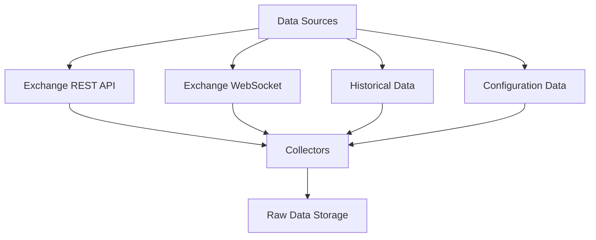
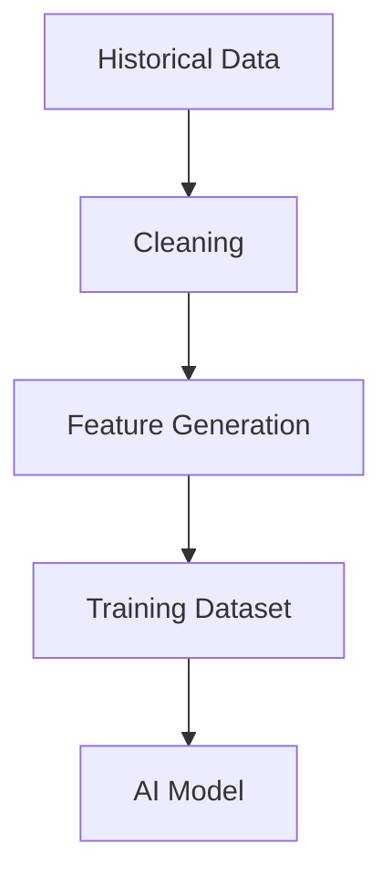

# ETH Bot Data Pipeline - Data Sources

## Overview

This document describes all external and internal data sources used by the ETH Futures AI Trading System.

The Data Source layer is responsible for collecting market information required for:

- Market analysis
- Technical indicators
- Feature engineering
- AI model training
- Backtesting
- Live trading decisions


---

# Data Source Architecture





---

# Data Source Categories


The system uses four main data source categories:


1. Exchange REST API

2. Exchange WebSocket

3. Historical Market Data

4. System Configuration Data


---

# 1. Exchange REST API


## Purpose

REST API provides request-based market data.

Used mainly for:

- Historical data collection
- Periodic updates
- Data recovery
- Backfilling missing data


---

## REST API Data Flow


---

# REST API Data Types


## OHLCV


Timeframes:

- 1 Hour
- 1 Day


Used for:

- Price history
- Trend analysis
- Model training


Data:

```
timestamp

open

high

low

close

volume
```


---

## Open Interest


Purpose:

Measures active futures contracts.


Used for:

- Market participation
- Leverage analysis
- Trend confirmation


Data:

```
timestamp

open_interest

change

percentage_change
```


---

## Funding Rate


Purpose:

Measures the cost between long and short positions.


Used for:

- Market sentiment
- Crowded trade detection


Data:

```
timestamp

funding_rate
```


---

## Mark Price


Purpose:

Fair futures valuation.


Used for:

- Liquidation calculations
- Price comparison


Data:

```
timestamp

mark_price
```


---

## Index Price


Purpose:

Reference spot price.


Used for:

- Futures premium calculation
- Price deviation analysis


Data:

```
timestamp

index_price
```


---

## Long/Short Ratio


Purpose:

Shows trader positioning.


Data:

```
timestamp

long_ratio

short_ratio
```


---

# 2. Exchange WebSocket


## Purpose

WebSocket provides real-time streaming data.

Used for:

- Live market monitoring
- Short-term models
- Order flow analysis


---

## WebSocket Data Flow


---

# WebSocket Data Types


## Live Trades


Contains:


```
timestamp

price

quantity

side
```


Used for:

- Market activity
- Trade pressure


---

## Order Book


Contains:


```
timestamp

bid_price

bid_quantity

ask_price

ask_quantity
```


Derived features:

- Spread
- Order imbalance
- Liquidity


---

## Liquidations


Contains:


```
timestamp

side

price

quantity

value
```


Used for:

- Market stress
- Volatility prediction


---

# 3. Historical Data


## Purpose

Historical data is required for:

- Training AI models
- Backtesting strategies
- Research


---

# Historical Data Sources


Possible sources:


## Exchange Historical Data

Advantages:

- Official data
- Consistent format
- Reliable


---

## Data Providers

Advantages:

- Long history
- Multiple markets
- Clean datasets


---

# Historical Data Requirements


Minimum:


```
ETH Futures

5+ years history

1H candles

1D candles
```


Additional:


```
Open Interest

Funding Rate

Liquidations

Order Book

Options Data
```


---

# Historical Data Usage





---

# 4. System Configuration Data


## Purpose

Configuration controls how the pipeline operates.


Examples:


```
Exchange settings

Database settings

Timeframes

Storage paths

Scheduler settings
```


---

# Configuration Sources


Example:


```
config/

├── exchange.yaml

├── database.yaml

├── pipeline.yaml

└── model.yaml
```


---

# Exchange Configuration Example


```yaml
exchange:
  name: binance

symbol:
  - ETHUSDT

timeframe:
  - 1h
  - 1d
```


---

# Data Source Reliability


Each source has different reliability requirements.


| Source | Frequency | Importance |
|---|---|---|
| OHLCV | Hourly/Daily | Critical |
| Open Interest | Periodic | High |
| Funding Rate | Periodic | High |
| Order Book | Real-time | Medium |
| Liquidations | Real-time | Medium |
| Options | Periodic | Optional |


---

# Data Collection Strategy


## Historical Collection


Used for initial setup.


Flow:


```
Historical Download

↓

Raw Storage

↓

Processing

↓

Dataset Creation
```


---

## Continuous Collection


Used during operation.


Flow:


```
Scheduler

↓

Collector

↓

Validation

↓

Storage
```


---

# Data Source Error Handling


## API Failure


Actions:

- Retry request
- Log error
- Wait before retry
- Continue pipeline


---

## Missing Data


Actions:

- Detect missing timestamp
- Request again
- Mark unavailable data


---

## Rate Limit Handling


Actions:

- API throttling
- Request queue
- Backoff strategy


---

# Data Source Folder Mapping


```
data_pipeline/

├── sources/

│   ├── exchange_api.py

│   ├── websocket.py

│   └── historical_loader.py


├── collectors/

│   ├── ohlcv_collector.py

│   ├── oi_collector.py

│   ├── funding_collector.py

│   ├── orderbook_collector.py

│   └── liquidation_collector.py
```


---

# Recommended Data Source Priority


For first version:


## Level 1 - Required

- OHLCV
- Open Interest
- Funding Rate
- Mark Price
- Index Price


## Level 2 - Important

- Order Book
- Liquidations
- Long/Short Ratio


## Level 3 - Advanced

- Options Chain
- Greeks
- Alternative Data


---

# Future Expansion


Possible additions:


- Multiple exchanges
- On-chain data
- Social sentiment
- News data
- Macro indicators
- Economic data


---

# Summary


The Data Source layer provides all market information required by the ETH Futures AI system.

Flow:


```
Exchange

↓

Data Sources

↓

Collectors

↓

Raw Storage

↓

ETL Pipeline

↓

AI Models
```

Document Version:

```
v1.0
```