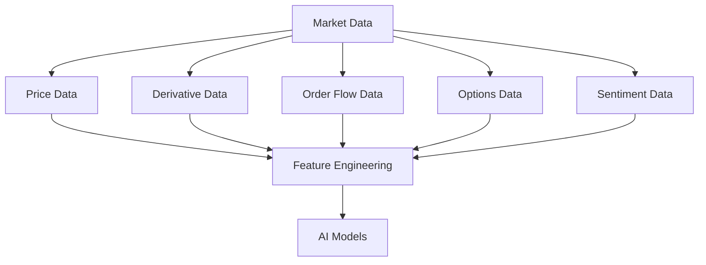
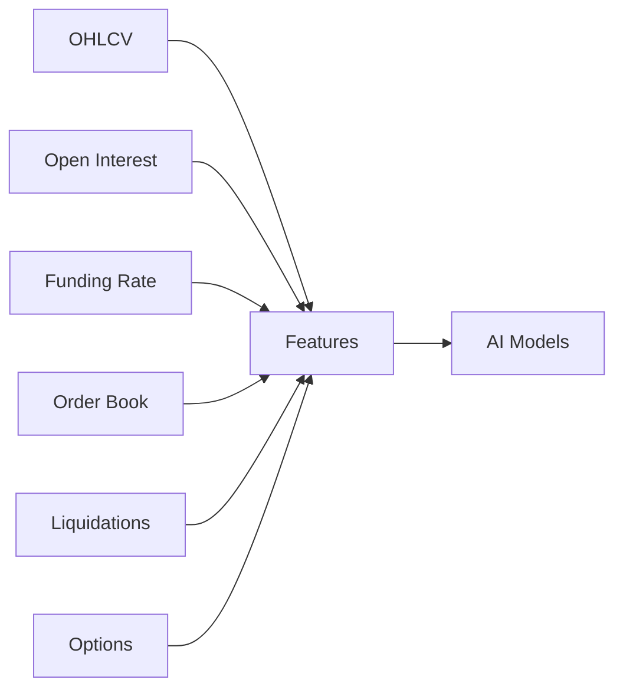

# ETH Bot Data Pipeline - Data Types

## Overview

This document defines all market data types collected, stored, processed, and used by the ETH Futures AI Trading System.

The data layer provides information for:

- Market understanding
- Technical analysis
- Feature engineering
- Machine learning models
- Deep learning models
- Backtesting
- Live trading


---

# Data Type Architecture





---

# Data Categories


The system collects:


| Category | Data |
|---|---|
| Price Data | OHLCV |
| Derivative Data | Open Interest, Funding Rate |
| Reference Data | Mark Price, Index Price |
| Order Flow Data | Order Book, Liquidations |
| Sentiment Data | Long/Short Ratio |
| Options Data | Chain, Greeks |


---

# 1. OHLCV Data


## Overview

OHLCV is the primary market price data.

It represents price movement during a specific time period.


OHLCV means:


```
Open

High

Low

Close

Volume
```


---

# Timeframes


The system supports:


## 1 Hour Candle


Used for:

- Short-term models
- Intraday strategies
- Market prediction


## 1 Day Candle


Used for:

- Long-term trend
- Market regime detection


---

# OHLCV Schema


| Field | Type | Description |
|-|-|-|
| timestamp | datetime | Candle time |
| open | float | Opening price |
| high | float | Highest price |
| low | float | Lowest price |
| close | float | Closing price |
| volume | float | Trading volume |


---

# Example


```
timestamp:

2026-08-05 10:00


open:

3500


high:

3550


low:

3480


close:

3530


volume:

25000
```


---

# OHLCV Derived Data


Generated features:


## Price Features

- Return
- Log return
- Percentage change


## Candle Features

- Body size
- Upper wick
- Lower wick


## Trend Features

- Moving averages
- Trend direction


---

# 2. Open Interest (OI)


## Overview

Open Interest represents the total number of active futures contracts.


It shows:

- Market participation
- Leverage level
- Trader commitment


---

# Open Interest Schema


| Field | Type | Description |
|-|-|-|
| timestamp | datetime | Time |
| open_interest | float | Total contracts |
| change | float | Difference |
| percentage_change | float | Change percentage |


---

# Open Interest Interpretation


Example:


```
Price ↑

OI ↑


Possible:

Strong participation
```


Example:


```
Price ↑

OI ↓


Possible:

Short covering
```


---

# 3. Funding Rate


## Overview

Funding rate is the periodic payment between long and short futures traders.


---

# Purpose


Used for:


- Sentiment analysis
- Detecting crowded positions
- Market extreme detection


---

# Funding Rate Schema


| Field | Type | Description |
|-|-|-|
| timestamp | datetime | Time |
| funding_rate | float | Funding value |


---

# Interpretation


Positive funding:


```
Long traders pay short traders
```

Usually indicates:

- More longs
- Bullish sentiment


Negative funding:


```
Short traders pay long traders
```

Usually indicates:

- More shorts
- Bearish sentiment


---

# 4. Mark Price


## Overview

Mark price is the fair futures price calculated by the exchange.


Used for:

- Liquidation calculation
- Unrealized PnL
- Futures valuation


---

# Schema


```
timestamp

mark_price
```


---

# 5. Index Price


## Overview

Index price represents the spot market reference price.


Used for:


- Futures premium
- Price difference analysis


---

# Schema


```
timestamp

index_price
```


---

# Price Difference Features


Generated:


```
Mark Price - Index Price

=

Futures Premium
```


---

# 6. Order Book Data


## Overview

Order book represents current market liquidity.


Contains:


## Bids

Buy orders


## Asks

Sell orders


---

# Order Book Schema


```
timestamp

bid_price

bid_quantity

ask_price

ask_quantity
```


---

# Order Book Features


Generated:


## Spread


```
ask price - bid price
```


## Order Imbalance


```
buy pressure vs sell pressure
```


## Liquidity


```
available market depth
```


---

# 7. Liquidation Data


## Overview

Liquidations occur when leveraged positions are forcibly closed.


Used for:


- Market stress detection
- Volatility prediction
- Extreme movement analysis


---

# Schema


| Field | Description |
|-|-|
| timestamp | Time |
| side | Long/Short |
| price | Liquidation price |
| quantity | Position size |
| value | USD value |


---

# Liquidation Features


Examples:


```
Long liquidation spike

=

Possible downward pressure
```


```
Short liquidation spike

=

Possible upward pressure
```


---

# 8. Long/Short Ratio


## Overview

Shows trader positioning.


Measures:

- Long percentage
- Short percentage


---

# Schema


```
timestamp

long_ratio

short_ratio
```


---

# Usage


Used for:

- Sentiment
- Contrarian signals
- Market bias


---

# 9. Options Data


## Overview

Options data provides advanced market expectation information.


Includes:


- Options chain
- Greeks


---

# Options Chain


Contains:


```
Strike Price

Expiry Date

Call Price

Put Price

Volume

Open Interest
```


---

# Options Greeks


## Delta


Price sensitivity.


## Gamma


Delta change.


## Theta


Time decay.


## Vega


Volatility sensitivity.


---

# 10. Derived Market Data


The pipeline creates additional datasets.


Examples:


## Volatility Data


```
ATR

Historical Volatility

Realized Volatility
```


---

## Trend Data


```
EMA

MACD

ADX

Trend Strength
```


---

## Market Structure Data


```
Support

Resistance

Liquidity Zones

Market Regime
```


---

# Data Priority


## Required


```
OHLCV

Open Interest

Funding Rate

Mark Price

Index Price
```


---

## Important


```
Order Book

Liquidations

Long/Short Ratio
```


---

## Advanced


```
Options Chain

Greeks

Alternative Data
```


---

# Data Relationship





---

# Storage Mapping


```
storage/

├── raw/

│
├── processed/

│
└── features/
```


Raw:

- Original exchange data


Processed:

- Clean market data


Features:

- AI-ready values


---

# Summary


The Data Pipeline uses multiple data types to understand:

- Price movement
- Market participation
- Liquidity
- Sentiment
- Volatility
- Trader behavior


Complete flow:


```
Market Data

↓

Processing

↓

Features

↓

AI Models

↓

Trading Decisions
```


Document Version:

```
v1.0
```