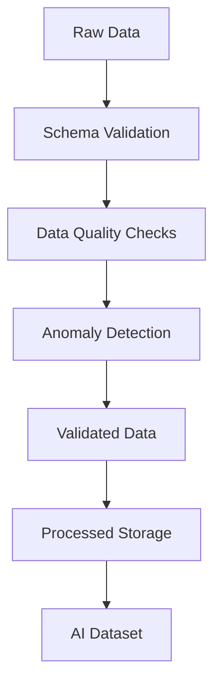
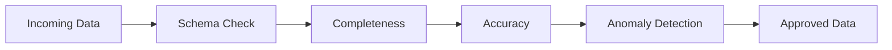
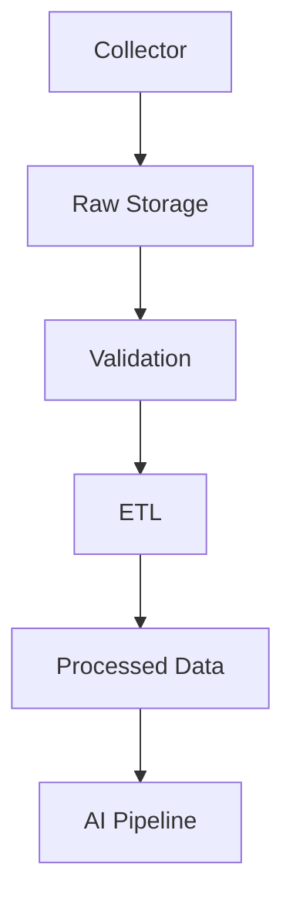

# ETH Bot Data Pipeline - Data Validation

## Overview

Data Validation is the quality control layer of the ETH Futures AI Trading System.

It ensures that collected market data is:

- Complete
- Accurate
- Consistent
- Fresh
- Reliable
- Suitable for AI models


The validation layer prevents:

- Bad market data
- Missing candles
- Incorrect calculations
- Model training errors
- Trading decisions based on corrupted data


---

# Validation Architecture





---

# Validation Goals


The system validates:


```
Data Format

↓

Data Completeness

↓

Data Accuracy

↓

Data Consistency

↓

Data Freshness

↓

Data Distribution
```


---

# Validation Layers


```
validation/

├── schema_check.py

├── missing_data.py

├── anomaly_detection.py

├── quality_report.py

└── validator.py
```


---

# 1. Schema Validation


## Purpose


Check whether data structure is correct.


Example:


Expected:


```
timestamp

open

high

low

close

volume
```


Received:


```
timestamp

open

close
```


Result:


```
FAILED
```


---

# Schema Checks


Validate:


- Column names
- Data types
- Required fields
- Format


---

# Example Schema


```yaml
ohlcv:

 required:

  - timestamp

  - open

  - high

  - low

  - close

  - volume
```


---

# 2. Timestamp Validation


## Purpose


Ensure correct time sequence.


Checks:


- Missing timestamps
- Duplicate timestamps
- Wrong timezone


---

# Example


Correct:


```
10:00

11:00

12:00
```


Wrong:


```
10:00

12:00
```


Missing:


```
11:00
```


---

# 3. Missing Data Validation


## Purpose


Detect incomplete datasets.


Common causes:


- API failure
- Network issue
- Exchange downtime


---

# Missing Candle Detection


Example:


For 1H candles:


Expected:


```
24 candles per day
```


Received:


```
23 candles
```


Action:


```
Request missing candle

↓

Update storage
```


---

# Missing Data Handling


Options:


## Re-fetch


Request data again.


---

## Interpolation


Only for specific analytics.


Not recommended for:


- Trading models
- Price data


---

## Mark Missing


Store:


```
NULL

or

missing flag
```


---

# 4. OHLCV Validation


## Purpose


Verify price relationships.


Rules:


```
High >= Open

High >= Close

Low <= Open

Low <= Close
```


---

# Invalid Example


```
Open:

3500


High:

3400
```


Result:


```
Invalid candle
```


---

# Volume Validation


Check:


```
Volume >= 0
```


Invalid:


```
Negative volume
```


---

# 5. Data Type Validation


Check:


Correct:


```
price:

float


volume:

float


timestamp:

datetime
```


Wrong:


```
price:

string
```


---

# 6. Duplicate Data Detection


## Purpose


Prevent duplicate records.


Example:


Before:


```
10:00 ETH candle

10:00 ETH candle
```


After:


```
10:00 ETH candle
```


---

# Duplicate Detection Key


Usually:


```
timestamp

+

symbol

+

timeframe
```


---

# 7. Data Freshness Validation


## Purpose


Ensure pipeline is running correctly.


Example:


Current time:


```
10:05
```


Latest candle:


```
10:00
```


Status:


```
Healthy
```


---

# Freshness Rules


Example:


## OHLCV


Maximum delay:


```
1-5 minutes
```


## WebSocket


Maximum delay:


```
Seconds
```


---

# 8. Anomaly Detection


## Purpose


Detect unusual market data.


Examples:


- Extreme price movement
- Abnormal volume
- Sudden data gaps


---

# Price Anomaly


Example:


Normal:


```
3500

3510

3520
```


Anomaly:


```
3500

50000

3510
```


---

# Volume Anomaly


Detect:


```
Unusual volume spikes
```


Possible reasons:


- Real market event
- Data error


---

# Statistical Methods


Methods:


## Z-Score


Detect extreme values.


---

## Standard Deviation


Measure abnormal movement.


---

## Rolling Average


Compare current value with history.


---

# 9. Market Relationship Validation


Check relationships between data.


---

# Mark Price vs Index Price


Normally:


```
Small difference
```


Large difference:


```
Possible abnormality
```


---

# Funding Rate Validation


Check:


```
Reasonable range
```


---

# Open Interest Validation


Check:


```
Sudden impossible changes
```


---

# 10. Feature Validation


Before AI training:


Check:


## Missing Features


Example:


```
RSI = NULL
```


---

## Feature Range


Example:


RSI:


```
0-100
```


Invalid:


```
RSI = 500
```


---

## Feature Stability


Check:


- Distribution changes
- Data drift


---

# 11. Dataset Validation


Before training models:


Validate:


```
Features

Labels

Time Order

Data Split
```


---

# Data Leakage Check


Important:


Never allow:


```
Future information

↓

Past prediction
```


Example:


Wrong:


```
Predict 10:00

Using 11:00 indicator
```


---

# Validation Pipeline





---

# Validation Reports


Generated reports:


```
reports/


daily_quality_report.json

validation_errors.json
```


---

# Quality Report Example


```json
{
 "date":"2026-08-05",

 "records_checked":50000,

 "missing_records":0,

 "invalid_records":2,

 "status":"passed"
}
```


---

# Validation Severity Levels


## INFO


Normal information.


Example:


```
Dataset updated
```


---

## WARNING


Potential issue.


Example:


```
Small data delay
```


---

## ERROR


Requires action.


Example:


```
Missing candles
```


---

## CRITICAL


Stop processing.


Example:


```
Corrupted market data
```


---

# Automated Validation Schedule


## Real-Time


Check:


- WebSocket health
- Data freshness


---

## Hourly


Check:


- New candles
- OHLCV quality
- Indicators


---

## Daily


Check:


- Full dataset quality
- Reports
- Data drift


---

# Python Libraries


## Data Validation


```
pydantic

great_expectations

pandera
```


---

## Data Processing


```
pandas

polars

numpy
```


---

## Statistics


```
scipy

statsmodels
```


---

# Validation Integration





---

# Future Improvements


Possible additions:


- Automated data quality dashboard
- ML anomaly detection
- Data drift monitoring
- Real-time alerting
- Validation rules engine


---

# Summary


Data Validation protects the complete AI trading pipeline from bad data.


Final flow:


```
Collect

↓

Validate

↓

Process

↓

Feature

↓

Train

↓

Predict
```


Document Version:

```
v1.0
```