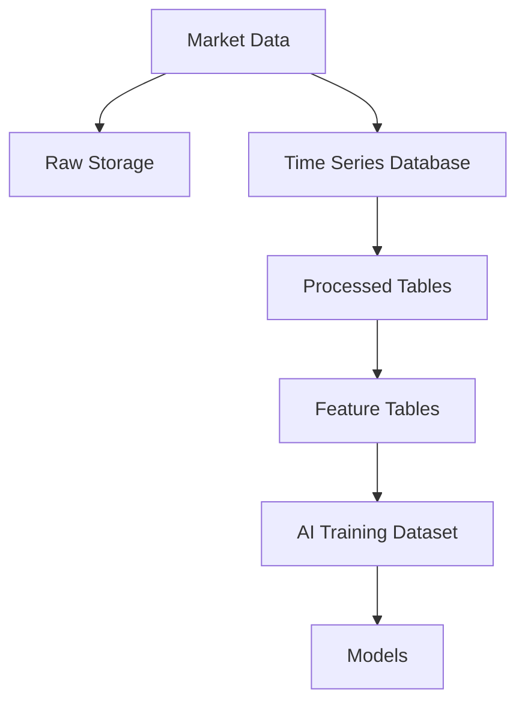
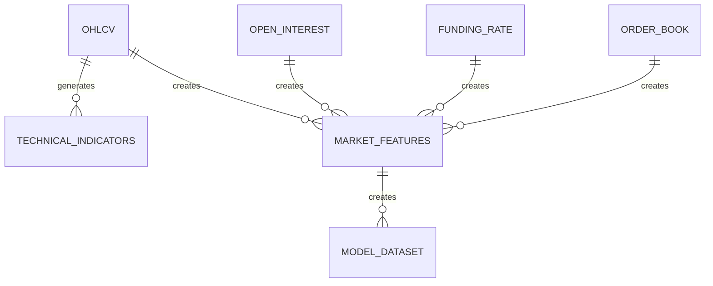
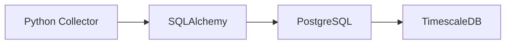

# ETH Bot Data Pipeline - Database Schema

## Overview

This document defines the database architecture and schema design for the ETH Futures AI Trading System.

The database layer stores:

- Market data
- Derivative data
- Order flow data
- Processed datasets
- Technical indicators
- AI features
- Training data


The database design focuses on:

- Fast time-series queries
- Historical storage
- Data integrity
- ML dataset generation
- Backtesting support


---

# Database Architecture





---

# Recommended Database Stack


## Primary Database

Recommended:

```
PostgreSQL + TimescaleDB
```


Reason:

- Time-series optimization
- SQL support
- Large historical data
- Easy integration with Python


---

## Analytical Storage


Recommended:

```
Parquet + DuckDB
```


Used for:

- Large backtesting
- Research
- Model training


---

# Storage Layers


The database follows three layers:


```
Database

|

├── Raw Layer

├── Processed Layer

└── Feature Layer
```


---

# 1. Raw Data Layer


## Purpose


Store original exchange data.


Rules:

- No modification
- No calculations
- Complete history


Tables:


```
raw_ohlcv

raw_open_interest

raw_funding_rate

raw_mark_price

raw_index_price

raw_order_book

raw_liquidations

raw_options
```


---

# 2. Processed Data Layer


## Purpose


Store cleaned and standardized data.


Operations:

- Timestamp correction
- Duplicate removal
- Missing data handling
- Data normalization


Tables:


```
eth_ohlcv

eth_derivatives

eth_market_depth
```


---

# 3. Feature Layer


## Purpose


Store AI-ready features.


Tables:


```
technical_indicators

market_features

model_features
```


---

# Database Entity Relationship





---

# Table Schemas


# 1. OHLCV Table


## Purpose

Stores candle data.


Table:

```
eth_ohlcv
```


Schema:


```sql
CREATE TABLE eth_ohlcv (

    id BIGSERIAL PRIMARY KEY,

    timestamp TIMESTAMP NOT NULL,

    timeframe VARCHAR(10) NOT NULL,

    open FLOAT NOT NULL,

    high FLOAT NOT NULL,

    low FLOAT NOT NULL,

    close FLOAT NOT NULL,

    volume FLOAT NOT NULL,

    created_at TIMESTAMP DEFAULT NOW()

);
```


---

# Index


```sql
CREATE INDEX idx_eth_ohlcv_timestamp

ON eth_ohlcv(timestamp);
```


Purpose:

Fast historical lookup.


---

# Example Data


| timestamp | open | high | low | close | volume |
|-|-|-|-|-|-|
|2026-08-05 10:00|3500|3550|3480|3530|25000|


---

# 2. Open Interest Table


Table:

```
open_interest
```


Schema:


```sql
CREATE TABLE open_interest (

    id BIGSERIAL PRIMARY KEY,

    timestamp TIMESTAMP NOT NULL,

    open_interest FLOAT,

    change FLOAT,

    percentage_change FLOAT

);
```


---

# 3. Funding Rate Table


Table:

```
funding_rate
```


Schema:


```sql
CREATE TABLE funding_rate (

    id BIGSERIAL PRIMARY KEY,

    timestamp TIMESTAMP NOT NULL,

    funding_rate FLOAT

);
```


---

# 4. Mark Price Table


Table:

```
mark_price
```


Schema:


```sql
CREATE TABLE mark_price (

    id BIGSERIAL PRIMARY KEY,

    timestamp TIMESTAMP NOT NULL,

    mark_price FLOAT

);
```


---

# 5. Index Price Table


Table:

```
index_price
```


Schema:


```sql
CREATE TABLE index_price (

    id BIGSERIAL PRIMARY KEY,

    timestamp TIMESTAMP NOT NULL,

    index_price FLOAT

);
```


---

# 6. Order Book Table


Table:

```
order_book
```


Schema:


```sql
CREATE TABLE order_book (

    id BIGSERIAL PRIMARY KEY,

    timestamp TIMESTAMP NOT NULL,

    bid_price FLOAT,

    bid_quantity FLOAT,

    ask_price FLOAT,

    ask_quantity FLOAT

);
```


---

# Derived Order Book Fields


Generated:


```
spread

order_imbalance

market_depth
```


---

# 7. Liquidation Table


Table:

```
liquidations
```


Schema:


```sql
CREATE TABLE liquidations (

    id BIGSERIAL PRIMARY KEY,

    timestamp TIMESTAMP NOT NULL,

    side VARCHAR(10),

    price FLOAT,

    quantity FLOAT,

    value FLOAT

);
```


---

# 8. Long Short Ratio Table


Table:

```
long_short_ratio
```


Schema:


```sql
CREATE TABLE long_short_ratio (

    id BIGSERIAL PRIMARY KEY,

    timestamp TIMESTAMP NOT NULL,

    long_ratio FLOAT,

    short_ratio FLOAT

);
```


---

# 9. Options Chain Table


Table:

```
options_chain
```


Schema:


```sql
CREATE TABLE options_chain (

    id BIGSERIAL PRIMARY KEY,

    timestamp TIMESTAMP,

    expiry DATE,

    strike FLOAT,

    option_type VARCHAR(10),

    price FLOAT,

    volume FLOAT,

    open_interest FLOAT

);
```


---

# 10. Options Greeks Table


Table:

```
options_greeks
```


Schema:


```sql
CREATE TABLE options_greeks (

    id BIGSERIAL PRIMARY KEY,

    timestamp TIMESTAMP,

    delta FLOAT,

    gamma FLOAT,

    theta FLOAT,

    vega FLOAT

);
```


---

# Technical Indicators Table


Table:

```
technical_indicators
```


Schema:


```sql
CREATE TABLE technical_indicators (

    id BIGSERIAL PRIMARY KEY,

    timestamp TIMESTAMP,

    rsi FLOAT,

    ema_20 FLOAT,

    ema_50 FLOAT,

    macd FLOAT,

    atr FLOAT,

    bollinger_upper FLOAT,

    bollinger_lower FLOAT

);
```


---

# Feature Table


Table:

```
market_features
```


Stores AI inputs.


Schema:


```sql
CREATE TABLE market_features (

    id BIGSERIAL PRIMARY KEY,

    timestamp TIMESTAMP,

    return FLOAT,

    volatility FLOAT,

    trend_strength FLOAT,

    oi_change FLOAT,

    funding_change FLOAT,

    order_imbalance FLOAT

);
```


---

# Model Dataset Table


Table:

```
model_dataset
```


Purpose:

Training data.


Schema:


```sql
CREATE TABLE model_dataset (

    id BIGSERIAL PRIMARY KEY,

    timestamp TIMESTAMP,

    model_name VARCHAR(50),

    feature_version VARCHAR(20),

    target FLOAT

);
```


---

# Database Partitioning


For large data:


Partition by time:


```
2024

2025

2026
```


Example:


```sql
PARTITION BY RANGE(timestamp);
```


Benefits:

- Faster queries
- Easier archiving
- Better performance


---

# Data Retention Policy


## Raw Data

Keep:

```
Unlimited
```


Reason:

Future research.


---

## Processed Data

Keep:

```
5+ years
```


---

## Real-Time Order Book

Keep:

```
Short term

Example:
30-90 days
```


---

# Database Backup Strategy


Backup:


Daily:

```
Database snapshot
```


Weekly:

```
Full archive
```


Monthly:

```
Long-term storage
```


---

# Python Database Stack


Libraries:


```
SQLAlchemy

psycopg

asyncpg

pandas

polars

pyarrow
```


---

# Database Connection Flow





---

# Database Performance Optimization


Techniques:


## Indexing

Use indexes on:

- timestamp
- symbol
- timeframe


## Compression

Use:

- Timescale compression
- Parquet compression


## Batch Insert

Avoid:

```
one row insert
```


Prefer:


```
bulk insert
```


---

# Future Database Improvements


Possible additions:


- ClickHouse for analytics
- Feature Store
- Distributed storage
- Real-time streaming database
- Multi-asset support


---

# Summary


Database responsibility:


```
Collect

↓

Store

↓

Process

↓

Generate Features

↓

Train Models
```


The database provides the foundation for reliable AI trading research and execution.


Document Version:

```
v1.0
```