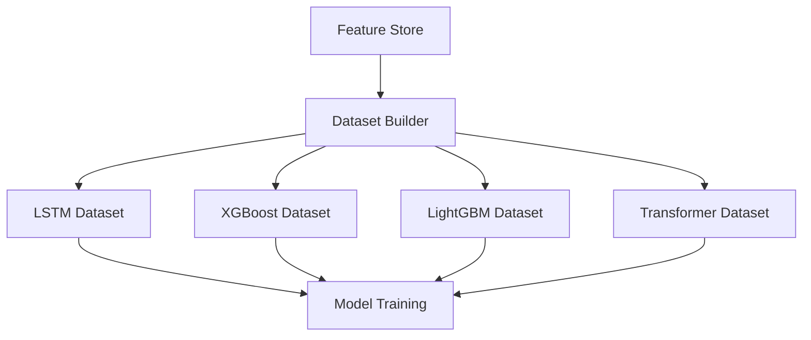
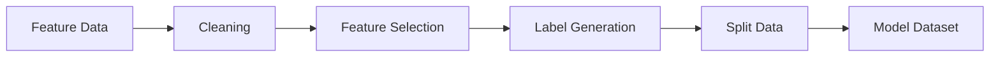
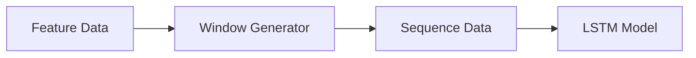
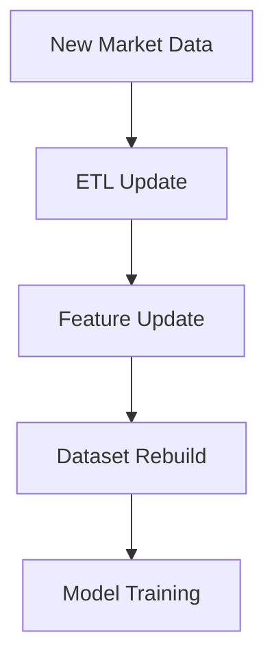

# ETH Bot Data Pipeline - Dataset Builder

## Overview

The Dataset Builder converts processed features into machine learning and deep learning ready datasets.

It is the final preparation layer before AI model training.

Pipeline:


```
Market Data

↓

Processed Data

↓

Technical Indicators

↓

Feature Engineering

↓

Dataset Builder

↓

AI Models
```


The Dataset Builder supports:

- LSTM
- XGBoost
- LightGBM
- CatBoost
- Transformer
- Other ML/DL models


---

# Dataset Builder Architecture





---

# Dataset Builder Responsibilities


The Dataset Builder handles:


- Feature selection
- Data alignment
- Label creation
- Train/Validation/Test split
- Scaling
- Sequence generation
- Dataset versioning


---

# Dataset Structure


```
datasets/

├── lstm/

├── xgboost/

├── lightgbm/

├── transformer/

└── metadata/
```


---

# Dataset Creation Flow





---

# 1. Feature Input


Dataset Builder receives:


## Price Features


Examples:


```
returns

log_returns

candle_features
```


---

## Technical Indicators


Examples:


```
RSI

EMA

MACD

ATR

ADX
```


---

## Derivative Features


Examples:


```
open_interest_change

funding_rate

liquidation_pressure
```


---

## Market Structure Features


Examples:


```
order_imbalance

spread

liquidity
```


---

# 2. Feature Selection


## Purpose


Choose useful features for each model.


Example:


```
All Features

↓

Selected Features

↓

Model Input
```


---

# Feature Groups


```
features/

├── price

├── trend

├── momentum

├── volatility

├── volume

├── derivatives

└── order_flow
```


---

# 3. Label Generation


AI models require targets.


Example:


Input:


```
Previous 100 candles
```


Target:


```
Future price movement
```


---

# Prediction Targets


## Direction Target


Example:


```
1 = Price Up

0 = Price Down
```


---

## Trend Target


Example:


```
Bullish

Bearish

Sideways
```


---

## Volatility Target


Example:


```
Low Volatility

Medium Volatility

High Volatility
```


---

## Future Return Target


Example:


```
Future 24 candle return
```


---

# Multi Output Dataset


The system can create multiple targets.


Example:


```
Input Features

        |

        v

AI Model


Outputs:

Direction

Trend

Volatility

Reversal

Duration
```


---

# LSTM Dataset Builder


## Purpose


Create sequential datasets.


LSTM requires:


```
Samples

×

Time Steps

×

Features
```


Example:


```
1000 samples

168 candles

50 features
```


Shape:


```
(1000,168,50)
```


---

# LSTM Dataset Flow





---

# Sequence Example


Input:


```
Candle 1

Candle 2

...

Candle 168
```


Output:


```
Next 24 candle prediction
```


---

# XGBoost Dataset Builder


## Purpose


Create tabular datasets.


Structure:


```
Rows = Samples

Columns = Features
```


Example:


| RSI | EMA | ATR | OI | Target |
|-|-|-|-|-|
|55|3500|40|10000|1|


---

# LightGBM Dataset Builder


Same structure as XGBoost.


Advantages:


- Large dataset support
- Fast training
- Good feature handling


---

# Transformer Dataset Builder


Transformer models require:


```
Sequence

+

Attention Mask
```


Example:


```
Input:

Previous market sequence


Output:

Future prediction
```


---

# Train Validation Test Split


Recommended:


```
70%

Training


15%

Validation


15%

Testing
```


---

# Time-Series Split Rule


Do NOT randomly shuffle.


Correct:


```
Past

↓

Training


Future

↓

Validation


Future

↓

Testing
```


Reason:


Avoid future data leakage.


---

# Data Scaling


## Standard Scaling


Formula:


```
(value - mean)

/

standard deviation
```


Used for:


- LSTM
- Neural networks


---

## Min-Max Scaling


Range:


```
0 to 1
```


Used for:


- Neural networks


---

# Data Leakage Prevention


Important rules:


Never use:


```
Future candles

Future indicators

Future information
```


Example wrong:


```
Predict 10:00

Using 11:00 data
```


---

# Dataset Versioning


Every dataset should have version.


Example:


```
datasets/


lstm/

v1/

v2/
```


Version includes:


```
Feature version

Data range

Target definition

Parameters
```


---

# Dataset Metadata


Store:


```
metadata/


dataset_info.json
```


Example:


```json
{
 "model":"LSTM",
 "features":50,
 "sequence_length":168,
 "target":"direction",
 "version":"v1"
}
```


---

# Dataset Folder Structure


```
datasets/


├── lstm/

│
│── train.npy

│── validation.npy

│── test.npy


├── xgboost/

│
│── train.parquet

│── validation.parquet

│── test.parquet


├── lightgbm/


├── transformer/


└── metadata/
```


---

# Dataset Automation





---

# Dataset Schedule


## Hourly


Update:


```
Latest candles

Latest features
```


---

## Daily


Run:


```
Dataset validation

Dataset update
```


---

## Monthly / Quarterly


Run:


```
Full dataset rebuild

Model retraining
```


---

# Python Libraries


## Data Processing


```
pandas

polars

numpy

pyarrow
```


---

## Machine Learning


```
scikit-learn

xgboost

lightgbm

catboost
```


---

## Deep Learning


```
tensorflow

keras

pytorch
```


---

# Dataset Quality Checks


Check:


## Missing Values


```
No missing features
```


---

## Feature Distribution


Check:


- Extreme values
- Data drift


---

## Label Balance


Example:


```
70% Up

30% Down
```


Avoid:


```
99% one class
```


---

# Dataset Performance Optimization


Techniques:


## Parquet Storage


Benefits:


- Compression
- Fast loading


---

## Batch Generation


Generate:


```
Chunks

Instead of

Whole dataset
```


---

## Parallel Processing


Use:


```
Multiprocessing

Dask

Ray
```


---

# Future Improvements


Possible additions:


- Automated feature selection
- Online dataset generation
- Feature store integration
- Distributed training pipeline
- Reinforcement learning datasets


---

# Summary


Dataset Builder transforms features into AI-ready datasets.


Final flow:


```
Features

↓

Dataset Builder

↓

LSTM/XGBoost/LightGBM

↓

Prediction

↓

Strategy
```


Document Version:

```
v1.0
```