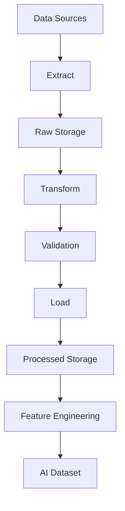
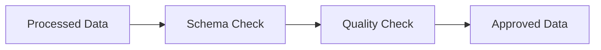
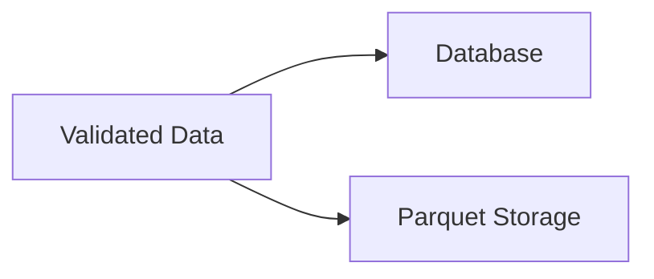

# ETH Bot Data Pipeline - ETL Pipeline

## Overview

ETL stands for:

- Extract
- Transform
- Load


The ETL pipeline is responsible for converting raw exchange data into clean, structured, and AI-ready datasets.


The ETL pipeline supports:

- Historical data processing
- Real-time data processing
- Feature generation
- Model training
- Backtesting


---

# ETL Architecture





---

# ETL Pipeline Goals


The ETL system should:


- Collect data automatically
- Preserve original data
- Clean incorrect records
- Standardize formats
- Validate quality
- Generate usable datasets
- Support ML/DL models


---

# ETL Layers


```
ETL Pipeline

|

├── Extract Layer

├── Transform Layer

├── Validation Layer

├── Load Layer

└── Feature Layer
```


---

# 1. Extract Layer


## Purpose


Extract data from external sources.


Sources:


```
Exchange REST API

Exchange WebSocket

Historical Files

Database
```


---

# Extract Architecture


---

# Extract Components


Folder:


```
etl/

├── extract.py

```


Responsibilities:


- API requests
- WebSocket receiving
- Historical loading
- File reading
- Data ingestion


---

# Extract Example Flow


```
Exchange

↓

Collector

↓

JSON Response

↓

Raw Storage
```


---

# Raw Data Format


Example:


```json
{
    "timestamp": "2026-08-05 10:00",
    "open": 3500,
    "high": 3550,
    "low": 3480,
    "close": 3530,
    "volume": 25000
}
```


---

# 2. Transform Layer


## Purpose


Convert raw data into clean data.


Folder:


```
etl/

├── transform.py
```


---

# Transform Operations


## Timestamp Processing


Tasks:


- Convert timezone
- Standardize format
- Sort data


Example:


Before:


```
05/08/26 10:00
```


After:


```
2026-08-05 10:00:00 UTC
```


---

# Missing Data Handling


Problems:


- Missing candles
- API failure
- Network issues


Solutions:


```
Detect

↓

Request again

↓

Fill missing data

↓

Mark unavailable
```


---

# Duplicate Removal


Example:


Before:


```
10:00 candle

10:00 candle
```


After:


```
10:00 candle
```


---

# Data Type Conversion


Example:


Before:


```
"3500"
```


After:


```
3500.0
```


---

# OHLC Validation


Rules:


```
High >= Open

High >= Close

Low <= Open

Low <= Close
```


---

# Outlier Detection


Detect:


- Abnormal price movement
- Wrong volume
- Data corruption


Example:


```
ETH Price:

3500

35000

3505
```


Possible:

- Bad data
- Exchange issue


---

# 3. Validation Layer


## Purpose


Ensure processed data quality.


Folder:


```
validation/

```


---

# Validation Checks


## Completeness Check


Verify:


- All candles exist
- No missing timestamps


Example:


```
Expected:

24 candles/day


Received:

23 candles/day
```


---

# Accuracy Check


Verify:


- Price values
- Volume values
- OHLC relationship


---

# Consistency Check


Verify:


- Duplicate records
- Correct ordering
- Correct timeframe


---

# Freshness Check


Verify:


Latest data arrival.


Example:


```
Last candle:

10:00


Current time:

10:05


Status:

OK
```


---

# Validation Flow





---

# 4. Load Layer


## Purpose


Store transformed data.


Folder:


```
etl/

├── load.py
```


---

# Load Destinations


## Database


Used for:


- Time-series queries
- Live systems


Example:


```
TimescaleDB
```


---

## File Storage


Used for:


- Training
- Research


Example:


```
Parquet
```


---

# Load Flow





---

# Data Processing Pipeline


Complete flow:


```
Raw Data

↓

Extract

↓

Transform

↓

Validate

↓

Load

↓

Indicators

↓

Features

↓

Dataset
```


---

# Batch ETL


## Purpose


Process historical data.


Example:


```
5 Years ETH Data

↓

ETL Processing

↓

Training Dataset
```


---

# Batch Schedule


Examples:


Daily:


```
Process yesterday data
```


Weekly:


```
Rebuild datasets
```


---

# Streaming ETL


## Purpose


Process real-time data.


Used for:


- Order book
- Trades
- Liquidations


Flow:


---

# ETL Scheduling


## Hourly Job


Tasks:


```
Collect 1H OHLCV

Update indicators

Generate features
```


---

## Daily Job


Tasks:


```
Collect 1D OHLCV

Run validation

Archive data
```


---

# ETL Folder Structure


```
etl/


├── extract.py

├── transform.py

├── validate.py

├── load.py

├── pipeline.py

└── scheduler.py
```


---

# Pipeline Controller


File:


```
pipeline.py
```


Responsible for:


```
Start ETL

↓

Run Extract

↓

Run Transform

↓

Run Validation

↓

Run Load
```


---

# Error Handling


## API Error


Actions:


```
Retry

↓

Log Error

↓

Continue
```


---

## Data Error


Actions:


```
Reject Data

↓

Save Error Report

↓

Alert
```


---

## Storage Error


Actions:


```
Queue Data

↓

Retry Insert

↓

Recover
```


---

# Logging


ETL logs:


```
logs/


etl.log

validation.log

error.log
```


Contains:


- Execution time
- Records processed
- Errors
- Warnings


---

# ETL Performance Optimization


## Batch Processing


Instead of:


```
Insert one row
```


Use:


```
Bulk insert
```


---

## Parallel Processing


Use:


- Multiprocessing
- Async processing


---

## Incremental ETL


Process only new data.


Example:


```
Last processed:

2026-08-05 10:00


New data:

After 10:00
```


---

# ETL Data Lineage


Track:


```
Source

↓

Raw Data

↓

Processed Data

↓

Features

↓

Model Dataset
```


---

# Future Improvements


Possible additions:


- Apache Airflow
- Prefect
- Kafka
- Spark
- Flink
- Real-time feature pipeline


---

# Summary


The ETL pipeline converts raw market information into reliable AI-ready data.


Final flow:


```
Exchange

↓

Extract

↓

Transform

↓

Validate

↓

Load

↓

Features

↓

AI Models
```


Document Version:

```
v1.0
```