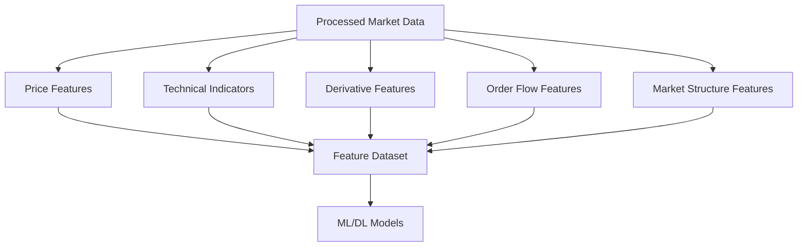
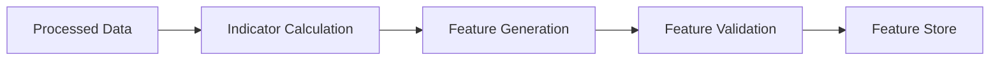

# ETH Bot Data Pipeline - Feature Engineering

## Overview

Feature Engineering is the process of converting processed market data into meaningful inputs for Machine Learning and Deep Learning models.

The goal is to transform:

```
Raw Market Data

↓

Processed Data

↓

Features

↓

AI Models
```

Features help models understand:

- Price behavior
- Market trend
- Volatility
- Momentum
- Liquidity
- Trader positioning
- Market regime


---

# Feature Engineering Architecture





---

# Purpose of Features


A model cannot directly understand market data.

Example:


Raw Data:

```
Close Price:

3500
```


Feature:

```
1 hour return:

+0.8%
```


The feature provides more useful information.


---

# Feature Categories


The pipeline creates:


```
features/

├── price/

├── trend/

├── momentum/

├── volatility/

├── volume/

├── derivatives/

├── order_flow/

├── sentiment/

└── market_regime/
```


---

# 1. Price Features


## Overview


Price features describe movement and behavior.


Source:

```
OHLCV
```


---

# Returns


## Simple Return


Formula:


```
(Current Close - Previous Close)

/

Previous Close
```


Example:


```
3500 → 3535


Return:

1%
```


---

## Log Return


Formula:


```
log(Current Price / Previous Price)
```


Used for:

- Financial modeling
- Time-series models


---

# Candle Features


Generated from:


```
Open

High

Low

Close
```


Features:


## Candle Body


```
close - open
```


---

## Upper Wick


```
high - max(open, close)
```


---

## Lower Wick


```
min(open, close) - low
```


---

## Candle Direction


Example:


```
1 = Bullish

0 = Bearish
```


---

# Price Distance Features


Examples:


```
close - EMA20

close - EMA50

close - VWAP
```


Used for:

- Trend detection


---

# 2. Trend Features


## Purpose


Identify market direction.


Sources:


- OHLCV
- Indicators


---

# Moving Average Features


Examples:


```
EMA20

EMA50

EMA200
```


Derived:


```
EMA20 > EMA50

=

Bullish trend
```


---

# Trend Strength


Using:


```
ADX
```


Output:


```
0-100
```


Higher value:

```
Strong trend
```


---

# Trend Direction Feature


Example:


```
1  = Bullish

0  = Neutral

-1 = Bearish
```


---

# MACD Features


Features:


```
MACD Line

Signal Line

Histogram
```


Used for:

- Momentum change
- Trend transition


---

# 3. Momentum Features


## Purpose


Measure speed of price movement.


---

# RSI Features


Generated:


```
RSI

RSI change

RSI zone
```


Example:


```
RSI > 70

Possible overbought
```


---

# Stochastic RSI


Features:


```
K value

D value
```


---

# Rate of Change


Measures:


```
Current price movement

compared to past price
```


---

# 4. Volatility Features


## Purpose


Understand market risk and movement size.


---

# ATR Features


Average True Range:


Features:


```
ATR

ATR percentage

ATR change
```


---

# Bollinger Band Features


Features:


```
Upper band

Lower band

Band width

Price position
```


---

# Historical Volatility


Measures:


```
How much price changes over time
```


---

# Volatility Regime


Example:


```
Low volatility

Medium volatility

High volatility
```


Used for:

- Strategy selection
- Risk adjustment


---

# 5. Volume Features


## Purpose


Understand trading activity.


---

# Volume Features


Examples:


```
Volume

Volume change

Volume moving average
```


---

# Volume Ratio


Formula:


```
Current Volume

/

Average Volume
```


---

# OBV Features


On Balance Volume:


Used for:

- Volume trend
- Accumulation detection


---

# 6. Derivative Features


## Purpose


Understand futures market behavior.


Sources:


- Open Interest
- Funding Rate
- Liquidations


---

# Open Interest Features


Examples:


```
OI

OI change

OI percentage change
```


Interpretation:


```
Price ↑

OI ↑


Strong participation
```


---

# Funding Rate Features


Features:


```
Funding rate

Funding change

Funding average
```


Used for:


- Sentiment
- Crowded positions


---

# Liquidation Features


Examples:


```
Long liquidation amount

Short liquidation amount

Liquidation imbalance
```


---

# 7. Order Flow Features


## Purpose


Understand market liquidity.


Source:


```
Order Book
```


---

# Spread Feature


Formula:


```
Ask Price - Bid Price
```


---

# Order Imbalance


Formula:


```
Bid Volume

-

Ask Volume
```


Interpretation:


Positive:

```
Buy pressure
```


Negative:

```
Sell pressure
```


---

# Market Depth Features


Examples:


```
Depth at 5 levels

Depth at 10 levels
```


---

# 8. Sentiment Features


Sources:


- Long/Short Ratio
- Funding Rate


---

# Long Short Features


Examples:


```
Long percentage

Short percentage

Ratio change
```


---

# 9. Market Regime Features


## Purpose


Identify current market condition.


Possible states:


```
Trending Up

Trending Down

Sideways

High Volatility

Low Volatility
```


---

# Feature Pipeline





---

# Feature Storage


Example:


```
storage/features/


eth_features.parquet
```


Contains:


```
timestamp

price_features

trend_features

volatility_features

derivative_features

target
```


---

# Feature Scaling


ML models require normalized values.


Methods:


## Standard Scaling


```
Mean = 0

Std = 1
```


---

## Min-Max Scaling


Range:


```
0 to 1
```


---

# Feature Selection


Remove:


- Duplicate features
- Highly correlated features
- Noisy features


Methods:


- Correlation analysis
- Feature importance
- SHAP analysis


---

# Feature Engineering For Models


## LSTM


Uses:


```
Sequence Features
```


Example:


```
Previous 168 candles

↓

LSTM

↓

Prediction
```


---

## XGBoost


Uses:


```
Tabular Features
```


Example:


```
RSI

EMA

ATR

OI Change

Funding

↓

Prediction
```


---

## LightGBM


Same feature structure as XGBoost.


Advantages:


- Faster training
- Large datasets


---

# Feature Versioning


Every feature set should have version:


Example:


```
features/

v1/

v2/

v3/
```


Reason:


- Reproduce experiments
- Compare models


---

# Feature Quality Checks


Check:


## Missing Values


```
No NULL values
```


## Distribution


Check:

- Extreme values
- Outliers


## Stability


Check:

- Feature behavior over time


---

# Feature Engineering Folder


```
features/


├── price_features.py

├── trend_features.py

├── volatility_features.py

├── derivative_features.py

├── orderbook_features.py

├── sentiment_features.py

└── feature_pipeline.py
```


---

# Future Improvements


Possible additions:


- Automated feature discovery
- Deep feature learning
- Embeddings
- Transformer features
- Reinforcement learning features


---

# Summary


Feature Engineering converts market information into AI-readable information.


Final pipeline:


```
Market Data

↓

Indicators

↓

Features

↓

Dataset

↓

AI Model

↓

Prediction
```


Document Version:

```
v1.0
```