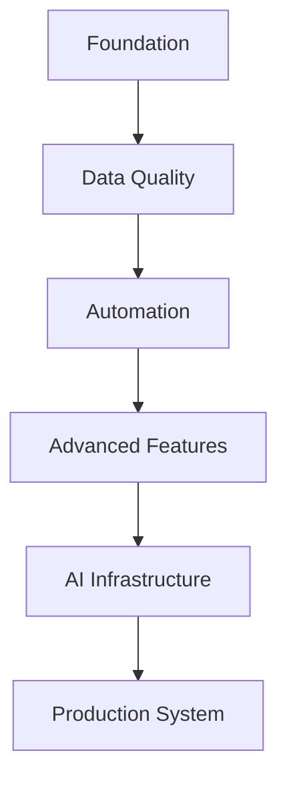
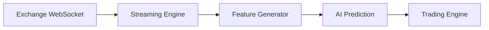
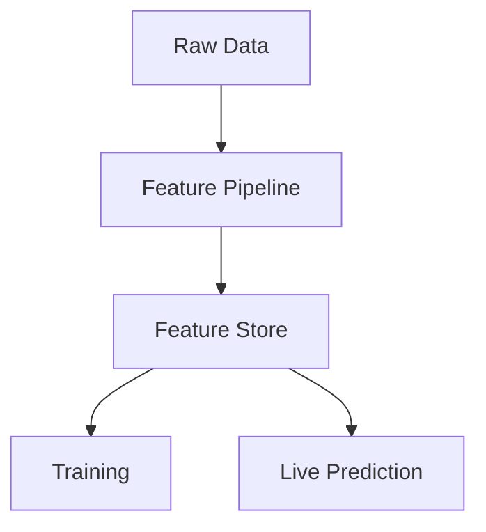
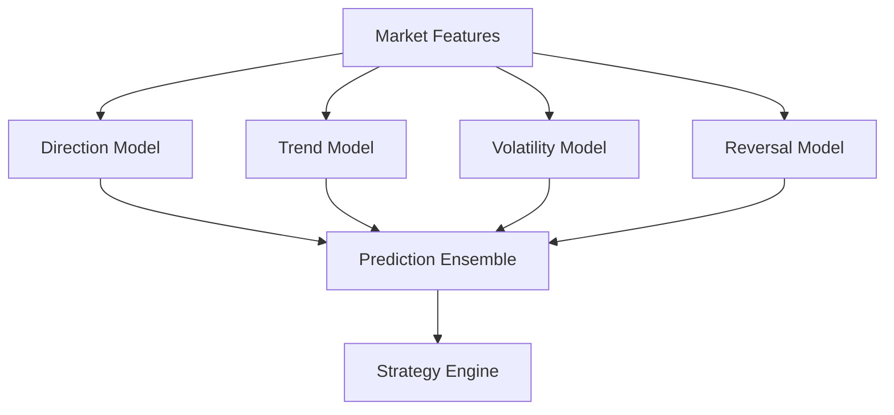
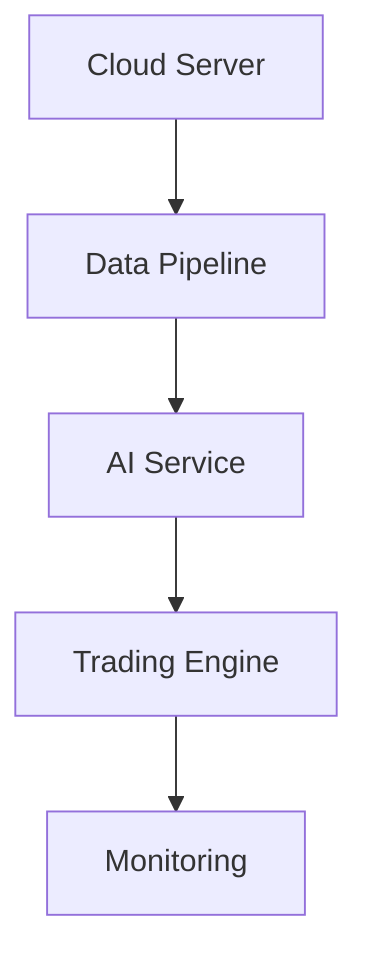
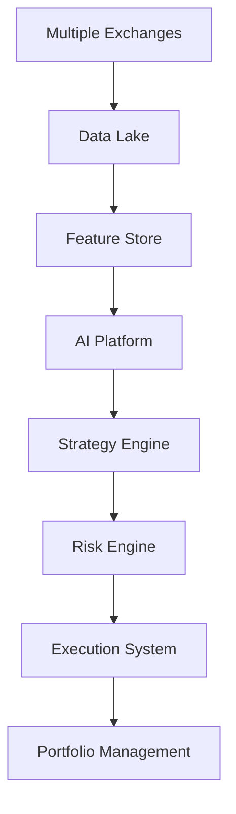

# ETH Bot Data Pipeline - Future Plan

## Overview

This document describes the future development roadmap of the ETH Futures AI Trading System Data Pipeline.

The goal is to evolve the pipeline from a research system into a production-grade AI trading infrastructure.


The future roadmap focuses on:

- Scalability
- Reliability
- Automation
- Advanced AI
- Real-time processing
- Production deployment


---

# Development Roadmap





---

# Phase 1 - Foundation Improvement


## Goal

Create a reliable core data pipeline.


Tasks:


- Complete data collectors
- Improve storage design
- Build ETL framework
- Add validation system
- Create documentation


---

## Improvements


### Data Collection


Add:


```
More exchanges

More market data sources

Better retry system
```


---

### Storage


Improve:


```
Partitioning

Compression

Backup system
```


---

### Validation


Add:


```
More quality rules

Automatic correction

Data reports
```


---

# Phase 2 - Real-Time Pipeline


## Goal

Support live market processing.


Current:


```
Batch Processing
```


Future:


```
Streaming Processing
```


---

# Real-Time Architecture





---

# Technologies


Possible:


```
Kafka

Redis Streams

Flink
```


---

# Real-Time Data Types


Support:


```
Live Trades

Order Book Updates

Liquidations

Funding Changes

Open Interest Changes
```


---

# Phase 3 - Advanced Feature Engineering


## Goal


Create better AI inputs.


---

# New Feature Categories


## Market Regime Features


Detect:


```
Trending Market

Range Market

High Volatility

Low Volatility
```


---

## Microstructure Features


Add:


```
Bid Ask Spread

Order Imbalance

Liquidity Zones

Market Depth
```


---

## Derivative Features


Add:


```
OI Momentum

Funding Pressure

Liquidation Pressure

Options Greeks
```


---

# Phase 4 - Feature Store


## Goal


Create centralized feature management.


Architecture:





---

# Possible Technology


```
Feast

Custom Feature Store
```


---

# Benefits


- Reuse features
- Avoid duplication
- Faster training
- Consistent predictions


---

# Phase 5 - Dataset Automation


## Goal


Automatically create training datasets.


Future system:


```
New Data

↓

Feature Update

↓

Dataset Build

↓

Model Training
```


---

# Improvements


Add:


- Automatic labeling
- Dataset versioning
- Data lineage
- Experiment tracking


---

# Phase 6 - AI Model Infrastructure


## Goal


Build a scalable AI prediction system.


Models:


```
LSTM

Transformer

XGBoost

LightGBM

CatBoost
```


---

# Multi Model Architecture





---

# Future AI Improvements


Add:


- Ensemble models
- Model comparison
- Hyperparameter optimization
- Automated retraining
- Model monitoring


---

# Phase 7 - Model Registry


## Goal


Track all trained models.


Store:


```
Model Version

Training Data Version

Parameters

Performance

Date
```


---

# Possible Tools


```
MLflow

Weights & Biases
```


---

# Phase 8 - Backtesting Infrastructure


## Goal


Create realistic model evaluation.


Support:


```
Historical simulation

Walk forward testing

Paper trading
```


---

# Backtesting Improvements


Add:


- Transaction costs
- Slippage simulation
- Funding costs
- Market impact


---

# Phase 9 - Production Deployment


## Goal


Run system continuously.


Architecture:





---

# Deployment Technologies


Possible:


```
Docker

Kubernetes

Linux Server

Cloud Infrastructure
```


---

# Phase 10 - Advanced Monitoring


## Goal


Create intelligent system monitoring.


Add:


- Data drift detection
- Model drift detection
- Prediction accuracy tracking
- Automatic alerts


---

# AI Based Monitoring


Future:


```
System Metrics

↓

AI Analysis

↓

Failure Prediction

↓

Automatic Recovery
```


---

# Phase 11 - Research Infrastructure


## Goal


Support continuous improvement.


Add:


- Experiment tracking
- Research notebooks
- Feature experiments
- Model comparison


---

# Research Structure


```
research/


├── experiments/

├── notebooks/

├── reports/

└── results/
```


---

# Phase 12 - Distributed Computing


## Goal


Handle large datasets and many models.


Possible technologies:


```
Ray

Dask

Spark
```


---

# Distributed Tasks


Support:


```
Parallel Training

Large Backtesting

Feature Generation

Hyperparameter Search
```


---

# Long Term Architecture





---

# Future Folder Expansion


Possible structure:


```
eth_bot/


├── data_pipeline/

├── feature_store/

├── ai_engine/

├── model_registry/

├── backtesting/

├── strategy/

├── risk_engine/

├── execution/

├── portfolio/

└── monitoring/
```


---

# Success Criteria


The future system should achieve:


## Data


```
Reliable 24/7 collection
```


## Pipeline


```
Fully automated processing
```


## AI


```
Multiple prediction models
```


## Trading


```
Safe automated execution
```


## Operations


```
Production monitoring
```


---

# Final Vision


The complete system:


```
Market Data

↓

Data Pipeline

↓

Feature Store

↓

AI Models

↓

Strategy

↓

Risk Engine

↓

Execution

↓

Portfolio

↓

Monitoring
```


The goal is to build a scalable AI trading infrastructure capable of continuous research, improvement, and production operation.


Document Version:

```
v1.0
```