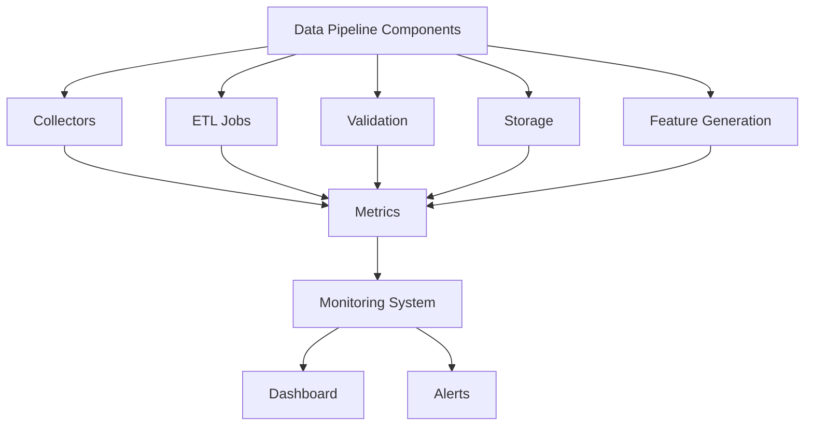
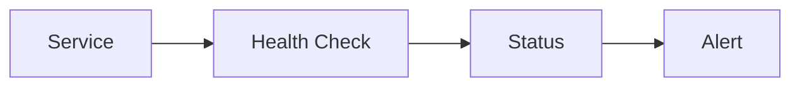
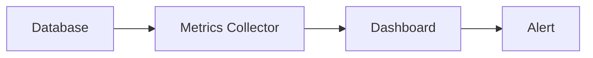
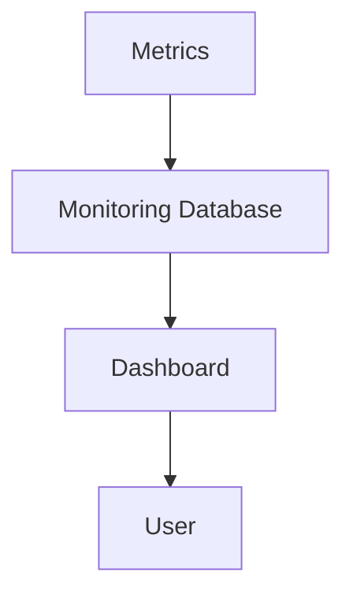
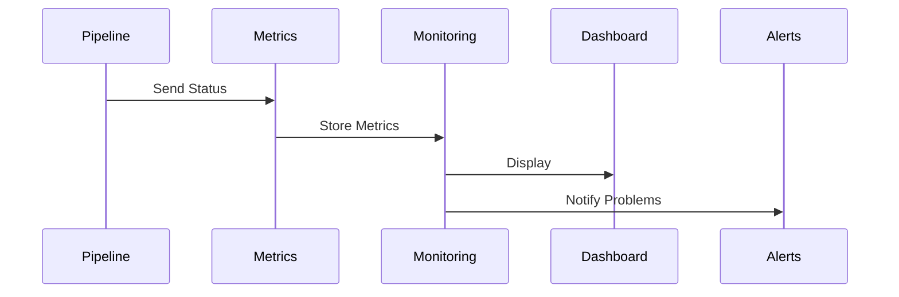

# ETH Bot Data Pipeline - Monitoring

## Overview

Monitoring is the observation and health management layer of the ETH Futures AI Trading System Data Pipeline.

The monitoring system ensures:

- Data pipeline availability
- Data freshness
- Job execution health
- Storage health
- API connectivity
- Data quality
- System performance


The monitoring layer detects problems before they affect:

- AI models
- Backtesting
- Strategy decisions
- Live trading


---

# Monitoring Architecture





---

# Monitoring Objectives


The system monitors:


```
Availability

↓

Performance

↓

Data Quality

↓

Errors

↓

Resources

↓

Alerts
```


---

# Monitoring Layers


```
monitoring/

├── health_check.py

├── metrics.py

├── alerts.py

├── dashboard.py

└── logger.py
```


---

# 1. Pipeline Health Monitoring


## Purpose


Check whether all pipeline services are running.


Monitored services:


```
Collectors

ETL

Database

Scheduler

Feature Generator

Dataset Builder
```


---

# Health Check Flow





---

# Health Status


## Healthy


Example:


```
Service running

Data updating

No errors
```


---

## Warning


Example:


```
Slow processing

Small delay
```


---

## Critical


Example:


```
Pipeline stopped

Database unavailable
```


---

# 2. Data Freshness Monitoring


## Purpose


Ensure new market data arrives on time.


---

# Freshness Checks


## OHLCV


Check:


```
Latest candle timestamp

vs

Current time
```


Example:


```
Latest:

10:00


Current:

10:05


Status:

Healthy
```


---

## WebSocket Data


Check:


```
Last message time
```


Expected:


```
Seconds delay
```


---

# Freshness Metrics


Track:


```
last_update_time

data_delay_seconds

missing_candles
```


---

# 3. Data Quality Monitoring


## Purpose


Track data correctness.


Checks:


- Missing values
- Duplicate records
- Invalid prices
- Wrong timestamps
- Schema changes


---

# Quality Metrics


Example:


```
records_processed

records_failed

missing_records

validation_score
```


---

# 4. API Monitoring


## Purpose


Monitor exchange connections.


Track:


```
API availability

Response time

Rate limits

Errors
```


---

# API Health Metrics


Example:


```
api_latency_ms

api_error_count

api_requests

api_success_rate
```


---

# 5. ETL Job Monitoring


## Purpose


Track automated workflows.


Monitor:


- Job status
- Runtime
- Failed jobs
- Processing speed


---

# ETL Metrics


Example:


```
job_name

start_time

end_time

duration

status

records_processed
```


---

# Job Status


Example:


```
COLLECT_OHLCV

SUCCESS


PROCESS_FEATURES

SUCCESS


BUILD_DATASET

FAILED
```


---

# 6. Database Monitoring


## Purpose


Monitor storage systems.


Track:


## Performance


```
Query time

Insert speed

Connection count
```


---

## Storage


```
Disk usage

Database size

Table growth
```


---

## Data


```
Latest timestamp

Record count

Missing partitions
```


---

# Database Health Flow





---

# 7. Resource Monitoring


Monitor system resources.


## CPU


Track:


```
Usage %

Load
```


---

## Memory


Track:


```
RAM usage

Memory leaks
```


---

## Disk


Track:


```
Storage usage

Growth rate
```


---

## Network


Track:


```
Bandwidth

Connection errors
```


---

# 8. Model Data Monitoring


## Purpose


Ensure AI input quality.


Monitor:


- Feature availability
- Feature distribution
- Data drift


---

# Feature Drift


Example:


Training data:


```
ATR average:

40
```


Current data:


```
ATR average:

120
```


Possible:


```
Market regime change
```


---

# Dataset Metrics


Track:


```
dataset_size

feature_count

missing_features

label_distribution
```


---

# 9. Logging System


## Purpose


Record system events.


Log files:


```
logs/


collector.log

etl.log

validation.log

database.log

error.log
```


---

# Log Levels


## DEBUG


Detailed information.


---

## INFO


Normal operation.


Example:


```
Data collected successfully
```


---

## WARNING


Potential issue.


Example:


```
API response slow
```


---

## ERROR


Failed operation.


Example:


```
Database insert failed
```


---

## CRITICAL


System failure.


Example:


```
Pipeline stopped
```


---

# 10. Alert System


## Purpose


Notify important events.


---

# Alert Levels


## Critical Alert


Examples:


```
Exchange API down

Database failure

No market data
```


Action:


```
Immediate notification
```


---

## Warning Alert


Examples:


```
Slow API

Storage growing fast

Small delay
```


---

# Alert Channels


Possible:


```
Telegram

Discord

Email

Slack

Dashboard
```


---

# 11. Monitoring Dashboard


Dashboard displays:


## Pipeline Status


```
Collectors

ETL

Storage

Features
```


---

## Data Status


```
Latest candle

Data delay

Record count
```


---

## System Status


```
CPU

Memory

Disk
```


---

# Dashboard Architecture





---

# 12. Recommended Tech Stack


## Metrics


```
Prometheus
```


---

## Dashboard


```
Grafana
```


---

## Logging


```
Python logging

Loguru
```


---

## Error Tracking


```
Sentry
```


---

# Python Libraries


## Monitoring


```
prometheus-client

psutil

loguru

sentry-sdk
```


---

# 13. Monitoring Folder Structure


```
monitoring/


├── health_check.py

├── metrics.py

├── alerts.py

├── logger.py

├── dashboard.py

└── config.py
```


---

# 14. Automated Monitoring Schedule


## Real-Time


Monitor:


```
API

WebSocket

System Health
```


---

## Every Minute


Check:


```
Pipeline status

Data freshness
```


---

## Hourly


Check:


```
Data quality

Feature update
```


---

## Daily


Generate:


```
System report

Data quality report
```


---

# 15. Example Monitoring Flow





---

# Future Improvements


Possible additions:


- AI anomaly detection
- Predictive failure detection
- Automatic recovery
- Distributed monitoring
- Cloud monitoring


---

# Summary


Monitoring ensures the Data Pipeline remains reliable and available 24/7.


Final flow:


```
Pipeline

↓

Metrics

↓

Monitoring

↓

Dashboard

↓

Alerts
```


Document Version:

```
v1.0
```