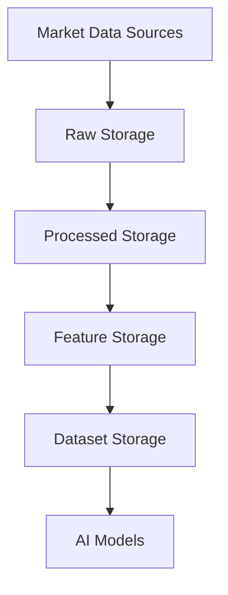
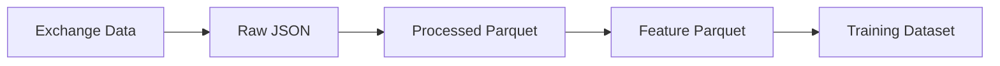
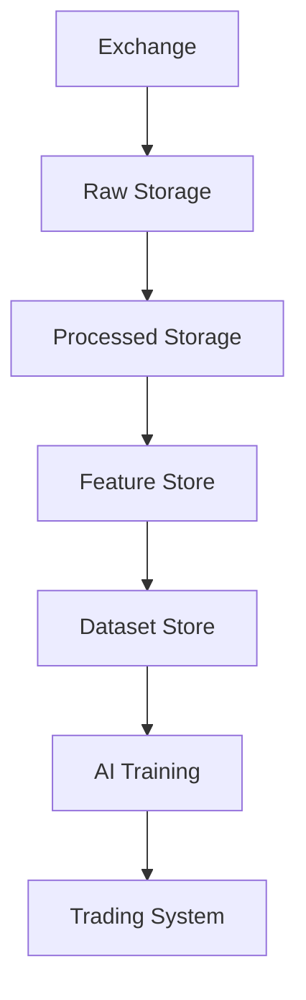

# ETH Bot Data Pipeline - Storage Design

## Overview

This document defines the storage architecture for the ETH Futures AI Trading System.

The storage layer is responsible for:

- Preserving raw market data
- Storing processed datasets
- Managing AI features
- Supporting backtesting
- Supporting model training
- Maintaining historical records


The storage architecture follows a multi-layer design:

```
Raw Data

↓

Processed Data

↓

Feature Data

↓

Training Dataset
```


---

# Storage Architecture





---

# Storage Principles


The storage system follows these principles:


## 1. Raw Data Preservation

Raw exchange data is never modified.


Purpose:

- Reprocessing
- Auditing
- Debugging
- Future research


---

## 2. Separation of Layers


Each data stage has separate storage.


Benefits:


- Easier debugging
- Better reliability
- Clear data lineage


---

## 3. Reproducibility


Every dataset should be reproducible from:


```
Raw Data

+

Processing Code

+

Configuration

=

Final Dataset
```


---

# Storage Layers


The system contains four major storage layers:


```
storage/

├── raw/

├── processed/

├── features/

└── datasets/
```


---

# 1. Raw Storage Layer


## Purpose


Store original exchange responses.


Characteristics:


- Immutable
- Complete history
- Original format


---

# Raw Storage Structure


```
storage/raw/


eth/


├── ohlcv/

│
├── open_interest/

│
├── funding_rate/

│
├── mark_price/

│
├── index_price/

│
├── order_book/

│
├── liquidations/

└── options/
```


---

# Raw OHLCV Example


```
storage/raw/ohlcv/


eth_1h_2026_08_05.json

eth_1d_2026_08_05.json
```


---

# Raw File Format


Supported formats:


## JSON


Used for:

- API responses
- Raw exchange data


Example:


```json
{
 "timestamp": "2026-08-05 10:00",
 "open":3500,
 "close":3530
}
```


---

## CSV


Used for:

- Simple exports
- Manual analysis


---

# 2. Processed Storage Layer


## Purpose


Stores cleaned and standardized market data.


Operations:


- Data cleaning
- Timestamp correction
- Missing value handling
- Normalization


---

# Processed Structure


```
storage/processed/


eth/


├── candles/

│
├── derivatives/

│
├── orderbook/

│
└── market_data/
```


---

# Recommended Format


## Parquet


Recommended for:


- Large datasets
- ML training
- Fast reading


Advantages:


- Column storage
- Compression
- Fast queries


---

# Processed Example


```
eth_1h.parquet

eth_1d.parquet

derivatives.parquet
```


---

# 3. Feature Storage Layer


## Purpose


Stores AI-ready features.


Features are generated from:


```
Processed Data

+

Indicators

+

Market Information
```


---

# Feature Structure


```
storage/features/


├── direction/

├── trend/

├── volatility/

├── reversal/

└── general/
```


---

# Feature Categories


## Price Features


Examples:


```
return

log_return

candle_size

price_change
```


---

## Technical Features


Examples:


```
RSI

EMA

MACD

ATR

ADX
```


---

## Derivative Features


Examples:


```
OI change

Funding change

Liquidation pressure
```


---

## Market Structure Features


Examples:


```
spread

order imbalance

liquidity
```


---

# 4. Dataset Storage Layer


## Purpose


Stores final datasets for AI models.


Structure:


```
storage/datasets/


├── lstm/

├── xgboost/

├── lightgbm/

└── transformer/
```


---

# LSTM Dataset Storage


Example:


```
datasets/lstm/


eth_direction_v1.npy

eth_trend_v1.npy
```


Contains:


```
Sequences

Labels

Targets
```


---

# XGBoost Dataset Storage


Example:


```
datasets/xgboost/


train.parquet

validation.parquet

test.parquet
```


Contains:


```
Features

Target
```


---

# Database Storage


## Time-Series Database


Recommended:


```
PostgreSQL + TimescaleDB
```


Used for:


- Live data
- Recent history
- Queries


---

# Database Tables


```
eth_ohlcv

open_interest

funding_rate

mark_price

index_price

order_book

liquidations

features
```


---

# File Storage


Recommended:


```
Parquet Files
```


Used for:


- Training
- Backtesting
- Research


---

# Storage Flow





---

# Data Retention Policy


## Raw Data


Retention:


```
Unlimited
```


Reason:


- Future model improvement
- New features
- Research


---

## Processed Data


Retention:


```
5+ Years
```


---

## Order Book Data


Retention:


```
30-90 Days
```


Reason:


Large storage requirements.


---

# Data Partitioning


Large datasets should be partitioned.


Recommended:


```
Year

↓

Month

↓

Day
```


Example:


```
storage/raw/ohlcv/


2026/

08/

05/

```


---

# Compression Strategy


Recommended:


## Parquet Compression


Use:


```
Snappy

ZSTD
```


Benefits:


- Less storage
- Faster loading


---

# Backup Strategy


## Daily Backup


Backup:


- Database
- Important files


---

## Weekly Backup


Full archive:


```
Raw Data

+

Processed Data
```


---

## Monthly Backup


Long-term storage:


```
Cold Storage
```


---

# Storage Monitoring


Monitor:


## Disk Usage


Check:

- Storage growth
- Large files


---

## Data Freshness


Check:


```
Latest timestamp

vs

Current time
```


---

## Data Integrity


Check:


- File corruption
- Missing partitions
- Wrong schema


---

# Storage Security


Protect:


- API data
- Database credentials
- Trading information


Use:


```
Environment Variables

Secrets Management

Access Control
```


---

# Recommended Storage Stack


```
Real-Time Data

↓

TimescaleDB

↓

Parquet Storage

↓

DuckDB

↓

ML Training

↓

AI Models
```


---

# Python Libraries


## Database


```
SQLAlchemy

psycopg

asyncpg
```


---

## File Storage


```
pandas

polars

pyarrow
```


---

## Compression


```
zstandard

gzip
```


---

# Future Storage Improvements


Possible upgrades:


## Data Lake


Use:


```
S3 Compatible Storage
```


---

## Feature Store


Use:


```
Feast
```


---

## Analytics Database


Use:


```
ClickHouse
```


---

# Final Storage Architecture





---

# Summary


The storage system provides a reliable foundation for:

- Market data collection
- Historical research
- AI model training
- Backtesting
- Live trading


Final flow:


```
Collect

↓

Store

↓

Process

↓

Feature

↓

Train

↓

Predict
```


Document Version:

```
v1.0
```