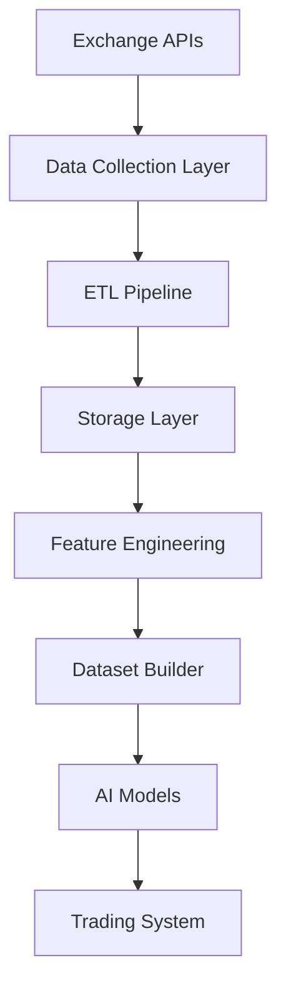
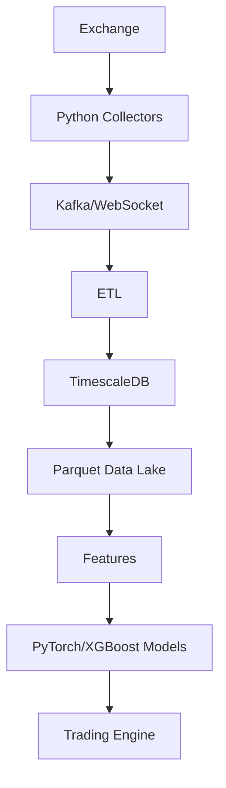

# ETH Bot Data Pipeline - Technology Stack

## Overview

This document defines the technology stack used for the ETH Futures AI Trading System Data Pipeline.

The stack is designed for:

- Real-time market data processing
- Historical data management
- ETL automation
- Feature engineering
- AI/ML model preparation
- Backtesting
- Production trading support


---

# System Architecture





---

# Technology Stack Overview


```
Programming

↓

Data Processing

↓

Storage

↓

Pipeline Automation

↓

Machine Learning

↓

Monitoring

↓

Deployment
```


---

# 1. Programming Language


## Python


Primary language:


```
Python 3.12+
```


Used for:


- Data collection
- ETL
- Feature engineering
- ML pipelines
- Automation
- APIs


Advantages:


- Large AI ecosystem
- Fast development
- Excellent financial libraries


---

# 2. Data Collection Stack


## Exchange REST API


Used for:


- Historical candles
- Funding rates
- Open interest
- Market statistics


Libraries:


```
requests

httpx

ccxt
```


---

## WebSocket


Used for:


- Real-time prices
- Order book
- Liquidations
- Trades


Libraries:


```
websockets

aiohttp
```


---

# 3. Data Processing Stack


## Pandas


Used for:


- Data manipulation
- Analysis
- Feature creation


```
pandas
```


---

## Polars


Used for:


- Large datasets
- Faster processing


```
polars
```


---

## NumPy


Used for:


- Numerical calculations
- Array operations


```
numpy
```


---

# 4. ETL Stack


## ETL Framework


Development:


```
Custom Python Pipeline
```


Production options:


```
Apache Airflow

Prefect

Dagster
```


---

# ETL Components


```
Extract

Transform

Validate

Load
```


---

# 5. Storage Stack


## Time-Series Database


Recommended:


```
PostgreSQL

+

TimescaleDB
```


Used for:


- OHLCV
- Market data
- Recent history
- Queries


---

## File Storage


Format:


```
Parquet
```


Libraries:


```
pyarrow

fastparquet
```


Used for:


- Training datasets
- Backtesting
- Research


---

## Object Storage


Options:


```
AWS S3

MinIO

Cloud Storage
```


Used for:


- Historical archives
- Large datasets


---

# 6. Database Access


Libraries:


```
SQLAlchemy

asyncpg

psycopg
```


Purpose:


- Database connection
- Query management
- ORM support


---

# 7. Technical Analysis Stack


## Indicator Libraries


Options:


```
TA-Lib

pandas-ta
```


Used for:


- RSI
- MACD
- EMA
- ATR
- Bollinger Bands


---

# 8. Feature Engineering Stack


Libraries:


```
pandas

numpy

scikit-learn
```


Used for:


- Feature creation
- Scaling
- Feature selection


---

# 9. Machine Learning Stack


## Traditional ML


### XGBoost


Used for:


- Classification
- Regression
- Direction prediction


```
xgboost
```


---

### LightGBM


Used for:


- Large datasets
- Fast training


```
lightgbm
```


---

### CatBoost


Used for:


- Alternative boosting model
- Feature experimentation


```
catboost
```


---

# 10. Deep Learning Stack


## PyTorch


Recommended:


```
pytorch
```


Used for:


- LSTM
- Transformers
- Neural networks


---

## TensorFlow / Keras


Alternative:


```
tensorflow

keras
```


Used for:


- Deep learning models
- Rapid experimentation


---

# 11. LSTM Stack


Components:


```
PyTorch

↓

LSTM Layers

↓

Sequence Dataset

↓

Prediction
```


Used for:


- Direction prediction
- Trend prediction
- Volatility prediction
- Future movement estimation


---

# 12. Dataset Stack


Libraries:


```
numpy

pandas

polars

pyarrow
```


Formats:


```
Parquet

CSV

NumPy Arrays
```


---

# 13. API Stack


## Backend Framework


Recommended:


```
FastAPI
```


Used for:


- Data access
- Feature API
- Dataset API
- Monitoring API


---

## API Server


```
Uvicorn

Gunicorn
```


---

# 14. Automation Stack


## Scheduler


Development:


```
APScheduler
```


Production:


```
Airflow

Prefect
```


---

## Task Queue


Optional:


```
Celery

Redis Queue
```


Used for:


- Background tasks
- Distributed processing


---

# 15. Streaming Stack


For large-scale systems:


```
Kafka

Redis Streams

Apache Flink
```


Used for:


- Real-time events
- Market streams


---

# 16. Monitoring Stack


## Metrics


```
Prometheus
```


---

## Dashboard


```
Grafana
```


---

## Logging


```
Python Logging

Loguru
```


---

## Error Tracking


```
Sentry
```


---

# 17. Testing Stack


## Unit Testing


```
pytest
```


---

## Data Testing


```
pytest

pandera

great_expectations
```


---

## API Testing


```
httpx

pytest
```


---

# 18. Development Tools


## Environment Management


Options:


```
venv

conda

poetry
```


---

## Code Quality


Tools:


```
black

ruff

mypy
```


---

# 19. Configuration Management


Formats:


```
YAML

JSON

ENV
```


Libraries:


```
python-dotenv

pydantic-settings
```


---

# 20. Version Control


Recommended:


```
Git
```


Used for:


- Code changes
- Configuration tracking
- Experiment history


---

# Complete Recommended Stack


```
Language:

Python


Data:

Pandas + Polars + NumPy


Storage:

PostgreSQL + TimescaleDB + Parquet


ETL:

Custom Pipeline + Airflow/Prefect


Indicators:

TA-Lib / pandas-ta


ML:

XGBoost + LightGBM + CatBoost


Deep Learning:

PyTorch


API:

FastAPI


Automation:

APScheduler


Monitoring:

Prometheus + Grafana


Testing:

pytest
```


---

# Production Architecture





---

# Future Technology Improvements


Possible additions:


- Kubernetes deployment
- GPU training cluster
- Distributed computing
- Feature store
- Model registry
- ML experiment tracking
- Real-time inference service


---

# Summary


The technology stack provides a complete foundation for:

- Market data collection
- Data engineering
- AI model training
- Backtesting
- Production trading


Final architecture:


```
Python

↓

Data Pipeline

↓

Storage

↓

Features

↓

AI Models

↓

Trading System
```


Document Version:

```
v1.0
```