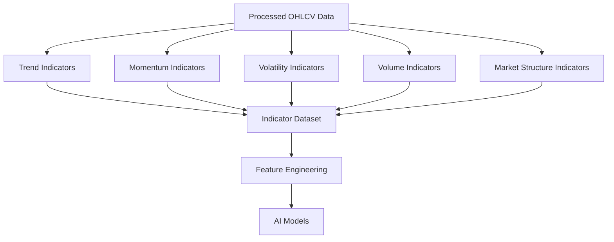
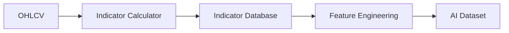

# ETH Bot Data Pipeline - Technical Indicators

## Overview

Technical Indicators are mathematical calculations applied to processed market data to identify:

- Trend direction
- Momentum
- Volatility
- Market strength
- Price behavior
- Trading conditions


The indicator layer converts:

```
Processed Market Data

↓

Technical Indicators

↓

Feature Engineering

↓

AI Models
```


---

# Technical Indicator Architecture





---

# Indicator Categories


The system organizes indicators into:


```
indicators/

├── trend/

├── momentum/

├── volatility/

├── volume/

├── market_structure/

└── indicator_pipeline.py
```


---

# 1. Trend Indicators


## Purpose


Identify the market direction and trend strength.


Used for:


- Bullish/Bearish detection
- Trend following
- Market regime detection


---

# Moving Average (MA)


## Simple Moving Average (SMA)


Formula:


```
Average closing price over N periods
```


Examples:


```
SMA20

SMA50

SMA200
```


Usage:


- Long-term trend
- Support/resistance


---

# Exponential Moving Average (EMA)


EMA gives more weight to recent prices.


Common:


```
EMA9

EMA20

EMA50

EMA200
```


Features:


```
EMA distance

EMA crossover

EMA slope
```


---

# EMA Crossover


Example:


```
EMA20 > EMA50

=

Bullish trend
```


```
EMA20 < EMA50

=

Bearish trend
```


---

# MACD


Moving Average Convergence Divergence.


Components:


```
MACD Line

Signal Line

Histogram
```


Features:


```
MACD value

MACD crossover

Histogram change
```


Used for:


- Momentum shift
- Trend reversal


---

# ADX


Average Directional Index.


Measures:


```
Trend Strength
```


Range:


```
0 - 100
```


Interpretation:


```
ADX < 20

Weak trend


ADX > 25

Strong trend
```


---

# 2. Momentum Indicators


## Purpose


Measure speed and strength of price movement.


---

# RSI


Relative Strength Index.


Range:


```
0 - 100
```


Interpretation:


```
RSI > 70

Overbought


RSI < 30

Oversold
```


Features:


```
RSI value

RSI change

RSI divergence
```


---

# Stochastic RSI


Measures RSI momentum.


Components:


```
%K

%D
```


Used for:


- Short-term signals
- Momentum reversal


---

# Rate of Change (ROC)


Measures percentage price change.


Formula:


```
(Current Price - Previous Price)

/

Previous Price
```


Features:


```
ROC value

ROC momentum
```


---

# Momentum Indicator List


```
RSI

Stochastic RSI

ROC

CCI

Williams %R
```


---

# 3. Volatility Indicators


## Purpose


Measure market movement and risk.


---

# ATR


Average True Range.


Measures:


```
Average price movement range
```


Features:


```
ATR

ATR percentage

ATR change
```


Used for:


- Stop loss
- Risk management
- Volatility prediction


---

# Bollinger Bands


Components:


```
Middle Band

Upper Band

Lower Band
```


Features:


```
Band width

Price position

Band expansion
```


---

# Historical Volatility


Measures:


```
Realized price volatility
```


Used for:


- Market regime
- Risk adjustment


---

# Volatility Indicators List


```
ATR

Bollinger Bands

Historical Volatility

Standard Deviation

Variance
```


---

# 4. Volume Indicators


## Purpose


Understand trading activity and participation.


---

# Volume Moving Average


Features:


```
Volume MA

Volume change

Volume ratio
```


---

# On Balance Volume (OBV)


Combines:

```
Price movement

+

Volume
```


Used for:


- Accumulation detection
- Distribution detection


---

# Volume Weighted Average Price (VWAP)


Measures:


```
Average traded price weighted by volume
```


Features:


```
Price distance from VWAP
```


---

# Volume Indicator List


```
OBV

VWAP

Volume MA

Volume Rate
```


---

# 5. Market Structure Indicators


## Purpose


Understand price structure and liquidity.


---

# Support and Resistance


Derived from:


- Previous highs
- Previous lows


Features:


```
Distance from support

Distance from resistance
```


---

# Pivot Points


Calculate:


```
Support levels

Resistance levels
```


---

# Fibonacci Levels


Common levels:


```
0.236

0.382

0.5

0.618

0.786
```


---

# 6. Derivative Market Indicators


These are not traditional indicators but important market measurements.


Sources:


- Futures data
- Options data


---

# Open Interest Indicators


Features:


```
OI change

OI momentum

OI divergence
```


---

# Funding Rate Indicators


Features:


```
Funding value

Funding trend

Funding extreme
```


---

# Liquidation Indicators


Features:


```
Long liquidation volume

Short liquidation volume

Liquidation imbalance
```


---

# 7. Indicator Pipeline





---

# Indicator Calculation Frequency


## 1 Hour Data


Calculate:


```
RSI

EMA

MACD

ATR

Volume Indicators
```


---

## 1 Day Data


Calculate:


```
Long-term trend

Market regime

Major levels
```


---

# Indicator Storage


Example:


```
storage/features/indicators/


├── trend.parquet

├── momentum.parquet

├── volatility.parquet

├── volume.parquet

└── structure.parquet
```


---

# Indicator Schema


Example:


```
timestamp

ema20

ema50

rsi

macd

atr

volume_ma

adx
```


---

# Python Libraries


Recommended:


## Calculation


```
pandas

numpy

pandas-ta

TA-Lib
```


---

## Large Data


```
polars
```


---

# Indicator Validation


Check:


## Correctness


Compare with:


- Known libraries
- Exchange charts


---

## Missing Data


Ensure:


```
No missing indicator values
```


---

## Stability


Check:


- Extreme values
- Sudden calculation errors


---

# Indicator Usage In Models


## Direction Model


Uses:


```
RSI

MACD

EMA

Momentum
```


---

## Trend Model


Uses:


```
EMA

ADX

MACD

Market Regime
```


---

## Volatility Model


Uses:


```
ATR

Historical Volatility

Bollinger Width
```


---

## Reversal Model


Uses:


```
RSI Extreme

Divergence

Volume Change

Liquidations
```


---

# Future Improvements


Possible additions:


- Custom indicators
- Learned indicators
- Neural network features
- Market regime classifier
- Adaptive indicators


---

# Summary


Technical Indicators transform price and market data into measurable signals.


Complete flow:


```
Market Data

↓

Indicators

↓

Features

↓

AI Models

↓

Predictions
```


Document Version:

```
v1.0
```