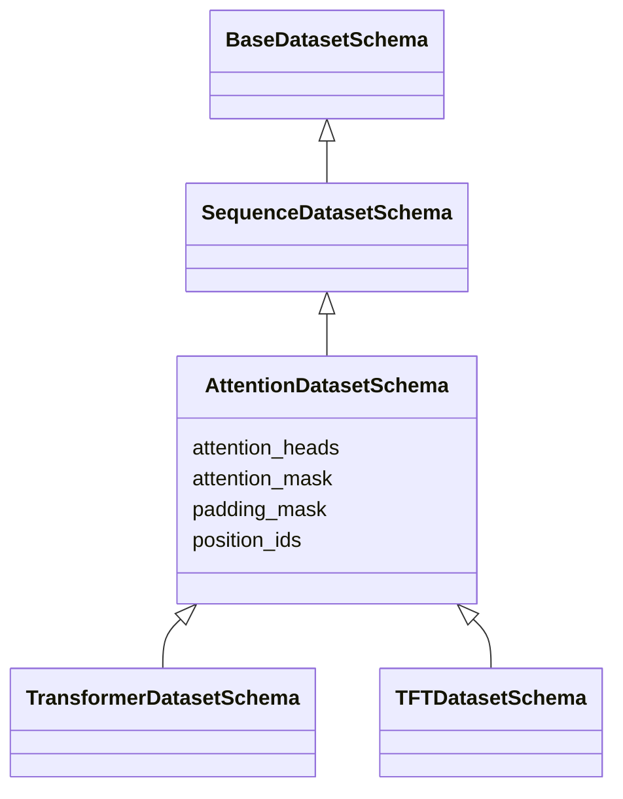
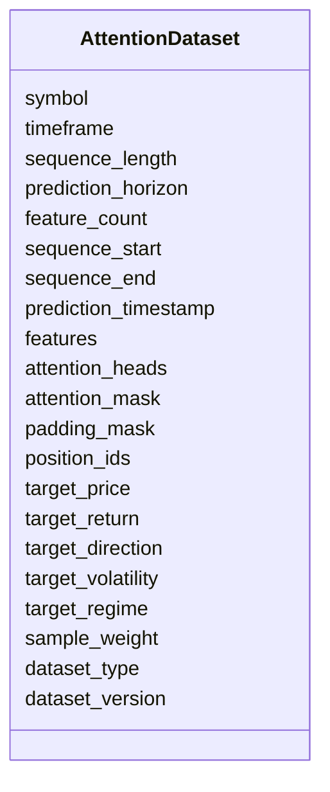

# Attention Dataset Schema

## Overview

The **Attention Dataset Schema** defines the base structure for all attention-based machine learning datasets used in the ETH Bot.

It extends the **Sequence Dataset Schema** by introducing the common components required by attention mechanisms, such as attention masks, padding masks, and positional information.

This schema serves as the foundation for Transformer-based architectures and should be inherited by model-specific datasets rather than used directly.

Supported model families include:

- Transformer
- Temporal Fusion Transformer (TFT)
- Future attention-based architectures

The Attention Dataset Schema provides only the common attention infrastructure. Model-specific components such as encoder-decoder structures, static features, and specialized attention mechanisms are implemented in child schemas.

---

# Role in Architecture

```mermaid
flowchart TD

Merged Feature Dataset

-->

Sequence Generator

-->

Attention Dataset Schema

-->

Model Specific Dataset

-->

Attention-Based Model

-->

Prediction
```

---

# Dataset Directory Structure

```text
datasets/
│
├── base_dataset.py
├── sequence_dataset.py
├── attention_dataset.py
│
├── transformer.py
├── tft.py
```

---

# Inheritance Architecture



---

# Purpose

The Attention Dataset Schema provides:

- Common attention metadata
- Attention mask support
- Padding mask support
- Positional information
- Shared interface for attention-based models
- Reusable foundation for Transformer-family architectures

---

# Schema Structure



---

# Field Definitions

## Attention Configuration

| Field | Description |
|---|---|
| attention_heads | Number of attention heads used by the model |

This value is optional because it is primarily determined by the model configuration rather than the dataset.

---

## Attention Mask

The attention mask specifies which positions in the sequence are valid.

| Value | Meaning |
|---|---|
| 1 | Valid observation |
| 0 | Padding |

Example:

```text
[1,1,1,1,1,1,1,1,1,1]
```

---

## Padding Mask

Padding masks are used when sequences have different lengths.

Example:

```text
Sequence

[ x x x x x x ]

Mask

[ 1 1 1 1 0 0 ]
```

This enables batching of variable-length sequences.

---

## Position IDs

Position IDs preserve the order of observations.

Example:

```text
0

1

2

3

...

59
```

These values are used together with positional encoding to provide temporal order information.

---

# Input Shape

The sequence input inherited from `SequenceDatasetSchema` has the shape:

```text
(sequence_length, feature_count)
```

Example:

```text
(60,145)
```

Attention-related tensors have the following shapes:

| Component | Shape |
|---|---|
| Attention Mask | `(sequence_length,)` |
| Padding Mask | `(sequence_length,)` |
| Position IDs | `(sequence_length,)` |

---

# Dataset Generation

```mermaid
flowchart LR

Merged Feature Dataset

-->

Sliding Window Generator

-->

Sequence Dataset

-->

Attention Metadata

-->

Attention Dataset

-->

Transformer Models
```

---

# Example Shapes

Training samples:

```text
100000
```

Sequence:

```text
(100000,60,145)
```

Attention mask:

```text
(100000,60)
```

Padding mask:

```text
(100000,60)
```

Position IDs:

```text
(100000,60)
```

---

# Training Pipeline

```mermaid
flowchart TD

Merged Feature Dataset

-->

Sequence Generator

-->

Attention Mask Generator

-->

Position Generator

-->

Attention Dataset

-->

Transformer Family Models

-->

Training
```

---

# Inference Pipeline

```mermaid
flowchart TD

Latest Feature Window

-->

Sequence Generator

-->

Attention Metadata

-->

Attention Dataset

-->

Trained Model

-->

Prediction
```

---

# Example Dataset Record

```json
{
  "symbol": "ETHUSDT",

  "timeframe": "1h",

  "sequence_length": 60,

  "prediction_horizon": 1,

  "feature_count": 145,

  "attention_heads": 8,

  "attention_mask": [
    1,1,1,1,1,1,1,1,1,1,
    1,1,1,1,1,1,1,1,1,1,
    1,1,1,1,1,1,1,1,1,1,
    1,1,1,1,1,1,1,1,1,1,
    1,1,1,1,1,1,1,1,1,1,
    1,1,1,1,1,1,1,1,1,1
  ],

  "padding_mask": [
    1,1,1,1,1,1,1,1,1,1,
    1,1,1,1,1,1,1,1,1,1,
    1,1,1,1,1,1,1,1,1,1,
    1,1,1,1,1,1,1,1,1,1,
    1,1,1,1,1,1,1,1,1,1,
    1,1,1,1,1,1,1,1,1,1
  ],

  "position_ids": [
    0,1,2,3,4,5,6,7,8,9,
    10,11,12,13,14,15,16,17,18,19,
    20,21,22,23,24,25,26,27,28,29,
    30,31,32,33,34,35,36,37,38,39,
    40,41,42,43,44,45,46,47,48,49,
    50,51,52,53,54,55,56,57,58,59
  ]
}
```

---

# Child Dataset Extensions

## Transformer Dataset

Adds:

- Transformer-specific configuration
- Self-attention implementation details

```text
Attention Dataset

+

Transformer-specific fields
```

---

## TFT Dataset

Adds:

- Static features
- Encoder features
- Decoder features
- Future-known variables

```text
Attention Dataset

+

Encoder-Decoder Structure

+

Static Variables
```

---

# Relationship With Other Schemas

| Dataset | Purpose | Used By |
|---|---|---|
| Base Dataset | Universal metadata | All datasets |
| Sequence Dataset | Historical sequences | LSTM, GRU |
| Attention Dataset | Common attention components | Transformer family |
| Transformer Dataset | Transformer-specific dataset | Transformer |
| TFT Dataset | Encoder-decoder forecasting dataset | TFT |

---

# Design Principles

```mermaid
mindmap

root((Attention Dataset))

    Reusable

    Sequence Based

    Attention Ready

    Model Independent

    Scalable

    Extensible

    AI Ready

    Modular
```

---

# Future Enhancements

Future versions may support:

- Causal attention masks
- Relative positional encoding
- Rotary positional embeddings (RoPE)
- Sparse attention
- Multi-scale attention
- Cross-attention support
- Multi-modal attention
- Dynamic masking strategies

---

# Summary

The **Attention Dataset Schema** provides the shared attention infrastructure for Transformer-based models in the ETH Bot.

By extending the Sequence Dataset Schema with attention masks, padding masks, and positional information, it establishes a reusable foundation for attention-driven architectures while keeping model-specific implementations separate. This layered design improves maintainability, reduces duplication, and supports future expansion of the AI pipeline.

```mermaid
flowchart TD

Base Dataset

-->

Sequence Dataset

-->

Attention Dataset

-->

Transformer Dataset

Attention Dataset

-->

TFT Dataset

Transformer Dataset

-->

Prediction

TFT Dataset

-->

Prediction
```