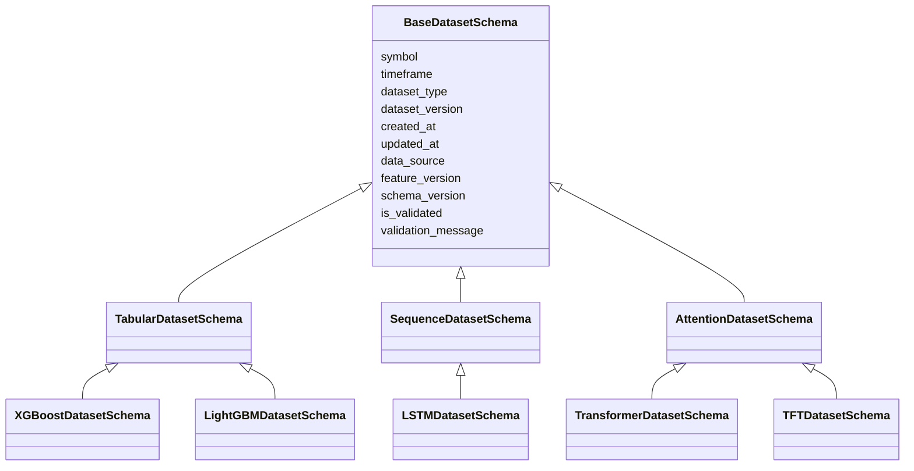
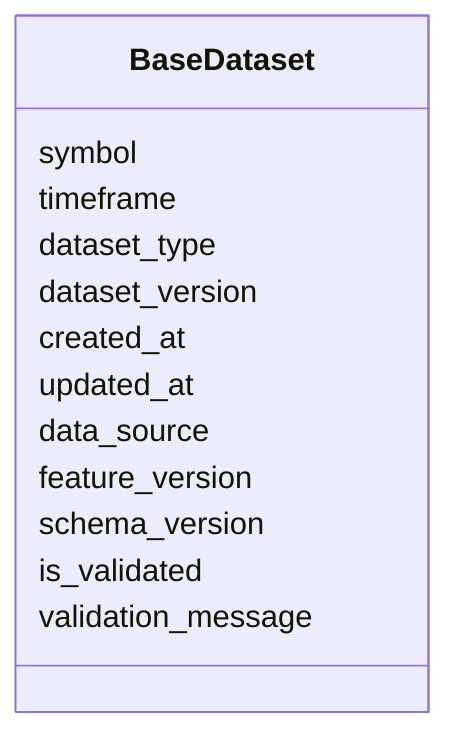

# Base Dataset Schema

## Overview

The **Base Dataset Schema** defines the universal metadata structure shared by all machine learning datasets in the ETH Bot.

It is the root schema of the dataset architecture and provides common fields required by every dataset type, regardless of the model architecture.

All specialized datasets inherit from this base:

- Tabular datasets
- Sequence datasets
- Attention-based datasets
- Transformer datasets
- Temporal Fusion Transformer (TFT) datasets

The Base Dataset Schema contains only **dataset-level information** and does not define model-specific inputs such as feature vectors, sequences, attention masks, or encoder-decoder structures.

---

# Role in Architecture

```mermaid
flowchart TD

Dataset Layer

-->

Base Dataset Schema

-->

Specialized Dataset Schemas

-->

Machine Learning Models
```

---

# Dataset Directory Structure

```text
datasets/
│
├── base_dataset.py
├── base_dataset.md
│
├── tabular_dataset.py
├── sequence_dataset.py
├── attention_dataset.py
│
├── xgboost.py
├── lightgbm.py
├── catboost.py
│
├── lstm.py
├── transformer.py
├── tft.py
```

---

# Inheritance Architecture



---

# Purpose

The Base Dataset Schema provides:

- Common dataset identification
- Asset information
- Dataset version control
- Data source tracking
- Feature version tracking
- Schema compatibility management
- Dataset validation status

---

# Schema Structure



---

# Field Definitions

## Asset Information

| Field | Description |
|---|---|
| symbol | Trading asset identifier |
| timeframe | Market data timeframe |

Example:

```text
ETHUSDT

1h
```

---

# Dataset Identification

| Field | Description |
|---|---|
| dataset_type | Dataset usage category |
| dataset_version | Dataset release version |

Supported dataset types:

| Value | Purpose |
|---|---|
| train | Model training |
| validation | Hyperparameter tuning |
| test | Performance evaluation |
| inference | Live prediction |

---

# Time Metadata

| Field | Description |
|---|---|
| created_at | Dataset creation timestamp |
| updated_at | Last modification timestamp |

Used for:

- Dataset tracking
- Reproducibility
- Pipeline monitoring

---

# Data Lineage Metadata

| Field | Description |
|---|---|
| data_source | Origin of dataset |
| feature_version | Version of generated features |
| schema_version | Dataset schema version |

Example:

```text
data_source:

Binance Futures API


feature_version:

2.1


schema_version:

1.0
```

---

# Validation Metadata

| Field | Description |
|---|---|
| is_validated | Dataset validation status |
| validation_message | Validation result details |

Used by:

- Data quality pipeline
- Training pipeline checks
- Automated monitoring

---

# Dataset Flow

```mermaid
flowchart TD

Raw Data

-->

Processed Data

-->

Feature Engineering

-->

Dataset Generator

-->

Base Dataset Metadata

-->

Model Dataset

-->

Training Pipeline
```

---

# Relationship With Dataset Types

```mermaid
flowchart LR

Base Dataset

-->

Tabular Dataset

-->

XGBoost

Base Dataset

-->

Tabular Dataset

-->

LightGBM

Base Dataset

-->

Sequence Dataset

-->

LSTM

Base Dataset

-->

Attention Dataset

-->

Transformer

Base Dataset

-->

Attention Dataset

-->

TFT
```

---

# Example Metadata Record

```json
{
  "symbol": "ETHUSDT",

  "timeframe": "1h",

  "dataset_type": "train",

  "dataset_version": "1.0",

  "created_at": "2026-08-05T12:00:00Z",

  "updated_at": "2026-08-05T12:10:00Z",

  "data_source": "ETH Futures Market Data",

  "feature_version": "2.0",

  "schema_version": "1.0",

  "is_validated": true,

  "validation_message": "Dataset validation successful"
}
```

---

# Design Principles

```mermaid
mindmap

root((Base Dataset))

    Universal

    Model Independent

    Lightweight

    Reusable

    Version Controlled

    Traceable

    Validated

    Extensible
```

---

# Dataset Layer Architecture

```mermaid
flowchart TD

Base Dataset Schema

-->

Tabular Dataset

-->

XGBoost

LightGBM

CatBoost


Base Dataset Schema

-->

Sequence Dataset

-->

LSTM

GRU


Base Dataset Schema

-->

Attention Dataset

-->

Transformer

TFT
```

---

# Future Enhancements

Future versions may include:

- Dataset checksum tracking
- Data hash verification
- Storage location metadata
- Training experiment ID
- Model compatibility metadata
- Dataset performance metrics
- Feature drift monitoring
- Data freshness score
- Pipeline execution ID

---

# Summary

The **Base Dataset Schema** is the foundation of the ETH Bot dataset architecture.

It provides common metadata and governance information shared across all machine learning datasets while keeping model-specific structures separate.

By introducing a common parent schema, the ETH Bot achieves:

- Reduced duplication
- Better dataset version control
- Improved reproducibility
- Easier model expansion
- Cleaner machine learning pipeline design

```mermaid
flowchart TD

Base Dataset Schema

-->

Specialized Dataset Schemas

-->

AI Models

-->

Predictions

-->

Strategy Engine

-->

Risk Engine

-->

Execution Engine
```