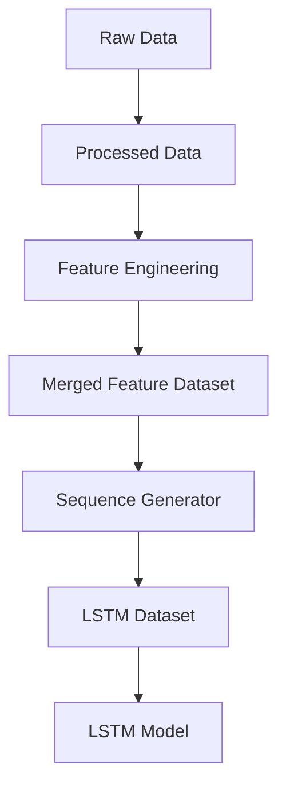
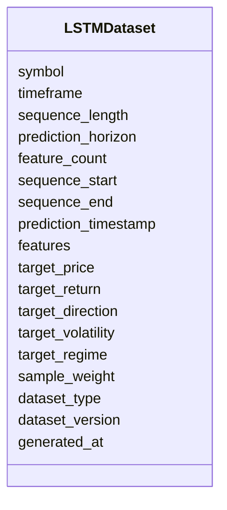

# LSTM Dataset Schema

## Overview

The **LSTM Dataset Schema** defines the standardized dataset format used to train, validate, test, and run inference with **Long Short-Term Memory (LSTM)** models in the ETH Bot.

Unlike raw, processed, or feature datasets, an LSTM dataset is **sequence-based**. It transforms the merged feature dataset into sliding windows of historical observations that allow the model to learn temporal dependencies in cryptocurrency markets.

This schema stores **sequence inputs and prediction targets only**.

---

# Pipeline Position



---

# Purpose

The LSTM dataset is responsible for:

- Converting feature vectors into sequential windows
- Preparing supervised learning targets
- Supporting model training
- Supporting validation and testing
- Supporting live inference
- Providing a consistent dataset format

---

# Dataset Structure



---

# Dataset Components

## Dataset Metadata

| Field | Description |
|--------|-------------|
| symbol | Trading symbol |
| timeframe | Candle timeframe |
| sequence_length | Number of historical observations |
| prediction_horizon | Forecast horizon |
| feature_count | Number of engineered features |

---

## Sequence Information

| Field | Description |
|--------|-------------|
| sequence_start | Start of input sequence |
| sequence_end | End of input sequence |
| prediction_timestamp | Timestamp being predicted |

---

## Input Features

The input consists of a two-dimensional tensor:

```text
(sequence_length × feature_count)
```

Example:

```text
60 × 145
```

meaning:

- 60 historical candles
- 145 engineered features per candle

---

## Target Labels

The target depends on the prediction task.

Possible targets include:

| Target | Description |
|---------|-------------|
| target_price | Future price |
| target_return | Future return |
| target_direction | Bullish / Neutral / Bearish |
| target_volatility | Future volatility |
| target_regime | Market regime |

A model may use one or multiple targets depending on the objective.

---

## Dataset Split

| Value | Purpose |
|--------|---------|
| train | Model training |
| validation | Hyperparameter tuning |
| test | Performance evaluation |
| inference | Live prediction |

---

## Metadata

| Field | Description |
|--------|-------------|
| dataset_version | Dataset schema version |
| generated_at | Dataset generation timestamp |

---

# Sequence Generation

```mermaid
flowchart LR

Merged Dataset

-->

Sliding Window

-->

Sequence

-->

Target

-->

LSTM Dataset
```

---

# Sliding Window Example

Suppose:

```text
Sequence Length = 5
Prediction Horizon = 1
```

Input:

```text
T1

T2

T3

T4

T5
```

Target:

```text
Predict T6
```

Next sample:

Input:

```text
T2

T3

T4

T5

T6
```

Target:

```text
Predict T7
```

This continues throughout the dataset.

---

# Example Shape

```text
Samples

100000
```

Input shape:

```text
(100000, 60, 145)
```

Meaning:

- 100,000 samples
- 60 historical candles
- 145 engineered features

Target:

```text
(100000, 1)
```

---

# Data Sources

The LSTM dataset is generated from the merged feature dataset, which combines:

```mermaid
mindmap

root((Merged Features))

    Price Features

    Volume Features

    Derivative Features

    Order Book Features

    Sentiment Features

    On-Chain Features

    Time Features
```

---

# Training Pipeline

```mermaid
flowchart TD

Merged Feature Dataset

-->

Sequence Generator

-->

Normalization

-->

Train Validation Test Split

-->

LSTM Dataset

-->

LSTM Model

-->

Training
```

---

# Inference Pipeline

```mermaid
flowchart TD

Latest Feature Window

-->

Sequence Generator

-->

Normalization

-->

LSTM Dataset

-->

Trained Model

-->

Prediction
```

---

# Example Dataset Record

```json
{
  "symbol": "ETHUSDT",
  "timeframe": "1h",

  "sequence_length": 60,

  "prediction_horizon": 1,

  "feature_count": 145,

  "sequence_start": "2026-08-03T00:00:00Z",

  "sequence_end": "2026-08-05T11:00:00Z",

  "prediction_timestamp": "2026-08-05T12:00:00Z",

  "features": [
    [0.42, 0.61, 0.18, "..."],
    [0.44, 0.59, 0.22, "..."],
    "... 60 rows ..."
  ],

  "target_price": 3658.42,

  "target_return": 0.014,

  "target_direction": 1,

  "target_volatility": 0.028,

  "target_regime": 2,

  "sample_weight": 1.0,

  "dataset_type": "train",

  "dataset_version": "1.0",

  "generated_at": "2026-08-05T12:05:00Z"
}
```

---

# Relationship with Other Schemas

```mermaid
flowchart TD

Raw Schemas

-->

Processed Schemas

Processed Schemas

-->

Feature Schemas

Feature Schemas

-->

Merged Dataset

Merged Dataset

-->

LSTM Dataset

LSTM Dataset

-->

LSTM Model

LSTM Model

-->

Predictions
```

---

# Design Principles

```mermaid
mindmap

root((LSTM Dataset))

    Sequence Based

    Time-Series Native

    AI Ready

    Deterministic

    Sliding Window

    Model Independent

    Reproducible

    Scalable
```

---

# Future Enhancements

Future versions may support:

- Multi-horizon forecasting
- Multi-task targets
- Attention masks
- Variable-length sequences
- Multi-timeframe sequences (e.g., 1H + 1D)
- Event-aware sequences
- Missing-data masks
- Dynamic feature selection
- Online sequence generation
- Sequence augmentation

---

# Summary

The **LSTM Dataset Schema** is the bridge between engineered features and the LSTM model. It converts the merged feature dataset into standardized sliding-window sequences with associated prediction targets, enabling efficient training, validation, testing, and live inference.

By separating dataset preparation from feature engineering and model implementation, the ETH Bot maintains a modular, reusable, and scalable machine learning pipeline that supports future models and evolving trading strategies.

```mermaid
flowchart TD

Raw Data

-->

Processed Data

-->

Feature Engineering

-->

Merged Feature Dataset

-->

Sequence Generator

-->

LSTM Dataset

-->

LSTM Model

-->

Prediction

-->

Strategy Engine

-->

Risk Engine

-->

Execution Engine
```