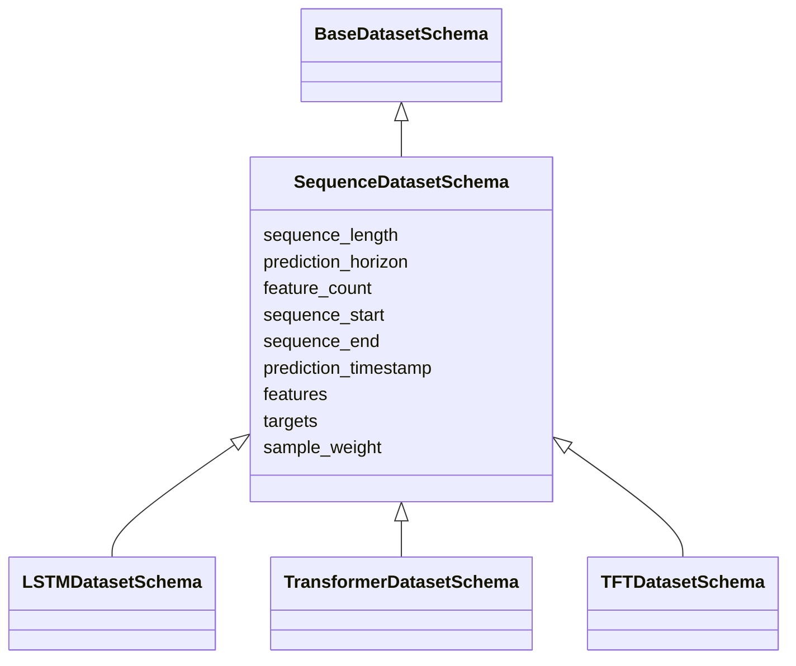
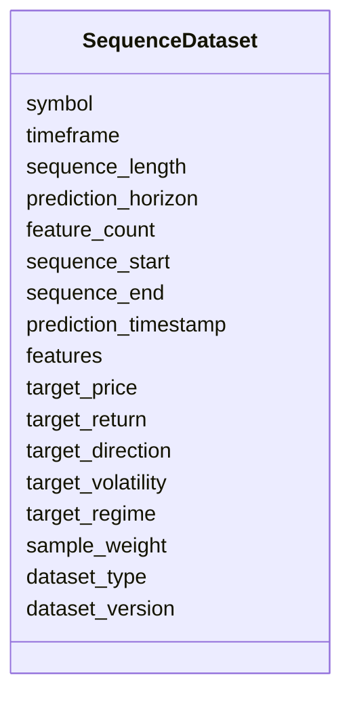

# Sequence Dataset Schema

## Overview

The **Sequence Dataset Schema** defines the base structure for all sequence-based machine learning datasets used in the ETH Bot.

It provides a common interface for models that learn from historical time-series sequences instead of independent feature vectors.

This schema extends the **Base Dataset Schema** and is designed to be inherited by advanced time-series models.

Supported models include:

- LSTM
- GRU
- Transformer
- Temporal Fusion Transformer (TFT)

The Sequence Dataset Schema defines common sequence information such as:

- Historical window length
- Feature dimensions
- Sequence timestamps
- Input sequences
- Prediction targets

Model-specific features such as attention masks, positional encoding, encoder-decoder separation, and static variables are implemented in child schemas.

---

# Role in Architecture

```mermaid
flowchart TD

Merged Feature Dataset

-->

Sequence Generator

-->

Sequence Dataset Schema

-->

Model Specific Dataset

-->

Sequence Model

-->

Prediction
```

---

# Dataset Directory Structure

```text
datasets/
│
├── base_dataset.py
├── base_dataset.md
│
├── sequence_dataset.py
├── sequence_dataset.md
│
├── lstm.py
├── transformer.py
├── tft.py
```

---

# Inheritance Architecture



---

# Purpose

The Sequence Dataset Schema provides:

- Standard sequence representation
- Time-series window management
- Historical feature storage
- Prediction target definition
- Common interface for deep learning models
- Reusable foundation for sequence architectures

---

# Dataset Structure



---

# Field Definitions

## Sequence Configuration

| Field | Description |
|---|---|
| sequence_length | Number of historical time steps |
| prediction_horizon | Number of future steps predicted |
| feature_count | Number of features per time step |

Example:

```text
sequence_length = 60

feature_count = 145
```

Input shape:

```text
(60,145)
```

Meaning:

- 60 historical candles
- 145 features per candle

---

# Sequence Time Information

| Field | Description |
|---|---|
| sequence_start | Beginning of historical window |
| sequence_end | End of historical window |
| prediction_timestamp | Future target timestamp |

Example:

```text
Sequence:

00:00

01:00

...

59:00


Predict:

60:00
```

---

# Sequence Features

The input is stored as a two-dimensional matrix.

Shape:

```text
(sequence_length × feature_count)
```

Example:

```text
[
 candle_1 [
   feature_1,
   feature_2,
   ...
 ],

 candle_2 [
   feature_1,
   feature_2,
   ...
 ]
]
```

---

# Target Structure

The schema supports multiple prediction tasks.

| Target | Purpose |
|---|---|
| target_price | Future ETH price |
| target_return | Future percentage return |
| target_direction | Market direction classification |
| target_volatility | Future volatility prediction |
| target_regime | Market state classification |

---

# Dataset Generation

```mermaid
flowchart LR

Merged Feature Dataset

-->

Sliding Window Generator

-->

Sequence Dataset

-->

Deep Learning Model
```

---

# Sliding Window Example

Configuration:

```text
Sequence Length = 5

Prediction Horizon = 1
```

Sample 1:

```text
Input:

T1

T2

T3

T4

T5


Target:

T6
```

Sample 2:

```text
Input:

T2

T3

T4

T5

T6


Target:

T7
```

---

# Data Sources

Sequence datasets are generated from engineered market features.

```mermaid
mindmap

root((Feature Dataset))

    Price Features

    Volume Features

    Derivative Features

    Order Book Features

    Sentiment Features

    On Chain Features

    Time Features
```

---

# Training Pipeline

```mermaid
flowchart TD

Merged Feature Dataset

-->

Feature Validation

-->

Sliding Window Generator

-->

Sequence Dataset

-->

Train Validation Test Split

-->

Sequence Model

-->

Training
```

---

# Inference Pipeline

```mermaid
flowchart TD

Latest Market Data

-->

Feature Generation

-->

Latest Sequence Window

-->

Sequence Dataset

-->

Trained Model

-->

Prediction
```

---

# Example Record

```json
{
  "symbol": "ETHUSDT",

  "timeframe": "1h",

  "sequence_length": 60,

  "prediction_horizon": 1,

  "feature_count": 145,

  "sequence_start": "2026-08-03T00:00:00Z",

  "sequence_end": "2026-08-05T11:00:00Z",

  "prediction_timestamp": "2026-08-05T12:00:00Z",

  "features": [
    [
      0.42,
      0.61,
      0.18
    ],
    [
      0.44,
      0.59,
      0.22
    ]
  ],

  "target_price": 3658.42,

  "target_return": 0.014,

  "target_direction": 1,

  "target_volatility": 0.028,

  "target_regime": 2,

  "sample_weight": 1.0,

  "dataset_type": "train",

  "dataset_version": "1.0"
}
```

---

# Child Dataset Extensions

## LSTM Dataset

Adds:

- Sequence input only
- Hidden-state based learning

```text
Sequence Dataset

+

LSTM specific configuration
```

---

## Transformer Dataset

Adds:

- Attention mask
- Position IDs

```text
Sequence Dataset

+

Attention Information
```

---

## TFT Dataset

Adds:

- Static features
- Encoder sequence
- Decoder sequence
- Future-known variables

```text
Sequence Dataset

+

Encoder Decoder Structure
```

---

# Model Comparison

| Dataset | Input | Model |
|---|---|---|
| Tabular Dataset | Feature vector | XGBoost, LightGBM |
| Sequence Dataset | Historical sequence | LSTM, GRU |
| Transformer Dataset | Sequence + attention | Transformer |
| TFT Dataset | Encoder + decoder | TFT |

---

# Design Principles

```mermaid
mindmap

root((Sequence Dataset))

    Time-Series Native

    Reusable

    Model Independent

    Deep Learning Ready

    Scalable

    Deterministic

    Historical Context

    Feature Compatible
```

---

# Future Enhancements

Future versions may include:

- Variable-length sequences
- Multi-timeframe sequences
- Sequence padding support
- Missing data masks
- Event-based sequences
- Streaming sequence generation
- Multi-asset sequences
- Sequence normalization metadata

---

# Summary

The **Sequence Dataset Schema** is the foundation layer for all time-series deep learning models in the ETH Bot.

It converts the merged feature dataset into standardized historical sequences with prediction targets, allowing LSTM, GRU, Transformer, and TFT models to learn temporal market patterns.

By separating common sequence handling from model-specific requirements, the ETH Bot maintains a modular, scalable, and extensible AI data pipeline.

```mermaid
flowchart TD

Raw Market Data

-->

Processed Data

-->

Feature Engineering

-->

Merged Dataset

-->

Sequence Dataset

-->

AI Model

-->

Prediction

-->

Strategy Engine

-->

Risk Engine

-->

Execution Engine
```