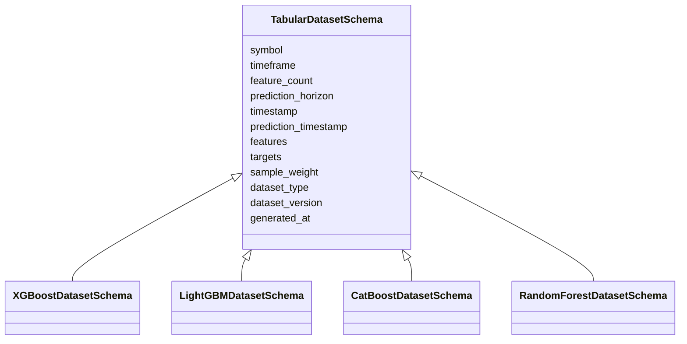
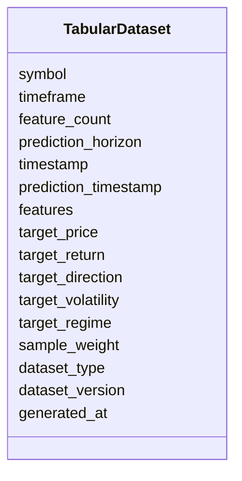

# Tabular Dataset Schema

## Overview

The **Tabular Dataset Schema** defines the base structure for all tabular machine learning datasets used in the ETH Bot.

It provides a common interface for machine learning models that consume independent feature vectors instead of sequential time-series windows.

This schema is designed as a **base dataset class** and should be inherited by model-specific datasets.

Supported models include:

- XGBoost
- LightGBM
- CatBoost
- Random Forest
- Extra Trees
- Gradient Boosting
- Classical ML models

The purpose of this schema is to maintain consistency across different tabular model pipelines.

---

# Role in Architecture

```mermaid
flowchart TD

Merged Feature Dataset

-->

Tabular Dataset Schema

-->

Model Specific Dataset

-->

ML Model

-->

Prediction
```

---

# Dataset Directory Relationship

```text
datasets/
│
├── tabular_dataset.py
│
├── xgboost.py
├── lightgbm.py
├── catboost.py
├── random_forest.py
└── extra_trees.py
```

All tabular model datasets inherit from:

```text
TabularDatasetSchema
```

---

# Inheritance Architecture



---

# Purpose

The Tabular Dataset Schema provides:

- Standardized feature vector format
- Common metadata fields
- Target label structure
- Dataset split management
- Model-independent dataset interface
- Reusable foundation for multiple ML algorithms

---

# Dataset Structure



---

# Field Definitions

## Dataset Metadata

| Field | Description |
|---|---|
| symbol | Trading asset symbol |
| timeframe | Market data timeframe |
| feature_count | Number of input features |
| prediction_horizon | Future prediction period |

---

## Sample Information

| Field | Description |
|---|---|
| timestamp | Current sample timestamp |
| prediction_timestamp | Future target timestamp |

---

## Feature Vector

Each sample contains a single numerical feature vector.

Shape:

```text
(feature_count,)
```

Example:

```text
145 features
```

Features are generated from:

- Price Features
- Volume Features
- Derivative Features
- Order Book Features
- Sentiment Features
- On-Chain Features
- Time Features

---

# Target Structure

The schema supports multiple prediction tasks.

| Target | Purpose |
|---|---|
| target_price | Future ETH price prediction |
| target_return | Future percentage return |
| target_direction | Bullish / Neutral / Bearish classification |
| target_volatility | Future volatility prediction |
| target_regime | Market condition classification |

---

# Dataset Types

| Type | Usage |
|---|---|
| train | Model training |
| validation | Hyperparameter tuning |
| test | Final evaluation |
| inference | Live trading prediction |

---

# Dataset Generation Pipeline

```mermaid
flowchart LR

Processed Data

-->

Feature Engineering

-->

Merged Feature Dataset

-->

Feature Selection

-->

Tabular Dataset

-->

ML Model
```

---

# Example Data Flow

```mermaid
flowchart TD

Raw Market Data

-->

Processed Schemas

-->

Feature Schemas

-->

Merged Dataset

-->

Tabular Dataset

-->

XGBoost

Tabular Dataset

-->

LightGBM

Tabular Dataset

-->

CatBoost

Tabular Dataset

-->

Random Forest
```

---

# Example Record

```json
{
  "symbol": "ETHUSDT",

  "timeframe": "1h",

  "feature_count": 145,

  "prediction_horizon": 1,

  "timestamp": "2026-08-05T11:00:00Z",

  "prediction_timestamp": "2026-08-05T12:00:00Z",

  "features": [
    0.42,
    0.61,
    0.18,
    "... 145 values ..."
  ],

  "target_price": 3658.42,

  "target_return": 0.014,

  "target_direction": 1,

  "target_volatility": 0.028,

  "target_regime": 2,

  "sample_weight": 1.0,

  "dataset_type": "train",

  "dataset_version": "1.0",

  "generated_at": "2026-08-05T12:05:00Z"
}
```

---

# Model Compatibility

| Model | Compatible |
|---|---|
| XGBoost | ✅ |
| LightGBM | ✅ |
| CatBoost | ✅ |
| Random Forest | ✅ |
| Extra Trees | ✅ |
| Logistic Regression | ✅ |
| Linear Regression | ✅ |
| SVM | ✅ |

---

# Comparison With Sequence Datasets

| Dataset | Input Format | Used By |
|---|---|---|
| Tabular Dataset | `(features,)` | XGBoost, LightGBM, CatBoost |
| LSTM Dataset | `(sequence, features)` | LSTM, GRU |
| Transformer Dataset | `(sequence, features)` + attention | Transformer |
| TFT Dataset | Encoder + Decoder + Static | TFT |

---

# Storage Flow

```mermaid
flowchart TD

Merged Feature Dataset

-->

Tabular Dataset

-->

Feature Matrix

-->

Model Training

-->

Model Registry

-->

Inference Pipeline
```

---

# Design Principles

```mermaid
mindmap

root((Tabular Dataset))

    Model Independent

    Reusable

    Lightweight

    AI Ready

    Deterministic

    Scalable

    Reproducible

    Feature Compatible
```

---

# Future Enhancements

Possible future additions:

- Feature lineage tracking
- Automatic feature selection metadata
- SHAP explainability metadata
- Dataset quality scores
- Feature importance storage
- Cross-validation fold information
- Online learning support
- Streaming feature generation

---

# Summary

The **Tabular Dataset Schema** is the foundation layer for all non-sequential machine learning models in the ETH Bot.

It converts the merged feature dataset into standardized feature vectors with prediction targets, providing a reusable interface for XGBoost, LightGBM, CatBoost, Random Forest, and other classical machine learning algorithms.

By separating dataset structure from feature engineering and model implementation, the ETH Bot maintains a modular, scalable, and maintainable AI trading pipeline.

```mermaid
flowchart TD

Raw Data

-->

Processed Data

-->

Feature Engineering

-->

Merged Dataset

-->

Tabular Dataset

-->

ML Models

-->

Prediction

-->

Strategy Engine

-->

Risk Engine

-->

Execution Engine
```