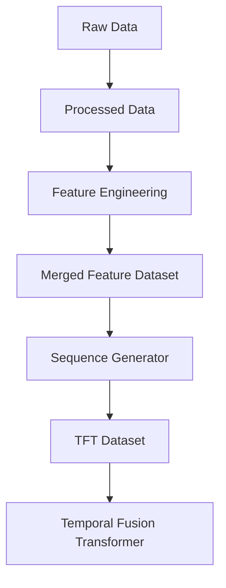
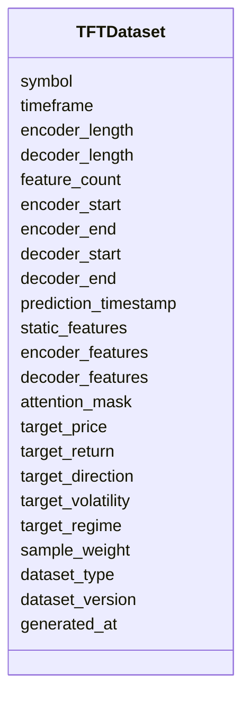

# Temporal Fusion Transformer (TFT) Dataset Schema

## Overview

The **Temporal Fusion Transformer (TFT) Dataset Schema** defines the standardized dataset format used to train, validate, test, and run inference with **Temporal Fusion Transformer (TFT)** models in the ETH Bot.

Unlike traditional sequence models, TFT is designed specifically for **multi-horizon time-series forecasting**. It separates inputs into **static features**, **historical (encoder) features**, and **future-known (decoder) features**, allowing the model to capture both historical market behavior and known future information such as timestamps and calendar effects.

This schema stores **encoder sequences, decoder sequences, static features, and prediction targets only**.

---

# Pipeline Position



---

# Purpose

The TFT dataset is responsible for:

- Preparing historical encoder sequences
- Preparing future-known decoder sequences
- Providing static metadata
- Supporting multi-horizon forecasting
- Standardizing datasets for TFT models
- Enabling training, validation, testing, and inference

---

# Dataset Structure



---

# Dataset Components

## Dataset Metadata

| Field | Description |
|--------|-------------|
| symbol | Trading symbol |
| timeframe | Candle timeframe |
| encoder_length | Number of historical observations |
| decoder_length | Number of future prediction steps |
| feature_count | Number of engineered features |

---

## Sequence Information

| Field | Description |
|--------|-------------|
| encoder_start | Start of historical sequence |
| encoder_end | End of historical sequence |
| decoder_start | Beginning of prediction window |
| decoder_end | End of prediction window |
| prediction_timestamp | Target prediction timestamp |

---

## Static Features

Static features remain constant throughout the sequence.

Examples include:

- Asset identifier
- Exchange identifier
- Market type
- Contract type

These are encoded once for the entire sample.

---

## Encoder Features

Historical observations used by the encoder.

Shape:

```text
(encoder_length × feature_count)
```

Example:

```text
60 × 145
```

---

## Decoder Features

Future-known features available before prediction.

Examples:

- Time features
- Calendar information
- Trading session
- Scheduled events

Shape:

```text
(decoder_length × feature_count)
```

Example:

```text
12 × 145
```

Only information known at prediction time should be included. Future market values must not be part of the decoder features.

---

## Attention Mask

Optional attention mask indicating valid positions.

| Value | Meaning |
|--------|---------|
| 1 | Valid observation |
| 0 | Padding |

---

## Target Labels

Supported prediction targets include:

| Target | Description |
|---------|-------------|
| target_price | Future price |
| target_return | Future return |
| target_direction | Bullish / Neutral / Bearish |
| target_volatility | Future volatility |
| target_regime | Market regime |

Depending on the training objective, one or multiple targets may be used.

---

## Dataset Split

| Value | Purpose |
|--------|---------|
| train | Model training |
| validation | Hyperparameter tuning |
| test | Model evaluation |
| inference | Live prediction |

---

## Metadata

| Field | Description |
|--------|-------------|
| dataset_version | Dataset schema version |
| generated_at | Dataset generation timestamp |

---

# Dataset Generation

```mermaid
flowchart LR

Merged Feature Dataset

-->

Sequence Generator

-->

Static Features

Sequence Generator

-->

Encoder Features

Sequence Generator

-->

Decoder Features

Static Features

-->

TFT Dataset

Encoder Features

-->

TFT Dataset

Decoder Features

-->

TFT Dataset
```

---

# Example Timeline

```text
Historical Encoder

↓

T1

T2

T3

...

T60

↓

Future Decoder

↓

T61

T62

...

T72
```

The encoder learns from historical observations, while the decoder receives only information that is available in advance.

---

# Example Shapes

Training samples:

```text
100000
```

Encoder:

```text
(100000,60,145)
```

Decoder:

```text
(100000,12,145)
```

Static features:

```text
(100000,8)
```

Targets:

```text
(100000,12)
```

---

# Data Sources

The TFT dataset is generated from the merged feature dataset.

```mermaid
mindmap

root((Merged Features))

    Price Features

    Volume Features

    Derivative Features

    Order Book Features

    Sentiment Features

    On-Chain Features

    Time Features
```

---

# Training Pipeline

```mermaid
flowchart TD

Merged Feature Dataset

-->

Sequence Generator

-->

Static Feature Generator

-->

Encoder Builder

-->

Decoder Builder

-->

Train Validation Test Split

-->

TFT Dataset

-->

Temporal Fusion Transformer

-->

Training
```

---

# Inference Pipeline

```mermaid
flowchart TD

Latest Feature Window

-->

Encoder Builder

-->

Future Time Features

-->

Decoder Builder

-->

TFT Dataset

-->

Trained TFT Model

-->

Prediction
```

---

# Example Dataset Record

```json
{
  "symbol": "ETHUSDT",
  "timeframe": "1h",

  "encoder_length": 60,
  "decoder_length": 12,
  "feature_count": 145,

  "encoder_start": "2026-08-03T00:00:00Z",
  "encoder_end": "2026-08-05T11:00:00Z",

  "decoder_start": "2026-08-05T12:00:00Z",
  "decoder_end": "2026-08-05T23:00:00Z",

  "prediction_timestamp": "2026-08-05T12:00:00Z",

  "static_features": [
    1,
    0,
    2,
    1,
    0,
    0,
    1,
    1
  ],

  "encoder_features": [
    [0.42, 0.61, 0.18, "..."],
    "... 60 rows ..."
  ],

  "decoder_features": [
    [0.31, 0.72, 0.44, "..."],
    "... 12 rows ..."
  ],

  "attention_mask": [
    1,1,1,1,1,1,1,1,1,1,
    1,1,1,1,1,1,1,1,1,1,
    1,1,1,1,1,1,1,1,1,1,
    1,1,1,1,1,1,1,1,1,1,
    1,1,1,1,1,1,1,1,1,1,
    1,1,1,1,1,1,1,1,1,1,
    1,1,1,1,1,1,1,1,1,1
  ],

  "target_price": 3658.42,
  "target_return": 0.014,
  "target_direction": 1,
  "target_volatility": 0.028,
  "target_regime": 2,

  "sample_weight": 1.0,
  "dataset_type": "train",
  "dataset_version": "1.0",
  "generated_at": "2026-08-05T12:05:00Z"
}
```

---

# Relationship with Other Schemas

```mermaid
flowchart TD

Raw Schemas

-->

Processed Schemas

-->

Feature Schemas

-->

Merged Dataset

Merged Dataset

-->

TFT Dataset

TFT Dataset

-->

Temporal Fusion Transformer

Temporal Fusion Transformer

-->

Predictions
```

---

# Model Comparison

| Feature | LSTM | Transformer | TFT |
|---------|------|-------------|-----|
| Sequential input | Yes | Yes | Yes |
| Attention mechanism | No | Yes | Yes |
| Static features | No | Optional | Yes |
| Future-known features | No | Optional | Yes |
| Multi-horizon forecasting | Limited | Good | Excellent |
| Interpretability | Low | Moderate | High |

---

# Design Principles

```mermaid
mindmap

root((TFT Dataset))

    Sequence Based

    Encoder Decoder

    Attention Ready

    Multi Horizon

    Time-Series Native

    AI Ready

    Modular

    Scalable
```

---

# Future Enhancements

Future versions may support:

- Multi-asset forecasting
- Cross-asset attention
- Multi-timeframe encoder inputs (e.g., 1H + 1D)
- Variable-length sequences
- Event embeddings
- Macroeconomic feature integration
- Probabilistic forecasting
- Quantile prediction
- Online streaming datasets
- Dynamic feature selection

---

# Summary

The **Temporal Fusion Transformer (TFT) Dataset Schema** bridges the merged feature dataset and TFT models by organizing engineered features into static inputs, historical encoder sequences, and future-known decoder sequences.

This structure enables advanced multi-horizon forecasting while preserving the modular design of the ETH Bot pipeline. By separating feature engineering from dataset preparation and model implementation, the architecture remains scalable, reusable, and adaptable to future forecasting tasks and model improvements.

```mermaid
flowchart TD

Raw Data

-->

Processed Data

-->

Feature Engineering

-->

Merged Feature Dataset

-->

Sequence Generator

-->

TFT Dataset

-->

Temporal Fusion Transformer

-->

Prediction

-->

Strategy Engine

-->

Risk Engine

-->

Execution Engine
```